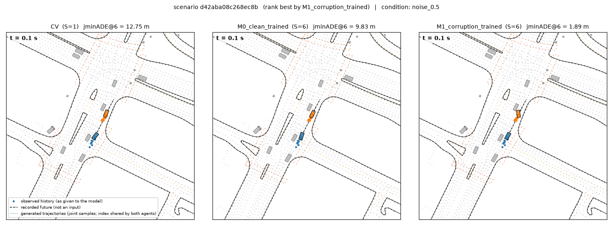
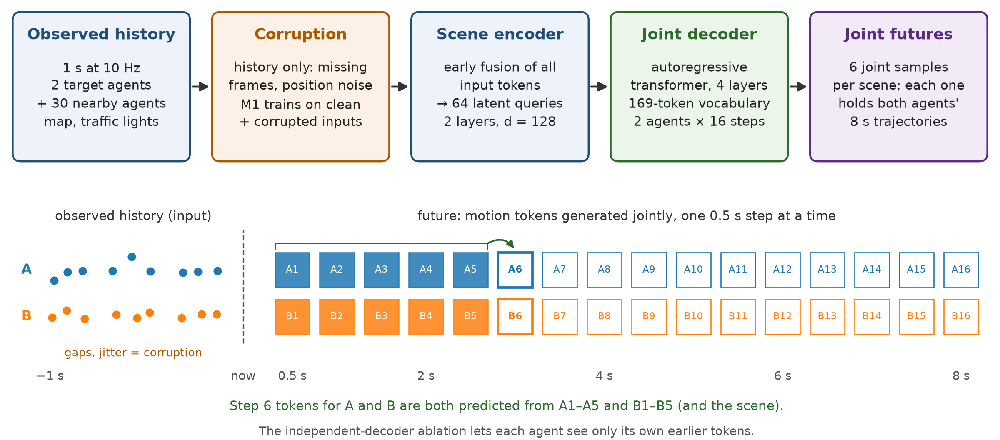
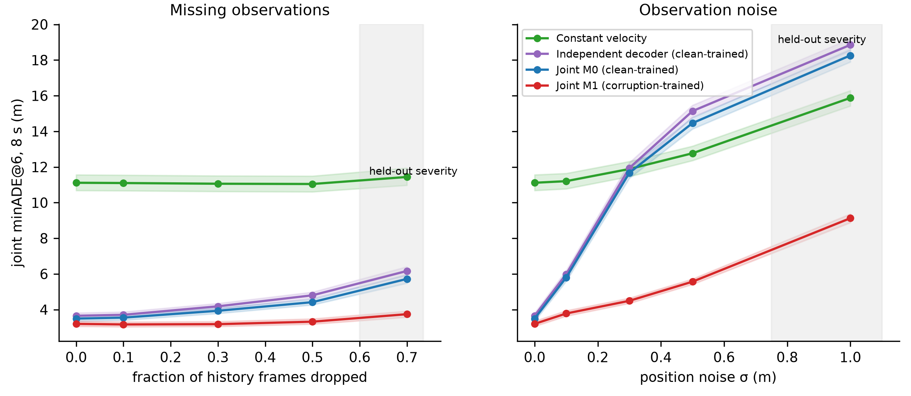
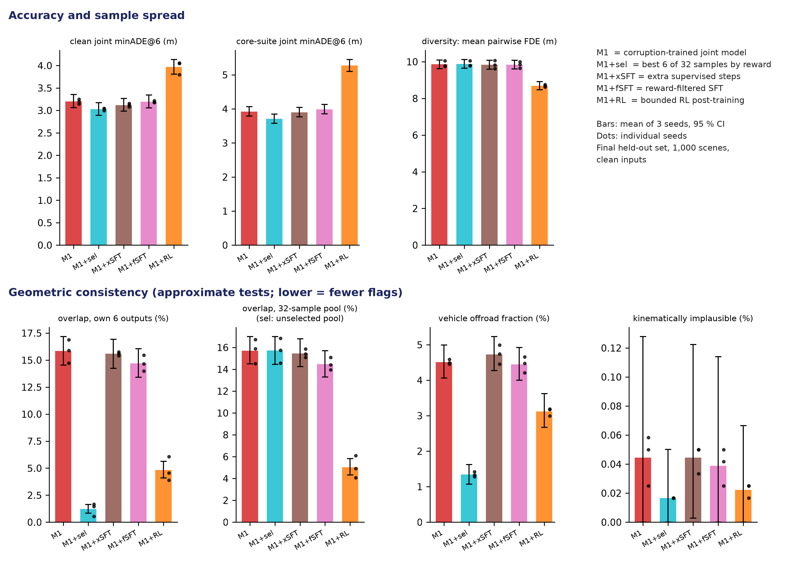
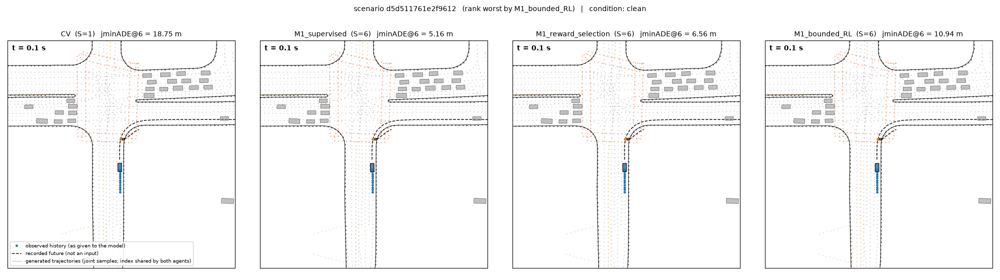

# JointMotion

**Robust Generative Motion Forecasting Under Imperfect Observations**

When two road users interact, such as a car turning across an oncoming car or a vehicle yielding to a pedestrian, their futures depend on each other. A forecaster therefore has to generate both futures *together*. It also has to do this from tracked motion histories that are often incomplete or noisy.

JointMotion is an independent, compact MotionLM-style model trained on the [Waymo Open Motion Dataset](https://waymo.com/open/) (WOMD). From 1 second of observed history it generates joint 8-second futures for interacting pairs of agents. The project asks three questions:

- How much does training on corrupted inputs help when histories have missing frames or noisy positions?
- Does joint generation beat predicting each agent independently?
- Does a bounded reinforcement-learning (RL) post-training step make the predictions more physically consistent?

<p align="center">
  
</p>

*Illustrative example, development set, position noise σ = 0.5 m (scene `d42aba08c268ec8b`). Panels from left to right: constant velocity, the clean-trained joint model M0, and the corruption-trained joint model M1, using seed-0 checkpoints. Dots are the observed 1 s history as the model received it, including noise. Dashed lines are the recorded future, which is not an input. Thin lines are 6 joint samples, boxes follow the first sample, and grey boxes are other road users at their logged positions. Joint minADE@6 for this scene is 12.75 m, 9.83 m and 1.89 m. The scene was picked by a fixed rule as one of M1's best scenes in a 64-scene pool, so it is a success case, not aggregate evidence. The same demo set includes M1's worst scenes ([selection record](reports/demos/prelim_M0_vs_M1_noise_0.5/demo_metrics.json)). Playback is 2× real time. [Full-resolution MP4](reports/demos/prelim_M0_vs_M1_noise_0.5/d42aba08c268ec8b_noise_0.5.mp4).*

> **Name.** The project was developed under the working name *Waymo_AV*. The Python package (`waymo_av`), configs, run names, manifests, the report and the slides keep that original name so that historical records and frozen experiment identifiers stay valid. JointMotion is an independent research project, not a Waymo product or an official challenge submission.

## Three takeaways

All numbers come from the **locked final held-out set**: 1,000 WOMD validation scenes, evaluated once per frozen method, with 3 training seeds per learned model.

1. **Corruption training substantially improves accuracy, especially under position noise.** Across the corrupted conditions used in training, the corruption-trained model cuts joint minADE@6 by 45–48 % in every seed. At stronger, held-out severities the cut is 47–49 %. With σ = 0.5 m position noise, error falls from 14.5 m to 5.6 m. With half of the history frames missing, it falls from 4.4 m to 3.3 m. Clean-input error also improves by 8–9 %.
2. **Joint decoding improves accuracy and geometric consistency.** Against an otherwise identical independent decoder, the joint model lowers clean joint minADE@6 by 4–5 % and box overlap between the two agents by 1.9–3.9 percentage points (pp). The 95 % intervals exclude zero in all three seeds. The final-position error gain is smaller, and its interval includes zero in two seeds.
3. **The tested RL objective reduces overlaps but worsens accuracy and diversity.** Bounded RL lowers overlap by about 10–12 pp and offroad by 1.3–1.5 pp relative to its starting model. It also raises clean error by 17–29 % and shrinks sample spread by 1.0–1.4 m, so under the preregistered rule it does not count in any seed. Reward-based candidate selection, which keeps the best 6 of 32 samples, performs better on every measured quality axis. Its cost is 32 sampled futures plus reward scoring per scene instead of 6 samples, about 5× the sampling.

**Preregistered verdict: 2 of 3 seeds pass.** Against M0, each M1 seed had to cut corrupted-input error by at least 5 %, worsen clean error by at most 3 %, and raise corrupted-input overlap by at most 0.5 pp. All seeds meet the two accuracy criteria. Seed 1 fails the overlap guardrail: its overlap rises by 1.72 pp, with an interval of [+0.77, +2.67]. Seeds 0 and 2 pass on their point estimates, but their intervals reach above +0.5 pp, so overlap non-inferiority is only weakly supported for them. The thresholds were not changed after seeing results.

## How it works

<p align="center">
  
</p>

- **Task.** Each scene has two interacting target agents, the dataset's `objects_of_interest` pair. The model sees 1 s of history at 10 Hz for both targets and the 30 nearest other agents, plus map polylines and traffic-light states. It predicts the targets' next 8 s at 2 Hz, which is 16 steps per agent.
- **Joint generation.** A latent-query scene encoder fuses all inputs. An autoregressive transformer decoder then emits one motion token per agent per 0.5 s step, from a vocabulary of 169 Verlet-wrapped tokens. Each step's tokens for *both* agents are predicted from both agents' earlier tokens, so every sample is a coherent joint future. The independent-decoder ablation masks out the other agent.
- **Robustness.** Corruption is applied only to the observed history, never to the recorded futures used as labels. M0 trains on clean histories. M1 trains on a 50/50 mix of clean and corrupted histories, with missing frames at rates 0.1, 0.3 and 0.5 and position noise at σ = 0.1, 0.3 and 0.5 m. Evaluation adds held-out severities: 70 % of frames missing, σ = 1.0 m, and a compound corruption.
- **Post-training.** Bounded REINFORCE starts from M1 and uses a leave-one-out baseline, a KL penalty and supervised replay. Its reward is an approximate geometric-consistency objective based on overlap, offroad and kinematics. It is compared with matched extra supervised fine-tuning (SFT), reward-filtered SFT, and inference-time reward-based selection.

The model has 1.79 M parameters. [Detailed architecture figure](reports/figures/fig_architecture.svg).

## Results on the locked final set

**How to read joint minADE@6.** For each scene the model draws 6 joint samples, and each sample contains both agents' 8-second trajectories. The score for a sample is its average position error over both agents and all future steps. The metric keeps the best of the six. Lower is better, and a sample only scores well if *both* agents are right at the same time.

| Method | Futures sampled per scene | Clean joint minADE@6 (m) | Corrupted joint minADE@6 (m) | Overlap (%) | Offroad (%) | Sample spread (m) |
|---|---|---|---|---|---|---|
| Constant velocity | 1 | 11.11 | 11.51 | 17.3 | 5.7 | — |
| Independent decoder, clean-trained | 6 | 3.65 | 7.62 | 19.0 | 5.7 | 11.6 |
| Joint M0, clean-trained | 6 | 3.49 | 7.30 | 15.8 | 5.5 | 11.8 |
| **Joint M1, corruption-trained** | 6 | **3.20** | **3.92** | 15.7 | 4.5 | 9.8 |
| M1 + extra SFT (control) | 6 | 3.12 | 3.90 | 15.5 | 4.7 | 9.9 |
| M1 + reward-filtered SFT (control) | 6 | 3.19 | 3.98 | 14.6 | 4.4 | 9.8 |
| M1 + bounded RL | 6 | 3.97 | 5.27 | 4.7 | 3.1 | 8.7 |
| M1 + reward-based selection (control) | 32, best 6 kept | 3.03 | 3.71 | 1.2 | 1.3 | 9.1 |
| Recorded future (reference) | — | 0 | 0 | 1.0 | 0.9 | — |

Values are means over 3 training seeds on 1,000 final-set scenes. Per-seed values, 95 % intervals and paired differences are in the [final comparison tables](reports/tables/final/comparison.md) and the [full table](reports/tables/final/table.md).

- **Corrupted** is the mean over the six corrupted conditions used in training.
- **Overlap** is the share of joint samples in which the two target boxes intersect, counted on steps where both recorded futures are valid. This is the same denominator as the recorded-future reference row.
- **Offroad** is the share of vehicle trajectory points beyond the nearest road edge.
- **Sample spread** is the mean pairwise distance between the six samples' final positions. It describes variety, not quality.

Both overlap and offroad are approximate geometric tests, not safety measures.

<p align="center">
  
</p>

*Error against corruption severity, final held-out set. Each line is the mean over 3 seeds, and the coloured bands are group-bootstrap 95 % intervals. The grey band marks severities never used in training. M1 trained only on 0.1, 0.3 and 0.5. [Original figure with full title](reports/figures/final/fig_error_vs_severity.pdf).*

<p align="center">
  
</p>

*Bounded RL against matched controls, all starting from the same development-selected M1 checkpoint, final held-out set, clean inputs. Panels are rearranged from the [original 7-panel figure](reports/figures/final/fig_rl_controls.pdf) without re-plotting. The "own 6 outputs" panel scores the samples each method returns. The 32-sample panel scores each model's 32-sample pool. For selection that pool is simply M1's candidates before selection, so it matches M1. Kinematic implausibility is near zero for every method, and its intervals overlap.*

## A failure case: what RL changed

<p align="center">
  
</p>

*Illustrative failure, development set, clean inputs (scene `d5d511761e2f9612`). Panels from left to right: constant velocity, supervised M1, M1 with reward-based selection, and M1 after bounded RL, using seed-0 checkpoints. The blue vehicle's recorded future, shown dashed, is a right turn. M1 and selection follow it, while RL's samples mostly continue straight and fall short of the turn. Joint minADE@6 is 18.75 m, 5.16 m, 6.56 m and 10.94 m. This scene was picked by a fixed rule as one of the RL model's worst scenes in a 64-scene pool ([selection record](reports/demos/final_M1_vs_selection_vs_RL_clean/demo_metrics.json)). It illustrates the aggregate pattern but is not evidence on its own. Playback is 2× real time. [Full-resolution MP4](reports/demos/final_M1_vs_selection_vs_RL_clean/d5d511761e2f9612_clean.mp4).*

A development-set diagnostic shows the same tendency in aggregate. An agent's sample counts as excessive stopping when its predicted 8 s displacement is under 1 m while the logged agent moved more than 5 m.

| Model | Excessive stopping, development set |
|---|---|
| Bounded RL | 3.49 % (596 / 17,082) |
| Supervised M1 | 0.43 % (73 / 17,082) |

The denominator counts eligible agent-sample pairs, pooled over 3 seeds on the same 500 development scenes for both models. This diagnostic is descriptive only and was not used for any decision.

## Reproduce

Training and post-training of all 18 models logged 2.27 GPU-hours on one GPU, not counting evaluation. Trained checkpoints and data are not included in this repository.

**Setup.** Python 3.12 and PyTorch 2.5.1 with CUDA 12.4. Set `data_root` in `configs/paths.yaml`.

```bash
uv venv --python 3.12 <data_root>/env/train
uv pip install --python <data_root>/env/train/bin/python -r requirements/train.lock
uv pip install --python <data_root>/env/train/bin/python -e .
PYTHON=<data_root>/env/train/bin/python bash scripts/build_protos.sh
PY=<data_root>/env/train/bin/python
CUDA_VISIBLE_DEVICES= $PY -m pytest tests      # 35 CPU tests on synthetic fixtures
bash scripts/smoke_synthetic.sh                # end-to-end smoke test, no WOMD data needed
```

**Dataset access.** WOMD requires a Google account that has accepted the [Waymo Open Dataset license](https://waymo.com/open/terms). Download, preprocessing, the locked manifests and calibration run as resumable campaign stages. This study used 48 training and 12 validation shards of the v1.3.0 scenario files.

```bash
<data_root>/tools/google-cloud-sdk/bin/gcloud auth login
$PY -m waymo_av.campaign --stage all --until calibrate --n-train-shards 48 --n-val-shards 12
```

**Training.** Run the overfit gate, then M0, M1 and the independent decoder for 3 seeds each. To train a single model directly, use the second command.

```bash
$PY -m waymo_av.campaign --stage all --until pilot --n-train-shards 48 --n-val-shards 12 --seeds 0,1,2
$PY -m waymo_av.train --config configs/train/m1_pilot.yaml --run-name m1_pilot_s0 --override seed=0 run_name=m1_pilot_s0
```

**Evaluation.** The development comparison, post-training with its controls, the freeze and the final evaluation run in this order. The final stage evaluates the locked set once per frozen method.

```bash
$PY -m waymo_av.campaign --stage dev_eval  --seeds 0,1,2
$PY -m waymo_av.campaign --stage posttrain --seeds 0,1,2   # RL, reward-filtered SFT, extra SFT
$PY -m waymo_av.campaign --stage freeze    --seeds 0,1,2   # writes manifests/freeze.json
$PY -m waymo_av.campaign --stage final_eval
$PY -m waymo_av.campaign --stage report
```

**Inference from a saved checkpoint.** This samples 6 joint futures per scene, plus the best-6-of-32 selection variant, on development scenes, and writes per-scene metrics. The demo command renders side-by-side GIF and MP4 files with a documented scene-selection rule.

```bash
$PY -m waymo_av.evaluate --methods cv ckpt:<runs>/m1_pilot_s0/ckpt_best.pt@m1 select:<runs>/m1_pilot_s0/ckpt_best.pt@m1 \
    --conditions clean noise_0.5 --manifest manifests/dev.json --out <scratch>/eval_m1 --limit 32
$PY -m waymo_av.demo --ckpts M0=<runs>/m0_pilot_s0/ckpt_best.pt M1=<runs>/m1_pilot_s0/ckpt_best.pt \
    --manifest manifests/dev.json --condition noise_0.5 --scenes 4 --out reports/demos/<name>
```

<details>
<summary>Full audit sequence and repository layout</summary>

```bash
PYTHONPATH=src $PY scripts/audit_timestamps.py --shards 0-47 --val-shards 0-11      # 10 Hz timing-rule audit (D-024)
PYTHONPATH=src $PY scripts/segment_overlap.py                                         # source-segment groups (D-025)
$PY -m waymo_av.data.manifests --lock-final --drop-train-from manifests/segment_overlap.json
PYTHONPATH=src $PY scripts/overlap_floor_audit.py                                     # recorded-future overlap audit v2 (D-028a)
PYTHONPATH=src $PY scripts/model_overlap_inspection.py --ckpt <runs>/m0_pilot_s0/ckpt_best.pt   # D-028b
PYTHONPATH=src $PY scripts/stopping_diagnostic.py                                     # descriptive stopping diagnostic
$PY -m waymo_av.figures --eval-dir <eval> --seeds 0,1,2 --out reports/figures/<dev|final> --label "<label>"
$PY scripts/build_readme_media.py                                                     # README figures and GIFs (docs/media)
```
Slides are built as described in [slides/README.md](slides/README.md).

```
src/waymo_av/
  data/          TFRecord reader (no TensorFlow), scenario parsing, preprocessing, immutable split manifests
  corruption.py  observation corruption families, frozen evaluation suites, training mixture
  features.py    ego-frame features from (corrupted) observations; labels from the uncorrupted log
  tokenizer.py   13 x 13 Verlet-wrapped motion tokens
  model.py       latent-query scene encoder + block-causal joint decoder (independent ablation flag)
  rollout.py     shared sampling path for evaluation, RL and demos
  metrics/       joint/marginal displacement, overlap, offroad, kinematics, group bootstrap
  train.py, rl.py, evaluate.py, aggregate.py, compare.py, figures.py, demo.py, report.py, campaign.py
configs/         paths, training and RL configs
manifests/       split manifests (final set locked), dataset version, audits, freeze record
registry/        experiment registry, GPU-hour log, campaign state
tests/           35 CPU tests on synthetic fixtures
```
</details>

## Reports, slides and records

- **Final report**, covering development and final results, metric qualification and limitations: [PDF](reports/report.pdf) or [Markdown](reports/report.md). It keeps the original campaign title.
- **Slides**, 10 slides with final results: [PDF](slides/waymo_av_results_final.pdf) or [PowerPoint](slides/waymo_av_results_final.pptx).
- **Final tables:** [per-seed comparison with paired 95 % intervals](reports/tables/final/comparison.md), [all methods and conditions](reports/tables/final/table.md), and [machine-readable summary](reports/tables/final/summary.json).
- **Development tables**, used for checkpoint selection and not held out: [comparison](reports/tables/dev/comparison.md).
- **Figures:** [final](reports/figures/final/), [development](reports/figures/dev/), and [README media provenance](docs/media/sources.json), built by [this script](scripts/build_readme_media.py).
- **Reproducibility records:** [decision log](DECISIONS.md), [plan and preregistered thresholds](PLAN.md), [status](STATUS.md), [resume guide](RESUME.md), [frozen methods and sampling](manifests/freeze.json), [locked final manifest](manifests/final.json), [metric definitions](docs/metrics.md), [source matrix](docs/source_matrix.md), and [experiment registry](registry/).

## Limitations

- **Scale.** This is a compact reproduction, with 1.79 M parameters and about 9k training scenes. It is not MotionLM itself, not a leaderboard entry and not state of the art.
- **Metrics.** The metrics are local implementations audited on analytic cases and oracles. The official Waymo metrics package could not be installed, so no official scores are reported.
- **Open-loop prediction.** Only the two target agents interact. Other agents are not simulated, so this is open-loop prediction, not closed-loop simulation or planning, and nothing here indicates production readiness.
- **Approximate geometry.** Overlap and offroad are approximate geometric tests. Recorded futures themselves are flagged for overlap on 1.0 % of jointly valid intervals. The RL reward built on these tests optimises approximate geometric consistency, not verified safety.
- **Synthetic corruption.** Missing frames and Gaussian noise are stress tests. They are not calibrated sensor-error models and say nothing about raw camera or LiDAR perception.
- **Statistics.** Intervals resample heuristic source-segment groups, because WOMD does not expose the originating drive segment, so independence is approximate. Results cover 3 seeds of one model size.
- **Confound.** Part of M1's clean-input gain may come from regularisation by the corruption mixture rather than corruption awareness. The extra-SFT control bounds this confound but does not remove it.
- **RL scope.** Post-training was deliberately bounded: two agents, a 16-step episode and one reward weighting. The outcome is negative for this objective, not for RL post-training in general.
- **Timing.** Per-scene timings were measured on a shared GPU and are descriptive only. The number of samples drawn per scene is the reliable cost measure.

## References

- A. Seff et al., *MotionLM: Multi-Agent Motion Forecasting as Language Modeling*, ICCV 2023. [arXiv:2309.16534](https://arxiv.org/abs/2309.16534)
- S. Ettinger et al., *Large Scale Interactive Motion Forecasting for Autonomous Driving: The Waymo Open Motion Dataset*, ICCV 2021. [arXiv:2104.10133](https://arxiv.org/abs/2104.10133)
- Z. Peng et al., *Improving Agent Behaviors with RL Fine-tuning for Autonomous Driving*, 2024. [arXiv:2409.18343](https://arxiv.org/abs/2409.18343)
- R. J. Williams, *Simple Statistical Gradient-Following Algorithms for Connectionist Reinforcement Learning*, Machine Learning 8, 1992.

## License

Licence: Waymo Open Dataset License Agreement for Non-Commercial Use (https://waymo.com/open/terms).
Raw data and processed windows are not redistributed. Code: MIT (this repository).

Figures and animations show small extracts of WOMD scenes for illustration. Code is released under the [MIT License](LICENSE).
