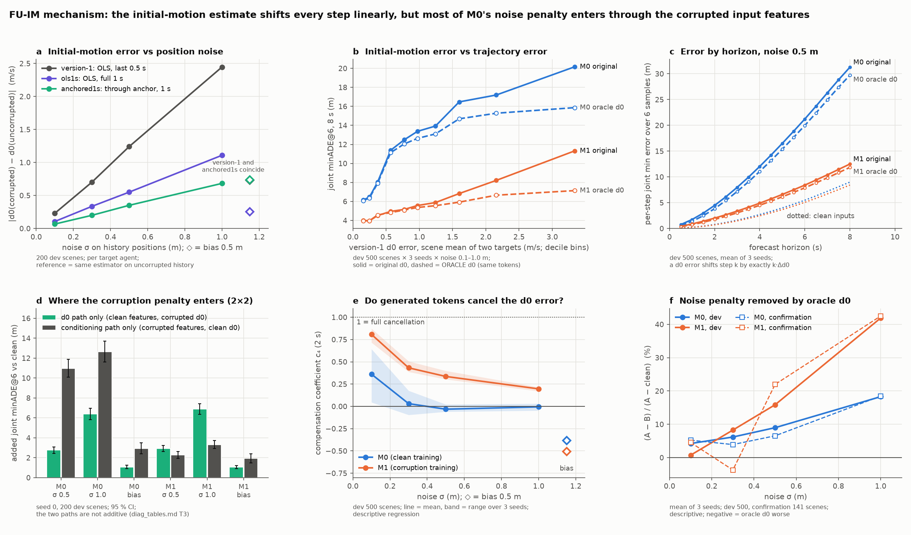
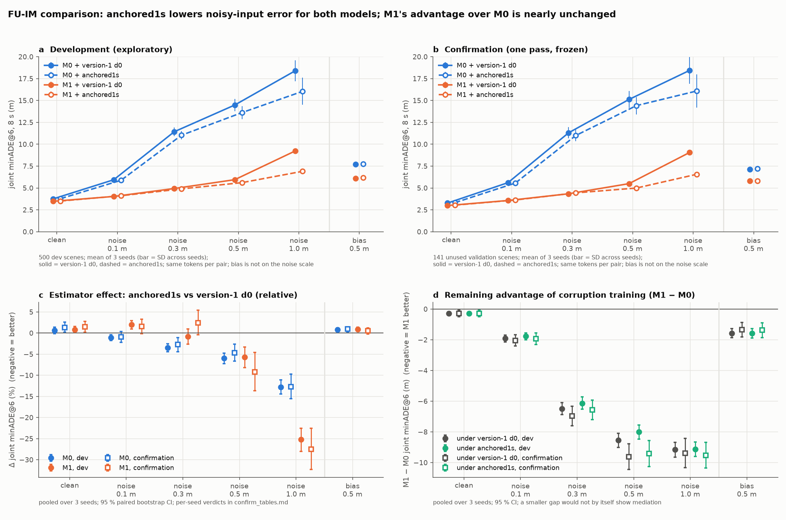

# Follow-up FU-IM: initial-motion error and a cheap estimator fix

Inference only, on the frozen version-1 M0 and M1 checkpoints (seeds 0, 1, 2). The protocol was
registered before any comparison (`PROTOCOL.md`, commit `6895e37`). Development analyses are
**exploratory**. The confirmation was one frozen pass on **141** previously unused official-validation
scenes. That is fewer than the 500 targeted; see Limitations. Version-1 code paths, checkpoints,
results and public claims are unchanged.

## Answer in brief

- **Where d0 enters.** The initial-motion estimate d0 is not a network input. It sets the start
  velocity for integrating the sampled tokens, so an error e moves forecast step k by exactly k·e.
  An oracle override can therefore replay the identical tokens.
- **How much of the noise penalty is d0.** With the oracle d0, M0's excess error under noise falls
  by only 4–18 %. Most of M0's noise penalty enters through the corrupted input features. For M1,
  which already resists the feature corruption, d0 is a larger share: about 42 % at 1.0 m noise.
- **The cheap fix.** The selected estimator, `anchored1s`, is a least-squares line through the
  observed current position over the full 1 s of history, using actual timestamps.
  - It cuts the d0 error 3.5–3.7× under noise.
  - It lowers the corrupted-input joint minADE@6 for both models, confirmed per seed:
    - M0: −5.8 % [−6.9, −4.6];
    - M1: −9.9 % [−11.8, −7.8].
  - It costs about 0.6–1.5 % on clean inputs. It does not help under the structured bias corruption,
    and it slightly hurts M1 at 0.1 m noise.
- **Corruption training still adds value.** With the same improved estimator for both models, M1
  still beats M0 by **−5.76 m (−53 %)** on corrupted inputs, confirmed per seed. The M1 advantage
  narrows by only +0.11 m [−0.02, +0.25]: directionally consistent with dev (+0.21 m), but not
  confirmed.

## Scope of the confirmation (read before the numbers)

- **Size.** The confirmation used **141 scenes, not the planned 500**. The planned download of four
  more validation shards failed because the credential needs interactive reauthentication.
- **Same scenes for every seed.** All three checkpoint seeds were evaluated on the **same** 141 scenes
  with the same corruption realisations. Seed-to-seed agreement therefore reflects checkpoint and
  sampling variation, not independent data. Each per-seed CI resamples the same scenes.
- **Heuristic source separation.** Scene independence from train, dev and the version-1 final set
  rests on the version-1 source-segment **heuristic**, which compares SDC motion n-grams.
  - It found no links.
  - It **could not test 37 of the 141** scenes, whose SDC is stationary.
  - Because all 141 are singleton groups, the cluster bootstrap reduces to a per-scene bootstrap.
- **Geometric tradeoffs.** Geometric consistency is reported below, including the adverse
  overlap increase.
- **Frozen checkpoints.** The estimator swap was tested only on the **frozen version-1
  checkpoints**. They were trained with version-1 d0 tokenisation, and nothing was retrained.
- **Verification.** Every headline number in this report was re-derived from the saved per-scene outputs by
  an independent script (`verification.md`, `scripts/fu_verify_report.py`).



*Mechanism. (a) Initial-motion error versus noise for the three estimators, on 200 dev scenes.
(b) Per-scene d0 error versus joint minADE@6, with the original d0 (solid) and the oracle d0
(dashed) decoding the same tokens. (c) Per-step error by horizon at 0.5 m noise. (d) 2×2
decomposition: d0 path versus conditioning path. (e) How far the generated tokens cancel the d0
error. (f) Share of the noise penalty removed by the oracle d0.*



*Estimator and training comparison. (a, b) Joint minADE@6 by condition for the four methods, on dev
and confirmation. (c) Relative estimator effect with 95 % CIs. (d) M1 − M0 gap under each
estimator.*

## Supported conclusions

The numbers are pooled over three seeds with 95 % paired cluster-bootstrap CIs. "Confirmed" means
all three per-seed CIs exclude 0 in the dev direction on the confirmation set. Full tables are in
`dev_tables.md`, `confirm_tables.md` and `diag_tables.md`.

**1. Mechanism (code trace and tests).**
- d0 comes from `tokenizer.initial_delta_from_observation`: OLS over the valid frames of the last
  0.5 s at nominal 0.1 s spacing, with fallbacks.
- It is used in three places: the rollout's Verlet integration, the training-label tokenisation,
  and the CV baseline.
- The encoder never reads it. All arms decoded identical tokens, and the `orig` re-decode matched
  version-1 rollouts bit-for-bit in every batch.
- Corruption also changes the network's own motion inputs: positions, finite-difference velocities
  and `has_prev`. That is the conditioning path.

**2. Initial-motion error grows linearly with noise.** For the version-1 estimator, measured against
the same estimator on uncorrupted history:

| condition | dev | confirmation |
|---|---|---|
| noise 0.1 m | 0.24 m/s | 0.23 m/s |
| noise 0.3 m | 0.72 m/s | 0.71 m/s |
| noise 0.5 m | 1.22 m/s | 1.23 m/s |
| noise 1.0 m | 2.39 m/s | 2.40 m/s |
| bias 0.5 m | 0.73 m/s | 0.73 m/s |

**3. d0 accounts for a minority of M0's noise penalty.** The oracle diagnostic removes this share of
M0's excess error over clean:

| condition | dev | confirmation |
|---|---|---|
| noise 0.1 m | 4 % | 5 % |
| noise 0.3 m | 6 % | 4 % |
| noise 0.5 m | 9 % | 7 % |
| noise 1.0 m | 18 % | 18 % |
| bias 0.5 m | 20 % | 14 % |

In the seed-0 2×2 at 0.5 m noise:
- corrupting only the features adds +11.0 m to M0;
- corrupting only d0 adds +2.8 m.

For M1:
- the oracle removes 16–22 % of the excess at 0.5 m and 42 % at 1.0 m (dev and confirmation);
- the d0-only cell is about as large as the features-only cell at 0.5 m (+2.9 vs +2.3 m) and larger
  at 1.0 m (+6.9 vs +3.3 m).

The paths interact strongly; the interaction is negative, so they are not additive.

**4. M1's tokens partly offset the d0 error. M0's do not.** The descriptive compensation coefficient
at 2 s is 0.6–0.9 at 0.1 m noise, falling to about 0.1–0.2 at 1.0 m for M1 (range over seeds, dev and confirmation). For M0 it is between −0.15 and +0.20 at 0.5–1.0 m, and it is unstable across seeds at 0.1–0.3 m (−0.4 to +0.6). Under
bias, both models' actions move in the same direction as the d0 error (c < 0). This is consistent
with reacting to corrupted velocity features that point the same way.

**5. The selected estimator.** The registered rule picked `anchored1s` on 200 dev scenes:
- Score: −6.5 %.
- Clean cost: +0.5 % for M0 and +1.3 % for M1.
- `ols1s` was rejected because M1's clean cost was +3.14 %, over the +3 % limit.

Estimator effect, `anchored1s` − version-1 d0:

| outcome | M0 dev | M0 confirmation | M1 dev | M1 confirmation |
|---|---|---|---|---|
| corrupted mean (5) | −6.2 % [−6.9, −5.6] | −5.8 % [−6.9, −4.6] ✔ | −8.5 % [−9.6, −7.5] | −9.9 % [−11.8, −7.8] ✔ |
| noise mean (4) | −7.3 % | −6.8 % ✔ | −10.9 % | −12.6 % ✔ |
| noise 1.0 m | −12.8 % | −12.7 % ✔ | −25.2 % | −27.5 % ✔ |
| clean | +0.6 % [−0.1, +1.4] | +1.3 % [+0.2, +2.6] (not confirmed per seed) | +0.8 % [+0.1, +1.5] | +1.5 % [+0.2, +2.8] (not confirmed per seed) |
| bias 0.5 m | +0.8 % | +0.9 % (not confirmed) | +0.9 % | +0.5 % (not confirmed) |
| noise 0.1 m | −1.1 % | −1.0 % (not confirmed) | **+2.0 %** (worse) | +1.6 % (not confirmed) |

✔ = confirmed.

- At noise of 0.5 m and above, the deployable estimator recovers 84–97 % of the oracle's gain.
- **Geometric consistency.** These are approximate 2 Hz tests, not safety measures. The table shows
  anchored1s − version-1 d0, pooled over seeds on confirmation, with 95 % CIs. Per-seed values are in
  `verification.md`.

  | metric | inputs | M0 | M1 | reading |
  |---|---|---|---|---|
  | vehicle offroad | corrupted mean | −2.35 pp [−3.11, −1.64] | −2.07 pp [−2.80, −1.33] | improvement |
  | jointly-valid overlap | corrupted mean | **+1.51 pp** [+0.72, +2.33] | **+1.73 pp** [+0.58, +2.92] | **adverse**: more sample pairs overlap |
  | vehicle offroad | clean | −0.18 pp [−0.38, −0.01] | −0.26 pp [−0.53, −0.06] | small improvement |
  | jointly-valid overlap | clean | +0.35 pp [−0.35, +1.06] | +0.39 pp [−0.51, +1.30] | not detectable |

  Dev agrees in direction: offroad −1.9 / −1.4 pp and overlap +0.8 / +1.0 pp under corruption. The
  overlap increase is the main adverse geometric tradeoff. The estimator's other adverse effects are:
  - the clean-input error cost above;
  - no benefit under bias;
  - an M1 penalty at 0.1 m noise.

**6. Corruption training keeps nearly all of its advantage after the stronger estimator.**

| comparison (corrupted mean) | dev | confirmation |
|---|---|---|
| M1 − M0 with version-1 d0 | −5.53 m (−47.8 %) | −5.87 m (−50.9 %) ✔ |
| M1 − M0 with `anchored1s` | −5.32 m (−49.0 %) | −5.76 m (−53.1 %) ✔ |
| change in the gap (DiD) | +0.21 m [+0.14, +0.28], all seeds | +0.11 m [−0.02, +0.25], not confirmed |

## Not supported or not claimed

- **Not a complete causal attribution.** The oracle swaps d0 while holding fixed tokens that were
  generated from corrupted features. The shares in conclusion 3 depend on the order of
  decomposition, and the paths interact.
- **Not mediation.** The small, unconfirmed narrowing of the M1 − M0 gap does not show whether
  corruption training works "through" d0. The frozen models were trained on tokens defined relative
  to the version-1 d0. M1 learned to partly offset that estimator's error, so changing the estimator
  shifts its calibration. The M1 penalty at 0.1 m noise is consistent with this.
- **Not evidence for real sensors.** `anchored1s` gains from the synthetic corruption leaving the
  current frame exact. Real current-frame noise would move every arm equally. Under the structured
  bias corruption it is no better than the version-1 estimator, as predicted analytically.
- **Not a retrained comparison.** No model was retrained with `anchored1s` tokenisation. Retraining
  could change both the estimator benefit and the M1 − M0 gap.
- **No change to version-1 headline claims.** The follow-up does support that the version-1
  robustness gain from corruption training holds up when a stronger d0 estimator is used.

## Limitations

- **Small confirmation set.** 141 scenes against a 500 target. The planned download of four more
  validation shards failed: the installed credential needs interactive reauthentication. The 141
  scenes come from the same 12 validation shards as the version-1 final set.
- **Audit quality.** No id exposure was found and no source-segment links. All groups are
  singletons, so the bootstrap is per scene. 37 of the 141 have a stationary SDC that the
  segment heuristic cannot test.
- **Dev is not independent of selection.** The 200 selection scenes are part of the 500 dev scenes.
- **Approximate geometry.** Overlap and offroad are approximate 2 Hz geometric tests, not safety
  measures. Corruptions are synthetic stress tests, not calibrated sensor models.
- **The 2×2 and compensation analyses are limited.** The 2×2 decomposition is seed 0 on 200 dev
  scenes only. The compensation coefficient is a descriptive regression.

## Reproduce

From the repository root. `PY` is `<data_root>/env/train/bin/python`. Outputs are resumable and are
reused only when their provenance matches exactly.

```bash
PY=/media/jarettpoliner/extradrive1/recovered_seagate_files/Waymo_AV_data/env/train/bin/python
$PY -m pytest -q tests/test_initmotion.py                               # 11 checks
CUDA_VISIBLE_DEVICES=0 $PY -m waymo_av.initmotion --stage diag         # 200 dev scenes, seed 0
$PY -m waymo_av.initmotion_report --stage diag                         # diag tables + selection.json
CUDA_VISIBLE_DEVICES=0 $PY -m waymo_av.initmotion --stage dev          # 500 dev scenes x 3 seeds
$PY -m waymo_av.initmotion_report --stage dev
$PY -m waymo_av.initmotion_report --stage freeze                       # refuses if freeze.json exists
$PY scripts/fu_confirm_set.py                                          # audit -> confirm manifest/groups
CUDA_VISIBLE_DEVICES=0 $PY -m waymo_av.initmotion --stage confirm      # one pass
$PY -m waymo_av.initmotion_report --stage confirm
$PY -m waymo_av.initmotion_report --stage figures
$PY scripts/fu_verify_report.py                                        # verification.md (saved outputs only)
```

Commits, in order:
- `6895e37`: protocol, runner and tests;
- `0671202`: diagnostic and selection;
- `f700138`: dev comparison and freeze;
- `d5556e6`: confirmation manifest;
- `0303649`: confirmation results, figures and this report;
- then a close-out commit with the independent verification, these corrections and the README and slide summaries.

## Resources

Recorded in `resources.json`:
- **GPU:** one RTX 4000 Ada (`cuda:0`), one job at a time. Total 0.040 GPU-hours against the
  3-hour cap. This counts process wall-clock for feature building, sampling and decoding across 102
  jobs, plus a 32-scene smoke test before registration.
- **CPU:** metrics took about 111 s on 8 niced workers.
- **Other:** no training, RL or downloads. About 218 MB of run outputs.
- **Version-1 outputs unchanged:** the 1,083 version-1 evaluation files under `runs/` have the same
  sha256 before and after.

## Files

| file | content |
|---|---|
| `PROTOCOL.md` | Mechanism trace and diagram, design, selection rule, confirmation plan, deviations log |
| `diag_tables.md`, `diag_results.json` | Exploratory diagnostic: d0 error, oracle A/B, 2×2, horizon, compensation, candidates |
| `selection.json` | The registered selection computation |
| `dev_tables.md`, `dev_results.json` | Exploratory 500-scene, 3-seed comparison |
| `freeze.json` | Frozen estimator, arms, contrasts, checkpoint and code hashes |
| `confirm_manifest.json`, `confirm_groups.json`, `confirm_audit.json` | Confirmation set and its audit |
| `confirm_tables.md`, `confirm_results.json` | The single confirmation pass, with verdicts |
| `figures/fig_mechanism.png`, `figures/fig_estimator_training.png` | Mechanism and comparison figures |
| `resources.json` | Compute and storage usage |
| `verification.md`, `verification.json` | Independent recomputation of the headline numbers, denominators, pairing and provenance |
