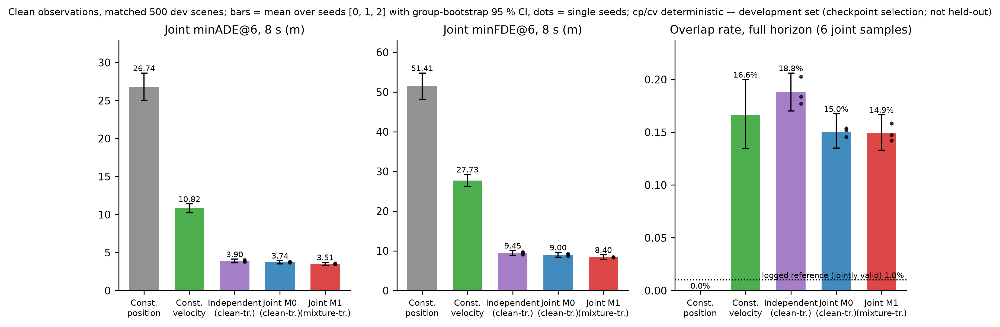
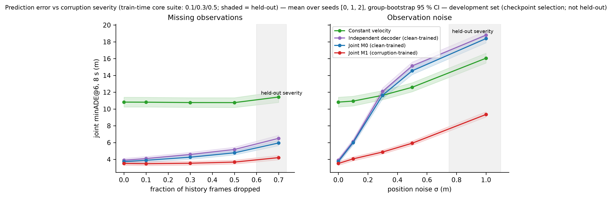
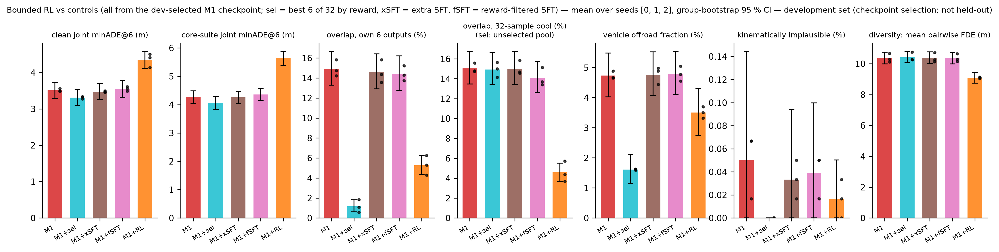
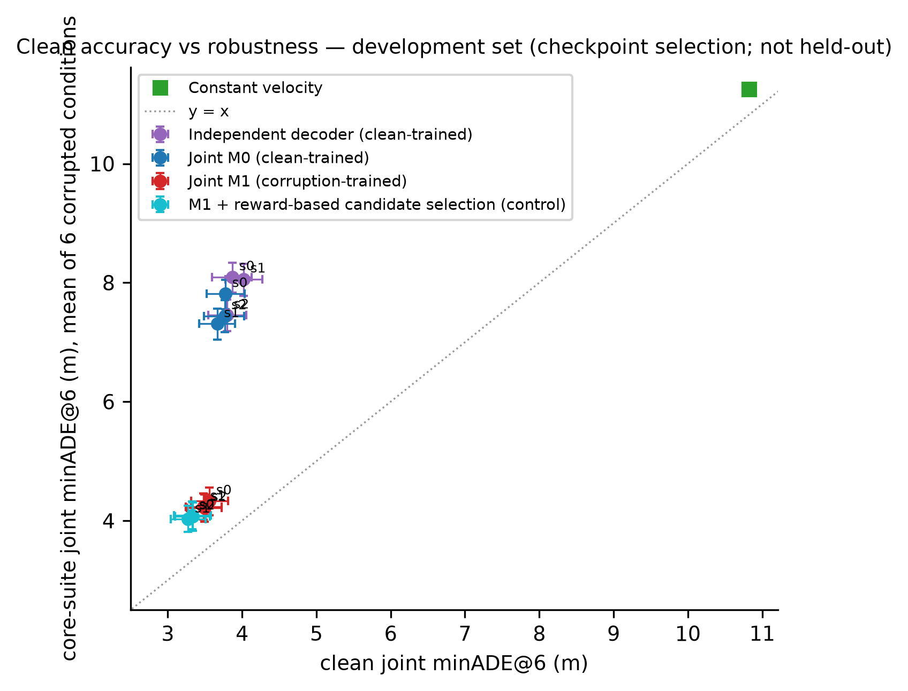
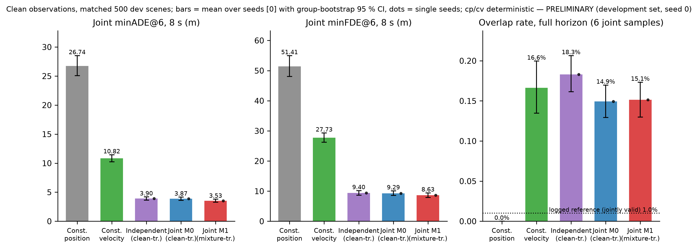
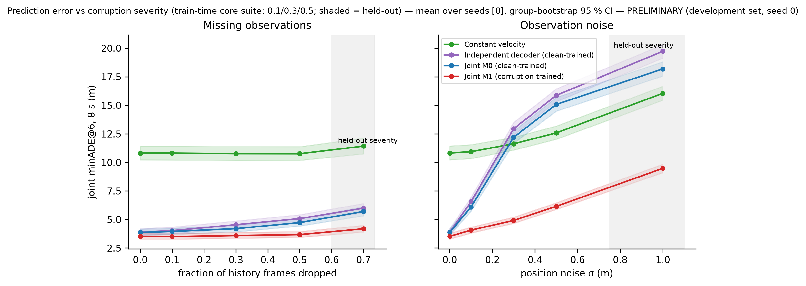
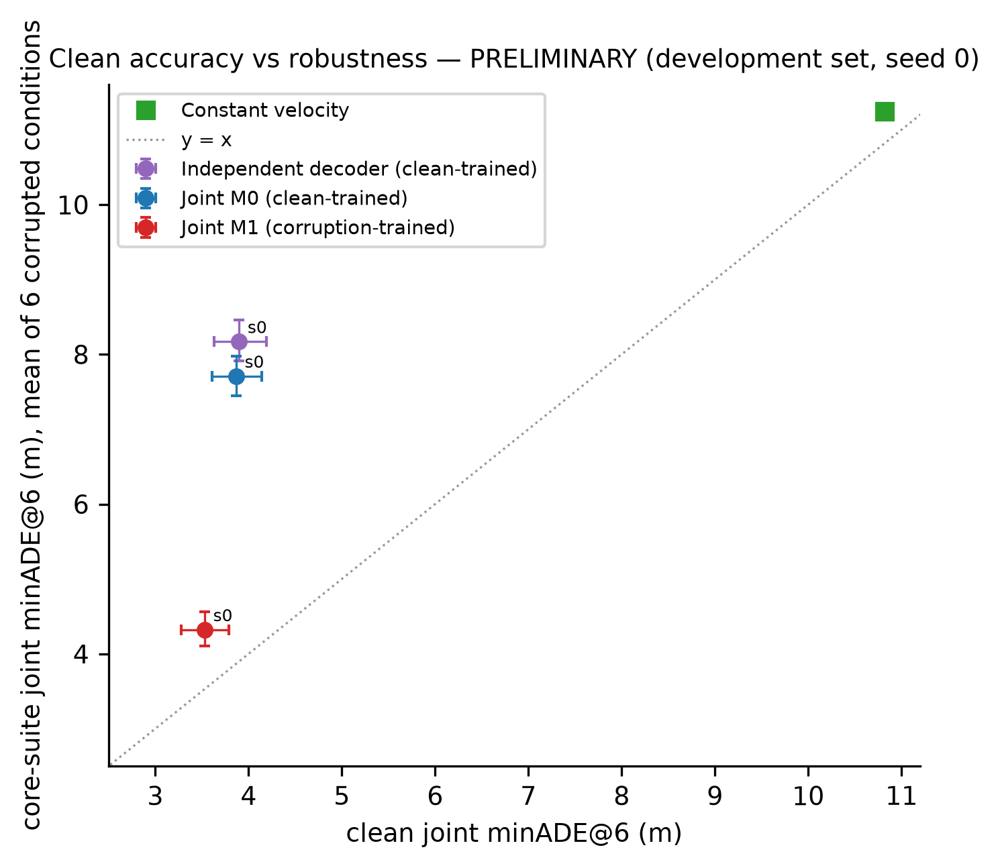
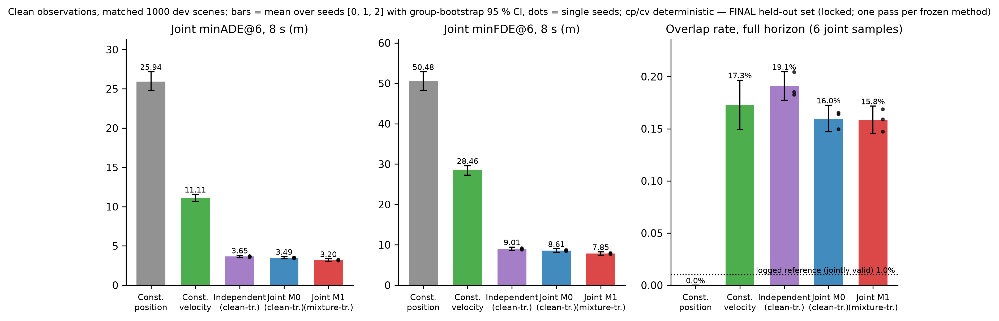
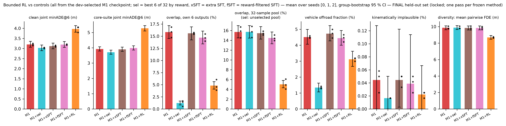
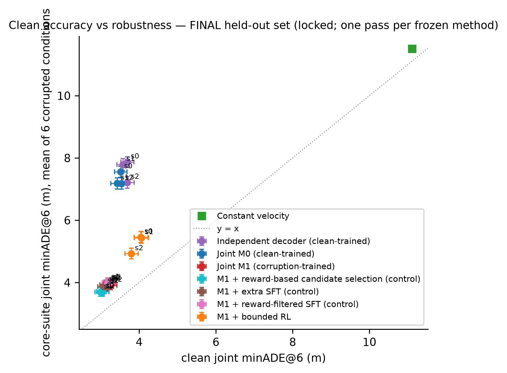

# Waymo_AV — Robust Joint Motion Forecasting Under Missing and Noisy Observations

Generated 2026-11-03 18:41 from commit `d3076b4`. Simplified MotionLM-style two-agent joint predictor; local metrics (not official challenge scores).

## 0. Key results

**Development set (500 scenes; checkpoint selection; NOT held-out)** (per-method means over seeds; CIs and paired differences in the tables below)

| method | clean joint minADE@6 (m) | core-suite joint minADE@6 (m) | clean overlap, own 6 outputs (%) | clean offroad (%) | n seeds |
|---|---|---|---|---|---|
| constant velocity | 10.82 | 11.25 | 16.6 | 5.4 | 1 |
| independent decoder | 3.90 (seeds: 3.87, 4.02, 3.80) | 7.87 (seeds: 8.10, 8.06, 7.46) | 18.8 (seeds: 17.7, 18.4, 20.3) | 5.8 (seeds: 6.0, 5.5, 5.9) | 3 |
| joint M0 (clean-trained) | 3.74 (seeds: 3.78, 3.67, 3.77) | 7.52 (seeds: 7.81, 7.31, 7.44) | 15.0 (seeds: 14.6, 15.2, 15.4) | 5.8 (seeds: 5.0, 5.8, 6.7) | 3 |
| joint M1 (corruption-trained) | 3.51 (seeds: 3.56, 3.48, 3.50) | 4.26 (seeds: 4.33, 4.23, 4.22) | 14.9 (seeds: 15.8, 14.2, 14.7) | 4.7 (seeds: 4.9, 4.7, 4.7) | 3 |
| M1 + best-6-of-32 reward selection | 3.31 (seeds: 3.33, 3.27, 3.33) | 4.06 (seeds: 4.09, 4.02, 4.08) | 1.2 (seeds: 1.1, 0.6, 1.8) | 1.6 (seeds: 1.6, 1.6, 1.6) | 3 |
| M1 + extra SFT | 3.47 (seeds: 3.45, 3.47, 3.49) | 4.25 (seeds: 4.30, 4.21, 4.25) | 14.6 (seeds: 15.8, 13.6, 14.4) | 4.8 (seeds: 5.0, 4.4, 4.9) | 3 |
| M1 + reward-filtered SFT | 3.55 (seeds: 3.61, 3.56, 3.49) | 4.36 (seeds: 4.38, 4.39, 4.30) | 14.4 (seeds: 15.2, 14.3, 13.7) | 4.8 (seeds: 5.0, 4.6, 4.8) | 3 |
| M1 + bounded RL | 4.35 (seeds: 4.50, 4.41, 4.14) | 5.64 (seeds: 5.91, 5.75, 5.26) | 5.3 (seeds: 5.3, 4.3, 6.2) | 3.5 (seeds: 3.7, 3.3, 3.5) | 3 |

- M1 vs M0 core-suite joint minADE@6 (seed of reference): -44.6 % [-47.3, -41.9] (group-level bootstrap). Per-seed verdicts against the preregistered thresholds: see the comparison section.

**FINAL held-out set (1,000 locked scenes; one pass per frozen method)** (per-method means over seeds; CIs and paired differences in the tables below)

| method | clean joint minADE@6 (m) | core-suite joint minADE@6 (m) | clean overlap, own 6 outputs (%) | clean offroad (%) | n seeds |
|---|---|---|---|---|---|
| constant velocity | 11.11 | 11.51 | 17.3 | 5.7 | 1 |
| independent decoder | 3.65 (seeds: 3.69, 3.58, 3.69) | 7.62 (seeds: 7.87, 7.79, 7.22) | 19.1 (seeds: 18.5, 18.3, 20.4) | 5.7 (seeds: 5.9, 5.4, 5.9) | 3 |
| joint M0 (clean-trained) | 3.49 (seeds: 3.52, 3.42, 3.54) | 7.30 (seeds: 7.55, 7.18, 7.18) | 16.0 (seeds: 15.0, 16.4, 16.5) | 5.5 (seeds: 5.1, 5.8, 5.8) | 3 |
| joint M1 (corruption-trained) | 3.20 (seeds: 3.20, 3.14, 3.25) | 3.92 (seeds: 3.95, 3.89, 3.91) | 15.8 (seeds: 14.7, 16.9, 15.9) | 4.5 (seeds: 4.5, 4.5, 4.6) | 3 |
| M1 + best-6-of-32 reward selection | 3.03 (seeds: 3.04, 2.99, 3.05) | 3.71 (seeds: 3.72, 3.69, 3.70) | 1.2 (seeds: 0.5, 1.7, 1.5) | 1.3 (seeds: 1.3, 1.3, 1.4) | 3 |
| M1 + extra SFT | 3.12 (seeds: 3.12, 3.08, 3.16) | 3.90 (seeds: 3.94, 3.88, 3.87) | 15.6 (seeds: 15.4, 15.8, 15.6) | 4.7 (seeds: 4.7, 4.5, 5.0) | 3 |
| M1 + reward-filtered SFT | 3.19 (seeds: 3.18, 3.18, 3.22) | 3.98 (seeds: 3.97, 4.00, 3.99) | 14.7 (seeds: 14.0, 14.7, 15.5) | 4.4 (seeds: 4.2, 4.5, 4.7) | 3 |
| M1 + bounded RL | 3.97 (seeds: 4.04, 4.06, 3.80) | 5.27 (seeds: 5.46, 5.44, 4.92) | 4.8 (seeds: 3.9, 4.5, 6.1) | 3.1 (seeds: 3.2, 3.0, 3.2) | 3 |

- M1 vs M0 core-suite joint minADE@6 (seed of reference): -47.7 % [-49.5, -45.9] (group-level bootstrap). Per-seed verdicts against the preregistered thresholds: see the comparison section.

RL outcome (D-031): recorded as mixed/negative under the frozen comparison rule — see section 3a (Q5/Q6) and DECISIONS.md.

## 1. Setup

- Dataset: `{
 "dataset": "Waymo Open Motion Dataset",
 "version": "1.3.0",
 "raw_subdir": "womd_v1_3_0",
 "format": "scenario tfrecord",
 "bucket": "gs://waymo_open_dataset_motion_v_1_3_0",
 "listed": "2026-11-03",
 "listing_sha256": "d34a243222ae7bc2443da13cc8691847e2b34455f7dfb82a81798c091be3cfa1"
}`
- Calibration: `{
 "n_scenes": 500,
 "tokenizer": {
  "saturation_rate": 0.0008159166509759618,
  "recon_err_mean_m": 0.09240365773439407,
  "recon_err_p99_m": 0.16335155069828033,
  "recon_err_max_m": 3.338541030883789,
  "vocab_used": 95,
  "top10_tokens": [
   [
    84,
    3102
   ],
   [
    71,
    1884
   ],
   [
    97,
    1823
   ],
   [
    85,
    928
   ],
   [
    83,
    854
   ],
   [
    58,
    799
   ],
   [
    110,
    636
   ],
   [
    70,
    628
   ],
   [
    96,
    592
   ],
   [
    72,
    589
   ]
  ],
  "zero_token_frac": 0.19469026548672566
 },
 "d0_speed_mps": {
  "mean": 6.568544387817383,
  "p50": 5.209609031677246,
  "p99": 22.173171997070312,
  "max": 32.964210510253906
 },
 "history_valid_frac_targets": 0.9890802556818181,
 "future_valid_frac_targets": 0.9957275390625,
 "initial_overlap_rate_gt": 0.001953125,
 "future_overlap_rate_gt": 0.032421875,
 "transform_roundtrip_max_err_m": 5.684341886080802e-14,
 "d0_init": {
  "mean_err_m_vs_true_first_half_second": 0.24413703676310622,
  "p99_err_m": 0.84452919952413,
  "zero_velocity_err_m": 3.2363052368164062
 },
 "cv_baseline_clean": {
  "joint_minADE_8s": 10.822137399683946,
  "joint_minFDE_8s": 27.731932333955744
 },
 "target_types": {
  "1": 895,
  "2": 73,
  "3": 32
 },
 "offroad_oracle": {
  "sign_+1": 0.009799354392039928,
  "sign_-1": 0.99020064560796,
  "chosen_sign": 1,
  "oracle_offroad_frac_with_chosen_sign": 0.009799354392039928,
  "metric_valid": true
 }
}`
- Decisions: see DECISIONS.md; metric definitions: docs/metrics.md; preregistered thresholds: PLAN.md.

## 2. Runs

| run | kind | status | step | params | best dev score | GPU s |
|---|---|---|---|---|---|---|
| extra_sft_pilot_s0 | train | completed | 600 | 1787049 | 3.949089663269664 | 29 |
| extra_sft_pilot_s1 | train | completed | 600 | 1787049 | 3.935310431027987 | 29 |
| extra_sft_pilot_s2 | train | completed | 600 | 1787049 | 3.900647410904919 | 51 |
| filtered_sft_pilot_s0 | filtered_sft | completed | 600 |  |  | 159 |
| filtered_sft_pilot_s1 | filtered_sft | completed | 600 |  |  | 159 |
| filtered_sft_pilot_s2 | filtered_sft | completed | 600 |  |  | 161 |
| m0_overfit | train | completed | 600 | 1787049 | 0.09314770238688652 | 85 |
| m0_pilot_s0 | train | completed | 12000 | 1787049 | 3.826065483889155 | 665 |
| m0_pilot_s1 | train | completed | 12000 | 1787049 | 3.7437833070258293 | 687 |
| m0_pilot_s2 | train | completed | 12000 | 1787049 | 3.5964835811289824 | 717 |
| m1_pilot_s0 | train | completed | 12000 | 1787049 | 3.9881160375091467 | 786 |
| m1_pilot_s1 | train | completed | 12000 | 1787049 | 3.843537574755282 | 915 |
| m1_pilot_s2 | train | completed | 12000 | 1787049 | 3.886693936363791 | 803 |
| mind_pilot_s0 | train | completed | 12000 | 1787049 | 3.8435042364822687 | 647 |
| mind_pilot_s1 | train | completed | 12000 | 1787049 | 4.0588419939584846 | 846 |
| mind_pilot_s2 | train | completed | 12000 | 1787049 | 3.831291175519941 | 623 |
| rl_pilot_s0 | rl | completed | 600 |  |  | 261 |
| rl_pilot_s1 | rl | completed | 600 |  |  | 261 |
| rl_pilot_s2 | rl | completed | 600 |  |  | 271 |

GPU-hours used (all runs): 2.27

## 2b. Metric qualification (before any post-training)

- Logged-future overlap audit v2 (D-028a; 500 dev scenes): reference rate on jointly valid intervals 1.0 % (5 scenes; classes {'heading_inference': 2, 'annotation_contact': 3}); the old unmasked full-horizon test flagged 15 scenes, 10 of them only on zero-filled invalid label steps. Superseded v1: manifests/overlap_floor_audit_v1_superseded.json.
- Generated-trajectory overlap inspection (D-028b; m0_pilot_s0, clean): 449/2994 (scene, sample) pairs flagged (15.0 %); verdicts {'approximation_sensitive': 56, 'confirmed_geometric': 324, 'ambiguous': 69}; by stratum {'type:1-1': {'approximation_sensitive': 40, 'confirmed_geometric': 252, 'ambiguous': 50}, 'turning': {'approximation_sensitive': 36, 'ambiguous': 26, 'confirmed_geometric': 134}, 'straight_moving': {'confirmed_geometric': 190, 'ambiguous': 32, 'approximation_sensitive': 20}, 'stationary': {'ambiguous': 13, 'approximation_sensitive': 2}, 'type:1-2': {'approximation_sensitive': 12, 'ambiguous': 17, 'confirmed_geometric': 48}, 'type:1-3': {'approximation_sensitive': 4, 'confirmed_geometric': 24, 'ambiguous': 2}}. The RL overlap reward is an approximate geometric-consistency objective, not a verified safety measure.
- Penetration depth does not separate logged-reference flags from model flags (p50 0.75 m vs 0.98 m); no depth margin is used.
- Offroad: sign convention +1 calibrated by log playback (manifests/metric_config.json); KD-tree nearest-segment implementation verified against brute force (tests).

## 3. Development-set results (checkpoint selection, sampling freeze)

Selection rules: M0/Mind checkpoints = lowest clean joint minADE@6 on the first 256 dev scenes; M1 = lowest mean of clean and core-suite joint minADE@6 on the same scenes (D-017). These selection scores are NOT comparable across models; every table below is a matched evaluation of the selected checkpoints on identical scenes, conditions and sampling.

| method | condition | n | joint minADE@6 8s | joint minFDE@6 8s | marginal minADE 8s | overlap rate (6, full horizon) | overlap jointly-valid (6) | overlap (32) | offroad frac | implausible | diversity FDE |
|---|---|---|---|---|---|---|---|---|---|---|---|
| cp | clean | 500 | 26.742 [25.024, 28.612] | 51.409 [48.093, 54.779] | 26.727 [24.994, 28.589] | 0.0000 [0.0000, 0.0000] | 0.0000 [0.0000, 0.0000] | — | 0.0140 [0.0060, 0.0230] | 0.0000 [0.0000, 0.0000] | nan [nan, nan] |
| cv | clean | 500 | 10.822 [10.236, 11.404] | 27.732 [26.190, 29.256] | 10.817 [10.236, 11.402] | 0.1663 [0.1345, 0.2000] | 0.1643 [0.1340, 0.1972] | — | 0.0542 [0.0427, 0.0657] | 0.0000 [0.0000, 0.0000] | nan [nan, nan] |
| extra_sft_pilot_s0 | clean | 500 | 3.454 [3.200, 3.706] | 8.442 [7.750, 9.133] | 2.968 [2.730, 3.198] | 0.1583 [0.1379, 0.1810] | 0.1560 [0.1352, 0.1790] | 0.1585 [0.1401, 0.1798] | 0.0498 [0.0416, 0.0583] | 0.0003 [0.0000, 0.0008] | 10.76 [10.26, 11.28] |
| extra_sft_pilot_s1 | clean | 500 | 3.470 [3.241, 3.691] | 8.401 [7.767, 9.049] | 2.956 [2.747, 3.162] | 0.1356 [0.1155, 0.1570] | 0.1349 [0.1147, 0.1563] | 0.1454 [0.1271, 0.1649] | 0.0444 [0.0368, 0.0519] | 0.0005 [0.0000, 0.0015] | 10.24 [9.77, 10.74] |
| extra_sft_pilot_s2 | clean | 500 | 3.493 [3.238, 3.732] | 8.375 [7.672, 9.053] | 2.997 [2.763, 3.228] | 0.1436 [0.1233, 0.1653] | 0.1423 [0.1225, 0.1630] | 0.1467 [0.1278, 0.1656] | 0.0489 [0.0410, 0.0572] | 0.0002 [0.0000, 0.0005] | 10.16 [9.68, 10.66] |
| filtered_sft_pilot_s0 | clean | 500 | 3.609 [3.334, 3.877] | 8.667 [7.953, 9.391] | 3.064 [2.809, 3.312] | 0.1523 [0.1323, 0.1750] | 0.1510 [0.1309, 0.1737] | 0.1512 [0.1334, 0.1720] | 0.0505 [0.0423, 0.0588] | 0.0005 [0.0000, 0.0013] | 10.57 [10.06, 11.11] |
| filtered_sft_pilot_s1 | clean | 500 | 3.559 [3.321, 3.803] | 8.677 [8.000, 9.368] | 3.081 [2.856, 3.305] | 0.1430 [0.1214, 0.1653] | 0.1423 [0.1207, 0.1647] | 0.1370 [0.1192, 0.1557] | 0.0455 [0.0382, 0.0532] | 0.0002 [0.0000, 0.0005] | 10.28 [9.82, 10.77] |
| filtered_sft_pilot_s2 | clean | 500 | 3.488 [3.234, 3.728] | 8.411 [7.690, 9.084] | 2.984 [2.757, 3.208] | 0.1373 [0.1172, 0.1579] | 0.1373 [0.1172, 0.1579] | 0.1340 [0.1170, 0.1525] | 0.0478 [0.0399, 0.0564] | 0.0005 [0.0000, 0.0015] | 10.30 [9.82, 10.78] |
| m0_pilot_s0 | clean | 500 | 3.776 [3.522, 4.037] | 9.195 [8.468, 9.916] | 3.185 [2.947, 3.413] | 0.1456 [0.1274, 0.1643] | 0.1443 [0.1261, 0.1630] | 0.1461 [0.1302, 0.1631] | 0.0503 [0.0421, 0.0588] | 0.0007 [0.0000, 0.0017] | 12.34 [11.82, 12.90] |
| m0_pilot_s1 | clean | 500 | 3.666 [3.417, 3.915] | 8.672 [8.003, 9.338] | 3.048 [2.816, 3.271] | 0.1520 [0.1310, 0.1730] | 0.1510 [0.1305, 0.1720] | 0.1535 [0.1360, 0.1712] | 0.0580 [0.0496, 0.0671] | 0.0005 [0.0000, 0.0013] | 11.92 [11.37, 12.48] |
| m0_pilot_s2 | clean | 500 | 3.765 [3.491, 4.027] | 9.125 [8.428, 9.842] | 3.157 [2.910, 3.397] | 0.1536 [0.1333, 0.1757] | 0.1523 [0.1325, 0.1740] | 0.1608 [0.1427, 0.1801] | 0.0670 [0.0582, 0.0764] | 0.0002 [0.0000, 0.0005] | 11.90 [11.38, 12.44] |
| m1_pilot_s0 | clean | 500 | 3.561 [3.310, 3.811] | 8.418 [7.739, 9.089] | 3.034 [2.806, 3.259] | 0.1583 [0.1379, 0.1813] | 0.1563 [0.1360, 0.1794] | 0.1480 [0.1306, 0.1674] | 0.0488 [0.0408, 0.0571] | 0.0002 [0.0000, 0.0005] | 10.84 [10.37, 11.35] |
| m1_pilot_s1 | clean | 500 | 3.481 [3.234, 3.724] | 8.424 [7.734, 9.092] | 2.993 [2.756, 3.223] | 0.1423 [0.1218, 0.1630] | 0.1409 [0.1206, 0.1620] | 0.1557 [0.1367, 0.1755] | 0.0465 [0.0387, 0.0543] | 0.0007 [0.0000, 0.0020] | 10.17 [9.74, 10.62] |
| m1_pilot_s2 | clean | 500 | 3.495 [3.246, 3.728] | 8.360 [7.680, 9.019] | 2.959 [2.733, 3.185] | 0.1473 [0.1263, 0.1700] | 0.1456 [0.1254, 0.1680] | 0.1474 [0.1288, 0.1674] | 0.0467 [0.0391, 0.0554] | 0.0007 [0.0000, 0.0020] | 10.21 [9.72, 10.72] |
| mind_pilot_s0 | clean | 500 | 3.871 [3.598, 4.137] | 9.522 [8.764, 10.272] | 3.270 [3.020, 3.528] | 0.1770 [0.1557, 0.1995] | 0.1733 [0.1520, 0.1961] | 0.1743 [0.1561, 0.1948] | 0.0602 [0.0518, 0.0691] | 0.0003 [0.0000, 0.0008] | 11.23 [10.76, 11.74] |
| mind_pilot_s1 | clean | 500 | 4.020 [3.755, 4.277] | 9.724 [9.001, 10.440] | 3.309 [3.074, 3.541] | 0.1837 [0.1617, 0.2063] | 0.1834 [0.1613, 0.2059] | 0.1781 [0.1591, 0.1967] | 0.0555 [0.0475, 0.0633] | 0.0000 [0.0000, 0.0000] | 12.26 [11.74, 12.81] |
| mind_pilot_s2 | clean | 500 | 3.796 [3.544, 4.053] | 9.109 [8.437, 9.796] | 3.147 [2.914, 3.380] | 0.2027 [0.1804, 0.2256] | 0.2017 [0.1794, 0.2245] | 0.1976 [0.1785, 0.2182] | 0.0594 [0.0513, 0.0685] | 0.0000 [0.0000, 0.0000] | 12.14 [11.61, 12.68] |
| oracle_log | clean | 500 | 0.000 [0.000, 0.000] | 0.000 [0.000, 0.000] | 0.000 [0.000, 0.000] | nan [nan, nan] | 0.0100 [0.0020, 0.0200] | — | 0.0107 [0.0057, 0.0170] | 0.0000 [0.0000, 0.0000] | nan [nan, nan] |
| rl_pilot_s0 | clean | 500 | 4.504 [4.225, 4.755] | 11.114 [10.349, 11.874] | 3.984 [3.724, 4.223] | 0.0528 [0.0406, 0.0647] | 0.0521 [0.0397, 0.0643] | 0.0438 [0.0341, 0.0544] | 0.0370 [0.0287, 0.0456] | 0.0000 [0.0000, 0.0000] | 9.10 [8.63, 9.60] |
| rl_pilot_s1 | clean | 500 | 4.409 [4.147, 4.663] | 10.856 [10.135, 11.545] | 3.906 [3.646, 4.148] | 0.0428 [0.0315, 0.0552] | 0.0418 [0.0307, 0.0540] | 0.0368 [0.0275, 0.0465] | 0.0332 [0.0255, 0.0412] | 0.0002 [0.0000, 0.0005] | 9.18 [8.73, 9.63] |
| rl_pilot_s2 | clean | 500 | 4.139 [3.864, 4.404] | 10.119 [9.368, 10.894] | 3.603 [3.340, 3.855] | 0.0625 [0.0487, 0.0773] | 0.0618 [0.0478, 0.0766] | 0.0573 [0.0450, 0.0704] | 0.0351 [0.0274, 0.0433] | 0.0003 [0.0000, 0.0010] | 9.09 [8.68, 9.51] |
| select_m1_s0 | clean | 500 | 3.331 [3.081, 3.586] | 7.818 [7.131, 8.509] | 2.859 [2.622, 3.089] | 0.0107 [0.0034, 0.0194] | 0.0107 [0.0034, 0.0194] | 0.1499 [0.1322, 0.1693] | 0.0163 [0.0110, 0.0220] | 0.0000 [0.0000, 0.0000] | 10.02 [9.59, 10.49] |
| select_m1_s1 | clean | 500 | 3.273 [3.040, 3.509] | 7.899 [7.269, 8.549] | 2.823 [2.600, 3.047] | 0.0057 [0.0013, 0.0114] | 0.0057 [0.0013, 0.0114] | 0.1564 [0.1377, 0.1760] | 0.0159 [0.0110, 0.0212] | 0.0000 [0.0000, 0.0000] | 9.50 [9.08, 9.90] |
| select_m1_s2 | clean | 500 | 3.334 [3.102, 3.564] | 8.073 [7.412, 8.728] | 2.863 [2.640, 3.076] | 0.0184 [0.0084, 0.0301] | 0.0184 [0.0084, 0.0301] | 0.1414 [0.1229, 0.1618] | 0.0162 [0.0114, 0.0215] | 0.0000 [0.0000, 0.0000] | 9.54 [9.10, 10.01] |
| cp | compound_0 | 500 | 26.742 [25.024, 28.612] | 51.409 [48.093, 54.779] | 26.727 [24.994, 28.589] | 0.0000 [0.0000, 0.0000] | 0.0000 [0.0000, 0.0000] | — | 0.0140 [0.0060, 0.0230] | 0.0000 [0.0000, 0.0000] | nan [nan, nan] |
| cv | compound_0 | 500 | 11.868 [11.308, 12.458] | 29.125 [27.641, 30.505] | 11.861 [11.302, 12.454] | 0.1784 [0.1463, 0.2124] | 0.1784 [0.1463, 0.2124] | — | 0.1193 [0.1032, 0.1346] | 0.0000 [0.0000, 0.0000] | nan [nan, nan] |
| extra_sft_pilot_s0 | compound_0 | 500 | 5.347 [5.079, 5.613] | 11.493 [10.758, 12.229] | 4.602 [4.350, 4.859] | 0.1697 [0.1489, 0.1918] | 0.1697 [0.1489, 0.1918] | 0.1691 [0.1510, 0.1894] | 0.1296 [0.1181, 0.1417] | 0.0005 [0.0000, 0.0013] | 14.22 [13.68, 14.77] |
| extra_sft_pilot_s1 | compound_0 | 500 | 5.193 [4.924, 5.469] | 11.230 [10.493, 11.992] | 4.440 [4.182, 4.708] | 0.1680 [0.1472, 0.1901] | 0.1677 [0.1467, 0.1900] | 0.1635 [0.1446, 0.1838] | 0.1077 [0.0973, 0.1181] | 0.0005 [0.0000, 0.0015] | 13.94 [13.44, 14.47] |
| extra_sft_pilot_s2 | compound_0 | 500 | 5.321 [5.041, 5.600] | 11.375 [10.655, 12.120] | 4.487 [4.218, 4.758] | 0.1720 [0.1496, 0.1960] | 0.1720 [0.1496, 0.1960] | 0.1697 [0.1506, 0.1903] | 0.1112 [0.1005, 0.1221] | 0.0007 [0.0000, 0.0020] | 14.01 [13.51, 14.55] |
| filtered_sft_pilot_s0 | compound_0 | 500 | 5.416 [5.131, 5.705] | 11.363 [10.652, 12.112] | 4.657 [4.391, 4.932] | 0.1660 [0.1442, 0.1884] | 0.1660 [0.1442, 0.1884] | 0.1673 [0.1491, 0.1870] | 0.1160 [0.1051, 0.1271] | 0.0002 [0.0000, 0.0005] | 13.97 [13.49, 14.51] |
| filtered_sft_pilot_s1 | compound_0 | 500 | 5.623 [5.319, 5.928] | 12.107 [11.329, 12.901] | 4.842 [4.550, 5.131] | 0.1430 [0.1229, 0.1640] | 0.1423 [0.1218, 0.1627] | 0.1539 [0.1350, 0.1739] | 0.1001 [0.0891, 0.1111] | 0.0007 [0.0000, 0.0020] | 13.56 [13.07, 14.08] |
| filtered_sft_pilot_s2 | compound_0 | 500 | 5.439 [5.141, 5.740] | 11.959 [11.182, 12.755] | 4.589 [4.321, 4.865] | 0.1693 [0.1473, 0.1936] | 0.1690 [0.1473, 0.1930] | 0.1661 [0.1469, 0.1874] | 0.1038 [0.0928, 0.1154] | 0.0003 [0.0000, 0.0010] | 13.70 [13.22, 14.23] |
| m0_pilot_s0 | compound_0 | 500 | 10.052 [9.579, 10.533] | 21.337 [20.169, 22.545] | 8.657 [8.219, 9.097] | 0.1637 [0.1403, 0.1869] | 0.1637 [0.1403, 0.1869] | 0.1641 [0.1432, 0.1848] | 0.2211 [0.2048, 0.2367] | 0.0015 [0.0003, 0.0032] | 24.76 [23.62, 25.92] |
| m0_pilot_s1 | compound_0 | 500 | 10.404 [9.896, 10.925] | 22.592 [21.395, 23.819] | 9.053 [8.583, 9.548] | 0.1583 [0.1356, 0.1823] | 0.1580 [0.1353, 0.1821] | 0.1547 [0.1344, 0.1756] | 0.2396 [0.2221, 0.2566] | 0.0007 [0.0000, 0.0020] | 22.25 [21.32, 23.17] |
| m0_pilot_s2 | compound_0 | 500 | 10.272 [9.791, 10.745] | 22.026 [20.900, 23.332] | 9.086 [8.626, 9.541] | 0.1473 [0.1258, 0.1693] | 0.1470 [0.1258, 0.1687] | 0.1555 [0.1348, 0.1772] | 0.2426 [0.2254, 0.2604] | 0.0010 [0.0002, 0.0020] | 22.93 [21.84, 24.07] |
| m1_pilot_s0 | compound_0 | 500 | 5.334 [5.067, 5.619] | 11.194 [10.445, 11.961] | 4.546 [4.301, 4.800] | 0.1677 [0.1457, 0.1910] | 0.1670 [0.1453, 0.1904] | 0.1675 [0.1491, 0.1878] | 0.1302 [0.1186, 0.1424] | 0.0005 [0.0000, 0.0013] | 14.15 [13.66, 14.67] |
| m1_pilot_s1 | compound_0 | 500 | 5.264 [4.998, 5.542] | 11.307 [10.592, 12.053] | 4.495 [4.231, 4.762] | 0.1660 [0.1445, 0.1890] | 0.1643 [0.1433, 0.1869] | 0.1698 [0.1502, 0.1904] | 0.1083 [0.0976, 0.1189] | 0.0003 [0.0000, 0.0010] | 13.71 [13.20, 14.22] |
| m1_pilot_s2 | compound_0 | 500 | 5.265 [4.987, 5.559] | 11.351 [10.625, 12.091] | 4.443 [4.190, 4.708] | 0.1673 [0.1462, 0.1901] | 0.1670 [0.1459, 0.1900] | 0.1711 [0.1519, 0.1915] | 0.1080 [0.0974, 0.1188] | 0.0003 [0.0000, 0.0010] | 14.02 [13.53, 14.55] |
| mind_pilot_s0 | compound_0 | 500 | 10.355 [9.888, 10.814] | 21.527 [20.460, 22.659] | 9.177 [8.737, 9.599] | 0.1523 [0.1305, 0.1754] | 0.1523 [0.1305, 0.1754] | 0.1534 [0.1328, 0.1724] | 0.2220 [0.2049, 0.2384] | 0.0013 [0.0003, 0.0028] | 23.83 [22.73, 24.95] |
| mind_pilot_s1 | compound_0 | 500 | 11.323 [10.793, 11.823] | 24.499 [23.199, 25.774] | 9.707 [9.221, 10.170] | 0.1403 [0.1188, 0.1633] | 0.1399 [0.1185, 0.1630] | 0.1334 [0.1156, 0.1534] | 0.2645 [0.2480, 0.2813] | 0.0005 [0.0000, 0.0012] | 25.81 [24.82, 26.81] |
| mind_pilot_s2 | compound_0 | 500 | 9.809 [9.316, 10.296] | 20.813 [19.687, 21.951] | 8.628 [8.164, 9.079] | 0.1727 [0.1469, 0.1980] | 0.1717 [0.1463, 0.1969] | 0.1676 [0.1463, 0.1908] | 0.1960 [0.1798, 0.2121] | 0.0010 [0.0002, 0.0020] | 19.95 [19.11, 20.86] |
| oracle_log | compound_0 | 500 | 0.000 [0.000, 0.000] | 0.000 [0.000, 0.000] | 0.000 [0.000, 0.000] | nan [nan, nan] | 0.0100 [0.0020, 0.0200] | — | 0.0107 [0.0057, 0.0170] | 0.0000 [0.0000, 0.0000] | nan [nan, nan] |
| rl_pilot_s0 | compound_0 | 500 | 7.717 [7.360, 8.088] | 16.986 [16.048, 17.941] | 6.986 [6.640, 7.355] | 0.0728 [0.0577, 0.0888] | 0.0728 [0.0577, 0.0888] | 0.0777 [0.0626, 0.0938] | 0.1010 [0.0882, 0.1145] | 0.0000 [0.0000, 0.0000] | 11.24 [10.78, 11.76] |
| rl_pilot_s1 | compound_0 | 500 | 7.494 [7.123, 7.865] | 16.806 [15.807, 17.810] | 6.743 [6.380, 7.114] | 0.0715 [0.0560, 0.0882] | 0.0715 [0.0560, 0.0882] | 0.0711 [0.0567, 0.0863] | 0.0863 [0.0742, 0.0984] | 0.0003 [0.0000, 0.0010] | 11.00 [10.54, 11.49] |
| rl_pilot_s2 | compound_0 | 500 | 6.767 [6.397, 7.126] | 15.266 [14.333, 16.170] | 5.965 [5.604, 6.308] | 0.0745 [0.0584, 0.0925] | 0.0741 [0.0579, 0.0922] | 0.0835 [0.0680, 0.1006] | 0.0860 [0.0748, 0.0988] | 0.0000 [0.0000, 0.0000] | 11.63 [11.20, 12.09] |
| select_m1_s0 | compound_0 | 500 | 5.002 [4.738, 5.285] | 10.655 [9.948, 11.382] | 4.350 [4.103, 4.613] | 0.0114 [0.0043, 0.0200] | 0.0114 [0.0043, 0.0200] | 0.1688 [0.1507, 0.1895] | 0.0410 [0.0334, 0.0491] | 0.0003 [0.0000, 0.0010] | 13.30 [12.85, 13.75] |
| select_m1_s1 | compound_0 | 500 | 5.114 [4.809, 5.419] | 10.956 [10.172, 11.744] | 4.412 [4.122, 4.710] | 0.0130 [0.0044, 0.0228] | 0.0130 [0.0044, 0.0228] | 0.1681 [0.1495, 0.1891] | 0.0330 [0.0263, 0.0402] | 0.0000 [0.0000, 0.0000] | 12.52 [12.09, 12.96] |
| select_m1_s2 | compound_0 | 500 | 5.107 [4.817, 5.404] | 11.034 [10.282, 11.871] | 4.425 [4.137, 4.712] | 0.0160 [0.0070, 0.0266] | 0.0160 [0.0070, 0.0266] | 0.1776 [0.1581, 0.1981] | 0.0349 [0.0282, 0.0426] | 0.0000 [0.0000, 0.0000] | 12.91 [12.43, 13.39] |
| cp | missing_0.1 | 500 | 26.742 [25.024, 28.612] | 51.409 [48.093, 54.779] | 26.727 [24.994, 28.589] | 0.0000 [0.0000, 0.0000] | 0.0000 [0.0000, 0.0000] | — | 0.0140 [0.0060, 0.0230] | 0.0000 [0.0000, 0.0000] | nan [nan, nan] |
| cv | missing_0.1 | 500 | 10.814 [10.238, 11.395] | 27.719 [26.177, 29.231] | 10.808 [10.219, 11.387] | 0.1663 [0.1345, 0.2000] | 0.1643 [0.1340, 0.1972] | — | 0.0540 [0.0424, 0.0655] | 0.0000 [0.0000, 0.0000] | nan [nan, nan] |
| extra_sft_pilot_s0 | missing_0.1 | 500 | 3.440 [3.198, 3.691] | 8.281 [7.576, 8.979] | 2.869 [2.652, 3.090] | 0.1450 [0.1259, 0.1657] | 0.1433 [0.1241, 0.1640] | 0.1606 [0.1418, 0.1814] | 0.0511 [0.0428, 0.0596] | 0.0002 [0.0000, 0.0005] | 11.05 [10.50, 11.62] |
| extra_sft_pilot_s1 | missing_0.1 | 500 | 3.511 [3.275, 3.754] | 8.345 [7.706, 9.014] | 2.931 [2.713, 3.141] | 0.1436 [0.1237, 0.1644] | 0.1416 [0.1212, 0.1627] | 0.1433 [0.1249, 0.1623] | 0.0463 [0.0385, 0.0539] | 0.0003 [0.0000, 0.0008] | 10.51 [10.02, 11.01] |
| extra_sft_pilot_s2 | missing_0.1 | 500 | 3.612 [3.356, 3.861] | 8.647 [7.916, 9.363] | 3.068 [2.822, 3.287] | 0.1460 [0.1240, 0.1673] | 0.1440 [0.1222, 0.1653] | 0.1463 [0.1273, 0.1662] | 0.0475 [0.0397, 0.0561] | 0.0005 [0.0000, 0.0012] | 10.02 [9.58, 10.46] |
| filtered_sft_pilot_s0 | missing_0.1 | 500 | 3.524 [3.262, 3.769] | 8.429 [7.709, 9.093] | 3.018 [2.780, 3.250] | 0.1536 [0.1353, 0.1754] | 0.1530 [0.1343, 0.1750] | 0.1541 [0.1355, 0.1750] | 0.0487 [0.0404, 0.0571] | 0.0005 [0.0000, 0.0013] | 10.59 [10.07, 11.10] |
| filtered_sft_pilot_s1 | missing_0.1 | 500 | 3.590 [3.332, 3.833] | 8.640 [7.959, 9.325] | 3.091 [2.849, 3.332] | 0.1286 [0.1089, 0.1493] | 0.1276 [0.1077, 0.1483] | 0.1289 [0.1119, 0.1464] | 0.0449 [0.0376, 0.0524] | 0.0003 [0.0000, 0.0010] | 9.98 [9.54, 10.43] |
| filtered_sft_pilot_s2 | missing_0.1 | 500 | 3.545 [3.297, 3.795] | 8.582 [7.872, 9.284] | 3.056 [2.813, 3.290] | 0.1440 [0.1232, 0.1667] | 0.1426 [0.1221, 0.1650] | 0.1363 [0.1182, 0.1553] | 0.0495 [0.0414, 0.0580] | 0.0002 [0.0000, 0.0005] | 10.06 [9.59, 10.59] |
| m0_pilot_s0 | missing_0.1 | 500 | 3.941 [3.691, 4.195] | 9.485 [8.754, 10.208] | 3.348 [3.109, 3.581] | 0.1503 [0.1316, 0.1700] | 0.1493 [0.1308, 0.1690] | 0.1564 [0.1396, 0.1747] | 0.0510 [0.0427, 0.0594] | 0.0000 [0.0000, 0.0000] | 12.47 [11.92, 13.03] |
| m0_pilot_s1 | missing_0.1 | 500 | 3.785 [3.536, 4.043] | 9.044 [8.365, 9.746] | 3.209 [2.981, 3.447] | 0.1603 [0.1393, 0.1813] | 0.1590 [0.1377, 0.1801] | 0.1623 [0.1427, 0.1817] | 0.0635 [0.0540, 0.0732] | 0.0003 [0.0000, 0.0010] | 12.06 [11.52, 12.61] |
| m0_pilot_s2 | missing_0.1 | 500 | 3.949 [3.677, 4.211] | 9.587 [8.829, 10.349] | 3.393 [3.141, 3.639] | 0.1750 [0.1536, 0.1980] | 0.1727 [0.1513, 0.1951] | 0.1747 [0.1566, 0.1939] | 0.0658 [0.0566, 0.0759] | 0.0000 [0.0000, 0.0000] | 11.92 [11.43, 12.43] |
| m1_pilot_s0 | missing_0.1 | 500 | 3.462 [3.213, 3.719] | 8.382 [7.674, 9.084] | 2.919 [2.687, 3.159] | 0.1513 [0.1317, 0.1730] | 0.1496 [0.1301, 0.1713] | 0.1519 [0.1340, 0.1722] | 0.0482 [0.0401, 0.0565] | 0.0003 [0.0000, 0.0010] | 10.76 [10.29, 11.25] |
| m1_pilot_s1 | missing_0.1 | 500 | 3.533 [3.271, 3.784] | 8.575 [7.902, 9.282] | 2.966 [2.725, 3.201] | 0.1473 [0.1263, 0.1687] | 0.1456 [0.1251, 0.1673] | 0.1525 [0.1338, 0.1718] | 0.0456 [0.0381, 0.0531] | 0.0005 [0.0000, 0.0013] | 10.32 [9.86, 10.81] |
| m1_pilot_s2 | missing_0.1 | 500 | 3.463 [3.197, 3.698] | 8.386 [7.677, 9.062] | 2.983 [2.737, 3.199] | 0.1483 [0.1275, 0.1700] | 0.1463 [0.1258, 0.1680] | 0.1450 [0.1259, 0.1648] | 0.0455 [0.0380, 0.0537] | 0.0008 [0.0000, 0.0025] | 10.22 [9.72, 10.74] |
| mind_pilot_s0 | missing_0.1 | 500 | 4.039 [3.746, 4.314] | 9.863 [9.058, 10.636] | 3.395 [3.124, 3.653] | 0.1887 [0.1667, 0.2125] | 0.1860 [0.1637, 0.2096] | 0.1854 [0.1662, 0.2065] | 0.0613 [0.0517, 0.0712] | 0.0003 [0.0000, 0.0010] | 10.88 [10.42, 11.37] |
| mind_pilot_s1 | missing_0.1 | 500 | 4.076 [3.808, 4.335] | 9.719 [9.004, 10.430] | 3.370 [3.140, 3.589] | 0.1787 [0.1573, 0.1993] | 0.1764 [0.1550, 0.1968] | 0.1831 [0.1635, 0.2026] | 0.0592 [0.0510, 0.0676] | 0.0002 [0.0000, 0.0005] | 12.80 [12.25, 13.34] |
| mind_pilot_s2 | missing_0.1 | 500 | 4.173 [3.896, 4.467] | 9.928 [9.160, 10.704] | 3.505 [3.245, 3.770] | 0.2094 [0.1874, 0.2317] | 0.2077 [0.1854, 0.2300] | 0.2007 [0.1807, 0.2211] | 0.0619 [0.0531, 0.0711] | 0.0000 [0.0000, 0.0000] | 12.17 [11.62, 12.77] |
| oracle_log | missing_0.1 | 500 | 0.000 [0.000, 0.000] | 0.000 [0.000, 0.000] | 0.000 [0.000, 0.000] | nan [nan, nan] | 0.0100 [0.0020, 0.0200] | — | 0.0107 [0.0057, 0.0170] | 0.0000 [0.0000, 0.0000] | nan [nan, nan] |
| rl_pilot_s0 | missing_0.1 | 500 | 4.485 [4.205, 4.760] | 11.078 [10.296, 11.857] | 3.994 [3.724, 4.250] | 0.0441 [0.0331, 0.0552] | 0.0431 [0.0325, 0.0540] | 0.0426 [0.0328, 0.0529] | 0.0369 [0.0286, 0.0451] | 0.0000 [0.0000, 0.0000] | 9.03 [8.60, 9.50] |
| rl_pilot_s1 | missing_0.1 | 500 | 4.428 [4.163, 4.685] | 10.935 [10.181, 11.660] | 3.861 [3.603, 4.106] | 0.0431 [0.0316, 0.0551] | 0.0431 [0.0316, 0.0551] | 0.0408 [0.0305, 0.0521] | 0.0330 [0.0253, 0.0407] | 0.0003 [0.0000, 0.0008] | 8.97 [8.56, 9.41] |
| rl_pilot_s2 | missing_0.1 | 500 | 4.197 [3.916, 4.464] | 10.380 [9.593, 11.080] | 3.652 [3.386, 3.900] | 0.0568 [0.0438, 0.0711] | 0.0558 [0.0429, 0.0703] | 0.0557 [0.0439, 0.0689] | 0.0350 [0.0273, 0.0429] | 0.0000 [0.0000, 0.0000] | 8.97 [8.55, 9.42] |
| select_m1_s0 | missing_0.1 | 500 | 3.384 [3.134, 3.637] | 8.064 [7.343, 8.802] | 2.913 [2.681, 3.160] | 0.0110 [0.0044, 0.0186] | 0.0110 [0.0044, 0.0186] | 0.1510 [0.1338, 0.1711] | 0.0170 [0.0117, 0.0227] | 0.0000 [0.0000, 0.0000] | 10.00 [9.55, 10.49] |
| select_m1_s1 | missing_0.1 | 500 | 3.290 [3.041, 3.531] | 7.852 [7.243, 8.498] | 2.843 [2.620, 3.068] | 0.0060 [0.0010, 0.0126] | 0.0060 [0.0010, 0.0126] | 0.1594 [0.1408, 0.1788] | 0.0158 [0.0114, 0.0206] | 0.0000 [0.0000, 0.0000] | 9.47 [9.04, 9.91] |
| select_m1_s2 | missing_0.1 | 500 | 3.397 [3.136, 3.630] | 8.081 [7.381, 8.767] | 2.914 [2.669, 3.137] | 0.0134 [0.0057, 0.0221] | 0.0134 [0.0057, 0.0221] | 0.1500 [0.1303, 0.1704] | 0.0160 [0.0111, 0.0215] | 0.0000 [0.0000, 0.0000] | 9.58 [9.15, 10.01] |
| cp | missing_0.3 | 500 | 26.742 [25.024, 28.612] | 51.409 [48.093, 54.779] | 26.727 [24.994, 28.589] | 0.0000 [0.0000, 0.0000] | 0.0000 [0.0000, 0.0000] | — | 0.0140 [0.0060, 0.0230] | 0.0000 [0.0000, 0.0000] | nan [nan, nan] |
| cv | missing_0.3 | 500 | 10.768 [10.193, 11.348] | 27.647 [26.120, 29.150] | 10.763 [10.177, 11.347] | 0.1623 [0.1323, 0.1960] | 0.1603 [0.1303, 0.1944] | — | 0.0539 [0.0424, 0.0651] | 0.0000 [0.0000, 0.0000] | nan [nan, nan] |
| extra_sft_pilot_s0 | missing_0.3 | 500 | 3.544 [3.301, 3.788] | 8.470 [7.786, 9.129] | 3.022 [2.784, 3.248] | 0.1697 [0.1486, 0.1931] | 0.1690 [0.1480, 0.1921] | 0.1573 [0.1387, 0.1770] | 0.0516 [0.0432, 0.0605] | 0.0007 [0.0000, 0.0020] | 10.96 [10.44, 11.51] |
| extra_sft_pilot_s1 | missing_0.3 | 500 | 3.512 [3.270, 3.756] | 8.423 [7.794, 9.088] | 2.991 [2.766, 3.220] | 0.1433 [0.1241, 0.1653] | 0.1420 [0.1224, 0.1647] | 0.1547 [0.1364, 0.1741] | 0.0471 [0.0397, 0.0549] | 0.0002 [0.0000, 0.0005] | 10.49 [10.01, 10.96] |
| extra_sft_pilot_s2 | missing_0.3 | 500 | 3.475 [3.236, 3.713] | 8.386 [7.714, 9.043] | 2.971 [2.746, 3.196] | 0.1463 [0.1256, 0.1677] | 0.1460 [0.1254, 0.1673] | 0.1504 [0.1315, 0.1709] | 0.0484 [0.0407, 0.0565] | 0.0003 [0.0000, 0.0008] | 10.43 [9.94, 10.93] |
| filtered_sft_pilot_s0 | missing_0.3 | 500 | 3.528 [3.281, 3.776] | 8.394 [7.710, 9.076] | 3.014 [2.778, 3.240] | 0.1570 [0.1373, 0.1781] | 0.1556 [0.1359, 0.1770] | 0.1552 [0.1370, 0.1751] | 0.0487 [0.0401, 0.0575] | 0.0005 [0.0000, 0.0015] | 11.03 [10.54, 11.54] |
| filtered_sft_pilot_s1 | missing_0.3 | 500 | 3.584 [3.339, 3.825] | 8.520 [7.853, 9.163] | 3.028 [2.803, 3.248] | 0.1406 [0.1210, 0.1623] | 0.1389 [0.1194, 0.1610] | 0.1379 [0.1208, 0.1559] | 0.0467 [0.0391, 0.0544] | 0.0002 [0.0000, 0.0005] | 10.49 [10.04, 10.97] |
| filtered_sft_pilot_s2 | missing_0.3 | 500 | 3.595 [3.343, 3.838] | 8.715 [8.030, 9.436] | 3.052 [2.821, 3.274] | 0.1456 [0.1258, 0.1670] | 0.1436 [0.1239, 0.1647] | 0.1394 [0.1213, 0.1590] | 0.0464 [0.0389, 0.0547] | 0.0002 [0.0000, 0.0005] | 10.55 [10.06, 11.04] |
| m0_pilot_s0 | missing_0.3 | 500 | 4.309 [4.041, 4.591] | 10.347 [9.582, 11.123] | 3.628 [3.377, 3.882] | 0.1814 [0.1613, 0.2047] | 0.1794 [0.1590, 0.2027] | 0.1738 [0.1551, 0.1943] | 0.0533 [0.0450, 0.0620] | 0.0003 [0.0000, 0.0008] | 12.66 [12.15, 13.19] |
| m0_pilot_s1 | missing_0.3 | 500 | 4.348 [4.042, 4.640] | 10.162 [9.364, 10.958] | 3.717 [3.440, 3.991] | 0.1764 [0.1530, 0.2011] | 0.1757 [0.1527, 0.2004] | 0.1758 [0.1549, 0.1976] | 0.0689 [0.0591, 0.0788] | 0.0000 [0.0000, 0.0000] | 12.74 [12.21, 13.31] |
| m0_pilot_s2 | missing_0.3 | 500 | 4.110 [3.829, 4.389] | 9.837 [9.117, 10.592] | 3.496 [3.238, 3.758] | 0.1884 [0.1663, 0.2126] | 0.1874 [0.1647, 0.2118] | 0.1904 [0.1705, 0.2113] | 0.0672 [0.0584, 0.0768] | 0.0000 [0.0000, 0.0000] | 12.65 [12.12, 13.21] |
| m1_pilot_s0 | missing_0.3 | 500 | 3.594 [3.330, 3.857] | 8.441 [7.763, 9.125] | 3.047 [2.798, 3.285] | 0.1566 [0.1367, 0.1796] | 0.1553 [0.1350, 0.1783] | 0.1611 [0.1427, 0.1814] | 0.0515 [0.0432, 0.0601] | 0.0003 [0.0000, 0.0010] | 10.94 [10.49, 11.43] |
| m1_pilot_s1 | missing_0.3 | 500 | 3.502 [3.255, 3.745] | 8.491 [7.840, 9.158] | 2.999 [2.766, 3.234] | 0.1703 [0.1486, 0.1931] | 0.1690 [0.1473, 0.1915] | 0.1671 [0.1483, 0.1871] | 0.0461 [0.0385, 0.0537] | 0.0005 [0.0000, 0.0015] | 10.65 [10.16, 11.14] |
| m1_pilot_s2 | missing_0.3 | 500 | 3.523 [3.278, 3.759] | 8.365 [7.687, 9.017] | 2.976 [2.747, 3.200] | 0.1566 [0.1347, 0.1806] | 0.1546 [0.1326, 0.1787] | 0.1526 [0.1339, 0.1740] | 0.0449 [0.0375, 0.0530] | 0.0003 [0.0000, 0.0008] | 10.51 [10.06, 10.97] |
| mind_pilot_s0 | missing_0.3 | 500 | 4.434 [4.119, 4.735] | 10.728 [9.914, 11.532] | 3.805 [3.517, 4.078] | 0.1961 [0.1717, 0.2203] | 0.1927 [0.1690, 0.2166] | 0.2012 [0.1802, 0.2244] | 0.0598 [0.0505, 0.0691] | 0.0003 [0.0000, 0.0010] | 11.21 [10.75, 11.69] |
| mind_pilot_s1 | missing_0.3 | 500 | 4.788 [4.488, 5.092] | 11.472 [10.617, 12.287] | 3.976 [3.710, 4.253] | 0.1804 [0.1573, 0.2040] | 0.1790 [0.1557, 0.2029] | 0.1873 [0.1665, 0.2082] | 0.0638 [0.0548, 0.0732] | 0.0002 [0.0000, 0.0005] | 13.68 [13.07, 14.33] |
| mind_pilot_s2 | missing_0.3 | 500 | 4.532 [4.247, 4.833] | 10.679 [9.913, 11.453] | 3.749 [3.486, 4.019] | 0.2358 [0.2122, 0.2616] | 0.2338 [0.2111, 0.2595] | 0.2248 [0.2034, 0.2479] | 0.0589 [0.0511, 0.0675] | 0.0002 [0.0000, 0.0005] | 12.84 [12.31, 13.46] |
| oracle_log | missing_0.3 | 500 | 0.000 [0.000, 0.000] | 0.000 [0.000, 0.000] | 0.000 [0.000, 0.000] | nan [nan, nan] | 0.0100 [0.0020, 0.0200] | — | 0.0107 [0.0057, 0.0170] | 0.0000 [0.0000, 0.0000] | nan [nan, nan] |
| rl_pilot_s0 | missing_0.3 | 500 | 4.491 [4.215, 4.749] | 11.010 [10.233, 11.778] | 3.999 [3.722, 4.245] | 0.0481 [0.0362, 0.0615] | 0.0474 [0.0353, 0.0608] | 0.0448 [0.0345, 0.0557] | 0.0369 [0.0282, 0.0456] | 0.0003 [0.0000, 0.0010] | 9.07 [8.66, 9.50] |
| rl_pilot_s1 | missing_0.3 | 500 | 4.419 [4.143, 4.690] | 10.884 [10.155, 11.612] | 3.843 [3.586, 4.093] | 0.0421 [0.0307, 0.0548] | 0.0421 [0.0307, 0.0548] | 0.0431 [0.0327, 0.0545] | 0.0327 [0.0251, 0.0407] | 0.0000 [0.0000, 0.0000] | 9.39 [8.90, 9.90] |
| rl_pilot_s2 | missing_0.3 | 500 | 4.223 [3.943, 4.496] | 10.327 [9.540, 11.119] | 3.662 [3.393, 3.909] | 0.0598 [0.0463, 0.0742] | 0.0588 [0.0458, 0.0729] | 0.0577 [0.0459, 0.0708] | 0.0336 [0.0261, 0.0415] | 0.0002 [0.0000, 0.0005] | 9.07 [8.68, 9.50] |
| select_m1_s0 | missing_0.3 | 500 | 3.448 [3.182, 3.709] | 8.348 [7.584, 9.120] | 2.953 [2.709, 3.194] | 0.0117 [0.0046, 0.0203] | 0.0117 [0.0046, 0.0203] | 0.1569 [0.1386, 0.1766] | 0.0167 [0.0114, 0.0224] | 0.0000 [0.0000, 0.0000] | 9.86 [9.48, 10.28] |
| select_m1_s1 | missing_0.3 | 500 | 3.426 [3.175, 3.664] | 8.159 [7.527, 8.821] | 2.974 [2.732, 3.202] | 0.0110 [0.0047, 0.0190] | 0.0110 [0.0047, 0.0190] | 0.1589 [0.1398, 0.1781] | 0.0149 [0.0103, 0.0201] | 0.0000 [0.0000, 0.0000] | 9.53 [9.12, 9.96] |
| select_m1_s2 | missing_0.3 | 500 | 3.551 [3.291, 3.803] | 8.548 [7.828, 9.285] | 3.075 [2.827, 3.315] | 0.0104 [0.0034, 0.0187] | 0.0104 [0.0034, 0.0187] | 0.1505 [0.1326, 0.1711] | 0.0155 [0.0104, 0.0210] | 0.0000 [0.0000, 0.0000] | 9.54 [9.13, 9.98] |
| cp | missing_0.5 | 500 | 26.742 [25.024, 28.612] | 51.409 [48.093, 54.779] | 26.727 [24.994, 28.589] | 0.0000 [0.0000, 0.0000] | 0.0000 [0.0000, 0.0000] | — | 0.0140 [0.0060, 0.0230] | 0.0000 [0.0000, 0.0000] | nan [nan, nan] |
| cv | missing_0.5 | 500 | 10.762 [10.179, 11.342] | 27.588 [26.084, 29.067] | 10.758 [10.173, 11.333] | 0.1683 [0.1377, 0.2024] | 0.1663 [0.1357, 0.2000] | — | 0.0543 [0.0427, 0.0656] | 0.0000 [0.0000, 0.0000] | nan [nan, nan] |
| extra_sft_pilot_s0 | missing_0.5 | 500 | 3.637 [3.383, 3.908] | 8.746 [8.045, 9.471] | 3.115 [2.877, 3.371] | 0.1630 [0.1440, 0.1853] | 0.1620 [0.1425, 0.1843] | 0.1601 [0.1426, 0.1795] | 0.0536 [0.0447, 0.0629] | 0.0003 [0.0000, 0.0010] | 11.13 [10.62, 11.69] |
| extra_sft_pilot_s1 | missing_0.5 | 500 | 3.612 [3.368, 3.853] | 8.625 [7.984, 9.307] | 3.084 [2.846, 3.315] | 0.1526 [0.1313, 0.1747] | 0.1526 [0.1313, 0.1747] | 0.1584 [0.1391, 0.1790] | 0.0511 [0.0431, 0.0593] | 0.0000 [0.0000, 0.0000] | 10.90 [10.46, 11.37] |
| extra_sft_pilot_s2 | missing_0.5 | 500 | 3.792 [3.526, 4.047] | 9.302 [8.565, 10.032] | 3.267 [3.025, 3.518] | 0.1333 [0.1148, 0.1539] | 0.1329 [0.1145, 0.1533] | 0.1503 [0.1315, 0.1698] | 0.0508 [0.0430, 0.0589] | 0.0005 [0.0000, 0.0013] | 10.46 [9.99, 10.96] |
| filtered_sft_pilot_s0 | missing_0.5 | 500 | 3.754 [3.506, 3.996] | 8.643 [7.985, 9.312] | 3.210 [2.987, 3.433] | 0.1483 [0.1296, 0.1683] | 0.1470 [0.1283, 0.1673] | 0.1460 [0.1290, 0.1630] | 0.0467 [0.0384, 0.0551] | 0.0002 [0.0000, 0.0005] | 11.39 [10.89, 11.92] |
| filtered_sft_pilot_s1 | missing_0.5 | 500 | 3.696 [3.455, 3.958] | 8.882 [8.199, 9.592] | 3.179 [2.942, 3.421] | 0.1409 [0.1210, 0.1617] | 0.1406 [0.1209, 0.1613] | 0.1417 [0.1224, 0.1604] | 0.0486 [0.0407, 0.0572] | 0.0000 [0.0000, 0.0000] | 10.66 [10.23, 11.13] |
| filtered_sft_pilot_s2 | missing_0.5 | 500 | 3.784 [3.513, 4.053] | 9.080 [8.344, 9.817] | 3.246 [2.992, 3.499] | 0.1336 [0.1136, 0.1533] | 0.1326 [0.1129, 0.1526] | 0.1398 [0.1226, 0.1583] | 0.0473 [0.0398, 0.0552] | 0.0003 [0.0000, 0.0010] | 10.77 [10.28, 11.29] |
| m0_pilot_s0 | missing_0.5 | 500 | 4.776 [4.461, 5.097] | 11.535 [10.622, 12.433] | 4.090 [3.789, 4.396] | 0.1757 [0.1546, 0.1985] | 0.1740 [0.1530, 0.1971] | 0.1872 [0.1689, 0.2077] | 0.0588 [0.0505, 0.0672] | 0.0005 [0.0000, 0.0015] | 14.27 [13.65, 14.98] |
| m0_pilot_s1 | missing_0.5 | 500 | 4.937 [4.615, 5.253] | 11.375 [10.561, 12.219] | 4.175 [3.878, 4.473] | 0.2034 [0.1804, 0.2281] | 0.2031 [0.1800, 0.2279] | 0.1976 [0.1770, 0.2198] | 0.0843 [0.0738, 0.0944] | 0.0000 [0.0000, 0.0000] | 15.08 [14.45, 15.76] |
| m0_pilot_s2 | missing_0.5 | 500 | 4.630 [4.336, 4.910] | 10.898 [10.135, 11.717] | 3.926 [3.648, 4.193] | 0.2174 [0.1941, 0.2431] | 0.2171 [0.1937, 0.2431] | 0.2177 [0.1967, 0.2400] | 0.0743 [0.0648, 0.0843] | 0.0000 [0.0000, 0.0000] | 13.67 [13.06, 14.29] |
| m1_pilot_s0 | missing_0.5 | 500 | 3.658 [3.395, 3.924] | 8.805 [8.080, 9.518] | 3.132 [2.887, 3.376] | 0.1470 [0.1263, 0.1684] | 0.1466 [0.1258, 0.1680] | 0.1574 [0.1394, 0.1761] | 0.0498 [0.0418, 0.0581] | 0.0000 [0.0000, 0.0000] | 11.05 [10.56, 11.56] |
| m1_pilot_s1 | missing_0.5 | 500 | 3.612 [3.363, 3.865] | 8.566 [7.904, 9.232] | 3.044 [2.822, 3.275] | 0.1663 [0.1437, 0.1901] | 0.1663 [0.1437, 0.1901] | 0.1636 [0.1440, 0.1841] | 0.0491 [0.0411, 0.0573] | 0.0003 [0.0000, 0.0010] | 10.74 [10.25, 11.26] |
| m1_pilot_s2 | missing_0.5 | 500 | 3.762 [3.486, 4.017] | 9.002 [8.221, 9.752] | 3.219 [2.954, 3.468] | 0.1523 [0.1317, 0.1737] | 0.1520 [0.1315, 0.1730] | 0.1527 [0.1344, 0.1725] | 0.0490 [0.0412, 0.0573] | 0.0008 [0.0000, 0.0022] | 10.57 [10.09, 11.09] |
| mind_pilot_s0 | missing_0.5 | 500 | 5.148 [4.826, 5.461] | 12.264 [11.403, 13.098] | 4.302 [4.007, 4.586] | 0.2081 [0.1837, 0.2340] | 0.2067 [0.1817, 0.2324] | 0.2052 [0.1824, 0.2282] | 0.0673 [0.0578, 0.0768] | 0.0003 [0.0000, 0.0010] | 12.60 [12.06, 13.16] |
| mind_pilot_s1 | missing_0.5 | 500 | 5.464 [5.114, 5.815] | 13.065 [12.148, 14.035] | 4.541 [4.230, 4.854] | 0.2024 [0.1794, 0.2272] | 0.2007 [0.1777, 0.2253] | 0.2009 [0.1815, 0.2214] | 0.0753 [0.0663, 0.0841] | 0.0002 [0.0000, 0.0005] | 15.95 [15.17, 16.77] |
| mind_pilot_s2 | missing_0.5 | 500 | 4.921 [4.617, 5.234] | 11.471 [10.713, 12.326] | 4.086 [3.808, 4.376] | 0.2368 [0.2125, 0.2616] | 0.2361 [0.2121, 0.2609] | 0.2259 [0.2043, 0.2490] | 0.0701 [0.0610, 0.0796] | 0.0010 [0.0000, 0.0025] | 14.55 [13.88, 15.27] |
| oracle_log | missing_0.5 | 500 | 0.000 [0.000, 0.000] | 0.000 [0.000, 0.000] | 0.000 [0.000, 0.000] | nan [nan, nan] | 0.0100 [0.0020, 0.0200] | — | 0.0107 [0.0057, 0.0170] | 0.0000 [0.0000, 0.0000] | nan [nan, nan] |
| rl_pilot_s0 | missing_0.5 | 500 | 4.975 [4.671, 5.292] | 12.220 [11.365, 13.055] | 4.470 [4.176, 4.771] | 0.0391 [0.0284, 0.0506] | 0.0387 [0.0281, 0.0501] | 0.0398 [0.0309, 0.0493] | 0.0356 [0.0271, 0.0438] | 0.0003 [0.0000, 0.0010] | 8.86 [8.42, 9.35] |
| rl_pilot_s1 | missing_0.5 | 500 | 4.766 [4.475, 5.053] | 11.766 [10.964, 12.540] | 4.201 [3.922, 4.475] | 0.0438 [0.0320, 0.0563] | 0.0438 [0.0320, 0.0563] | 0.0438 [0.0336, 0.0551] | 0.0337 [0.0259, 0.0417] | 0.0002 [0.0000, 0.0005] | 9.15 [8.68, 9.65] |
| rl_pilot_s2 | missing_0.5 | 500 | 4.379 [4.087, 4.660] | 10.681 [9.926, 11.445] | 3.847 [3.575, 4.110] | 0.0581 [0.0440, 0.0736] | 0.0581 [0.0440, 0.0736] | 0.0542 [0.0432, 0.0664] | 0.0351 [0.0272, 0.0433] | 0.0002 [0.0000, 0.0005] | 9.23 [8.76, 9.73] |
| select_m1_s0 | missing_0.5 | 500 | 3.566 [3.293, 3.832] | 8.597 [7.853, 9.355] | 3.066 [2.809, 3.320] | 0.0097 [0.0033, 0.0173] | 0.0097 [0.0033, 0.0173] | 0.1560 [0.1379, 0.1749] | 0.0179 [0.0123, 0.0237] | 0.0000 [0.0000, 0.0000] | 10.17 [9.74, 10.63] |
| select_m1_s1 | missing_0.5 | 500 | 3.510 [3.261, 3.756] | 8.253 [7.596, 8.949] | 3.001 [2.773, 3.232] | 0.0127 [0.0050, 0.0218] | 0.0127 [0.0050, 0.0218] | 0.1710 [0.1510, 0.1923] | 0.0169 [0.0119, 0.0228] | 0.0000 [0.0000, 0.0000] | 10.00 [9.56, 10.47] |
| select_m1_s2 | missing_0.5 | 500 | 3.570 [3.304, 3.838] | 8.535 [7.833, 9.231] | 3.082 [2.830, 3.337] | 0.0117 [0.0047, 0.0197] | 0.0117 [0.0047, 0.0197] | 0.1495 [0.1312, 0.1685] | 0.0162 [0.0113, 0.0216] | 0.0000 [0.0000, 0.0000] | 9.50 [9.07, 9.94] |
| cp | missing_0.7 | 500 | 26.742 [25.024, 28.612] | 51.409 [48.093, 54.779] | 26.727 [24.994, 28.589] | 0.0000 [0.0000, 0.0000] | 0.0000 [0.0000, 0.0000] | — | 0.0140 [0.0060, 0.0230] | 0.0000 [0.0000, 0.0000] | nan [nan, nan] |
| cv | missing_0.7 | 500 | 11.427 [10.781, 12.093] | 28.673 [27.113, 30.278] | 11.427 [10.775, 12.090] | 0.1623 [0.1305, 0.1960] | 0.1603 [0.1283, 0.1944] | — | 0.0527 [0.0412, 0.0639] | 0.0000 [0.0000, 0.0000] | nan [nan, nan] |
| extra_sft_pilot_s0 | missing_0.7 | 500 | 4.244 [3.942, 4.537] | 9.661 [8.965, 10.341] | 3.604 [3.324, 3.885] | 0.1954 [0.1723, 0.2203] | 0.1947 [0.1714, 0.2194] | 0.1870 [0.1671, 0.2084] | 0.0549 [0.0464, 0.0635] | 0.0003 [0.0000, 0.0008] | 12.49 [11.85, 13.12] |
| extra_sft_pilot_s1 | missing_0.7 | 500 | 4.151 [3.865, 4.455] | 9.334 [8.640, 10.056] | 3.577 [3.299, 3.866] | 0.1677 [0.1457, 0.1912] | 0.1670 [0.1450, 0.1904] | 0.1754 [0.1552, 0.1963] | 0.0566 [0.0480, 0.0654] | 0.0003 [0.0000, 0.0008] | 12.10 [11.52, 12.71] |
| extra_sft_pilot_s2 | missing_0.7 | 500 | 4.163 [3.873, 4.477] | 9.571 [8.833, 10.330] | 3.570 [3.303, 3.857] | 0.1673 [0.1457, 0.1900] | 0.1663 [0.1449, 0.1895] | 0.1679 [0.1489, 0.1877] | 0.0564 [0.0477, 0.0650] | 0.0015 [0.0005, 0.0028] | 12.10 [11.50, 12.74] |
| filtered_sft_pilot_s0 | missing_0.7 | 500 | 4.500 [4.189, 4.819] | 10.070 [9.313, 10.863] | 3.808 [3.532, 4.093] | 0.1677 [0.1466, 0.1891] | 0.1663 [0.1452, 0.1881] | 0.1651 [0.1468, 0.1842] | 0.0476 [0.0397, 0.0561] | 0.0005 [0.0000, 0.0012] | 12.07 [11.49, 12.69] |
| filtered_sft_pilot_s1 | missing_0.7 | 500 | 4.445 [4.122, 4.792] | 10.203 [9.418, 11.007] | 3.830 [3.526, 4.150] | 0.1637 [0.1407, 0.1867] | 0.1637 [0.1407, 0.1867] | 0.1544 [0.1356, 0.1738] | 0.0518 [0.0438, 0.0604] | 0.0007 [0.0000, 0.0017] | 11.60 [11.06, 12.20] |
| filtered_sft_pilot_s2 | missing_0.7 | 500 | 4.413 [4.074, 4.777] | 10.063 [9.194, 10.875] | 3.838 [3.505, 4.181] | 0.1603 [0.1403, 0.1824] | 0.1603 [0.1403, 0.1824] | 0.1582 [0.1400, 0.1772] | 0.0516 [0.0430, 0.0599] | 0.0008 [0.0002, 0.0018] | 12.02 [11.36, 12.71] |
| m0_pilot_s0 | missing_0.7 | 500 | 5.819 [5.424, 6.233] | 13.362 [12.418, 14.315] | 4.951 [4.592, 5.330] | 0.1977 [0.1761, 0.2220] | 0.1964 [0.1744, 0.2204] | 0.2026 [0.1835, 0.2240] | 0.0754 [0.0659, 0.0847] | 0.0010 [0.0000, 0.0030] | 17.58 [16.75, 18.43] |
| m0_pilot_s1 | missing_0.7 | 500 | 6.211 [5.800, 6.658] | 14.030 [12.995, 15.126] | 5.260 [4.905, 5.657] | 0.2088 [0.1865, 0.2333] | 0.2074 [0.1853, 0.2317] | 0.2131 [0.1930, 0.2344] | 0.0951 [0.0850, 0.1057] | 0.0000 [0.0000, 0.0000] | 17.55 [16.85, 18.27] |
| m0_pilot_s2 | missing_0.7 | 500 | 5.835 [5.475, 6.207] | 13.334 [12.454, 14.311] | 4.956 [4.626, 5.303] | 0.2378 [0.2133, 0.2632] | 0.2378 [0.2133, 0.2632] | 0.2452 [0.2227, 0.2688] | 0.0867 [0.0764, 0.0974] | 0.0010 [0.0002, 0.0020] | 16.87 [16.01, 17.73] |
| m1_pilot_s0 | missing_0.7 | 500 | 4.208 [3.911, 4.508] | 9.571 [8.898, 10.268] | 3.568 [3.292, 3.856] | 0.1860 [0.1643, 0.2092] | 0.1840 [0.1620, 0.2073] | 0.1761 [0.1564, 0.1972] | 0.0535 [0.0449, 0.0622] | 0.0003 [0.0000, 0.0008] | 12.78 [12.14, 13.43] |
| m1_pilot_s1 | missing_0.7 | 500 | 4.219 [3.907, 4.561] | 9.557 [8.790, 10.357] | 3.635 [3.347, 3.946] | 0.1864 [0.1637, 0.2108] | 0.1860 [0.1637, 0.2104] | 0.1852 [0.1644, 0.2075] | 0.0543 [0.0458, 0.0630] | 0.0005 [0.0000, 0.0015] | 12.04 [11.45, 12.67] |
| m1_pilot_s2 | missing_0.7 | 500 | 4.194 [3.912, 4.483] | 9.599 [8.896, 10.356] | 3.610 [3.341, 3.883] | 0.1710 [0.1499, 0.1936] | 0.1703 [0.1493, 0.1928] | 0.1628 [0.1441, 0.1822] | 0.0510 [0.0429, 0.0588] | 0.0020 [0.0007, 0.0035] | 12.33 [11.65, 13.07] |
| mind_pilot_s0 | missing_0.7 | 500 | 6.139 [5.746, 6.537] | 14.106 [13.208, 15.063] | 5.232 [4.877, 5.599] | 0.2081 [0.1840, 0.2336] | 0.2064 [0.1827, 0.2317] | 0.1984 [0.1783, 0.2205] | 0.0779 [0.0679, 0.0878] | 0.0003 [0.0000, 0.0008] | 15.36 [14.63, 16.13] |
| mind_pilot_s1 | missing_0.7 | 500 | 7.069 [6.590, 7.576] | 16.427 [15.306, 17.596] | 5.979 [5.549, 6.464] | 0.1877 [0.1670, 0.2103] | 0.1864 [0.1657, 0.2087] | 0.1939 [0.1759, 0.2127] | 0.0873 [0.0781, 0.0968] | 0.0007 [0.0000, 0.0018] | 19.33 [18.34, 20.30] |
| mind_pilot_s2 | missing_0.7 | 500 | 6.309 [5.916, 6.730] | 14.253 [13.265, 15.291] | 5.461 [5.087, 5.858] | 0.2388 [0.2142, 0.2655] | 0.2381 [0.2135, 0.2649] | 0.2350 [0.2127, 0.2571] | 0.0824 [0.0730, 0.0926] | 0.0007 [0.0000, 0.0017] | 16.97 [16.15, 17.80] |
| oracle_log | missing_0.7 | 500 | 0.000 [0.000, 0.000] | 0.000 [0.000, 0.000] | 0.000 [0.000, 0.000] | nan [nan, nan] | 0.0100 [0.0020, 0.0200] | — | 0.0107 [0.0057, 0.0170] | 0.0000 [0.0000, 0.0000] | nan [nan, nan] |
| rl_pilot_s0 | missing_0.7 | 500 | 5.527 [5.148, 5.875] | 13.140 [12.280, 14.003] | 5.022 [4.657, 5.354] | 0.0484 [0.0372, 0.0604] | 0.0481 [0.0371, 0.0600] | 0.0525 [0.0420, 0.0641] | 0.0372 [0.0281, 0.0465] | 0.0002 [0.0000, 0.0005] | 10.28 [9.67, 10.91] |
| rl_pilot_s1 | missing_0.7 | 500 | 5.653 [5.232, 6.083] | 12.951 [12.034, 13.906] | 5.075 [4.660, 5.499] | 0.0611 [0.0458, 0.0773] | 0.0608 [0.0453, 0.0770] | 0.0550 [0.0423, 0.0691] | 0.0333 [0.0252, 0.0421] | 0.0000 [0.0000, 0.0000] | 9.80 [9.32, 10.29] |
| rl_pilot_s2 | missing_0.7 | 500 | 5.051 [4.689, 5.418] | 11.716 [10.820, 12.628] | 4.444 [4.106, 4.800] | 0.0668 [0.0534, 0.0827] | 0.0665 [0.0531, 0.0822] | 0.0629 [0.0516, 0.0761] | 0.0373 [0.0292, 0.0459] | 0.0003 [0.0000, 0.0008] | 10.00 [9.43, 10.61] |
| select_m1_s0 | missing_0.7 | 500 | 3.989 [3.708, 4.296] | 8.946 [8.246, 9.657] | 3.456 [3.176, 3.745] | 0.0080 [0.0023, 0.0153] | 0.0080 [0.0023, 0.0153] | 0.1789 [0.1585, 0.2005] | 0.0193 [0.0137, 0.0252] | 0.0000 [0.0000, 0.0000] | 11.67 [11.10, 12.27] |
| select_m1_s1 | missing_0.7 | 500 | 4.132 [3.825, 4.456] | 9.385 [8.634, 10.169] | 3.571 [3.291, 3.876] | 0.0157 [0.0070, 0.0257] | 0.0157 [0.0070, 0.0257] | 0.1812 [0.1613, 0.2031] | 0.0183 [0.0133, 0.0236] | 0.0000 [0.0000, 0.0000] | 10.93 [10.41, 11.51] |
| select_m1_s2 | missing_0.7 | 500 | 3.941 [3.654, 4.242] | 9.047 [8.302, 9.800] | 3.409 [3.136, 3.688] | 0.0127 [0.0054, 0.0214] | 0.0127 [0.0054, 0.0214] | 0.1658 [0.1467, 0.1856] | 0.0159 [0.0108, 0.0213] | 0.0000 [0.0000, 0.0000] | 11.32 [10.75, 11.94] |
| cp | noise_0.1 | 500 | 26.742 [25.024, 28.612] | 51.409 [48.093, 54.779] | 26.727 [24.994, 28.589] | 0.0000 [0.0000, 0.0000] | 0.0000 [0.0000, 0.0000] | — | 0.0140 [0.0060, 0.0230] | 0.0000 [0.0000, 0.0000] | nan [nan, nan] |
| cv | noise_0.1 | 500 | 10.941 [10.362, 11.522] | 27.861 [26.335, 29.377] | 10.935 [10.352, 11.515] | 0.1683 [0.1360, 0.2028] | 0.1683 [0.1360, 0.2028] | — | 0.0604 [0.0486, 0.0722] | 0.0000 [0.0000, 0.0000] | nan [nan, nan] |
| extra_sft_pilot_s0 | noise_0.1 | 500 | 4.118 [3.844, 4.396] | 9.431 [8.671, 10.129] | 3.502 [3.256, 3.758] | 0.1827 [0.1617, 0.2052] | 0.1810 [0.1600, 0.2038] | 0.1782 [0.1602, 0.1975] | 0.0616 [0.0534, 0.0704] | 0.0003 [0.0000, 0.0010] | 12.34 [11.82, 12.87] |
| extra_sft_pilot_s1 | noise_0.1 | 500 | 4.007 [3.760, 4.266] | 9.185 [8.494, 9.868] | 3.400 [3.167, 3.644] | 0.1680 [0.1477, 0.1893] | 0.1670 [0.1466, 0.1881] | 0.1720 [0.1541, 0.1905] | 0.0606 [0.0527, 0.0693] | 0.0007 [0.0000, 0.0017] | 12.09 [11.57, 12.61] |
| extra_sft_pilot_s2 | noise_0.1 | 500 | 4.123 [3.851, 4.393] | 9.524 [8.782, 10.248] | 3.516 [3.258, 3.771] | 0.1647 [0.1452, 0.1874] | 0.1627 [0.1432, 0.1848] | 0.1630 [0.1454, 0.1827] | 0.0602 [0.0521, 0.0689] | 0.0002 [0.0000, 0.0005] | 11.84 [11.37, 12.31] |
| filtered_sft_pilot_s0 | noise_0.1 | 500 | 4.084 [3.811, 4.345] | 9.388 [8.641, 10.065] | 3.471 [3.224, 3.717] | 0.1723 [0.1516, 0.1941] | 0.1697 [0.1493, 0.1904] | 0.1670 [0.1492, 0.1866] | 0.0567 [0.0486, 0.0649] | 0.0000 [0.0000, 0.0000] | 12.15 [11.70, 12.64] |
| filtered_sft_pilot_s1 | noise_0.1 | 500 | 4.115 [3.850, 4.381] | 9.584 [8.895, 10.297] | 3.519 [3.268, 3.770] | 0.1533 [0.1343, 0.1726] | 0.1513 [0.1322, 0.1704] | 0.1571 [0.1392, 0.1755] | 0.0516 [0.0441, 0.0596] | 0.0002 [0.0000, 0.0005] | 11.75 [11.27, 12.24] |
| filtered_sft_pilot_s2 | noise_0.1 | 500 | 4.118 [3.836, 4.402] | 9.468 [8.734, 10.208] | 3.509 [3.243, 3.772] | 0.1560 [0.1357, 0.1770] | 0.1540 [0.1347, 0.1750] | 0.1525 [0.1357, 0.1710] | 0.0537 [0.0459, 0.0622] | 0.0005 [0.0000, 0.0015] | 11.81 [11.31, 12.33] |
| m0_pilot_s0 | noise_0.1 | 500 | 6.226 [5.849, 6.606] | 13.746 [12.764, 14.732] | 5.251 [4.926, 5.585] | 0.1677 [0.1450, 0.1890] | 0.1657 [0.1437, 0.1866] | 0.1676 [0.1490, 0.1872] | 0.1182 [0.1056, 0.1304] | 0.0005 [0.0000, 0.0013] | 16.32 [15.57, 17.09] |
| m0_pilot_s1 | noise_0.1 | 500 | 6.066 [5.726, 6.403] | 13.583 [12.724, 14.469] | 5.276 [4.957, 5.594] | 0.1667 [0.1457, 0.1873] | 0.1657 [0.1452, 0.1864] | 0.1608 [0.1415, 0.1796] | 0.1245 [0.1113, 0.1380] | 0.0003 [0.0000, 0.0010] | 15.22 [14.57, 15.86] |
| m0_pilot_s2 | noise_0.1 | 500 | 5.710 [5.387, 6.042] | 12.832 [12.013, 13.694] | 4.903 [4.599, 5.204] | 0.1556 [0.1343, 0.1767] | 0.1543 [0.1332, 0.1750] | 0.1609 [0.1419, 0.1796] | 0.1235 [0.1107, 0.1367] | 0.0000 [0.0000, 0.0000] | 14.81 [14.23, 15.45] |
| m1_pilot_s0 | noise_0.1 | 500 | 4.205 [3.936, 4.487] | 9.662 [8.926, 10.362] | 3.467 [3.222, 3.719] | 0.1807 [0.1600, 0.2033] | 0.1790 [0.1583, 0.2014] | 0.1701 [0.1523, 0.1892] | 0.0637 [0.0551, 0.0725] | 0.0008 [0.0000, 0.0025] | 12.19 [11.70, 12.64] |
| m1_pilot_s1 | noise_0.1 | 500 | 3.943 [3.689, 4.198] | 9.150 [8.501, 9.843] | 3.361 [3.119, 3.605] | 0.1804 [0.1597, 0.2021] | 0.1797 [0.1590, 0.2018] | 0.1787 [0.1604, 0.1978] | 0.0544 [0.0468, 0.0624] | 0.0008 [0.0000, 0.0025] | 11.94 [11.47, 12.42] |
| m1_pilot_s2 | noise_0.1 | 500 | 4.033 [3.766, 4.299] | 9.280 [8.595, 10.011] | 3.459 [3.214, 3.699] | 0.1697 [0.1493, 0.1933] | 0.1683 [0.1486, 0.1917] | 0.1687 [0.1500, 0.1883] | 0.0569 [0.0489, 0.0655] | 0.0005 [0.0000, 0.0013] | 11.92 [11.41, 12.42] |
| mind_pilot_s0 | noise_0.1 | 500 | 6.600 [6.200, 7.010] | 14.539 [13.573, 15.601] | 5.683 [5.310, 6.058] | 0.1810 [0.1590, 0.2033] | 0.1810 [0.1590, 0.2033] | 0.1908 [0.1701, 0.2110] | 0.1291 [0.1154, 0.1437] | 0.0010 [0.0000, 0.0030] | 15.30 [14.59, 16.06] |
| mind_pilot_s1 | noise_0.1 | 500 | 6.227 [5.840, 6.603] | 13.702 [12.758, 14.678] | 5.300 [4.951, 5.642] | 0.1757 [0.1546, 0.1966] | 0.1737 [0.1530, 0.1944] | 0.1715 [0.1522, 0.1904] | 0.1243 [0.1111, 0.1378] | 0.0000 [0.0000, 0.0000] | 16.69 [16.00, 17.37] |
| mind_pilot_s2 | noise_0.1 | 500 | 5.535 [5.186, 5.860] | 12.570 [11.678, 13.483] | 4.740 [4.423, 5.033] | 0.1931 [0.1690, 0.2153] | 0.1910 [0.1670, 0.2136] | 0.1874 [0.1668, 0.2084] | 0.1061 [0.0945, 0.1187] | 0.0003 [0.0000, 0.0008] | 14.25 [13.66, 14.86] |
| oracle_log | noise_0.1 | 500 | 0.000 [0.000, 0.000] | 0.000 [0.000, 0.000] | 0.000 [0.000, 0.000] | nan [nan, nan] | 0.0100 [0.0020, 0.0200] | — | 0.0107 [0.0057, 0.0170] | 0.0000 [0.0000, 0.0000] | nan [nan, nan] |
| rl_pilot_s0 | noise_0.1 | 500 | 5.621 [5.301, 5.932] | 13.065 [12.232, 13.895] | 4.943 [4.631, 5.247] | 0.0551 [0.0433, 0.0687] | 0.0548 [0.0430, 0.0685] | 0.0500 [0.0400, 0.0612] | 0.0390 [0.0307, 0.0479] | 0.0000 [0.0000, 0.0000] | 10.21 [9.75, 10.67] |
| rl_pilot_s1 | noise_0.1 | 500 | 5.602 [5.280, 5.914] | 13.277 [12.464, 14.057] | 4.989 [4.675, 5.291] | 0.0501 [0.0391, 0.0618] | 0.0494 [0.0384, 0.0609] | 0.0464 [0.0364, 0.0569] | 0.0381 [0.0304, 0.0466] | 0.0000 [0.0000, 0.0000] | 10.12 [9.65, 10.59] |
| rl_pilot_s2 | noise_0.1 | 500 | 5.050 [4.754, 5.345] | 11.819 [11.038, 12.625] | 4.391 [4.107, 4.685] | 0.0615 [0.0486, 0.0753] | 0.0611 [0.0482, 0.0750] | 0.0592 [0.0481, 0.0717] | 0.0372 [0.0300, 0.0449] | 0.0000 [0.0000, 0.0000] | 10.19 [9.76, 10.63] |
| select_m1_s0 | noise_0.1 | 500 | 3.851 [3.588, 4.108] | 8.795 [8.115, 9.473] | 3.297 [3.056, 3.542] | 0.0043 [0.0010, 0.0084] | 0.0043 [0.0010, 0.0084] | 0.1745 [0.1564, 0.1944] | 0.0155 [0.0107, 0.0207] | 0.0000 [0.0000, 0.0000] | 11.45 [11.01, 11.92] |
| select_m1_s1 | noise_0.1 | 500 | 3.892 [3.624, 4.157] | 8.999 [8.274, 9.741] | 3.352 [3.094, 3.601] | 0.0047 [0.0017, 0.0087] | 0.0047 [0.0017, 0.0087] | 0.1799 [0.1610, 0.1988] | 0.0156 [0.0109, 0.0211] | 0.0000 [0.0000, 0.0000] | 10.89 [10.49, 11.35] |
| select_m1_s2 | noise_0.1 | 500 | 4.084 [3.771, 4.404] | 9.603 [8.776, 10.450] | 3.482 [3.193, 3.777] | 0.0080 [0.0030, 0.0140] | 0.0080 [0.0030, 0.0140] | 0.1729 [0.1543, 0.1935] | 0.0166 [0.0117, 0.0222] | 0.0000 [0.0000, 0.0000] | 10.98 [10.55, 11.40] |
| cp | noise_0.3 | 500 | 26.742 [25.024, 28.612] | 51.409 [48.093, 54.779] | 26.727 [24.994, 28.589] | 0.0000 [0.0000, 0.0000] | 0.0000 [0.0000, 0.0000] | — | 0.0140 [0.0060, 0.0230] | 0.0000 [0.0000, 0.0000] | nan [nan, nan] |
| cv | noise_0.3 | 500 | 11.631 [11.098, 12.187] | 28.848 [27.384, 30.278] | 11.628 [11.094, 12.186] | 0.1764 [0.1440, 0.2093] | 0.1743 [0.1423, 0.2072] | — | 0.1018 [0.0868, 0.1155] | 0.0000 [0.0000, 0.0000] | nan [nan, nan] |
| extra_sft_pilot_s0 | noise_0.3 | 500 | 4.949 [4.674, 5.230] | 10.786 [10.014, 11.545] | 4.125 [3.876, 4.385] | 0.1784 [0.1574, 0.1987] | 0.1780 [0.1570, 0.1982] | 0.1747 [0.1571, 0.1926] | 0.1131 [0.1029, 0.1239] | 0.0005 [0.0000, 0.0015] | 14.55 [14.08, 15.03] |
| extra_sft_pilot_s1 | noise_0.3 | 500 | 4.751 [4.499, 5.000] | 10.432 [9.733, 11.118] | 3.966 [3.736, 4.200] | 0.1740 [0.1539, 0.1934] | 0.1740 [0.1539, 0.1934] | 0.1705 [0.1530, 0.1887] | 0.0908 [0.0814, 0.1003] | 0.0002 [0.0000, 0.0005] | 14.29 [13.83, 14.77] |
| extra_sft_pilot_s2 | noise_0.3 | 500 | 4.862 [4.578, 5.146] | 10.665 [9.896, 11.420] | 4.036 [3.776, 4.291] | 0.1904 [0.1697, 0.2131] | 0.1890 [0.1683, 0.2113] | 0.1757 [0.1591, 0.1934] | 0.0917 [0.0819, 0.1014] | 0.0005 [0.0000, 0.0015] | 14.20 [13.69, 14.72] |
| filtered_sft_pilot_s0 | noise_0.3 | 500 | 5.105 [4.831, 5.379] | 11.073 [10.324, 11.804] | 4.322 [4.066, 4.580] | 0.1647 [0.1450, 0.1851] | 0.1637 [0.1442, 0.1841] | 0.1740 [0.1562, 0.1926] | 0.0982 [0.0881, 0.1083] | 0.0008 [0.0000, 0.0025] | 13.95 [13.46, 14.47] |
| filtered_sft_pilot_s1 | noise_0.3 | 500 | 5.100 [4.821, 5.377] | 11.142 [10.427, 11.914] | 4.303 [4.049, 4.561] | 0.1677 [0.1483, 0.1870] | 0.1660 [0.1466, 0.1857] | 0.1614 [0.1441, 0.1791] | 0.0790 [0.0700, 0.0886] | 0.0008 [0.0000, 0.0025] | 13.78 [13.31, 14.28] |
| filtered_sft_pilot_s2 | noise_0.3 | 500 | 5.006 [4.732, 5.276] | 11.105 [10.325, 11.861] | 4.128 [3.871, 4.380] | 0.1653 [0.1443, 0.1870] | 0.1650 [0.1440, 0.1866] | 0.1642 [0.1469, 0.1817] | 0.0824 [0.0732, 0.0915] | 0.0007 [0.0000, 0.0020] | 13.71 [13.19, 14.23] |
| m0_pilot_s0 | noise_0.3 | 500 | 12.417 [11.855, 12.942] | 26.141 [24.902, 27.420] | 10.425 [9.911, 10.894] | 0.1313 [0.1136, 0.1499] | 0.1313 [0.1136, 0.1499] | 0.1268 [0.1121, 0.1432] | 0.2642 [0.2455, 0.2804] | 0.0017 [0.0005, 0.0032] | 32.97 [31.55, 34.46] |
| m0_pilot_s1 | noise_0.3 | 500 | 11.094 [10.567, 11.611] | 23.840 [22.570, 25.145] | 9.662 [9.173, 10.146] | 0.1383 [0.1189, 0.1590] | 0.1376 [0.1186, 0.1583] | 0.1294 [0.1118, 0.1475] | 0.2442 [0.2262, 0.2612] | 0.0008 [0.0000, 0.0022] | 23.09 [22.16, 24.06] |
| m0_pilot_s2 | noise_0.3 | 500 | 11.428 [10.915, 11.953] | 25.190 [24.029, 26.478] | 10.107 [9.611, 10.603] | 0.1450 [0.1238, 0.1667] | 0.1440 [0.1230, 0.1657] | 0.1484 [0.1283, 0.1687] | 0.2548 [0.2356, 0.2732] | 0.0022 [0.0005, 0.0042] | 24.78 [23.69, 25.98] |
| m1_pilot_s0 | noise_0.3 | 500 | 4.940 [4.678, 5.205] | 10.918 [10.182, 11.646] | 4.115 [3.863, 4.374] | 0.1730 [0.1527, 0.1937] | 0.1720 [0.1520, 0.1927] | 0.1780 [0.1596, 0.1960] | 0.1165 [0.1060, 0.1274] | 0.0002 [0.0000, 0.0005] | 14.31 [13.87, 14.77] |
| m1_pilot_s1 | noise_0.3 | 500 | 4.857 [4.604, 5.112] | 10.455 [9.789, 11.107] | 4.007 [3.769, 4.257] | 0.1787 [0.1576, 0.1998] | 0.1774 [0.1566, 0.1987] | 0.1777 [0.1597, 0.1960] | 0.0898 [0.0807, 0.0992] | 0.0003 [0.0000, 0.0010] | 13.88 [13.41, 14.36] |
| m1_pilot_s2 | noise_0.3 | 500 | 4.831 [4.560, 5.105] | 10.721 [9.997, 11.459] | 3.982 [3.745, 4.231] | 0.1730 [0.1530, 0.1933] | 0.1730 [0.1530, 0.1933] | 0.1769 [0.1602, 0.1952] | 0.0886 [0.0793, 0.0983] | 0.0005 [0.0000, 0.0013] | 13.89 [13.44, 14.36] |
| mind_pilot_s0 | noise_0.3 | 500 | 12.800 [12.262, 13.310] | 27.253 [26.041, 28.581] | 10.941 [10.440, 11.440] | 0.1333 [0.1146, 0.1531] | 0.1329 [0.1142, 0.1530] | 0.1380 [0.1206, 0.1563] | 0.2544 [0.2385, 0.2695] | 0.0030 [0.0013, 0.0052] | 33.74 [32.15, 35.36] |
| mind_pilot_s1 | noise_0.3 | 500 | 12.466 [11.906, 13.021] | 27.252 [25.852, 28.592] | 10.796 [10.274, 11.314] | 0.1142 [0.0973, 0.1329] | 0.1142 [0.0973, 0.1329] | 0.1120 [0.0961, 0.1284] | 0.2637 [0.2454, 0.2804] | 0.0005 [0.0000, 0.0012] | 26.36 [25.40, 27.41] |
| mind_pilot_s2 | noise_0.3 | 500 | 11.034 [10.530, 11.566] | 23.635 [22.321, 24.990] | 9.700 [9.205, 10.213] | 0.1546 [0.1321, 0.1774] | 0.1543 [0.1315, 0.1767] | 0.1487 [0.1279, 0.1698] | 0.1857 [0.1707, 0.2011] | 0.0012 [0.0002, 0.0027] | 20.39 [19.52, 21.27] |
| oracle_log | noise_0.3 | 500 | 0.000 [0.000, 0.000] | 0.000 [0.000, 0.000] | 0.000 [0.000, 0.000] | nan [nan, nan] | 0.0100 [0.0020, 0.0200] | — | 0.0107 [0.0057, 0.0170] | 0.0000 [0.0000, 0.0000] | nan [nan, nan] |
| rl_pilot_s0 | noise_0.3 | 500 | 7.223 [6.900, 7.560] | 16.086 [15.206, 16.998] | 6.425 [6.104, 6.755] | 0.0731 [0.0589, 0.0885] | 0.0728 [0.0584, 0.0880] | 0.0713 [0.0584, 0.0838] | 0.0799 [0.0697, 0.0902] | 0.0000 [0.0000, 0.0000] | 11.45 [11.03, 11.90] |
| rl_pilot_s1 | noise_0.3 | 500 | 7.005 [6.663, 7.357] | 15.631 [14.726, 16.539] | 6.275 [5.930, 6.608] | 0.0701 [0.0555, 0.0858] | 0.0691 [0.0543, 0.0845] | 0.0704 [0.0566, 0.0845] | 0.0581 [0.0489, 0.0670] | 0.0000 [0.0000, 0.0000] | 11.44 [10.99, 11.97] |
| rl_pilot_s2 | noise_0.3 | 500 | 6.299 [5.969, 6.629] | 14.259 [13.402, 15.122] | 5.590 [5.269, 5.904] | 0.0835 [0.0679, 0.0993] | 0.0822 [0.0668, 0.0979] | 0.0874 [0.0729, 0.1025] | 0.0594 [0.0509, 0.0688] | 0.0000 [0.0000, 0.0000] | 11.61 [11.18, 12.08] |
| select_m1_s0 | noise_0.3 | 500 | 4.675 [4.397, 4.960] | 10.369 [9.614, 11.117] | 3.953 [3.701, 4.211] | 0.0040 [0.0010, 0.0080] | 0.0040 [0.0010, 0.0080] | 0.1758 [0.1580, 0.1936] | 0.0270 [0.0212, 0.0330] | 0.0000 [0.0000, 0.0000] | 13.43 [12.98, 13.90] |
| select_m1_s1 | noise_0.3 | 500 | 4.612 [4.331, 4.890] | 10.047 [9.317, 10.759] | 3.830 [3.569, 4.093] | 0.0053 [0.0010, 0.0110] | 0.0053 [0.0010, 0.0110] | 0.1769 [0.1592, 0.1951] | 0.0192 [0.0146, 0.0243] | 0.0000 [0.0000, 0.0000] | 13.27 [12.82, 13.74] |
| select_m1_s2 | noise_0.3 | 500 | 4.558 [4.283, 4.831] | 10.074 [9.342, 10.818] | 3.831 [3.579, 4.083] | 0.0040 [0.0010, 0.0084] | 0.0040 [0.0010, 0.0084] | 0.1782 [0.1606, 0.1970] | 0.0214 [0.0163, 0.0269] | 0.0000 [0.0000, 0.0000] | 13.13 [12.67, 13.61] |
| cp | noise_0.5 | 500 | 26.742 [25.024, 28.612] | 51.409 [48.093, 54.779] | 26.727 [24.994, 28.589] | 0.0000 [0.0000, 0.0000] | 0.0000 [0.0000, 0.0000] | — | 0.0140 [0.0060, 0.0230] | 0.0000 [0.0000, 0.0000] | nan [nan, nan] |
| cv | noise_0.5 | 500 | 12.586 [12.052, 13.128] | 30.255 [28.800, 31.669] | 12.579 [12.045, 13.122] | 0.1583 [0.1275, 0.1908] | 0.1583 [0.1275, 0.1908] | — | 0.1449 [0.1280, 0.1617] | 0.0000 [0.0000, 0.0000] | nan [nan, nan] |
| extra_sft_pilot_s0 | noise_0.5 | 500 | 6.123 [5.824, 6.409] | 12.973 [12.227, 13.732] | 5.078 [4.803, 5.342] | 0.1593 [0.1413, 0.1777] | 0.1587 [0.1408, 0.1770] | 0.1609 [0.1449, 0.1774] | 0.1565 [0.1444, 0.1688] | 0.0010 [0.0000, 0.0025] | 17.30 [16.78, 17.84] |
| extra_sft_pilot_s1 | noise_0.5 | 500 | 5.847 [5.571, 6.141] | 12.508 [11.822, 13.227] | 4.892 [4.621, 5.159] | 0.1580 [0.1386, 0.1764] | 0.1570 [0.1378, 0.1750] | 0.1574 [0.1396, 0.1744] | 0.1362 [0.1243, 0.1488] | 0.0002 [0.0000, 0.0005] | 16.84 [16.32, 17.35] |
| extra_sft_pilot_s2 | noise_0.5 | 500 | 5.636 [5.379, 5.900] | 11.975 [11.271, 12.641] | 4.619 [4.382, 4.865] | 0.1630 [0.1432, 0.1837] | 0.1620 [0.1426, 0.1824] | 0.1638 [0.1461, 0.1804] | 0.1384 [0.1265, 0.1504] | 0.0002 [0.0000, 0.0005] | 16.78 [16.28, 17.27] |
| filtered_sft_pilot_s0 | noise_0.5 | 500 | 6.278 [5.972, 6.576] | 13.124 [12.364, 13.906] | 5.229 [4.932, 5.515] | 0.1556 [0.1359, 0.1757] | 0.1543 [0.1349, 0.1737] | 0.1500 [0.1338, 0.1670] | 0.1433 [0.1313, 0.1554] | 0.0005 [0.0000, 0.0015] | 16.32 [15.83, 16.80] |
| filtered_sft_pilot_s1 | noise_0.5 | 500 | 6.251 [5.962, 6.546] | 13.210 [12.461, 13.964] | 5.204 [4.939, 5.487] | 0.1420 [0.1232, 0.1600] | 0.1413 [0.1224, 0.1593] | 0.1507 [0.1334, 0.1676] | 0.1164 [0.1048, 0.1280] | 0.0003 [0.0000, 0.0010] | 16.37 [15.81, 16.95] |
| filtered_sft_pilot_s2 | noise_0.5 | 500 | 5.770 [5.481, 6.074] | 12.238 [11.521, 12.953] | 4.819 [4.558, 5.095] | 0.1416 [0.1224, 0.1613] | 0.1406 [0.1219, 0.1603] | 0.1511 [0.1332, 0.1697] | 0.1222 [0.1111, 0.1336] | 0.0000 [0.0000, 0.0000] | 15.50 [15.03, 16.03] |
| m0_pilot_s0 | noise_0.5 | 500 | 15.216 [14.603, 15.801] | 32.422 [30.932, 33.967] | 12.905 [12.317, 13.458] | 0.1232 [0.1063, 0.1412] | 0.1222 [0.1049, 0.1402] | 0.1193 [0.1058, 0.1344] | 0.3291 [0.3100, 0.3475] | 0.0083 [0.0050, 0.0122] | 41.90 [40.25, 43.66] |
| m0_pilot_s1 | noise_0.5 | 500 | 13.618 [13.051, 14.229] | 29.756 [28.343, 31.287] | 11.825 [11.295, 12.395] | 0.1029 [0.0857, 0.1218] | 0.1019 [0.0848, 0.1206] | 0.1028 [0.0863, 0.1187] | 0.2966 [0.2774, 0.3156] | 0.0005 [0.0000, 0.0013] | 27.83 [26.76, 28.97] |
| m0_pilot_s2 | noise_0.5 | 500 | 14.817 [14.195, 15.438] | 32.472 [31.078, 33.959] | 12.928 [12.322, 13.541] | 0.1259 [0.1075, 0.1459] | 0.1249 [0.1065, 0.1449] | 0.1278 [0.1098, 0.1462] | 0.3157 [0.2959, 0.3356] | 0.0035 [0.0017, 0.0058] | 33.85 [32.44, 35.39] |
| m1_pilot_s0 | noise_0.5 | 500 | 6.117 [5.815, 6.419] | 12.745 [11.928, 13.498] | 5.074 [4.810, 5.356] | 0.1590 [0.1397, 0.1787] | 0.1573 [0.1382, 0.1770] | 0.1619 [0.1451, 0.1783] | 0.1619 [0.1497, 0.1741] | 0.0003 [0.0000, 0.0010] | 16.90 [16.39, 17.40] |
| m1_pilot_s1 | noise_0.5 | 500 | 5.961 [5.672, 6.250] | 12.593 [11.846, 13.362] | 4.948 [4.680, 5.218] | 0.1600 [0.1419, 0.1777] | 0.1583 [0.1407, 0.1757] | 0.1653 [0.1476, 0.1822] | 0.1351 [0.1235, 0.1466] | 0.0003 [0.0000, 0.0010] | 16.57 [16.07, 17.10] |
| m1_pilot_s2 | noise_0.5 | 500 | 5.697 [5.422, 5.965] | 11.973 [11.245, 12.730] | 4.692 [4.436, 4.943] | 0.1590 [0.1400, 0.1780] | 0.1583 [0.1396, 0.1774] | 0.1592 [0.1413, 0.1766] | 0.1401 [0.1290, 0.1520] | 0.0003 [0.0000, 0.0010] | 16.60 [16.11, 17.12] |
| mind_pilot_s0 | noise_0.5 | 500 | 15.551 [14.996, 16.110] | 33.091 [31.724, 34.483] | 12.881 [12.380, 13.374] | 0.1182 [0.1009, 0.1372] | 0.1176 [0.1003, 0.1362] | 0.1226 [0.1082, 0.1384] | 0.3212 [0.3044, 0.3377] | 0.0077 [0.0050, 0.0109] | 45.31 [43.69, 47.01] |
| mind_pilot_s1 | noise_0.5 | 500 | 15.329 [14.671, 15.989] | 33.480 [31.925, 35.055] | 13.213 [12.613, 13.817] | 0.1029 [0.0855, 0.1221] | 0.1019 [0.0848, 0.1206] | 0.0999 [0.0844, 0.1155] | 0.3136 [0.2947, 0.3316] | 0.0012 [0.0003, 0.0022] | 31.69 [30.43, 32.90] |
| mind_pilot_s2 | noise_0.5 | 500 | 14.537 [13.963, 15.165] | 31.200 [29.783, 32.688] | 12.949 [12.408, 13.520] | 0.1199 [0.1009, 0.1399] | 0.1189 [0.0997, 0.1389] | 0.1276 [0.1088, 0.1472] | 0.2565 [0.2387, 0.2742] | 0.0040 [0.0018, 0.0067] | 29.43 [27.94, 30.86] |
| oracle_log | noise_0.5 | 500 | 0.000 [0.000, 0.000] | 0.000 [0.000, 0.000] | 0.000 [0.000, 0.000] | nan [nan, nan] | 0.0100 [0.0020, 0.0200] | — | 0.0107 [0.0057, 0.0170] | 0.0000 [0.0000, 0.0000] | nan [nan, nan] |
| rl_pilot_s0 | noise_0.5 | 500 | 8.649 [8.262, 9.050] | 18.649 [17.711, 19.600] | 7.766 [7.387, 8.151] | 0.0828 [0.0671, 0.0996] | 0.0822 [0.0666, 0.0989] | 0.0793 [0.0658, 0.0936] | 0.1276 [0.1148, 0.1415] | 0.0000 [0.0000, 0.0000] | 12.88 [12.48, 13.29] |
| rl_pilot_s1 | noise_0.5 | 500 | 8.257 [7.874, 8.621] | 18.006 [17.072, 18.982] | 7.321 [6.955, 7.681] | 0.0788 [0.0619, 0.0963] | 0.0782 [0.0614, 0.0957] | 0.0758 [0.0617, 0.0901] | 0.1055 [0.0925, 0.1189] | 0.0000 [0.0000, 0.0000] | 12.84 [12.38, 13.32] |
| rl_pilot_s2 | noise_0.5 | 500 | 7.425 [7.081, 7.760] | 16.275 [15.393, 17.162] | 6.506 [6.165, 6.824] | 0.0862 [0.0695, 0.1028] | 0.0848 [0.0686, 0.1018] | 0.0845 [0.0702, 0.0998] | 0.1009 [0.0897, 0.1128] | 0.0000 [0.0000, 0.0000] | 13.18 [12.79, 13.58] |
| select_m1_s0 | noise_0.5 | 500 | 5.605 [5.320, 5.914] | 12.045 [11.244, 12.806] | 4.655 [4.388, 4.943] | 0.0067 [0.0016, 0.0137] | 0.0067 [0.0016, 0.0137] | 0.1593 [0.1431, 0.1770] | 0.0405 [0.0329, 0.0487] | 0.0000 [0.0000, 0.0000] | 16.04 [15.54, 16.56] |
| select_m1_s1 | noise_0.5 | 500 | 5.417 [5.132, 5.694] | 11.605 [10.887, 12.307] | 4.495 [4.235, 4.748] | 0.0040 [0.0003, 0.0090] | 0.0040 [0.0003, 0.0090] | 0.1607 [0.1435, 0.1773] | 0.0327 [0.0257, 0.0397] | 0.0000 [0.0000, 0.0000] | 15.37 [14.87, 15.88] |
| select_m1_s2 | noise_0.5 | 500 | 5.294 [5.012, 5.563] | 11.303 [10.579, 12.026] | 4.385 [4.134, 4.634] | 0.0063 [0.0013, 0.0126] | 0.0063 [0.0013, 0.0126] | 0.1611 [0.1435, 0.1791] | 0.0325 [0.0263, 0.0392] | 0.0000 [0.0000, 0.0000] | 15.27 [14.77, 15.76] |
| cp | noise_1 | 500 | 26.742 [25.024, 28.612] | 51.409 [48.093, 54.779] | 26.727 [24.994, 28.589] | 0.0000 [0.0000, 0.0000] | 0.0000 [0.0000, 0.0000] | — | 0.0140 [0.0060, 0.0230] | 0.0000 [0.0000, 0.0000] | nan [nan, nan] |
| cv | noise_1 | 500 | 16.053 [15.473, 16.659] | 35.912 [34.431, 37.395] | 16.043 [15.459, 16.656] | 0.1242 [0.0946, 0.1526] | 0.1222 [0.0926, 0.1503] | — | 0.2475 [0.2272, 0.2689] | 0.0000 [0.0000, 0.0000] | nan [nan, nan] |
| extra_sft_pilot_s0 | noise_1 | 500 | 9.516 [9.147, 9.893] | 19.294 [18.378, 20.178] | 8.081 [7.714, 8.431] | 0.1453 [0.1257, 0.1647] | 0.1450 [0.1252, 0.1640] | 0.1483 [0.1318, 0.1667] | 0.2669 [0.2503, 0.2829] | 0.0005 [0.0000, 0.0015] | 22.98 [22.42, 23.50] |
| extra_sft_pilot_s1 | noise_1 | 500 | 9.350 [8.998, 9.726] | 18.761 [17.878, 19.662] | 7.790 [7.451, 8.135] | 0.1536 [0.1335, 0.1750] | 0.1523 [0.1323, 0.1733] | 0.1481 [0.1314, 0.1670] | 0.2628 [0.2465, 0.2796] | 0.0008 [0.0000, 0.0025] | 22.31 [21.73, 22.90] |
| extra_sft_pilot_s2 | noise_1 | 500 | 9.039 [8.698, 9.408] | 18.305 [17.455, 19.127] | 7.665 [7.352, 8.000] | 0.1490 [0.1287, 0.1687] | 0.1480 [0.1279, 0.1680] | 0.1480 [0.1303, 0.1662] | 0.2635 [0.2471, 0.2802] | 0.0000 [0.0000, 0.0000] | 21.46 [20.91, 22.01] |
| filtered_sft_pilot_s0 | noise_1 | 500 | 9.563 [9.192, 9.945] | 19.408 [18.513, 20.271] | 8.100 [7.763, 8.450] | 0.1443 [0.1233, 0.1663] | 0.1443 [0.1233, 0.1663] | 0.1471 [0.1290, 0.1661] | 0.2488 [0.2332, 0.2644] | 0.0003 [0.0000, 0.0008] | 20.92 [20.36, 21.48] |
| filtered_sft_pilot_s1 | noise_1 | 500 | 9.434 [9.045, 9.844] | 18.728 [17.851, 19.631] | 7.990 [7.627, 8.365] | 0.1640 [0.1414, 0.1858] | 0.1633 [0.1412, 0.1853] | 0.1385 [0.1212, 0.1564] | 0.2354 [0.2190, 0.2512] | 0.0005 [0.0000, 0.0013] | 20.86 [20.32, 21.42] |
| filtered_sft_pilot_s2 | noise_1 | 500 | 9.088 [8.723, 9.461] | 18.417 [17.567, 19.266] | 7.786 [7.452, 8.135] | 0.1406 [0.1200, 0.1620] | 0.1406 [0.1200, 0.1620] | 0.1415 [0.1229, 0.1614] | 0.2463 [0.2299, 0.2635] | 0.0002 [0.0000, 0.0005] | 19.13 [18.61, 19.68] |
| m0_pilot_s0 | noise_1 | 500 | 17.987 [17.401, 18.594] | 39.057 [37.527, 40.571] | 15.042 [14.503, 15.614] | 0.1196 [0.1027, 0.1384] | 0.1192 [0.1023, 0.1379] | 0.1220 [0.1081, 0.1364] | 0.3643 [0.3472, 0.3817] | 0.0175 [0.0125, 0.0233] | 56.76 [55.00, 58.47] |
| m0_pilot_s1 | noise_1 | 500 | 16.976 [16.287, 17.658] | 37.214 [35.472, 38.902] | 15.249 [14.591, 15.887] | 0.1206 [0.0989, 0.1427] | 0.1206 [0.0989, 0.1427] | 0.1170 [0.0977, 0.1366] | 0.3369 [0.3177, 0.3564] | 0.0008 [0.0002, 0.0018] | 30.50 [29.23, 31.83] |
| m0_pilot_s2 | noise_1 | 500 | 20.223 [19.501, 20.935] | 44.563 [42.744, 46.383] | 17.208 [16.545, 17.857] | 0.1296 [0.1111, 0.1494] | 0.1296 [0.1111, 0.1494] | 0.1320 [0.1143, 0.1507] | 0.3815 [0.3629, 0.3999] | 0.0137 [0.0098, 0.0180] | 47.90 [46.03, 49.89] |
| m1_pilot_s0 | noise_1 | 500 | 9.510 [9.157, 9.871] | 19.267 [18.371, 20.093] | 8.003 [7.657, 8.349] | 0.1533 [0.1335, 0.1740] | 0.1530 [0.1333, 0.1740] | 0.1514 [0.1335, 0.1703] | 0.2629 [0.2471, 0.2782] | 0.0010 [0.0000, 0.0025] | 22.71 [22.11, 23.27] |
| m1_pilot_s1 | noise_1 | 500 | 9.284 [8.933, 9.662] | 18.639 [17.698, 19.521] | 7.641 [7.317, 7.984] | 0.1376 [0.1188, 0.1566] | 0.1373 [0.1185, 0.1563] | 0.1467 [0.1290, 0.1646] | 0.2643 [0.2474, 0.2805] | 0.0003 [0.0000, 0.0010] | 22.50 [21.92, 23.05] |
| m1_pilot_s2 | noise_1 | 500 | 9.252 [8.908, 9.645] | 18.723 [17.863, 19.631] | 7.785 [7.446, 8.140] | 0.1446 [0.1245, 0.1660] | 0.1440 [0.1238, 0.1650] | 0.1475 [0.1291, 0.1669] | 0.2675 [0.2505, 0.2843] | 0.0002 [0.0000, 0.0005] | 20.25 [19.74, 20.77] |
| mind_pilot_s0 | noise_1 | 500 | 19.390 [18.775, 20.027] | 41.488 [39.837, 43.151] | 15.785 [15.203, 16.406] | 0.1219 [0.1052, 0.1393] | 0.1216 [0.1049, 0.1390] | 0.1212 [0.1077, 0.1357] | 0.3739 [0.3603, 0.3880] | 0.0157 [0.0116, 0.0203] | 60.57 [58.85, 62.29] |
| mind_pilot_s1 | noise_1 | 500 | 18.175 [17.523, 18.869] | 39.656 [37.971, 41.336] | 15.686 [15.066, 16.328] | 0.1065 [0.0892, 0.1263] | 0.1065 [0.0892, 0.1263] | 0.1072 [0.0904, 0.1252] | 0.3584 [0.3403, 0.3766] | 0.0022 [0.0010, 0.0035] | 38.84 [37.51, 40.15] |
| mind_pilot_s2 | noise_1 | 500 | 18.827 [18.161, 19.481] | 40.571 [38.942, 42.322] | 16.423 [15.772, 17.036] | 0.1269 [0.1061, 0.1490] | 0.1269 [0.1061, 0.1490] | 0.1274 [0.1096, 0.1473] | 0.3126 [0.2952, 0.3303] | 0.0068 [0.0045, 0.0094] | 39.44 [37.74, 41.12] |
| oracle_log | noise_1 | 500 | 0.000 [0.000, 0.000] | 0.000 [0.000, 0.000] | 0.000 [0.000, 0.000] | nan [nan, nan] | 0.0100 [0.0020, 0.0200] | — | 0.0107 [0.0057, 0.0170] | 0.0000 [0.0000, 0.0000] | nan [nan, nan] |
| rl_pilot_s0 | noise_1 | 500 | 11.837 [11.368, 12.310] | 24.176 [23.124, 25.247] | 10.578 [10.129, 11.021] | 0.0929 [0.0745, 0.1120] | 0.0929 [0.0745, 0.1120] | 0.0929 [0.0755, 0.1112] | 0.2410 [0.2244, 0.2582] | 0.0000 [0.0000, 0.0000] | 16.37 [15.89, 16.88] |
| rl_pilot_s1 | noise_1 | 500 | 11.122 [10.693, 11.576] | 22.769 [21.726, 23.834] | 9.781 [9.367, 10.212] | 0.0952 [0.0780, 0.1145] | 0.0945 [0.0772, 0.1137] | 0.0935 [0.0763, 0.1108] | 0.2268 [0.2092, 0.2447] | 0.0002 [0.0000, 0.0005] | 16.48 [16.00, 16.99] |
| rl_pilot_s2 | noise_1 | 500 | 10.860 [10.422, 11.294] | 22.758 [21.757, 23.804] | 9.632 [9.195, 10.046] | 0.1055 [0.0858, 0.1259] | 0.1052 [0.0853, 0.1258] | 0.1046 [0.0867, 0.1232] | 0.2294 [0.2123, 0.2470] | 0.0000 [0.0000, 0.0000] | 16.45 [15.99, 16.93] |
| select_m1_s0 | noise_1 | 500 | 8.572 [8.220, 8.941] | 17.445 [16.558, 18.315] | 7.212 [6.887, 7.544] | 0.0104 [0.0037, 0.0187] | 0.0104 [0.0037, 0.0187] | 0.1471 [0.1298, 0.1653] | 0.0988 [0.0862, 0.1114] | 0.0003 [0.0000, 0.0010] | 20.42 [19.82, 21.00] |
| select_m1_s1 | noise_1 | 500 | 8.447 [8.077, 8.835] | 17.133 [16.252, 18.038] | 7.054 [6.695, 7.427] | 0.0073 [0.0017, 0.0148] | 0.0073 [0.0017, 0.0148] | 0.1493 [0.1316, 0.1671] | 0.1026 [0.0899, 0.1152] | 0.0000 [0.0000, 0.0000] | 20.46 [19.93, 21.01] |
| select_m1_s2 | noise_1 | 500 | 8.332 [7.983, 8.716] | 16.778 [15.949, 17.636] | 7.109 [6.785, 7.454] | 0.0130 [0.0050, 0.0233] | 0.0130 [0.0050, 0.0233] | 0.1440 [0.1257, 0.1629] | 0.1130 [0.0993, 0.1274] | 0.0000 [0.0000, 0.0000] | 18.81 [18.30, 19.36] |

Paired differences vs `m0_pilot_s0` (method − reference; group-level bootstrap 95% CI; groups = heuristic source-segment components, D-025):

| method | condition | Δ joint minADE@6 8s | rel. Δ | Δ overlap rate (pp) | n |
|---|---|---|---|---|---|
| cp | clean | +22.966 [+21.252, +24.762] | +608.2% [+562.9%, +655.8%] | -14.56 [-16.43, -12.74] | 500 |
| cp | compound_0 | +16.690 [+14.942, +18.595] | +166.0% [+148.6%, +185.0%] | -16.37 [-18.69, -14.03] | 500 |
| cp | missing_0.1 | +22.801 [+21.119, +24.616] | +578.6% [+535.9%, +624.7%] | -15.03 [-17.00, -13.16] | 500 |
| cp | missing_0.3 | +22.433 [+20.755, +24.223] | +520.6% [+481.6%, +562.1%] | -18.14 [-20.47, -16.13] | 500 |
| cp | missing_0.5 | +21.966 [+20.294, +23.759] | +459.9% [+424.9%, +497.5%] | -17.57 [-19.85, -15.46] | 500 |
| cp | missing_0.7 | +20.922 [+19.265, +22.724] | +359.5% [+331.0%, +390.5%] | -19.77 [-22.20, -17.61] | 500 |
| cp | noise_0.1 | +20.515 [+18.807, +22.335] | +329.5% [+302.0%, +358.7%] | -16.77 [-18.90, -14.50] | 500 |
| cp | noise_0.3 | +14.324 [+12.581, +16.308] | +115.4% [+101.3%, +131.3%] | -13.13 [-14.99, -11.36] | 500 |
| cp | noise_0.5 | +11.526 [+9.697, +13.513] | +75.8% [+63.7%, +88.8%] | -12.32 [-14.12, -10.63] | 500 |
| cp | noise_1 | +8.755 [+6.867, +10.780] | +48.7% [+38.2%, +59.9%] | -11.96 [-13.84, -10.27] | 500 |
| cv | clean | +7.046 [+6.443, +7.673] | +186.6% [+170.6%, +203.2%] | +2.07 [-1.30, +5.41] | 500 |
| cv | compound_0 | +1.815 [+1.092, +2.558] | +18.1% [+10.9%, +25.4%] | +1.47 [-1.70, +4.75] | 500 |
| cv | missing_0.1 | +6.873 [+6.285, +7.475] | +174.4% [+159.5%, +189.7%] | +1.60 [-1.77, +5.06] | 500 |
| cv | missing_0.3 | +6.459 [+5.858, +7.072] | +149.9% [+135.9%, +164.1%] | -1.90 [-5.25, +1.50] | 500 |
| cv | missing_0.5 | +5.986 [+5.375, +6.584] | +125.3% [+112.5%, +137.9%] | -0.73 [-3.98, +2.43] | 500 |
| cv | missing_0.7 | +5.607 [+4.986, +6.213] | +96.4% [+85.7%, +106.8%] | -3.54 [-6.83, -0.30] | 500 |
| cv | noise_0.1 | +4.714 [+4.064, +5.388] | +75.7% [+65.3%, +86.5%] | +0.07 [-3.39, +3.65] | 500 |
| cv | noise_0.3 | -0.786 [-1.519, +0.053] | -6.3% [-12.2%, +0.4%] | +4.51 [+1.03, +7.91] | 500 |
| cv | noise_0.5 | -2.629 [-3.480, -1.774] | -17.3% [-22.9%, -11.7%] | +3.51 [+0.53, +6.81] | 500 |
| cv | noise_1 | -1.934 [-2.724, -1.139] | -10.8% [-15.1%, -6.3%] | +0.47 [-2.32, +3.03] | 500 |
| extra_sft_pilot_s0 | clean | -0.322 [-0.506, -0.125] | -8.5% [-13.4%, -3.3%] | +1.27 [-0.74, +3.43] | 500 |
| extra_sft_pilot_s0 | compound_0 | -4.705 [-5.176, -4.242] | -46.8% [-51.5%, -42.2%] | +0.60 [-1.91, +3.23] | 500 |
| extra_sft_pilot_s0 | missing_0.1 | -0.501 [-0.700, -0.307] | -12.7% [-17.8%, -7.8%] | -0.53 [-2.47, +1.47] | 500 |
| extra_sft_pilot_s0 | missing_0.3 | -0.765 [-0.988, -0.558] | -17.8% [-22.9%, -12.9%] | -1.17 [-3.41, +0.93] | 500 |
| extra_sft_pilot_s0 | missing_0.5 | -1.139 [-1.408, -0.876] | -23.8% [-29.5%, -18.3%] | -1.27 [-3.51, +0.90] | 500 |
| extra_sft_pilot_s0 | missing_0.7 | -1.576 [-1.910, -1.288] | -27.1% [-32.8%, -22.1%] | -0.23 [-2.74, +2.27] | 500 |
| extra_sft_pilot_s0 | noise_0.1 | -2.108 [-2.438, -1.785] | -33.9% [-39.2%, -28.7%] | +1.50 [-0.97, +4.08] | 500 |
| extra_sft_pilot_s0 | noise_0.3 | -7.469 [-8.019, -6.897] | -60.1% [-64.6%, -55.5%] | +4.71 [+2.34, +7.03] | 500 |
| extra_sft_pilot_s0 | noise_0.5 | -9.092 [-9.710, -8.439] | -59.8% [-63.8%, -55.5%] | +3.61 [+1.30, +6.08] | 500 |
| extra_sft_pilot_s0 | noise_1 | -8.471 [-9.101, -7.884] | -47.1% [-50.6%, -43.8%] | +2.57 [+0.60, +4.52] | 500 |
| extra_sft_pilot_s1 | clean | -0.306 [-0.519, -0.102] | -8.1% [-13.8%, -2.7%] | -1.00 [-3.04, +0.94] | 500 |
| extra_sft_pilot_s1 | compound_0 | -4.860 [-5.360, -4.375] | -48.3% [-53.3%, -43.5%] | +0.43 [-2.23, +3.17] | 500 |
| extra_sft_pilot_s1 | missing_0.1 | -0.429 [-0.645, -0.216] | -10.9% [-16.4%, -5.5%] | -0.67 [-2.83, +1.53] | 500 |
| extra_sft_pilot_s1 | missing_0.3 | -0.797 [-1.046, -0.567] | -18.5% [-24.3%, -13.1%] | -3.81 [-6.31, -1.37] | 500 |
| extra_sft_pilot_s1 | missing_0.5 | -1.164 [-1.439, -0.906] | -24.4% [-30.1%, -19.0%] | -2.30 [-4.80, +0.10] | 500 |
| extra_sft_pilot_s1 | missing_0.7 | -1.669 [-2.004, -1.349] | -28.7% [-34.4%, -23.2%] | -3.01 [-5.63, -0.34] | 500 |
| extra_sft_pilot_s1 | noise_0.1 | -2.220 [-2.580, -1.894] | -35.7% [-41.4%, -30.4%] | +0.03 [-2.38, +2.58] | 500 |
| extra_sft_pilot_s1 | noise_0.3 | -7.666 [-8.219, -7.088] | -61.7% [-66.2%, -57.1%] | +4.28 [+1.57, +6.78] | 500 |
| extra_sft_pilot_s1 | noise_0.5 | -9.369 [-10.000, -8.729] | -61.6% [-65.7%, -57.4%] | +3.47 [+1.10, +5.75] | 500 |
| extra_sft_pilot_s1 | noise_1 | -8.637 [-9.301, -8.033] | -48.0% [-51.7%, -44.7%] | +3.41 [+1.41, +5.40] | 500 |
| extra_sft_pilot_s2 | clean | -0.283 [-0.462, -0.105] | -7.5% [-12.2%, -2.8%] | -0.20 [-2.23, +1.81] | 500 |
| extra_sft_pilot_s2 | compound_0 | -4.731 [-5.208, -4.277] | -47.1% [-51.8%, -42.5%] | +0.84 [-1.74, +3.55] | 500 |
| extra_sft_pilot_s2 | missing_0.1 | -0.328 [-0.523, -0.131] | -8.3% [-13.3%, -3.3%] | -0.43 [-2.66, +1.67] | 500 |
| extra_sft_pilot_s2 | missing_0.3 | -0.834 [-1.072, -0.610] | -19.4% [-24.9%, -14.2%] | -3.51 [-5.88, -1.20] | 500 |
| extra_sft_pilot_s2 | missing_0.5 | -0.984 [-1.252, -0.727] | -20.6% [-26.2%, -15.2%] | -4.24 [-6.45, -1.97] | 500 |
| extra_sft_pilot_s2 | missing_0.7 | -1.657 [-2.001, -1.320] | -28.5% [-34.4%, -22.7%] | -3.04 [-5.72, -0.60] | 500 |
| extra_sft_pilot_s2 | noise_0.1 | -2.104 [-2.441, -1.772] | -33.8% [-39.2%, -28.5%] | -0.30 [-2.80, +2.40] | 500 |
| extra_sft_pilot_s2 | noise_0.3 | -7.555 [-8.124, -6.988] | -60.8% [-65.4%, -56.3%] | +5.91 [+3.27, +8.48] | 500 |
| extra_sft_pilot_s2 | noise_0.5 | -9.580 [-10.221, -8.944] | -63.0% [-67.2%, -58.8%] | +3.97 [+1.54, +6.51] | 500 |
| extra_sft_pilot_s2 | noise_1 | -8.948 [-9.566, -8.348] | -49.7% [-53.2%, -46.4%] | +2.94 [+0.96, +4.92] | 500 |
| filtered_sft_pilot_s0 | clean | -0.167 [-0.353, +0.017] | -4.4% [-9.4%, +0.4%] | +0.67 [-1.14, +2.74] | 500 |
| filtered_sft_pilot_s0 | compound_0 | -4.637 [-5.106, -4.185] | -46.1% [-50.8%, -41.6%] | +0.23 [-2.40, +2.98] | 500 |
| filtered_sft_pilot_s0 | missing_0.1 | -0.417 [-0.607, -0.227] | -10.6% [-15.4%, -5.8%] | +0.33 [-1.47, +2.27] | 500 |
| filtered_sft_pilot_s0 | missing_0.3 | -0.782 [-1.004, -0.565] | -18.1% [-23.3%, -13.1%] | -2.44 [-4.64, -0.36] | 500 |
| filtered_sft_pilot_s0 | missing_0.5 | -1.022 [-1.285, -0.768] | -21.4% [-26.9%, -16.1%] | -2.74 [-5.01, -0.57] | 500 |
| filtered_sft_pilot_s0 | missing_0.7 | -1.319 [-1.636, -1.010] | -22.7% [-28.1%, -17.4%] | -3.01 [-5.46, -0.64] | 500 |
| filtered_sft_pilot_s0 | noise_0.1 | -2.142 [-2.480, -1.811] | -34.4% [-39.8%, -29.1%] | +0.47 [-2.04, +3.23] | 500 |
| filtered_sft_pilot_s0 | noise_0.3 | -7.313 [-7.837, -6.751] | -58.9% [-63.1%, -54.4%] | +3.34 [+0.83, +5.71] | 500 |
| filtered_sft_pilot_s0 | noise_0.5 | -8.938 [-9.550, -8.286] | -58.7% [-62.8%, -54.5%] | +3.24 [+0.90, +5.58] | 500 |
| filtered_sft_pilot_s0 | noise_1 | -8.424 [-9.018, -7.848] | -46.8% [-50.1%, -43.6%] | +2.47 [+0.44, +4.48] | 500 |
| filtered_sft_pilot_s1 | clean | -0.217 [-0.418, -0.011] | -5.7% [-11.1%, -0.3%] | -0.27 [-2.31, +1.77] | 500 |
| filtered_sft_pilot_s1 | compound_0 | -4.429 [-4.922, -3.961] | -44.1% [-49.0%, -39.4%] | -2.07 [-4.73, +0.50] | 500 |
| filtered_sft_pilot_s1 | missing_0.1 | -0.351 [-0.554, -0.142] | -8.9% [-14.1%, -3.6%] | -2.17 [-4.29, -0.10] | 500 |
| filtered_sft_pilot_s1 | missing_0.3 | -0.725 [-0.959, -0.495] | -16.8% [-22.3%, -11.5%] | -4.07 [-6.55, -1.74] | 500 |
| filtered_sft_pilot_s1 | missing_0.5 | -1.080 [-1.358, -0.824] | -22.6% [-28.4%, -17.3%] | -3.47 [-5.94, -1.04] | 500 |
| filtered_sft_pilot_s1 | missing_0.7 | -1.375 [-1.705, -1.047] | -23.6% [-29.3%, -18.0%] | -3.41 [-6.16, -0.80] | 500 |
| filtered_sft_pilot_s1 | noise_0.1 | -2.112 [-2.450, -1.783] | -33.9% [-39.3%, -28.6%] | -1.44 [-3.97, +1.17] | 500 |
| filtered_sft_pilot_s1 | noise_0.3 | -7.318 [-7.859, -6.759] | -58.9% [-63.3%, -54.4%] | +3.64 [+1.16, +6.15] | 500 |
| filtered_sft_pilot_s1 | noise_0.5 | -8.965 [-9.589, -8.328] | -58.9% [-63.0%, -54.7%] | +1.87 [-0.53, +4.12] | 500 |
| filtered_sft_pilot_s1 | noise_1 | -8.553 [-9.169, -7.944] | -47.6% [-51.0%, -44.2%] | +4.44 [+2.16, +6.64] | 500 |
| filtered_sft_pilot_s2 | clean | -0.288 [-0.483, -0.097] | -7.6% [-12.8%, -2.6%] | -0.84 [-2.99, +1.23] | 500 |
| filtered_sft_pilot_s2 | compound_0 | -4.613 [-5.097, -4.154] | -45.9% [-50.7%, -41.3%] | +0.57 [-2.04, +3.37] | 500 |
| filtered_sft_pilot_s2 | missing_0.1 | -0.396 [-0.597, -0.192] | -10.1% [-15.2%, -4.9%] | -0.63 [-2.83, +1.44] | 500 |
| filtered_sft_pilot_s2 | missing_0.3 | -0.714 [-0.936, -0.503] | -16.6% [-21.7%, -11.7%] | -3.57 [-6.05, -1.14] | 500 |
| filtered_sft_pilot_s2 | missing_0.5 | -0.992 [-1.249, -0.731] | -20.8% [-26.2%, -15.3%] | -4.21 [-6.67, -1.81] | 500 |
| filtered_sft_pilot_s2 | missing_0.7 | -1.406 [-1.740, -1.076] | -24.2% [-29.9%, -18.5%] | -3.74 [-6.15, -1.31] | 500 |
| filtered_sft_pilot_s2 | noise_0.1 | -2.109 [-2.453, -1.766] | -33.9% [-39.4%, -28.4%] | -1.17 [-3.59, +1.36] | 500 |
| filtered_sft_pilot_s2 | noise_0.3 | -7.411 [-7.959, -6.831] | -59.7% [-64.1%, -55.0%] | +3.41 [+0.80, +5.78] | 500 |
| filtered_sft_pilot_s2 | noise_0.5 | -9.446 [-10.040, -8.826] | -62.1% [-66.0%, -58.0%] | +1.84 [-0.37, +4.08] | 500 |
| filtered_sft_pilot_s2 | noise_1 | -8.899 [-9.489, -8.333] | -49.5% [-52.8%, -46.3%] | +2.10 [+0.07, +4.07] | 500 |
| m0_pilot_s1 | clean | -0.110 [-0.323, +0.103] | -2.9% [-8.5%, +2.7%] | +0.63 [-1.31, +2.61] | 500 |
| m0_pilot_s1 | compound_0 | +0.352 [-0.168, +0.900] | +3.5% [-1.7%, +9.0%] | -0.53 [-2.84, +1.79] | 500 |
| m0_pilot_s1 | missing_0.1 | -0.156 [-0.356, +0.055] | -4.0% [-9.0%, +1.4%] | +1.00 [-1.10, +3.05] | 500 |
| m0_pilot_s1 | missing_0.3 | +0.039 [-0.221, +0.297] | +0.9% [-5.1%, +6.9%] | -0.50 [-2.87, +1.81] | 500 |
| m0_pilot_s1 | missing_0.5 | +0.161 [-0.142, +0.453] | +3.4% [-3.0%, +9.5%] | +2.77 [+0.40, +5.21] | 500 |
| m0_pilot_s1 | missing_0.7 | +0.392 [+0.029, +0.763] | +6.7% [+0.5%, +13.1%] | +1.10 [-1.47, +3.68] | 500 |
| m0_pilot_s1 | noise_0.1 | -0.161 [-0.481, +0.186] | -2.6% [-7.7%, +3.0%] | -0.10 [-2.54, +2.38] | 500 |
| m0_pilot_s1 | noise_0.3 | -1.323 [-1.850, -0.776] | -10.7% [-14.9%, -6.2%] | +0.70 [-1.66, +2.92] | 500 |
| m0_pilot_s1 | noise_0.5 | -1.598 [-2.210, -0.952] | -10.5% [-14.5%, -6.3%] | -2.04 [-4.07, +0.07] | 500 |
| m0_pilot_s1 | noise_1 | -1.011 [-1.759, -0.286] | -5.6% [-9.8%, -1.6%] | +0.10 [-1.67, +1.94] | 500 |
| m0_pilot_s2 | clean | -0.010 [-0.217, +0.187] | -0.3% [-5.8%, +4.9%] | +0.80 [-1.20, +2.83] | 500 |
| m0_pilot_s2 | compound_0 | +0.220 [-0.276, +0.704] | +2.2% [-2.7%, +7.0%] | -1.64 [-3.88, +0.74] | 500 |
| m0_pilot_s2 | missing_0.1 | +0.009 [-0.176, +0.191] | +0.2% [-4.5%, +4.9%] | +2.47 [+0.33, +4.45] | 500 |
| m0_pilot_s2 | missing_0.3 | -0.200 [-0.448, +0.040] | -4.6% [-10.4%, +0.9%] | +0.70 [-1.78, +3.05] | 500 |
| m0_pilot_s2 | missing_0.5 | -0.146 [-0.435, +0.132] | -3.1% [-9.1%, +2.8%] | +4.18 [+1.74, +6.75] | 500 |
| m0_pilot_s2 | missing_0.7 | +0.015 [-0.315, +0.357] | +0.3% [-5.4%, +6.1%] | +4.01 [+1.17, +6.59] | 500 |
| m0_pilot_s2 | noise_0.1 | -0.516 [-0.869, -0.155] | -8.3% [-14.0%, -2.5%] | -1.20 [-3.81, +1.33] | 500 |
| m0_pilot_s2 | noise_0.3 | -0.989 [-1.556, -0.401] | -8.0% [-12.5%, -3.2%] | +1.37 [-1.07, +3.70] | 500 |
| m0_pilot_s2 | noise_0.5 | -0.398 [-1.080, +0.345] | -2.6% [-7.1%, +2.3%] | +0.27 [-1.94, +2.50] | 500 |
| m0_pilot_s2 | noise_1 | +2.236 [+1.458, +3.017] | +12.4% [+8.1%, +16.8%] | +1.00 [-0.80, +2.77] | 500 |
| m1_pilot_s0 | clean | -0.214 [-0.391, -0.036] | -5.7% [-10.3%, -0.9%] | +1.27 [-0.53, +3.21] | 500 |
| m1_pilot_s0 | compound_0 | -4.718 [-5.187, -4.238] | -46.9% [-51.6%, -42.2%] | +0.40 [-2.11, +3.02] | 500 |
| m1_pilot_s0 | missing_0.1 | -0.479 [-0.657, -0.295] | -12.2% [-16.7%, -7.5%] | +0.10 [-1.87, +2.10] | 500 |
| m1_pilot_s0 | missing_0.3 | -0.716 [-0.934, -0.512] | -16.6% [-21.7%, -11.9%] | -2.47 [-4.71, -0.30] | 500 |
| m1_pilot_s0 | missing_0.5 | -1.118 [-1.377, -0.862] | -23.4% [-28.8%, -18.1%] | -2.87 [-5.22, -0.57] | 500 |
| m1_pilot_s0 | missing_0.7 | -1.612 [-1.931, -1.318] | -27.7% [-33.2%, -22.7%] | -1.17 [-3.64, +1.24] | 500 |
| m1_pilot_s0 | noise_0.1 | -2.021 [-2.365, -1.688] | -32.5% [-38.0%, -27.1%] | +1.30 [-1.11, +3.83] | 500 |
| m1_pilot_s0 | noise_0.3 | -7.478 [-8.014, -6.927] | -60.2% [-64.5%, -55.8%] | +4.18 [+1.64, +6.59] | 500 |
| m1_pilot_s0 | noise_0.5 | -9.099 [-9.698, -8.479] | -59.8% [-63.7%, -55.7%] | +3.57 [+1.27, +5.99] | 500 |
| m1_pilot_s0 | noise_1 | -8.477 [-9.066, -7.874] | -47.1% [-50.4%, -43.8%] | +3.37 [+1.21, +5.43] | 500 |
| m1_pilot_s1 | clean | -0.295 [-0.498, -0.106] | -7.8% [-13.2%, -2.8%] | -0.33 [-2.35, +1.71] | 500 |
| m1_pilot_s1 | compound_0 | -4.788 [-5.277, -4.299] | -47.6% [-52.5%, -42.8%] | +0.23 [-2.33, +3.03] | 500 |
| m1_pilot_s1 | missing_0.1 | -0.408 [-0.612, -0.194] | -10.3% [-15.5%, -4.9%] | -0.30 [-2.46, +1.81] | 500 |
| m1_pilot_s1 | missing_0.3 | -0.807 [-1.037, -0.574] | -18.7% [-24.1%, -13.3%] | -1.10 [-3.61, +1.27] | 500 |
| m1_pilot_s1 | missing_0.5 | -1.164 [-1.437, -0.897] | -24.4% [-30.1%, -18.8%] | -0.94 [-3.40, +1.54] | 500 |
| m1_pilot_s1 | missing_0.7 | -1.601 [-1.950, -1.275] | -27.5% [-33.5%, -21.9%] | -1.14 [-3.67, +1.34] | 500 |
| m1_pilot_s1 | noise_0.1 | -2.283 [-2.635, -1.959] | -36.7% [-42.3%, -31.5%] | +1.27 [-1.37, +3.99] | 500 |
| m1_pilot_s1 | noise_0.3 | -7.561 [-8.113, -6.986] | -60.9% [-65.3%, -56.3%] | +4.74 [+2.06, +7.34] | 500 |
| m1_pilot_s1 | noise_0.5 | -9.254 [-9.880, -8.623] | -60.8% [-64.9%, -56.7%] | +3.67 [+1.34, +6.10] | 500 |
| m1_pilot_s1 | noise_1 | -8.703 [-9.324, -8.099] | -48.4% [-51.8%, -45.0%] | +1.80 [-0.03, +3.79] | 500 |
| m1_pilot_s2 | clean | -0.281 [-0.472, -0.103] | -7.4% [-12.5%, -2.7%] | +0.17 [-2.07, +2.41] | 500 |
| m1_pilot_s2 | compound_0 | -4.788 [-5.262, -4.331] | -47.6% [-52.4%, -43.1%] | +0.37 [-2.27, +3.11] | 500 |
| m1_pilot_s2 | missing_0.1 | -0.477 [-0.660, -0.298] | -12.1% [-16.8%, -7.6%] | -0.20 [-2.34, +1.87] | 500 |
| m1_pilot_s2 | missing_0.3 | -0.786 [-0.990, -0.587] | -18.2% [-23.0%, -13.6%] | -2.47 [-4.92, -0.17] | 500 |
| m1_pilot_s2 | missing_0.5 | -1.013 [-1.279, -0.766] | -21.2% [-26.8%, -16.0%] | -2.34 [-4.77, +0.13] | 500 |
| m1_pilot_s2 | missing_0.7 | -1.625 [-1.954, -1.292] | -27.9% [-33.6%, -22.2%] | -2.67 [-5.16, -0.20] | 500 |
| m1_pilot_s2 | noise_0.1 | -2.194 [-2.527, -1.863] | -35.2% [-40.6%, -29.9%] | +0.20 [-2.24, +2.93] | 500 |
| m1_pilot_s2 | noise_0.3 | -7.586 [-8.129, -7.007] | -61.1% [-65.5%, -56.4%] | +4.18 [+1.64, +6.51] | 500 |
| m1_pilot_s2 | noise_0.5 | -9.518 [-10.155, -8.876] | -62.6% [-66.7%, -58.3%] | +3.57 [+1.17, +5.91] | 500 |
| m1_pilot_s2 | noise_1 | -8.735 [-9.337, -8.131] | -48.6% [-51.9%, -45.2%] | +2.51 [+0.60, +4.38] | 500 |
| mind_pilot_s0 | clean | +0.095 [-0.104, +0.289] | +2.5% [-2.7%, +7.7%] | +3.14 [+1.07, +5.32] | 500 |
| mind_pilot_s0 | compound_0 | +0.303 [-0.150, +0.736] | +3.0% [-1.5%, +7.3%] | -1.14 [-3.16, +0.90] | 500 |
| mind_pilot_s0 | missing_0.1 | +0.098 [-0.100, +0.294] | +2.5% [-2.5%, +7.5%] | +3.84 [+1.54, +5.98] | 500 |
| mind_pilot_s0 | missing_0.3 | +0.124 [-0.121, +0.368] | +2.9% [-2.8%, +8.5%] | +1.47 [-1.00, +3.77] | 500 |
| mind_pilot_s0 | missing_0.5 | +0.372 [+0.093, +0.653] | +7.8% [+1.9%, +13.7%] | +3.24 [+1.00, +5.62] | 500 |
| mind_pilot_s0 | missing_0.7 | +0.320 [-0.009, +0.624] | +5.5% [-0.1%, +10.7%] | +1.04 [-1.36, +3.55] | 500 |
| mind_pilot_s0 | noise_0.1 | +0.374 [+0.036, +0.696] | +6.0% [+0.6%, +11.2%] | +1.34 [-0.90, +3.64] | 500 |
| mind_pilot_s0 | noise_0.3 | +0.382 [-0.094, +0.901] | +3.1% [-0.8%, +7.3%] | +0.20 [-1.70, +2.18] | 500 |
| mind_pilot_s0 | noise_0.5 | +0.336 [-0.291, +0.944] | +2.2% [-1.9%, +6.2%] | -0.50 [-2.31, +1.37] | 500 |
| mind_pilot_s0 | noise_1 | +1.403 [+0.749, +2.120] | +7.8% [+4.2%, +11.8%] | +0.23 [-1.60, +1.98] | 500 |
| mind_pilot_s1 | clean | +0.245 [+0.022, +0.463] | +6.5% [+0.6%, +12.3%] | +3.81 [+1.63, +5.98] | 500 |
| mind_pilot_s1 | compound_0 | +1.271 [+0.739, +1.799] | +12.6% [+7.4%, +17.9%] | -2.34 [-4.61, -0.10] | 500 |
| mind_pilot_s1 | missing_0.1 | +0.135 [-0.073, +0.352] | +3.4% [-1.8%, +8.9%] | +2.84 [+0.53, +5.02] | 500 |
| mind_pilot_s1 | missing_0.3 | +0.479 [+0.220, +0.740] | +11.1% [+5.1%, +17.2%] | -0.10 [-2.61, +2.38] | 500 |
| mind_pilot_s1 | missing_0.5 | +0.688 [+0.388, +1.013] | +14.4% [+8.1%, +21.2%] | +2.67 [+0.23, +5.20] | 500 |
| mind_pilot_s1 | missing_0.7 | +1.250 [+0.876, +1.643] | +21.5% [+15.1%, +28.2%] | -1.00 [-3.61, +1.34] | 500 |
| mind_pilot_s1 | noise_0.1 | +0.001 [-0.359, +0.369] | +0.0% [-5.8%, +5.9%] | +0.80 [-1.74, +3.28] | 500 |
| mind_pilot_s1 | noise_0.3 | +0.048 [-0.484, +0.629] | +0.4% [-3.9%, +5.1%] | -1.70 [-3.94, +0.44] | 500 |
| mind_pilot_s1 | noise_0.5 | +0.114 [-0.571, +0.832] | +0.7% [-3.8%, +5.5%] | -2.04 [-3.87, -0.13] | 500 |
| mind_pilot_s1 | noise_1 | +0.188 [-0.483, +0.907] | +1.0% [-2.7%, +5.0%] | -1.30 [-3.03, +0.47] | 500 |
| mind_pilot_s2 | clean | +0.021 [-0.188, +0.222] | +0.5% [-5.0%, +5.9%] | +5.71 [+3.48, +7.93] | 500 |
| mind_pilot_s2 | compound_0 | -0.243 [-0.757, +0.269] | -2.4% [-7.5%, +2.7%] | +0.90 [-1.84, +3.70] | 500 |
| mind_pilot_s2 | missing_0.1 | +0.232 [+0.013, +0.454] | +5.9% [+0.3%, +11.5%] | +5.91 [+3.76, +8.25] | 500 |
| mind_pilot_s2 | missing_0.3 | +0.223 [-0.008, +0.461] | +5.2% [-0.2%, +10.7%] | +5.44 [+2.95, +8.03] | 500 |
| mind_pilot_s2 | missing_0.5 | +0.145 [-0.156, +0.439] | +3.0% [-3.3%, +9.2%] | +6.11 [+3.59, +8.55] | 500 |
| mind_pilot_s2 | missing_0.7 | +0.490 [+0.140, +0.842] | +8.4% [+2.4%, +14.5%] | +4.11 [+1.44, +6.73] | 500 |
| mind_pilot_s2 | noise_0.1 | -0.691 [-1.075, -0.323] | -11.1% [-17.3%, -5.2%] | +2.54 [-0.00, +5.19] | 500 |
| mind_pilot_s2 | noise_0.3 | -1.384 [-1.955, -0.766] | -11.1% [-15.7%, -6.2%] | +2.34 [+0.00, +4.80] | 500 |
| mind_pilot_s2 | noise_0.5 | -0.678 [-1.371, +0.032] | -4.5% [-9.0%, +0.2%] | -0.33 [-2.47, +1.81] | 500 |
| mind_pilot_s2 | noise_1 | +0.840 [+0.083, +1.572] | +4.7% [+0.5%, +8.7%] | +0.73 [-1.26, +2.78] | 500 |
| oracle_log | clean | -3.776 [-4.037, -3.522] | -100.0% [-106.9%, -93.3%] | +nan [+nan, +nan] | 500 |
| oracle_log | compound_0 | -10.052 [-10.533, -9.579] | -100.0% [-104.8%, -95.3%] | +nan [+nan, +nan] | 500 |
| oracle_log | missing_0.1 | -3.941 [-4.195, -3.691] | -100.0% [-106.4%, -93.7%] | +nan [+nan, +nan] | 500 |
| oracle_log | missing_0.3 | -4.309 [-4.591, -4.041] | -100.0% [-106.5%, -93.8%] | +nan [+nan, +nan] | 500 |
| oracle_log | missing_0.5 | -4.776 [-5.097, -4.461] | -100.0% [-106.7%, -93.4%] | +nan [+nan, +nan] | 500 |
| oracle_log | missing_0.7 | -5.819 [-6.233, -5.424] | -100.0% [-107.1%, -93.2%] | +nan [+nan, +nan] | 500 |
| oracle_log | noise_0.1 | -6.226 [-6.606, -5.849] | -100.0% [-106.1%, -93.9%] | +nan [+nan, +nan] | 500 |
| oracle_log | noise_0.3 | -12.417 [-12.942, -11.855] | -100.0% [-104.2%, -95.5%] | +nan [+nan, +nan] | 500 |
| oracle_log | noise_0.5 | -15.216 [-15.801, -14.603] | -100.0% [-103.8%, -96.0%] | +nan [+nan, +nan] | 500 |
| oracle_log | noise_1 | -17.987 [-18.594, -17.401] | -100.0% [-103.4%, -96.7%] | +nan [+nan, +nan] | 500 |
| rl_pilot_s0 | clean | +0.729 [+0.520, +0.944] | +19.3% [+13.8%, +25.0%] | -9.29 [-11.01, -7.48] | 500 |
| rl_pilot_s0 | compound_0 | -2.336 [-2.829, -1.875] | -23.2% [-28.1%, -18.7%] | -9.08 [-11.34, -6.69] | 500 |
| rl_pilot_s0 | missing_0.1 | +0.544 [+0.317, +0.780] | +13.8% [+8.0%, +19.8%] | -10.62 [-12.52, -8.75] | 500 |
| rl_pilot_s0 | missing_0.3 | +0.182 [-0.082, +0.445] | +4.2% [-1.9%, +10.3%] | -13.33 [-15.66, -11.20] | 500 |
| rl_pilot_s0 | missing_0.5 | +0.199 [-0.113, +0.499] | +4.2% [-2.4%, +10.4%] | -13.66 [-16.06, -11.38] | 500 |
| rl_pilot_s0 | missing_0.7 | -0.293 [-0.641, +0.067] | -5.0% [-11.0%, +1.2%] | -14.93 [-17.43, -12.61] | 500 |
| rl_pilot_s0 | noise_0.1 | -0.605 [-0.948, -0.251] | -9.7% [-15.2%, -4.0%] | -11.26 [-13.39, -9.00] | 500 |
| rl_pilot_s0 | noise_0.3 | -5.194 [-5.689, -4.660] | -41.8% [-45.8%, -37.5%] | -5.81 [-7.92, -3.71] | 500 |
| rl_pilot_s0 | noise_0.5 | -6.567 [-7.187, -5.924] | -43.2% [-47.2%, -38.9%] | -4.04 [-6.00, -2.10] | 500 |
| rl_pilot_s0 | noise_1 | -6.150 [-6.771, -5.540] | -34.2% [-37.6%, -30.8%] | -2.67 [-4.57, -0.80] | 500 |
| rl_pilot_s1 | clean | +0.634 [+0.412, +0.853] | +16.8% [+10.9%, +22.6%] | -10.29 [-12.22, -8.35] | 500 |
| rl_pilot_s1 | compound_0 | -2.558 [-3.051, -2.068] | -25.4% [-30.4%, -20.6%] | -9.22 [-11.58, -6.99] | 500 |
| rl_pilot_s1 | missing_0.1 | +0.487 [+0.257, +0.728] | +12.4% [+6.5%, +18.5%] | -10.72 [-12.86, -8.66] | 500 |
| rl_pilot_s1 | missing_0.3 | +0.110 [-0.168, +0.384] | +2.6% [-3.9%, +8.9%] | -13.93 [-16.37, -11.78] | 500 |
| rl_pilot_s1 | missing_0.5 | -0.010 [-0.307, +0.282] | -0.2% [-6.4%, +5.9%] | -13.19 [-15.57, -10.95] | 500 |
| rl_pilot_s1 | missing_0.7 | -0.167 [-0.536, +0.187] | -2.9% [-9.2%, +3.2%] | -13.66 [-16.13, -11.30] | 500 |
| rl_pilot_s1 | noise_0.1 | -0.624 [-0.986, -0.287] | -10.0% [-15.8%, -4.6%] | -11.76 [-14.09, -9.42] | 500 |
| rl_pilot_s1 | noise_0.3 | -5.413 [-5.958, -4.828] | -43.6% [-48.0%, -38.9%] | -6.11 [-8.42, -3.90] | 500 |
| rl_pilot_s1 | noise_0.5 | -6.958 [-7.602, -6.316] | -45.7% [-50.0%, -41.5%] | -4.44 [-6.37, -2.40] | 500 |
| rl_pilot_s1 | noise_1 | -6.865 [-7.483, -6.244] | -38.2% [-41.6%, -34.7%] | -2.44 [-4.25, -0.74] | 500 |
| rl_pilot_s2 | clean | +0.364 [+0.139, +0.588] | +9.6% [+3.7%, +15.6%] | -8.32 [-10.22, -6.36] | 500 |
| rl_pilot_s2 | compound_0 | -3.286 [-3.778, -2.795] | -32.7% [-37.6%, -27.8%] | -8.92 [-11.29, -6.54] | 500 |
| rl_pilot_s2 | missing_0.1 | +0.256 [+0.045, +0.476] | +6.5% [+1.1%, +12.1%] | -9.35 [-11.38, -7.29] | 500 |
| rl_pilot_s2 | missing_0.3 | -0.086 [-0.340, +0.171] | -2.0% [-7.9%, +4.0%] | -12.16 [-14.50, -10.00] | 500 |
| rl_pilot_s2 | missing_0.5 | -0.397 [-0.669, -0.135] | -8.3% [-14.0%, -2.8%] | -11.76 [-14.06, -9.49] | 500 |
| rl_pilot_s2 | missing_0.7 | -0.769 [-1.128, -0.431] | -13.2% [-19.4%, -7.4%] | -13.09 [-15.57, -10.79] | 500 |
| rl_pilot_s2 | noise_0.1 | -1.177 [-1.512, -0.842] | -18.9% [-24.3%, -13.5%] | -10.62 [-13.01, -8.15] | 500 |
| rl_pilot_s2 | noise_0.3 | -6.119 [-6.678, -5.519] | -49.3% [-53.8%, -44.4%] | -4.78 [-7.06, -2.64] | 500 |
| rl_pilot_s2 | noise_0.5 | -7.790 [-8.401, -7.149] | -51.2% [-55.2%, -47.0%] | -3.71 [-5.87, -1.53] | 500 |
| rl_pilot_s2 | noise_1 | -7.127 [-7.774, -6.480] | -39.6% [-43.2%, -36.0%] | -1.40 [-3.43, +0.64] | 500 |
| select_m1_s0 | clean | -0.445 [-0.629, -0.259] | -11.8% [-16.7%, -6.9%] | -13.49 [-15.36, -11.72] | 500 |
| select_m1_s0 | compound_0 | -5.051 [-5.539, -4.584] | -50.2% [-55.1%, -45.6%] | -15.23 [-17.47, -13.03] | 500 |
| select_m1_s0 | missing_0.1 | -0.556 [-0.760, -0.341] | -14.1% [-19.3%, -8.7%] | -13.93 [-15.90, -12.11] | 500 |
| select_m1_s0 | missing_0.3 | -0.861 [-1.085, -0.648] | -20.0% [-25.2%, -15.0%] | -16.97 [-19.28, -14.96] | 500 |
| select_m1_s0 | missing_0.5 | -1.209 [-1.469, -0.947] | -25.3% [-30.8%, -19.8%] | -16.60 [-18.80, -14.60] | 500 |
| select_m1_s0 | missing_0.7 | -1.830 [-2.162, -1.522] | -31.5% [-37.1%, -26.2%] | -18.97 [-21.44, -16.70] | 500 |
| select_m1_s0 | noise_0.1 | -2.376 [-2.726, -2.041] | -38.2% [-43.8%, -32.8%] | -16.33 [-18.50, -14.11] | 500 |
| select_m1_s0 | noise_0.3 | -7.743 [-8.297, -7.198] | -62.4% [-66.8%, -58.0%] | -12.73 [-14.60, -10.98] | 500 |
| select_m1_s0 | noise_0.5 | -9.611 [-10.226, -8.963] | -63.2% [-67.2%, -58.9%] | -11.66 [-13.45, -9.86] | 500 |
| select_m1_s0 | noise_1 | -9.415 [-10.014, -8.808] | -52.3% [-55.7%, -49.0%] | -10.92 [-12.59, -9.28] | 500 |
| select_m1_s1 | clean | -0.503 [-0.713, -0.304] | -13.3% [-18.9%, -8.0%] | -13.99 [-15.77, -12.16] | 500 |
| select_m1_s1 | compound_0 | -4.939 [-5.444, -4.459] | -49.1% [-54.2%, -44.4%] | -15.06 [-17.40, -12.84] | 500 |
| select_m1_s1 | missing_0.1 | -0.651 [-0.862, -0.435] | -16.5% [-21.9%, -11.0%] | -14.43 [-16.37, -12.58] | 500 |
| select_m1_s1 | missing_0.3 | -0.883 [-1.124, -0.652] | -20.5% [-26.1%, -15.1%] | -17.03 [-19.24, -15.07] | 500 |
| select_m1_s1 | missing_0.5 | -1.265 [-1.529, -1.011] | -26.5% [-32.0%, -21.2%] | -16.30 [-18.44, -14.26] | 500 |
| select_m1_s1 | missing_0.7 | -1.687 [-2.018, -1.361] | -29.0% [-34.7%, -23.4%] | -18.20 [-20.55, -16.07] | 500 |
| select_m1_s1 | noise_0.1 | -2.335 [-2.687, -1.997] | -37.5% [-43.2%, -32.1%] | -16.30 [-18.47, -14.07] | 500 |
| select_m1_s1 | noise_0.3 | -7.806 [-8.355, -7.216] | -62.9% [-67.3%, -58.1%] | -12.59 [-14.59, -10.82] | 500 |
| select_m1_s1 | noise_0.5 | -9.798 [-10.397, -9.162] | -64.4% [-68.3%, -60.2%] | -11.92 [-13.72, -10.25] | 500 |
| select_m1_s1 | noise_1 | -9.540 [-10.173, -8.922] | -53.0% [-56.6%, -49.6%] | -11.22 [-12.93, -9.57] | 500 |
| select_m1_s2 | clean | -0.442 [-0.632, -0.249] | -11.7% [-16.7%, -6.6%] | -12.73 [-14.67, -10.80] | 500 |
| select_m1_s2 | compound_0 | -4.946 [-5.453, -4.490] | -49.2% [-54.3%, -44.7%] | -14.76 [-17.07, -12.54] | 500 |
| select_m1_s2 | missing_0.1 | -0.544 [-0.732, -0.355] | -13.8% [-18.6%, -9.0%] | -13.69 [-15.74, -11.72] | 500 |
| select_m1_s2 | missing_0.3 | -0.758 [-0.997, -0.521] | -17.6% [-23.1%, -12.1%] | -17.10 [-19.44, -14.99] | 500 |
| select_m1_s2 | missing_0.5 | -1.206 [-1.460, -0.964] | -25.3% [-30.6%, -20.2%] | -16.40 [-18.64, -14.29] | 500 |
| select_m1_s2 | missing_0.7 | -1.878 [-2.202, -1.560] | -32.3% [-37.8%, -26.8%] | -18.50 [-20.85, -16.33] | 500 |
| select_m1_s2 | noise_0.1 | -2.142 [-2.500, -1.814] | -34.4% [-40.1%, -29.1%] | -15.97 [-18.10, -13.73] | 500 |
| select_m1_s2 | noise_0.3 | -7.860 [-8.411, -7.276] | -63.3% [-67.7%, -58.6%] | -12.73 [-14.63, -10.97] | 500 |
| select_m1_s2 | noise_0.5 | -9.922 [-10.555, -9.296] | -65.2% [-69.4%, -61.1%] | -11.69 [-13.44, -9.99] | 500 |
| select_m1_s2 | noise_1 | -9.655 [-10.275, -9.033] | -53.7% [-57.1%, -50.2%] | -10.65 [-12.32, -9.02] | 500 |
| cp | CORE_SUITE | +18.928 [+17.208, +20.764] | +242.2% [+220.2%, +265.7%] | -15.49 [-16.74, -14.36] | 500 |
| cv | CORE_SUITE | +3.436 [+2.829, +4.064] | +44.0% [+36.2%, +52.0%] | +1.17 [-1.11, +3.57] | 500 |
| extra_sft_pilot_s0 | CORE_SUITE | -3.512 [-3.720, -3.295] | -44.9% [-47.6%, -42.2%] | +1.14 [-0.07, +2.40] | 500 |
| extra_sft_pilot_s1 | CORE_SUITE | -3.608 [-3.833, -3.382] | -46.2% [-49.0%, -43.3%] | +0.17 [-1.20, +1.53] | 500 |
| extra_sft_pilot_s2 | CORE_SUITE | -3.564 [-3.780, -3.347] | -45.6% [-48.4%, -42.8%] | +0.23 [-1.12, +1.58] | 500 |
| filtered_sft_pilot_s0 | CORE_SUITE | -3.435 [-3.632, -3.235] | -44.0% [-46.5%, -41.4%] | +0.37 [-0.90, +1.61] | 500 |
| filtered_sft_pilot_s1 | CORE_SUITE | -3.425 [-3.639, -3.207] | -43.8% [-46.6%, -41.0%] | -0.94 [-2.34, +0.37] | 500 |
| filtered_sft_pilot_s2 | CORE_SUITE | -3.511 [-3.716, -3.295] | -44.9% [-47.5%, -42.2%] | -0.72 [-2.11, +0.69] | 500 |
| m0_pilot_s1 | CORE_SUITE | -0.506 [-0.704, -0.293] | -6.5% [-9.0%, -3.8%] | +0.31 [-0.81, +1.38] | 500 |
| m0_pilot_s2 | CORE_SUITE | -0.373 [-0.581, -0.163] | -4.8% [-7.4%, -2.1%] | +1.30 [+0.17, +2.45] | 500 |
| m1_pilot_s0 | CORE_SUITE | -3.485 [-3.698, -3.270] | -44.6% [-47.3%, -41.9%] | +0.63 [-0.66, +1.94] | 500 |
| m1_pilot_s1 | CORE_SUITE | -3.580 [-3.799, -3.358] | -45.8% [-48.6%, -43.0%] | +1.22 [-0.19, +2.62] | 500 |
| m1_pilot_s2 | CORE_SUITE | -3.596 [-3.810, -3.381] | -46.0% [-48.8%, -43.3%] | +0.49 [-0.85, +1.86] | 500 |
| mind_pilot_s0 | CORE_SUITE | +0.281 [+0.107, +0.465] | +3.6% [+1.4%, +5.9%] | +1.60 [+0.55, +2.63] | 500 |
| mind_pilot_s1 | CORE_SUITE | +0.244 [+0.042, +0.457] | +3.1% [+0.5%, +5.8%] | +0.41 [-0.70, +1.46] | 500 |
| mind_pilot_s2 | CORE_SUITE | -0.359 [-0.570, -0.136] | -4.6% [-7.3%, -1.7%] | +3.67 [+2.46, +4.80] | 500 |
| oracle_log | CORE_SUITE | -7.814 [-8.069, -7.550] | -100.0% [-103.3%, -96.6%] | +nan [+nan, +nan] | 500 |
| rl_pilot_s0 | CORE_SUITE | -1.907 [-2.133, -1.676] | -24.4% [-27.3%, -21.4%] | -9.79 [-10.99, -8.61] | 500 |
| rl_pilot_s1 | CORE_SUITE | -2.068 [-2.289, -1.831] | -26.5% [-29.3%, -23.4%] | -10.03 [-11.33, -8.81] | 500 |
| rl_pilot_s2 | CORE_SUITE | -2.552 [-2.774, -2.314] | -32.7% [-35.5%, -29.6%] | -8.73 [-10.03, -7.43] | 500 |
| select_m1_s0 | CORE_SUITE | -3.726 [-3.945, -3.499] | -47.7% [-50.5%, -44.8%] | -14.70 [-15.93, -13.62] | 500 |
| select_m1_s1 | CORE_SUITE | -3.790 [-4.014, -3.560] | -48.5% [-51.4%, -45.6%] | -14.76 [-15.96, -13.68] | 500 |
| select_m1_s2 | CORE_SUITE | -3.739 [-3.961, -3.520] | -47.8% [-50.7%, -45.1%] | -14.60 [-15.82, -13.45] | 500 |

Denominators: `overlap rate (6, full horizon)` = fraction of (scene, sample) pairs with any box overlap over the full 80-step generated horizon, scenes with initial overlap excluded, NaN for logged futures; `overlap jointly-valid` = same test restricted to sub-steps where both targets have valid logged labels (defined for generated and logged trajectories on identical intervals; the oracle_log row is the reference rate); `offroad frac` = vehicle targets only, full horizon (logged: valid steps only); cp/cv are deterministic single trajectories; learned models use 6 joint samples (32 for the audit columns).

### 3a. Per-seed development comparison

### Development comparison (500 dev scenes; bootstrap unit = heuristic source-segment group, 95% CI)

Sampling: learned models 6 samples (joint metrics) + 32-sample audit; cp/cv deterministic (1 sample, listed separately).

#### Per-seed results (joint minADE@6 8 s, m; overlap and offroad rates as fractions)

| method | seed | clean jminADE | clean jminFDE | core-suite jminADE | held-out jminADE | clean overlap(6) | clean overlap(32) | clean offroad | clean implausible | clean diversity FDE |
|---|---|---|---|---|---|---|---|---|---|---|
| cp | det. | 26.742 [25.024, 28.612] | 51.409 [48.093, 54.779] | 26.742 [25.024, 28.612] | 26.742 [25.024, 28.612] | 0.0000 [0.0000, 0.0000] | — | 0.0140 [0.0060, 0.0230] | 0.0000 [0.0000, 0.0000] | — |
| cv | det. | 10.822 [10.236, 11.404] | 27.732 [26.190, 29.256] | 11.250 [10.708, 11.804] | 13.116 [12.576, 13.676] | 0.1663 [0.1345, 0.2000] | — | 0.0542 [0.0427, 0.0657] | 0.0000 [0.0000, 0.0000] | — |
| oracle_log | det. | 0.000 [0.000, 0.000] | 0.000 [0.000, 0.000] | 0.000 [0.000, 0.000] | 0.000 [0.000, 0.000] | — | — | 0.0107 [0.0057, 0.0170] | 0.0000 [0.0000, 0.0000] | — |
| m0_pilot_s0 | 0 | 3.776 [3.522, 4.037] | 9.195 [8.468, 9.916] | 7.814 [7.550, 8.069] | 11.286 [10.949, 11.620] | 0.1456 [0.1274, 0.1643] | 0.1461 [0.1302, 0.1631] | 0.0503 [0.0421, 0.0588] | 0.0007 [0.0000, 0.0017] | 12.34 [11.82, 12.90] |
| m0_pilot_s1 | 1 | 3.666 [3.417, 3.915] | 8.672 [8.003, 9.338] | 7.308 [7.047, 7.572] | 11.197 [10.827, 11.578] | 0.1520 [0.1310, 0.1730] | 0.1535 [0.1360, 0.1712] | 0.0580 [0.0496, 0.0671] | 0.0005 [0.0000, 0.0013] | 11.92 [11.37, 12.48] |
| m0_pilot_s2 | 2 | 3.765 [3.491, 4.027] | 9.125 [8.428, 9.842] | 7.441 [7.175, 7.698] | 12.110 [11.738, 12.464] | 0.1536 [0.1333, 0.1757] | 0.1608 [0.1427, 0.1801] | 0.0670 [0.0582, 0.0764] | 0.0002 [0.0000, 0.0005] | 11.90 [11.38, 12.44] |
| mind_pilot_s0 | 0 | 3.871 [3.598, 4.137] | 9.522 [8.764, 10.272] | 8.095 [7.836, 8.349] | 11.962 [11.655, 12.267] | 0.1770 [0.1557, 0.1995] | 0.1743 [0.1561, 0.1948] | 0.0602 [0.0518, 0.0691] | 0.0003 [0.0000, 0.0008] | 11.23 [10.76, 11.74] |
| mind_pilot_s1 | 1 | 4.020 [3.755, 4.277] | 9.724 [9.001, 10.440] | 8.058 [7.778, 8.329] | 12.189 [11.811, 12.556] | 0.1837 [0.1617, 0.2063] | 0.1781 [0.1591, 0.1967] | 0.0555 [0.0475, 0.0633] | 0.0000 [0.0000, 0.0000] | 12.26 [11.74, 12.81] |
| mind_pilot_s2 | 2 | 3.796 [3.544, 4.053] | 9.109 [8.437, 9.796] | 7.455 [7.178, 7.733] | 11.648 [11.278, 11.999] | 0.2027 [0.1804, 0.2256] | 0.1976 [0.1785, 0.2182] | 0.0594 [0.0513, 0.0685] | 0.0000 [0.0000, 0.0000] | 12.14 [11.61, 12.68] |
| m1_pilot_s0 | 0 | 3.561 [3.310, 3.811] | 8.418 [7.739, 9.089] | 4.329 [4.093, 4.565] | 6.351 [6.121, 6.598] | 0.1583 [0.1379, 0.1813] | 0.1480 [0.1306, 0.1674] | 0.0488 [0.0408, 0.0571] | 0.0002 [0.0000, 0.0005] | 10.84 [10.37, 11.35] |
| m1_pilot_s1 | 1 | 3.481 [3.234, 3.724] | 8.424 [7.734, 9.092] | 4.235 [4.012, 4.459] | 6.256 [6.011, 6.497] | 0.1423 [0.1218, 0.1630] | 0.1557 [0.1367, 0.1755] | 0.0465 [0.0387, 0.0543] | 0.0007 [0.0000, 0.0020] | 10.17 [9.74, 10.62] |
| m1_pilot_s2 | 2 | 3.495 [3.246, 3.728] | 8.360 [7.680, 9.019] | 4.218 [3.988, 4.447] | 6.237 [6.012, 6.489] | 0.1473 [0.1263, 0.1700] | 0.1474 [0.1288, 0.1674] | 0.0467 [0.0391, 0.0554] | 0.0007 [0.0000, 0.0020] | 10.21 [9.72, 10.72] |
| select_m1_s0 | 0 | 3.331 [3.081, 3.586] | 7.818 [7.131, 8.509] | 4.088 [3.855, 4.321] | 5.854 [5.623, 6.087] | 0.0107 [0.0034, 0.0194] | 0.1499 [0.1322, 0.1693] | 0.0163 [0.0110, 0.0220] | 0.0000 [0.0000, 0.0000] | 10.02 [9.59, 10.49] |
| select_m1_s1 | 1 | 3.273 [3.040, 3.509] | 7.899 [7.269, 8.549] | 4.024 [3.797, 4.246] | 5.897 [5.648, 6.159] | 0.0057 [0.0013, 0.0114] | 0.1564 [0.1377, 0.1760] | 0.0159 [0.0110, 0.0212] | 0.0000 [0.0000, 0.0000] | 9.50 [9.08, 9.90] |
| select_m1_s2 | 2 | 3.334 [3.102, 3.564] | 8.073 [7.412, 8.728] | 4.076 [3.831, 4.309] | 5.793 [5.556, 6.043] | 0.0184 [0.0084, 0.0301] | 0.1414 [0.1229, 0.1618] | 0.0162 [0.0114, 0.0215] | 0.0000 [0.0000, 0.0000] | 9.54 [9.10, 10.01] |
| extra_sft_pilot_s0 | 0 | 3.454 [3.200, 3.706] | 8.442 [7.750, 9.133] | 4.302 [4.062, 4.532] | 6.369 [6.122, 6.608] | 0.1583 [0.1379, 0.1810] | 0.1585 [0.1401, 0.1798] | 0.0498 [0.0416, 0.0583] | 0.0003 [0.0000, 0.0008] | 10.76 [10.26, 11.28] |
| extra_sft_pilot_s1 | 1 | 3.470 [3.241, 3.691] | 8.401 [7.767, 9.049] | 4.207 [3.981, 4.433] | 6.231 [5.994, 6.476] | 0.1356 [0.1155, 0.1570] | 0.1454 [0.1271, 0.1649] | 0.0444 [0.0368, 0.0519] | 0.0005 [0.0000, 0.0015] | 10.24 [9.77, 10.74] |
| extra_sft_pilot_s2 | 2 | 3.493 [3.238, 3.732] | 8.375 [7.672, 9.053] | 4.250 [4.021, 4.482] | 6.174 [5.941, 6.416] | 0.1436 [0.1233, 0.1653] | 0.1467 [0.1278, 0.1656] | 0.0489 [0.0410, 0.0572] | 0.0002 [0.0000, 0.0005] | 10.16 [9.68, 10.66] |
| filtered_sft_pilot_s0 | 0 | 3.609 [3.334, 3.877] | 8.667 [7.953, 9.391] | 4.379 [4.150, 4.611] | 6.493 [6.248, 6.752] | 0.1523 [0.1323, 0.1750] | 0.1512 [0.1334, 0.1720] | 0.0505 [0.0423, 0.0588] | 0.0005 [0.0000, 0.0013] | 10.57 [10.06, 11.11] |
| filtered_sft_pilot_s1 | 1 | 3.559 [3.321, 3.803] | 8.677 [8.000, 9.368] | 4.389 [4.161, 4.616] | 6.501 [6.245, 6.771] | 0.1430 [0.1214, 0.1653] | 0.1370 [0.1192, 0.1557] | 0.0455 [0.0382, 0.0532] | 0.0002 [0.0000, 0.0005] | 10.28 [9.82, 10.77] |
| filtered_sft_pilot_s2 | 2 | 3.488 [3.234, 3.728] | 8.411 [7.690, 9.084] | 4.303 [4.070, 4.542] | 6.313 [6.056, 6.580] | 0.1373 [0.1172, 0.1579] | 0.1340 [0.1170, 0.1525] | 0.0478 [0.0399, 0.0564] | 0.0005 [0.0000, 0.0015] | 10.30 [9.82, 10.78] |
| rl_pilot_s0 | 0 | 4.504 [4.225, 4.755] | 11.114 [10.349, 11.874] | 5.907 [5.630, 6.179] | 8.360 [8.033, 8.684] | 0.0528 [0.0406, 0.0647] | 0.0438 [0.0341, 0.0544] | 0.0370 [0.0287, 0.0456] | 0.0000 [0.0000, 0.0000] | 9.10 [8.63, 9.60] |
| rl_pilot_s1 | 1 | 4.409 [4.147, 4.663] | 10.856 [10.135, 11.545] | 5.746 [5.477, 6.007] | 8.089 [7.762, 8.404] | 0.0428 [0.0315, 0.0552] | 0.0368 [0.0275, 0.0465] | 0.0332 [0.0255, 0.0412] | 0.0002 [0.0000, 0.0005] | 9.18 [8.73, 9.63] |
| rl_pilot_s2 | 2 | 4.139 [3.864, 4.404] | 10.119 [9.368, 10.894] | 5.262 [4.997, 5.513] | 7.559 [7.258, 7.858] | 0.0625 [0.0487, 0.0773] | 0.0573 [0.0450, 0.0704] | 0.0351 [0.0274, 0.0433] | 0.0003 [0.0000, 0.0010] | 9.09 [8.68, 9.51] |

#### Q1 Joint vs independent decoder (m0 − mind; negative = joint better)

| seed | clean jminADE Δ | clean jminFDE Δ | clean overlap Δ (pp) | clean overlap32 Δ (pp) |
|---|---|---|---|---|
| 0 | -0.095 [-0.289, +0.104] (-2.5%) | -0.327 [-0.900, +0.276] (-3.4%) | -3.14 [-5.32, -1.07] | -2.82 [-4.36, -1.16] |
| 1 | -0.354 [-0.548, -0.165] (-8.8%) | -1.052 [-1.599, -0.498] (-10.8%) | -3.17 [-5.33, -0.97] | -2.46 [-4.00, -0.87] |
| 2 | -0.031 [-0.232, +0.159] (-0.8%) | +0.015 [-0.614, +0.603] (+0.2%) | -4.91 [-7.08, -2.73] | -3.69 [-5.30, -1.98] |
| sign agreement | consistent | MIXED | consistent | consistent |

#### Q2 Corruption-trained vs clean-trained under degraded inputs (m1 − m0; negative = m1 better)

| seed | core-suite jminADE Δ | held-out jminADE Δ | core-suite jminFDE Δ | core-suite overlap Δ (pp) |
|---|---|---|---|---|
| 0 | -3.485 [-3.698, -3.270] (-44.6%) | -4.935 [-5.239, -4.643] (-43.7%) | -7.454 [-8.028, -6.901] (-43.1%) | +0.63 [-0.66, +1.94] |
| 1 | -3.073 [-3.278, -2.870] (-42.1%) | -4.942 [-5.290, -4.591] (-44.1%) | -6.655 [-7.208, -6.104] (-40.8%) | +0.92 [-0.47, +2.26] |
| 2 | -3.222 [-3.433, -3.007] (-43.3%) | -5.873 [-6.193, -5.535] (-48.5%) | -7.182 [-7.740, -6.647] (-42.7%) | -0.81 [-2.08, +0.54] |
| sign agreement | consistent | consistent | consistent | MIXED |

#### Q3 Clean accuracy and physical consistency (m1 − m0 on clean)

| seed | clean jminADE Δ | clean overlap Δ (pp) | clean offroad Δ (pp) | clean implausible Δ (pp) |
|---|---|---|---|---|
| 0 | -0.214 [-0.391, -0.036] (-5.7%) | +1.27 [-0.53, +3.21] | -0.14 [-0.77, +0.47] | -0.05 [-0.13, +0.00] |
| 1 | -0.185 [-0.354, -0.016] (-5.1%) | -0.97 [-3.02, +1.07] | -1.15 [-1.83, -0.52] | +0.02 [-0.03, +0.08] |
| 2 | -0.270 [-0.471, -0.067] (-7.2%) | -0.63 [-2.61, +1.48] | -2.03 [-2.66, -1.43] | +0.05 [+0.00, +0.13] |
| sign agreement | consistent | MIXED | consistent | MIXED |

#### Q5a Bounded RL vs its M1 initialisation (rl − m1)

| seed | clean jminADE Δ | core-suite jminADE Δ | clean overlap6 Δ (pp; the method's own 6 outputs) | clean overlap32 Δ (pp; 32-sample pool — for select_m1 this is the UNSELECTED pool) | clean overlap32 jointly-valid Δ (pp) | clean offroad Δ (pp) | clean diversity32 Δ (m) |
|---|---|---|---|---|---|---|---|
| 0 | +0.943 [+0.781, +1.114] (+26.5%) | +1.578 [+1.401, +1.750] (+36.5%) | -10.55 [-12.45, -8.85] | -10.42 [-11.99, -9.03] | -10.38 [-11.94, -8.99] | -1.18 [-1.69, -0.70] | -1.63 [-1.92, -1.33] |
| 1 | +0.928 [+0.760, +1.098] (+26.7%) | +1.512 [+1.335, +1.680] (+35.7%) | -9.95 [-11.91, -8.17] | -11.90 [-13.57, -10.34] | -11.82 [-13.53, -10.29] | -1.33 [-1.77, -0.90] | -1.18 [-1.46, -0.92] |
| 2 | +0.644 [+0.463, +0.831] (+18.4%) | +1.044 [+0.893, +1.197] (+24.7%) | -8.48 [-10.34, -6.68] | -9.01 [-10.40, -7.62] | -8.94 [-10.34, -7.56] | -1.16 [-1.59, -0.74] | -0.98 [-1.25, -0.74] |
| sign agreement | consistent | consistent | consistent | consistent | consistent | consistent | consistent |

#### Q5b Extra-SFT control vs M1 (extra_sft − m1)

| seed | clean jminADE Δ | core-suite jminADE Δ | clean overlap6 Δ (pp; the method's own 6 outputs) | clean overlap32 Δ (pp; 32-sample pool — for select_m1 this is the UNSELECTED pool) | clean overlap32 jointly-valid Δ (pp) | clean offroad Δ (pp) | clean diversity32 Δ (m) |
|---|---|---|---|---|---|---|---|
| 0 | -0.107 [-0.244, +0.030] (-3.0%) | -0.027 [-0.087, +0.040] (-0.6%) | +0.00 [-1.57, +1.57] | +1.05 [+0.34, +1.78] | +1.06 [+0.36, +1.78] | +0.09 [-0.21, +0.40] | +0.06 [-0.11, +0.24] |
| 1 | -0.011 [-0.140, +0.130] (-0.3%) | -0.028 [-0.090, +0.035] (-0.7%) | -0.67 [-2.04, +0.77] | -1.03 [-1.76, -0.32] | -1.01 [-1.74, -0.29] | -0.21 [-0.56, +0.12] | -0.02 [-0.17, +0.13] |
| 2 | -0.003 [-0.126, +0.120] (-0.1%) | +0.032 [-0.034, +0.103] (+0.8%) | -0.37 [-1.77, +1.07] | -0.06 [-0.83, +0.67] | -0.01 [-0.77, +0.71] | +0.22 [-0.11, +0.55] | +0.02 [-0.15, +0.18] |
| sign agreement | consistent | MIXED | MIXED | MIXED | MIXED | MIXED | MIXED |

#### Q5c Reward-filtered-SFT control vs M1 (filtered_sft − m1)

| seed | clean jminADE Δ | core-suite jminADE Δ | clean overlap6 Δ (pp; the method's own 6 outputs) | clean overlap32 Δ (pp; 32-sample pool — for select_m1 this is the UNSELECTED pool) | clean overlap32 jointly-valid Δ (pp) | clean offroad Δ (pp) | clean diversity32 Δ (m) |
|---|---|---|---|---|---|---|---|
| 0 | +0.047 [-0.080, +0.173] (+1.3%) | +0.050 [-0.020, +0.115] (+1.1%) | -0.60 [-2.13, +1.00] | +0.33 [-0.42, +1.11] | +0.29 [-0.44, +1.05] | +0.16 [-0.15, +0.46] | -0.02 [-0.21, +0.17] |
| 1 | +0.078 [-0.037, +0.192] (+2.2%) | +0.154 [+0.087, +0.224] (+3.6%) | +0.07 [-1.44, +1.50] | -1.88 [-2.68, -1.08] | -1.92 [-2.72, -1.12] | -0.10 [-0.43, +0.23] | +0.01 [-0.14, +0.15] |
| 2 | -0.007 [-0.126, +0.111] (-0.2%) | +0.084 [+0.007, +0.161] (+2.0%) | -1.00 [-2.61, +0.57] | -1.33 [-2.14, -0.58] | -1.29 [-2.10, -0.53] | +0.11 [-0.21, +0.44] | +0.02 [-0.14, +0.17] |
| sign agreement | MIXED | consistent | MIXED | MIXED | MIXED | MIXED | MIXED |

#### Q5d Reward-based candidate selection vs M1 (select − m1)

| seed | clean jminADE Δ | core-suite jminADE Δ | clean overlap6 Δ (pp; the method's own 6 outputs) | clean overlap32 Δ (pp; 32-sample pool — for select_m1 this is the UNSELECTED pool) | clean overlap32 jointly-valid Δ (pp) | clean offroad Δ (pp) | clean diversity32 Δ (m) |
|---|---|---|---|---|---|---|---|
| 0 | -0.230 [-0.348, -0.108] (-6.5%) | -0.241 [-0.319, -0.164] (-5.6%) | -14.76 [-16.93, -12.86] | +0.19 [-0.43, +0.79] | +0.15 [-0.47, +0.74] | -3.26 [-3.76, -2.78] | +0.08 [-0.05, +0.22] |
| 1 | -0.208 [-0.322, -0.090] (-6.0%) | -0.210 [-0.283, -0.141] (-5.0%) | -13.66 [-15.67, -11.68] | +0.06 [-0.61, +0.72] | +0.04 [-0.64, +0.68] | -3.07 [-3.56, -2.57] | -0.03 [-0.18, +0.11] |
| 2 | -0.162 [-0.284, -0.039] (-4.6%) | -0.143 [-0.224, -0.063] (-3.4%) | -12.89 [-14.96, -11.00] | -0.59 [-1.23, +0.04] | -0.56 [-1.20, +0.07] | -3.05 [-3.54, -2.58] | +0.16 [+0.03, +0.27] |
| sign agreement | consistent | consistent | consistent | MIXED | MIXED | consistent | MIXED |

#### Q5e RL vs extra-SFT control (rl − extra_sft)

| seed | clean jminADE Δ | core-suite jminADE Δ | clean overlap6 Δ (pp; the method's own 6 outputs) | clean overlap32 Δ (pp; 32-sample pool — for select_m1 this is the UNSELECTED pool) | clean overlap32 jointly-valid Δ (pp) | clean offroad Δ (pp) | clean diversity32 Δ (m) |
|---|---|---|---|---|---|---|---|
| 0 | +1.050 [+0.864, +1.234] (+30.4%) | +1.606 [+1.431, +1.781] (+37.3%) | -10.55 [-12.63, -8.73] | -11.47 [-13.13, -9.96] | -11.45 [-13.12, -9.92] | -1.28 [-1.79, -0.80] | -1.69 [-1.96, -1.40] |
| 1 | +0.940 [+0.769, +1.113] (+27.1%) | +1.540 [+1.365, +1.710] (+36.6%) | -9.29 [-11.19, -7.56] | -10.87 [-12.48, -9.41] | -10.80 [-12.39, -9.35] | -1.12 [-1.52, -0.70] | -1.16 [-1.43, -0.90] |
| 2 | +0.647 [+0.465, +0.838] (+18.5%) | +1.012 [+0.863, +1.157] (+23.8%) | -8.12 [-9.87, -6.31] | -8.94 [-10.24, -7.58] | -8.93 [-10.23, -7.57] | -1.38 [-1.84, -0.94] | -1.00 [-1.26, -0.74] |
| sign agreement | consistent | consistent | consistent | consistent | consistent | consistent | consistent |

#### Q5f RL vs reward-filtered-SFT control (rl − filtered_sft)

| seed | clean jminADE Δ | core-suite jminADE Δ | clean overlap6 Δ (pp; the method's own 6 outputs) | clean overlap32 Δ (pp; 32-sample pool — for select_m1 this is the UNSELECTED pool) | clean overlap32 jointly-valid Δ (pp) | clean offroad Δ (pp) | clean diversity32 Δ (m) |
|---|---|---|---|---|---|---|---|
| 0 | +0.896 [+0.715, +1.069] (+24.8%) | +1.529 [+1.369, +1.695] (+34.9%) | -9.95 [-12.00, -8.15] | -10.75 [-12.31, -9.38] | -10.67 [-12.21, -9.31] | -1.35 [-1.81, -0.89] | -1.61 [-1.90, -1.31] |
| 1 | +0.851 [+0.688, +1.016] (+23.9%) | +1.357 [+1.206, +1.506] (+30.9%) | -10.02 [-12.01, -8.32] | -10.02 [-11.48, -8.66] | -9.90 [-11.34, -8.53] | -1.23 [-1.66, -0.80] | -1.19 [-1.46, -0.92] |
| 2 | +0.651 [+0.483, +0.832] (+18.7%) | +0.959 [+0.820, +1.099] (+22.3%) | -7.48 [-9.17, -5.88] | -7.67 [-8.90, -6.43] | -7.65 [-8.87, -6.42] | -1.27 [-1.78, -0.80] | -1.00 [-1.23, -0.78] |
| sign agreement | consistent | consistent | consistent | consistent | consistent | consistent | consistent |

#### Q5g RL vs reward-based candidate selection (rl − select_m1; select draws 32 candidates per scene)

| seed | clean jminADE Δ | core-suite jminADE Δ | clean overlap6 Δ (pp; the method's own 6 outputs) | clean overlap32 Δ (pp; 32-sample pool — for select_m1 this is the UNSELECTED pool) | clean overlap32 jointly-valid Δ (pp) | clean offroad Δ (pp) | clean diversity32 Δ (m) |
|---|---|---|---|---|---|---|---|
| 0 | +1.173 [+0.998, +1.339] (+35.2%) | +1.819 [+1.653, +1.987] (+44.5%) | +4.21 [+3.01, +5.41] | -10.61 [-12.18, -9.20] | -10.53 [-12.10, -9.13] | +2.08 [+1.60, +2.57] | -1.71 [-1.99, -1.43] |
| 1 | +1.137 [+0.952, +1.325] (+34.7%) | +1.722 [+1.558, +1.885] (+42.8%) | +3.71 [+2.61, +4.88] | -11.96 [-13.59, -10.42] | -11.85 [-13.51, -10.26] | +1.73 [+1.32, +2.15] | -1.15 [-1.43, -0.89] |
| 2 | +0.806 [+0.627, +0.995] (+24.2%) | +1.187 [+1.047, +1.332] (+29.1%) | +4.41 [+3.21, +5.81] | -8.41 [-9.75, -7.08] | -8.38 [-9.72, -7.07] | +1.88 [+1.43, +2.34] | -1.14 [-1.38, -0.90] |
| sign agreement | consistent | consistent | consistent | consistent | consistent | consistent | consistent |

#### Q6a Excessive-stopping diagnostic (descriptive; clean dev; 500 scenes; identical scenes/sampling; eligible = agent with valid logged final step and logged final displacement > 5 m; stopped = predicted final displacement < 1 m; counted per (agent, joint sample); 6 samples/scene (select_m1: best 6 of 32 by reward); torch seed 0; descriptive only, no threshold)

| method | eligible (agent, sample) pairs | stopped-while-logged-moved | frequency | seeds |
|---|---|---|---|---|
| m1_pilot | 17082 | 73 | 0.43 % | 0,1,2 |
| select_m1 | 17082 | 75 | 0.44 % | 0,1,2 |
| extra_sft_pilot | 17082 | 74 | 0.43 % | 0,1,2 |
| filtered_sft_pilot | 17082 | 99 | 0.58 % | 0,1,2 |
| rl_pilot | 17082 | 596 | 3.49 % | 0,1,2 |
| m0_pilot | 17082 | 89 | 0.52 % | 0,1,2 |

#### Q6b Post-training behaviour summary (clean dev; scene-level means over seeds; 6-sample metrics unless 32 noted)

| method | speed_mean (m/s) | GT speed_mean | final_disp_mean (m) | GT final_disp | final_disp / GT | implausible rate | diversity FDE (6) | diversity FDE (32) | marginal minADE | joint meanADE (6) |
|---|---|---|---|---|---|---|---|---|---|---|
| m1_pilot | 6.61 | 6.66 | 51.08 | 51.56 | 0.991 | 0.05 % | 10.41 | 10.36 | 2.996 | 5.607 |
| select_m1 | 6.52 | 6.66 | 50.50 | 51.56 | 0.979 | 0.00 % | 9.68 | 10.43 | 2.848 | 5.401 |
| extra_sft_pilot | 6.57 | 6.66 | 50.78 | 51.56 | 0.985 | 0.03 % | 10.39 | 10.38 | 2.974 | 5.579 |
| filtered_sft_pilot | 6.56 | 6.66 | 50.66 | 51.56 | 0.982 | 0.04 % | 10.38 | 10.36 | 3.043 | 5.639 |
| rl_pilot | 5.78 | 6.66 | 44.97 | 51.56 | 0.872 | 0.02 % | 9.12 | 9.09 | 3.831 | 6.381 |

#### Sampling cost and wall-clock (clean condition)

Wall-clock seconds per scene are DESCRIPTIVE measurements logged by evaluate.py on a GPU shared with unrelated jobs; they do not establish a reliable relative speed ranking. The deterministic cost driver is the number of joint samples drawn per scene (and, for select_m1, the reward scoring of all 32 candidates).

| method | samples drawn per scene | s / scene (descriptive) |
|---|---|---|
| cp | 1 | 0.0000 |
| cv | 1 | 0.0000 |
| extra_sft_pilot_s0 | 6 | 0.0073 |
| extra_sft_pilot_s1 | 6 | 0.0072 |
| extra_sft_pilot_s2 | 6 | 0.0074 |
| filtered_sft_pilot_s0 | 6 | 0.0074 |
| filtered_sft_pilot_s1 | 6 | 0.0074 |
| filtered_sft_pilot_s2 | 6 | 0.0075 |
| m0_pilot_s0 | 6 | 0.0038 |
| m0_pilot_s1 | 6 | 0.0032 |
| m0_pilot_s2 | 6 | 0.0032 |
| m1_pilot_s0 | 6 | 0.0032 |
| m1_pilot_s1 | 6 | 0.0032 |
| m1_pilot_s2 | 6 | 0.0032 |
| mind_pilot_s0 | 6 | 0.0031 |
| mind_pilot_s1 | 6 | 0.0031 |
| mind_pilot_s2 | 6 | 0.0032 |
| oracle_log | 1 | 0.0000 |
| rl_pilot_s0 | 6 | 0.0078 |
| rl_pilot_s1 | 6 | 0.0075 |
| rl_pilot_s2 | 6 | 0.0075 |
| select_m1_s0 | 32 + reward scoring of 32 | 0.0521 |
| select_m1_s1 | 32 + reward scoring of 32 | 0.0512 |
| select_m1_s2 | 32 + reward scoring of 32 | 0.0512 |

#### Per-condition joint minADE@6 (mean over seeds; per-seed values in summary.json)

| condition | cv | m0_pilot | mind_pilot | m1_pilot | select_m1 | rl_pilot |
|---|---|---|---|---|---|---|
| clean | 10.822 | 3.736 (±0.049, n=3) | 3.896 (±0.093, n=3) | 3.513 (±0.035, n=3) | 3.313 (±0.028, n=3) | 4.351 (±0.155, n=3) |
| missing_0.1 | 10.814 | 3.892 (±0.076, n=3) | 4.096 (±0.057, n=3) | 3.486 (±0.033, n=3) | 3.357 (±0.048, n=3) | 4.370 (±0.125, n=3) |
| missing_0.3 | 10.768 | 4.256 (±0.105, n=3) | 4.584 (±0.149, n=3) | 3.540 (±0.039, n=3) | 3.475 (±0.054, n=3) | 4.378 (±0.113, n=3) |
| missing_0.5 | 10.762 | 4.781 (±0.125, n=3) | 5.178 (±0.223, n=3) | 3.677 (±0.063, n=3) | 3.549 (±0.027, n=3) | 4.707 (±0.247, n=3) |
| noise_0.1 | 10.941 | 6.001 (±0.216, n=3) | 6.121 (±0.441, n=3) | 4.060 (±0.109, n=3) | 3.942 (±0.102, n=3) | 5.424 (±0.265, n=3) |
| noise_0.3 | 11.631 | 11.647 (±0.562, n=3) | 12.100 (±0.766, n=3) | 4.876 (±0.046, n=3) | 4.615 (±0.048, n=3) | 6.842 (±0.395, n=3) |
| noise_0.5 | 12.586 | 14.550 (±0.679, n=3) | 15.139 (±0.435, n=3) | 5.925 (±0.173, n=3) | 5.439 (±0.128, n=3) | 8.110 (±0.510, n=3) |
| missing_0.7 | 11.427 | 5.955 (±0.181, n=3) | 6.506 (±0.404, n=3) | 4.207 (±0.010, n=3) | 4.021 (±0.081, n=3) | 5.410 (±0.259, n=3) |
| noise_1 | 16.053 | 18.395 (±1.357, n=3) | 18.797 (±0.496, n=3) | 9.349 (±0.115, n=3) | 8.450 (±0.098, n=3) | 11.273 (±0.413, n=3) |
| compound_0 | 11.868 | 10.243 (±0.145, n=3) | 10.496 (±0.626, n=3) | 5.288 (±0.033, n=3) | 5.074 (±0.051, n=3) | 7.326 (±0.406, n=3) |

#### Preregistered thresholds (m1 vs m0, per seed)

| seed | core-suite rel. Δ (need ≤ −5%) | clean rel. Δ (need ≤ +3%) | core-suite overlap Δ pp (need ≤ +0.5) | verdict |
|---|---|---|---|---|
| 0 | -44.6% [-47.3, -41.9] | -5.7% [-10.3, -0.9] | +0.63 [-0.66, +1.94] | FAIL |
| 1 | -42.1% [-44.8, -39.3] | -5.1% [-9.7, -0.4] | +0.92 [-0.47, +2.26] | FAIL |
| 2 | -43.3% [-46.1, -40.4] | -7.2% [-12.5, -1.8] | -0.81 [-2.08, +0.54] | PASS |
## 5. Locked final evaluation (official validation shards; one pass per frozen method)

| method | condition | n | joint minADE@6 8s | joint minFDE@6 8s | marginal minADE 8s | overlap rate (6, full horizon) | overlap jointly-valid (6) | overlap (32) | offroad frac | implausible | diversity FDE |
|---|---|---|---|---|---|---|---|---|---|---|---|
| cp | clean | 1000 | 25.937 [24.776, 27.178] | 50.479 [48.264, 52.878] | 25.915 [24.746, 27.150] | 0.0000 [0.0000, 0.0000] | 0.0000 [0.0000, 0.0000] | — | 0.0115 [0.0065, 0.0170] | 0.0000 [0.0000, 0.0000] | nan [nan, nan] |
| cv | clean | 1000 | 11.114 [10.681, 11.562] | 28.456 [27.264, 29.601] | 11.092 [10.657, 11.539] | 0.1725 [0.1494, 0.1966] | 0.1725 [0.1494, 0.1966] | — | 0.0565 [0.0492, 0.0643] | 0.0000 [0.0000, 0.0000] | nan [nan, nan] |
| extra_sft_pilot_s0 | clean | 1000 | 3.123 [2.976, 3.282] | 7.667 [7.258, 8.145] | 2.638 [2.502, 2.781] | 0.1541 [0.1393, 0.1697] | 0.1528 [0.1381, 0.1683] | 0.1510 [0.1379, 0.1645] | 0.0474 [0.0424, 0.0526] | 0.0003 [0.0000, 0.0010] | 10.07 [9.78, 10.37] |
| extra_sft_pilot_s1 | clean | 1000 | 3.078 [2.925, 3.234] | 7.505 [7.073, 7.960] | 2.604 [2.463, 2.749] | 0.1576 [0.1421, 0.1735] | 0.1565 [0.1410, 0.1722] | 0.1540 [0.1404, 0.1690] | 0.0446 [0.0397, 0.0500] | 0.0005 [0.0000, 0.0013] | 9.84 [9.54, 10.14] |
| extra_sft_pilot_s2 | clean | 1000 | 3.156 [3.000, 3.322] | 7.784 [7.333, 8.258] | 2.672 [2.528, 2.835] | 0.1561 [0.1393, 0.1729] | 0.1548 [0.1379, 0.1719] | 0.1585 [0.1446, 0.1735] | 0.0499 [0.0445, 0.0558] | 0.0005 [0.0000, 0.0014] | 9.73 [9.42, 10.05] |
| filtered_sft_pilot_s0 | clean | 1000 | 3.178 [3.036, 3.345] | 7.724 [7.302, 8.196] | 2.677 [2.545, 2.825] | 0.1398 [0.1265, 0.1538] | 0.1382 [0.1250, 0.1525] | 0.1394 [0.1266, 0.1518] | 0.0421 [0.0373, 0.0471] | 0.0005 [0.0000, 0.0015] | 9.89 [9.60, 10.21] |
| filtered_sft_pilot_s1 | clean | 1000 | 3.180 [3.032, 3.331] | 7.705 [7.283, 8.143] | 2.693 [2.559, 2.835] | 0.1466 [0.1313, 0.1627] | 0.1458 [0.1304, 0.1619] | 0.1440 [0.1306, 0.1580] | 0.0448 [0.0399, 0.0502] | 0.0004 [0.0000, 0.0012] | 9.81 [9.49, 10.10] |
| filtered_sft_pilot_s2 | clean | 1000 | 3.218 [3.059, 3.396] | 7.986 [7.524, 8.463] | 2.727 [2.574, 2.888] | 0.1546 [0.1388, 0.1705] | 0.1533 [0.1374, 0.1693] | 0.1509 [0.1370, 0.1654] | 0.0466 [0.0415, 0.0522] | 0.0003 [0.0000, 0.0008] | 9.71 [9.41, 10.02] |
| m0_pilot_s0 | clean | 1000 | 3.516 [3.357, 3.687] | 8.600 [8.150, 9.111] | 2.959 [2.810, 3.114] | 0.1496 [0.1355, 0.1638] | 0.1473 [0.1334, 0.1615] | 0.1483 [0.1362, 0.1605] | 0.0508 [0.0454, 0.0563] | 0.0004 [0.0000, 0.0013] | 12.43 [12.03, 12.84] |
| m0_pilot_s1 | clean | 1000 | 3.425 [3.262, 3.594] | 8.470 [8.029, 8.956] | 2.854 [2.704, 3.008] | 0.1638 [0.1486, 0.1807] | 0.1628 [0.1473, 0.1799] | 0.1614 [0.1476, 0.1760] | 0.0576 [0.0517, 0.0633] | 0.0005 [0.0000, 0.0015] | 11.76 [11.40, 12.14] |
| m0_pilot_s2 | clean | 1000 | 3.541 [3.372, 3.721] | 8.755 [8.261, 9.258] | 2.999 [2.839, 3.170] | 0.1655 [0.1499, 0.1810] | 0.1645 [0.1488, 0.1796] | 0.1663 [0.1533, 0.1805] | 0.0579 [0.0522, 0.0638] | 0.0003 [0.0000, 0.0008] | 11.18 [10.85, 11.51] |
| m1_pilot_s0 | clean | 1000 | 3.200 [3.055, 3.364] | 7.875 [7.433, 8.351] | 2.720 [2.583, 2.878] | 0.1473 [0.1327, 0.1617] | 0.1459 [0.1312, 0.1605] | 0.1452 [0.1325, 0.1582] | 0.0449 [0.0400, 0.0503] | 0.0006 [0.0000, 0.0017] | 10.01 [9.71, 10.30] |
| m1_pilot_s1 | clean | 1000 | 3.143 [2.991, 3.303] | 7.694 [7.273, 8.155] | 2.649 [2.513, 2.789] | 0.1688 [0.1525, 0.1857] | 0.1678 [0.1510, 0.1847] | 0.1672 [0.1526, 0.1820] | 0.0445 [0.0398, 0.0499] | 0.0005 [0.0000, 0.0014] | 9.70 [9.40, 10.00] |
| m1_pilot_s2 | clean | 1000 | 3.251 [3.088, 3.424] | 7.975 [7.517, 8.471] | 2.758 [2.610, 2.921] | 0.1590 [0.1432, 0.1755] | 0.1581 [0.1422, 0.1749] | 0.1588 [0.1444, 0.1735] | 0.0459 [0.0410, 0.0514] | 0.0003 [0.0000, 0.0008] | 9.80 [9.49, 10.13] |
| mind_pilot_s0 | clean | 1000 | 3.689 [3.527, 3.866] | 9.175 [8.706, 9.695] | 3.061 [2.910, 3.222] | 0.1852 [0.1690, 0.2025] | 0.1842 [0.1680, 0.2015] | 0.1880 [0.1734, 0.2032] | 0.0594 [0.0536, 0.0654] | 0.0004 [0.0000, 0.0013] | 10.79 [10.47, 11.12] |
| mind_pilot_s1 | clean | 1000 | 3.575 [3.417, 3.752] | 8.844 [8.370, 9.350] | 2.962 [2.811, 3.121] | 0.1827 [0.1675, 0.1989] | 0.1814 [0.1658, 0.1973] | 0.1863 [0.1720, 0.2016] | 0.0542 [0.0489, 0.0597] | 0.0005 [0.0000, 0.0014] | 12.19 [11.84, 12.56] |
| mind_pilot_s2 | clean | 1000 | 3.691 [3.525, 3.870] | 8.997 [8.512, 9.494] | 3.039 [2.891, 3.197] | 0.2044 [0.1875, 0.2211] | 0.2036 [0.1867, 0.2199] | 0.1958 [0.1812, 0.2104] | 0.0588 [0.0535, 0.0646] | 0.0004 [0.0000, 0.0013] | 11.87 [11.51, 12.24] |
| oracle_log | clean | 1000 | 0.000 [0.000, 0.000] | 0.000 [0.000, 0.000] | 0.000 [0.000, 0.000] | nan [nan, nan] | 0.0100 [0.0040, 0.0161] | — | 0.0095 [0.0061, 0.0133] | 0.0005 [0.0000, 0.0016] | nan [nan, nan] |
| rl_pilot_s0 | clean | 1000 | 4.043 [3.871, 4.232] | 10.165 [9.642, 10.706] | 3.563 [3.397, 3.745] | 0.0388 [0.0315, 0.0467] | 0.0379 [0.0308, 0.0459] | 0.0408 [0.0344, 0.0481] | 0.0317 [0.0266, 0.0370] | 0.0003 [0.0000, 0.0007] | 8.75 [8.47, 9.05] |
| rl_pilot_s1 | clean | 1000 | 4.059 [3.875, 4.246] | 10.300 [9.778, 10.848] | 3.579 [3.403, 3.761] | 0.0455 [0.0367, 0.0546] | 0.0441 [0.0356, 0.0530] | 0.0492 [0.0408, 0.0581] | 0.0299 [0.0252, 0.0349] | 0.0003 [0.0000, 0.0008] | 8.75 [8.46, 9.05] |
| rl_pilot_s2 | clean | 1000 | 3.795 [3.627, 3.977] | 9.738 [9.242, 10.237] | 3.327 [3.165, 3.502] | 0.0607 [0.0508, 0.0720] | 0.0592 [0.0492, 0.0704] | 0.0609 [0.0516, 0.0706] | 0.0319 [0.0273, 0.0368] | 0.0002 [0.0000, 0.0005] | 8.68 [8.40, 8.97] |
| select_m1_s0 | clean | 1000 | 3.041 [2.894, 3.204] | 7.379 [6.941, 7.838] | 2.602 [2.460, 2.756] | 0.0053 [0.0020, 0.0094] | 0.0053 [0.0020, 0.0094] | 0.1457 [0.1329, 0.1583] | 0.0128 [0.0100, 0.0159] | 0.0002 [0.0000, 0.0005] | 9.15 [8.89, 9.43] |
| select_m1_s1 | clean | 1000 | 2.994 [2.851, 3.146] | 7.307 [6.886, 7.734] | 2.563 [2.428, 2.711] | 0.0165 [0.0102, 0.0234] | 0.0165 [0.0102, 0.0234] | 0.1683 [0.1533, 0.1836] | 0.0133 [0.0104, 0.0165] | 0.0002 [0.0000, 0.0005] | 9.11 [8.81, 9.37] |
| select_m1_s2 | clean | 1000 | 3.045 [2.892, 3.218] | 7.564 [7.099, 8.041] | 2.620 [2.479, 2.780] | 0.0145 [0.0087, 0.0207] | 0.0145 [0.0087, 0.0207] | 0.1576 [0.1430, 0.1724] | 0.0142 [0.0112, 0.0174] | 0.0002 [0.0000, 0.0005] | 9.05 [8.77, 9.34] |
| cp | compound_0 | 1000 | 25.937 [24.776, 27.178] | 50.479 [48.264, 52.878] | 25.915 [24.746, 27.150] | 0.0000 [0.0000, 0.0000] | 0.0000 [0.0000, 0.0000] | — | 0.0115 [0.0065, 0.0170] | 0.0000 [0.0000, 0.0000] | nan [nan, nan] |
| cv | compound_0 | 1000 | 12.051 [11.625, 12.476] | 29.755 [28.615, 30.892] | 12.027 [11.602, 12.449] | 0.1535 [0.1310, 0.1775] | 0.1535 [0.1310, 0.1775] | — | 0.1065 [0.0965, 0.1161] | 0.0000 [0.0000, 0.0000] | nan [nan, nan] |
| extra_sft_pilot_s0 | compound_0 | 1000 | 4.986 [4.801, 5.176] | 10.682 [10.189, 11.207] | 4.187 [4.009, 4.360] | 0.1759 [0.1601, 0.1914] | 0.1757 [0.1600, 0.1913] | 0.1759 [0.1622, 0.1893] | 0.1166 [0.1088, 0.1245] | 0.0003 [0.0000, 0.0010] | 13.96 [13.60, 14.32] |
| extra_sft_pilot_s1 | compound_0 | 1000 | 4.912 [4.726, 5.103] | 10.671 [10.203, 11.188] | 4.096 [3.930, 4.268] | 0.1827 [0.1657, 0.1977] | 0.1825 [0.1657, 0.1976] | 0.1825 [0.1671, 0.1961] | 0.0989 [0.0915, 0.1067] | 0.0001 [0.0000, 0.0003] | 13.49 [13.17, 13.84] |
| extra_sft_pilot_s2 | compound_0 | 1000 | 4.947 [4.762, 5.148] | 10.770 [10.274, 11.275] | 4.154 [3.981, 4.351] | 0.1846 [0.1690, 0.2000] | 0.1839 [0.1685, 0.1993] | 0.1854 [0.1706, 0.1996] | 0.1013 [0.0942, 0.1089] | 0.0001 [0.0000, 0.0003] | 13.72 [13.37, 14.07] |
| filtered_sft_pilot_s0 | compound_0 | 1000 | 5.159 [4.970, 5.349] | 10.979 [10.507, 11.468] | 4.343 [4.173, 4.513] | 0.1673 [0.1515, 0.1829] | 0.1667 [0.1510, 0.1822] | 0.1709 [0.1570, 0.1853] | 0.1071 [0.0998, 0.1147] | 0.0004 [0.0000, 0.0012] | 13.67 [13.32, 14.01] |
| filtered_sft_pilot_s1 | compound_0 | 1000 | 5.048 [4.862, 5.241] | 10.969 [10.486, 11.475] | 4.299 [4.132, 4.467] | 0.1814 [0.1648, 0.1971] | 0.1799 [0.1636, 0.1957] | 0.1756 [0.1604, 0.1900] | 0.0927 [0.0856, 0.1000] | 0.0002 [0.0000, 0.0005] | 13.58 [13.21, 13.94] |
| filtered_sft_pilot_s2 | compound_0 | 1000 | 5.023 [4.831, 5.224] | 11.040 [10.523, 11.569] | 4.238 [4.058, 4.431] | 0.1727 [0.1581, 0.1884] | 0.1713 [0.1568, 0.1869] | 0.1694 [0.1548, 0.1835] | 0.0935 [0.0866, 0.1010] | 0.0004 [0.0000, 0.0011] | 13.56 [13.21, 13.92] |
| m0_pilot_s0 | compound_0 | 1000 | 10.108 [9.757, 10.456] | 21.449 [20.625, 22.307] | 8.667 [8.347, 9.002] | 0.1520 [0.1376, 0.1660] | 0.1505 [0.1359, 0.1640] | 0.1465 [0.1337, 0.1595] | 0.2085 [0.1976, 0.2196] | 0.0011 [0.0004, 0.0018] | 25.96 [25.13, 26.83] |
| m0_pilot_s1 | compound_0 | 1000 | 10.579 [10.205, 10.936] | 22.885 [21.993, 23.807] | 9.229 [8.871, 9.569] | 0.1254 [0.1108, 0.1393] | 0.1252 [0.1106, 0.1391] | 0.1308 [0.1178, 0.1439] | 0.2288 [0.2176, 0.2409] | 0.0005 [0.0000, 0.0013] | 22.22 [21.57, 22.86] |
| m0_pilot_s2 | compound_0 | 1000 | 9.973 [9.628, 10.312] | 21.708 [20.838, 22.589] | 8.752 [8.435, 9.062] | 0.1515 [0.1372, 0.1667] | 0.1506 [0.1364, 0.1658] | 0.1508 [0.1362, 0.1650] | 0.2291 [0.2173, 0.2416] | 0.0010 [0.0003, 0.0018] | 22.32 [21.61, 23.06] |
| m1_pilot_s0 | compound_0 | 1000 | 5.005 [4.825, 5.186] | 10.788 [10.300, 11.279] | 4.216 [4.050, 4.390] | 0.1712 [0.1555, 0.1871] | 0.1697 [0.1541, 0.1854] | 0.1731 [0.1597, 0.1870] | 0.1161 [0.1081, 0.1240] | 0.0004 [0.0000, 0.0011] | 14.10 [13.73, 14.46] |
| m1_pilot_s1 | compound_0 | 1000 | 4.910 [4.719, 5.090] | 10.659 [10.176, 11.165] | 4.147 [3.970, 4.316] | 0.1926 [0.1759, 0.2083] | 0.1916 [0.1747, 0.2075] | 0.1859 [0.1699, 0.1995] | 0.0970 [0.0898, 0.1046] | 0.0002 [0.0000, 0.0005] | 13.40 [13.06, 13.75] |
| m1_pilot_s2 | compound_0 | 1000 | 4.911 [4.722, 5.104] | 10.742 [10.243, 11.233] | 4.168 [3.993, 4.350] | 0.1824 [0.1667, 0.1981] | 0.1815 [0.1658, 0.1976] | 0.1851 [0.1707, 0.1986] | 0.0973 [0.0901, 0.1051] | 0.0002 [0.0000, 0.0005] | 13.53 [13.19, 13.88] |
| mind_pilot_s0 | compound_0 | 1000 | 10.746 [10.386, 11.090] | 22.606 [21.818, 23.525] | 9.258 [8.922, 9.580] | 0.1438 [0.1295, 0.1576] | 0.1433 [0.1288, 0.1571] | 0.1478 [0.1344, 0.1609] | 0.2209 [0.2104, 0.2319] | 0.0006 [0.0001, 0.0013] | 25.28 [24.38, 26.19] |
| mind_pilot_s1 | compound_0 | 1000 | 11.376 [10.993, 11.754] | 25.004 [24.089, 25.947] | 9.784 [9.436, 10.137] | 0.1255 [0.1115, 0.1393] | 0.1250 [0.1111, 0.1388] | 0.1262 [0.1135, 0.1389] | 0.2505 [0.2389, 0.2627] | 0.0001 [0.0000, 0.0003] | 24.76 [24.09, 25.43] |
| mind_pilot_s2 | compound_0 | 1000 | 9.725 [9.384, 10.042] | 20.731 [19.930, 21.541] | 8.616 [8.295, 8.914] | 0.1431 [0.1280, 0.1586] | 0.1429 [0.1278, 0.1583] | 0.1422 [0.1278, 0.1565] | 0.1848 [0.1744, 0.1960] | 0.0007 [0.0002, 0.0015] | 19.46 [18.86, 20.08] |
| oracle_log | compound_0 | 1000 | 0.000 [0.000, 0.000] | 0.000 [0.000, 0.000] | 0.000 [0.000, 0.000] | nan [nan, nan] | 0.0100 [0.0040, 0.0161] | — | 0.0095 [0.0061, 0.0133] | 0.0005 [0.0000, 0.0016] | nan [nan, nan] |
| rl_pilot_s0 | compound_0 | 1000 | 7.206 [6.959, 7.454] | 15.999 [15.334, 16.644] | 6.439 [6.197, 6.681] | 0.0709 [0.0597, 0.0825] | 0.0704 [0.0592, 0.0821] | 0.0714 [0.0609, 0.0819] | 0.0896 [0.0816, 0.0979] | 0.0000 [0.0000, 0.0000] | 11.10 [10.78, 11.44] |
| rl_pilot_s1 | compound_0 | 1000 | 7.112 [6.861, 7.361] | 15.992 [15.324, 16.650] | 6.336 [6.085, 6.578] | 0.0816 [0.0688, 0.0937] | 0.0814 [0.0686, 0.0935] | 0.0804 [0.0684, 0.0921] | 0.0758 [0.0682, 0.0832] | 0.0001 [0.0000, 0.0003] | 11.39 [11.05, 11.72] |
| rl_pilot_s2 | compound_0 | 1000 | 6.343 [6.117, 6.580] | 14.474 [13.861, 15.069] | 5.588 [5.368, 5.818] | 0.0868 [0.0744, 0.0992] | 0.0858 [0.0736, 0.0981] | 0.0908 [0.0796, 0.1028] | 0.0747 [0.0678, 0.0815] | 0.0001 [0.0000, 0.0003] | 11.41 [11.07, 11.75] |
| select_m1_s0 | compound_0 | 1000 | 4.815 [4.631, 5.008] | 10.333 [9.845, 10.836] | 4.067 [3.896, 4.241] | 0.0112 [0.0060, 0.0166] | 0.0112 [0.0060, 0.0166] | 0.1737 [0.1598, 0.1867] | 0.0373 [0.0323, 0.0425] | 0.0000 [0.0000, 0.0000] | 12.90 [12.58, 13.24] |
| select_m1_s1 | compound_0 | 1000 | 4.655 [4.480, 4.837] | 10.061 [9.566, 10.571] | 3.965 [3.797, 4.134] | 0.0135 [0.0079, 0.0197] | 0.0135 [0.0079, 0.0197] | 0.1901 [0.1744, 0.2044] | 0.0329 [0.0280, 0.0379] | 0.0000 [0.0000, 0.0000] | 12.94 [12.61, 13.29] |
| select_m1_s2 | compound_0 | 1000 | 4.694 [4.509, 4.893] | 10.323 [9.825, 10.858] | 3.983 [3.806, 4.175] | 0.0104 [0.0058, 0.0157] | 0.0104 [0.0058, 0.0157] | 0.1816 [0.1670, 0.1955] | 0.0326 [0.0277, 0.0377] | 0.0000 [0.0000, 0.0000] | 12.64 [12.31, 12.96] |
| cp | missing_0.1 | 1000 | 25.937 [24.776, 27.178] | 50.479 [48.264, 52.878] | 25.915 [24.746, 27.150] | 0.0000 [0.0000, 0.0000] | 0.0000 [0.0000, 0.0000] | — | 0.0115 [0.0065, 0.0170] | 0.0000 [0.0000, 0.0000] | nan [nan, nan] |
| cv | missing_0.1 | 1000 | 11.099 [10.668, 11.545] | 28.427 [27.236, 29.574] | 11.077 [10.645, 11.525] | 0.1725 [0.1494, 0.1966] | 0.1725 [0.1494, 0.1966] | — | 0.0564 [0.0490, 0.0641] | 0.0000 [0.0000, 0.0000] | nan [nan, nan] |
| extra_sft_pilot_s0 | missing_0.1 | 1000 | 3.155 [3.011, 3.313] | 7.692 [7.296, 8.132] | 2.634 [2.498, 2.783] | 0.1535 [0.1394, 0.1678] | 0.1528 [0.1386, 0.1673] | 0.1518 [0.1385, 0.1650] | 0.0471 [0.0420, 0.0524] | 0.0003 [0.0000, 0.0009] | 10.16 [9.85, 10.49] |
| extra_sft_pilot_s1 | missing_0.1 | 1000 | 3.134 [2.983, 3.288] | 7.717 [7.292, 8.179] | 2.665 [2.530, 2.809] | 0.1568 [0.1414, 0.1727] | 0.1553 [0.1399, 0.1709] | 0.1564 [0.1424, 0.1711] | 0.0472 [0.0421, 0.0527] | 0.0006 [0.0000, 0.0016] | 9.76 [9.46, 10.06] |
| extra_sft_pilot_s2 | missing_0.1 | 1000 | 3.146 [2.988, 3.319] | 7.848 [7.385, 8.320] | 2.660 [2.510, 2.820] | 0.1591 [0.1431, 0.1757] | 0.1580 [0.1419, 0.1744] | 0.1629 [0.1489, 0.1779] | 0.0489 [0.0436, 0.0548] | 0.0002 [0.0000, 0.0005] | 9.78 [9.47, 10.09] |
| filtered_sft_pilot_s0 | missing_0.1 | 1000 | 3.177 [3.021, 3.343] | 7.732 [7.307, 8.222] | 2.680 [2.527, 2.839] | 0.1429 [0.1290, 0.1571] | 0.1413 [0.1274, 0.1553] | 0.1374 [0.1251, 0.1497] | 0.0441 [0.0391, 0.0494] | 0.0003 [0.0000, 0.0010] | 10.20 [9.88, 10.52] |
| filtered_sft_pilot_s1 | missing_0.1 | 1000 | 3.183 [3.030, 3.341] | 7.819 [7.388, 8.290] | 2.681 [2.543, 2.826] | 0.1404 [0.1252, 0.1553] | 0.1393 [0.1240, 0.1543] | 0.1447 [0.1308, 0.1586] | 0.0442 [0.0393, 0.0496] | 0.0004 [0.0000, 0.0013] | 9.55 [9.26, 9.84] |
| filtered_sft_pilot_s2 | missing_0.1 | 1000 | 3.269 [3.099, 3.451] | 8.185 [7.701, 8.692] | 2.775 [2.622, 2.942] | 0.1540 [0.1382, 0.1700] | 0.1528 [0.1370, 0.1690] | 0.1498 [0.1363, 0.1639] | 0.0447 [0.0396, 0.0502] | 0.0001 [0.0000, 0.0003] | 9.73 [9.43, 10.03] |
| m0_pilot_s0 | missing_0.1 | 1000 | 3.556 [3.397, 3.730] | 8.669 [8.194, 9.154] | 2.952 [2.804, 3.108] | 0.1606 [0.1466, 0.1755] | 0.1593 [0.1453, 0.1742] | 0.1624 [0.1488, 0.1748] | 0.0490 [0.0437, 0.0542] | 0.0003 [0.0000, 0.0008] | 12.36 [11.97, 12.76] |
| m0_pilot_s1 | missing_0.1 | 1000 | 3.489 [3.334, 3.656] | 8.535 [8.086, 9.007] | 2.942 [2.804, 3.094] | 0.1657 [0.1496, 0.1829] | 0.1652 [0.1493, 0.1824] | 0.1727 [0.1580, 0.1884] | 0.0596 [0.0536, 0.0654] | 0.0003 [0.0000, 0.0010] | 12.03 [11.66, 12.41] |
| m0_pilot_s2 | missing_0.1 | 1000 | 3.600 [3.441, 3.778] | 8.692 [8.227, 9.191] | 2.996 [2.850, 3.154] | 0.1807 [0.1652, 0.1971] | 0.1799 [0.1645, 0.1963] | 0.1762 [0.1616, 0.1907] | 0.0608 [0.0552, 0.0669] | 0.0001 [0.0000, 0.0003] | 11.53 [11.19, 11.87] |
| m1_pilot_s0 | missing_0.1 | 1000 | 3.199 [3.048, 3.369] | 7.826 [7.373, 8.307] | 2.698 [2.563, 2.855] | 0.1501 [0.1353, 0.1652] | 0.1491 [0.1342, 0.1642] | 0.1469 [0.1339, 0.1603] | 0.0468 [0.0417, 0.0525] | 0.0005 [0.0000, 0.0015] | 10.11 [9.81, 10.41] |
| m1_pilot_s1 | missing_0.1 | 1000 | 3.145 [2.995, 3.292] | 7.709 [7.295, 8.167] | 2.675 [2.532, 2.814] | 0.1672 [0.1512, 0.1832] | 0.1658 [0.1501, 0.1818] | 0.1658 [0.1514, 0.1807] | 0.0465 [0.0415, 0.0519] | 0.0005 [0.0000, 0.0015] | 9.63 [9.32, 9.91] |
| m1_pilot_s2 | missing_0.1 | 1000 | 3.155 [2.998, 3.327] | 7.893 [7.418, 8.359] | 2.708 [2.561, 2.868] | 0.1583 [0.1430, 0.1739] | 0.1576 [0.1424, 0.1732] | 0.1584 [0.1449, 0.1727] | 0.0460 [0.0409, 0.0516] | 0.0004 [0.0000, 0.0013] | 9.87 [9.56, 10.20] |
| mind_pilot_s0 | missing_0.1 | 1000 | 3.664 [3.501, 3.841] | 9.056 [8.593, 9.575] | 3.075 [2.922, 3.235] | 0.1929 [0.1759, 0.2107] | 0.1917 [0.1749, 0.2097] | 0.1883 [0.1732, 0.2039] | 0.0600 [0.0540, 0.0659] | 0.0004 [0.0000, 0.0013] | 10.85 [10.52, 11.18] |
| mind_pilot_s1 | missing_0.1 | 1000 | 3.695 [3.526, 3.877] | 9.122 [8.641, 9.607] | 3.045 [2.897, 3.206] | 0.1911 [0.1743, 0.2080] | 0.1897 [0.1729, 0.2065] | 0.1871 [0.1724, 0.2022] | 0.0567 [0.0511, 0.0625] | 0.0007 [0.0000, 0.0018] | 12.45 [12.09, 12.82] |
| mind_pilot_s2 | missing_0.1 | 1000 | 3.761 [3.593, 3.943] | 9.162 [8.663, 9.688] | 3.113 [2.959, 3.277] | 0.2071 [0.1905, 0.2244] | 0.2061 [0.1893, 0.2235] | 0.2086 [0.1931, 0.2238] | 0.0622 [0.0566, 0.0683] | 0.0005 [0.0000, 0.0015] | 12.06 [11.69, 12.45] |
| oracle_log | missing_0.1 | 1000 | 0.000 [0.000, 0.000] | 0.000 [0.000, 0.000] | 0.000 [0.000, 0.000] | nan [nan, nan] | 0.0100 [0.0040, 0.0161] | — | 0.0095 [0.0061, 0.0133] | 0.0005 [0.0000, 0.0016] | nan [nan, nan] |
| rl_pilot_s0 | missing_0.1 | 1000 | 4.108 [3.931, 4.290] | 10.350 [9.831, 10.908] | 3.604 [3.435, 3.783] | 0.0401 [0.0326, 0.0481] | 0.0396 [0.0321, 0.0476] | 0.0411 [0.0343, 0.0486] | 0.0314 [0.0264, 0.0367] | 0.0002 [0.0000, 0.0005] | 8.60 [8.33, 8.88] |
| rl_pilot_s1 | missing_0.1 | 1000 | 4.100 [3.925, 4.290] | 10.397 [9.850, 10.952] | 3.622 [3.449, 3.812] | 0.0533 [0.0440, 0.0633] | 0.0517 [0.0426, 0.0617] | 0.0493 [0.0410, 0.0581] | 0.0302 [0.0255, 0.0352] | 0.0002 [0.0000, 0.0005] | 8.76 [8.45, 9.05] |
| rl_pilot_s2 | missing_0.1 | 1000 | 3.818 [3.644, 4.001] | 9.724 [9.223, 10.239] | 3.304 [3.139, 3.469] | 0.0615 [0.0510, 0.0725] | 0.0602 [0.0500, 0.0710] | 0.0605 [0.0513, 0.0701] | 0.0311 [0.0261, 0.0360] | 0.0001 [0.0000, 0.0003] | 8.64 [8.37, 8.92] |
| select_m1_s0 | missing_0.1 | 1000 | 3.038 [2.894, 3.197] | 7.498 [7.059, 7.969] | 2.565 [2.434, 2.712] | 0.0072 [0.0035, 0.0115] | 0.0072 [0.0035, 0.0115] | 0.1475 [0.1347, 0.1602] | 0.0128 [0.0099, 0.0158] | 0.0003 [0.0000, 0.0010] | 9.48 [9.20, 9.77] |
| select_m1_s1 | missing_0.1 | 1000 | 3.010 [2.861, 3.173] | 7.374 [6.935, 7.837] | 2.575 [2.437, 2.731] | 0.0162 [0.0099, 0.0235] | 0.0162 [0.0099, 0.0235] | 0.1667 [0.1522, 0.1820] | 0.0135 [0.0106, 0.0167] | 0.0000 [0.0000, 0.0000] | 8.99 [8.72, 9.25] |
| select_m1_s2 | missing_0.1 | 1000 | 3.062 [2.911, 3.227] | 7.734 [7.269, 8.189] | 2.630 [2.484, 2.779] | 0.0130 [0.0077, 0.0189] | 0.0130 [0.0077, 0.0189] | 0.1584 [0.1445, 0.1727] | 0.0141 [0.0110, 0.0174] | 0.0002 [0.0000, 0.0005] | 9.17 [8.88, 9.47] |
| cp | missing_0.3 | 1000 | 25.937 [24.776, 27.178] | 50.479 [48.264, 52.878] | 25.915 [24.746, 27.150] | 0.0000 [0.0000, 0.0000] | 0.0000 [0.0000, 0.0000] | — | 0.0115 [0.0065, 0.0170] | 0.0000 [0.0000, 0.0000] | nan [nan, nan] |
| cv | missing_0.3 | 1000 | 11.060 [10.626, 11.505] | 28.365 [27.181, 29.506] | 11.038 [10.604, 11.481] | 0.1775 [0.1545, 0.2016] | 0.1775 [0.1545, 0.2016] | — | 0.0563 [0.0489, 0.0640] | 0.0000 [0.0000, 0.0000] | nan [nan, nan] |
| extra_sft_pilot_s0 | missing_0.3 | 1000 | 3.132 [2.990, 3.300] | 7.640 [7.240, 8.099] | 2.615 [2.489, 2.758] | 0.1515 [0.1374, 0.1663] | 0.1494 [0.1355, 0.1643] | 0.1522 [0.1391, 0.1654] | 0.0470 [0.0420, 0.0524] | 0.0005 [0.0000, 0.0015] | 10.44 [10.11, 10.78] |
| extra_sft_pilot_s1 | missing_0.3 | 1000 | 3.142 [2.988, 3.304] | 7.685 [7.239, 8.143] | 2.668 [2.528, 2.820] | 0.1596 [0.1438, 0.1758] | 0.1573 [0.1415, 0.1734] | 0.1583 [0.1444, 0.1729] | 0.0468 [0.0416, 0.0523] | 0.0003 [0.0000, 0.0009] | 9.97 [9.66, 10.25] |
| extra_sft_pilot_s2 | missing_0.3 | 1000 | 3.152 [3.003, 3.313] | 7.879 [7.421, 8.362] | 2.675 [2.535, 2.822] | 0.1610 [0.1446, 0.1775] | 0.1598 [0.1435, 0.1764] | 0.1648 [0.1501, 0.1796] | 0.0482 [0.0431, 0.0536] | 0.0003 [0.0000, 0.0009] | 9.65 [9.35, 9.94] |
| filtered_sft_pilot_s0 | missing_0.3 | 1000 | 3.267 [3.111, 3.436] | 7.973 [7.522, 8.468] | 2.741 [2.600, 2.895] | 0.1384 [0.1233, 0.1523] | 0.1379 [0.1230, 0.1518] | 0.1368 [0.1244, 0.1493] | 0.0432 [0.0383, 0.0484] | 0.0003 [0.0000, 0.0010] | 10.16 [9.86, 10.48] |
| filtered_sft_pilot_s1 | missing_0.3 | 1000 | 3.166 [3.021, 3.326] | 7.721 [7.285, 8.171] | 2.672 [2.538, 2.812] | 0.1409 [0.1260, 0.1561] | 0.1399 [0.1249, 0.1550] | 0.1442 [0.1301, 0.1586] | 0.0438 [0.0389, 0.0491] | 0.0004 [0.0000, 0.0013] | 10.13 [9.81, 10.45] |
| filtered_sft_pilot_s2 | missing_0.3 | 1000 | 3.253 [3.096, 3.412] | 7.974 [7.516, 8.461] | 2.771 [2.629, 2.927] | 0.1558 [0.1399, 0.1719] | 0.1546 [0.1390, 0.1705] | 0.1551 [0.1406, 0.1698] | 0.0457 [0.0408, 0.0511] | 0.0003 [0.0000, 0.0010] | 9.90 [9.61, 10.19] |
| m0_pilot_s0 | missing_0.3 | 1000 | 3.978 [3.797, 4.169] | 9.627 [9.107, 10.186] | 3.317 [3.157, 3.494] | 0.1874 [0.1712, 0.2043] | 0.1852 [0.1690, 0.2015] | 0.1839 [0.1699, 0.1973] | 0.0526 [0.0473, 0.0581] | 0.0003 [0.0000, 0.0010] | 12.93 [12.53, 13.33] |
| m0_pilot_s1 | missing_0.3 | 1000 | 3.906 [3.741, 4.082] | 9.296 [8.812, 9.794] | 3.307 [3.154, 3.466] | 0.1906 [0.1747, 0.2078] | 0.1902 [0.1743, 0.2075] | 0.1914 [0.1759, 0.2074] | 0.0672 [0.0609, 0.0732] | 0.0002 [0.0000, 0.0005] | 13.11 [12.69, 13.51] |
| m0_pilot_s2 | missing_0.3 | 1000 | 3.911 [3.727, 4.098] | 9.500 [9.012, 10.048] | 3.299 [3.132, 3.472] | 0.1882 [0.1713, 0.2049] | 0.1854 [0.1688, 0.2022] | 0.1878 [0.1731, 0.2026] | 0.0673 [0.0612, 0.0735] | 0.0003 [0.0000, 0.0010] | 11.85 [11.51, 12.20] |
| m1_pilot_s0 | missing_0.3 | 1000 | 3.203 [3.059, 3.368] | 7.816 [7.373, 8.277] | 2.686 [2.557, 2.834] | 0.1444 [0.1302, 0.1596] | 0.1429 [0.1287, 0.1578] | 0.1473 [0.1350, 0.1600] | 0.0468 [0.0416, 0.0521] | 0.0003 [0.0000, 0.0008] | 10.35 [10.03, 10.67] |
| m1_pilot_s1 | missing_0.3 | 1000 | 3.145 [3.000, 3.310] | 7.659 [7.242, 8.104] | 2.648 [2.512, 2.792] | 0.1657 [0.1497, 0.1820] | 0.1643 [0.1484, 0.1807] | 0.1739 [0.1590, 0.1890] | 0.0453 [0.0405, 0.0505] | 0.0004 [0.0000, 0.0013] | 9.99 [9.69, 10.29] |
| m1_pilot_s2 | missing_0.3 | 1000 | 3.195 [3.048, 3.353] | 7.892 [7.436, 8.357] | 2.708 [2.573, 2.848] | 0.1615 [0.1458, 0.1782] | 0.1605 [0.1448, 0.1774] | 0.1636 [0.1492, 0.1781] | 0.0451 [0.0400, 0.0503] | 0.0002 [0.0000, 0.0005] | 9.97 [9.67, 10.31] |
| mind_pilot_s0 | missing_0.3 | 1000 | 4.184 [4.003, 4.377] | 10.303 [9.771, 10.830] | 3.535 [3.375, 3.709] | 0.1991 [0.1805, 0.2164] | 0.1976 [0.1792, 0.2149] | 0.2099 [0.1927, 0.2265] | 0.0611 [0.0553, 0.0672] | 0.0004 [0.0000, 0.0013] | 11.18 [10.85, 11.52] |
| mind_pilot_s1 | missing_0.3 | 1000 | 4.166 [3.986, 4.360] | 10.083 [9.577, 10.594] | 3.462 [3.295, 3.643] | 0.2090 [0.1931, 0.2273] | 0.2076 [0.1916, 0.2257] | 0.2050 [0.1912, 0.2210] | 0.0610 [0.0554, 0.0668] | 0.0006 [0.0000, 0.0016] | 13.51 [13.06, 13.94] |
| mind_pilot_s2 | missing_0.3 | 1000 | 4.196 [4.016, 4.394] | 10.100 [9.588, 10.613] | 3.511 [3.350, 3.692] | 0.2228 [0.2046, 0.2408] | 0.2217 [0.2036, 0.2397] | 0.2277 [0.2113, 0.2442] | 0.0654 [0.0595, 0.0718] | 0.0003 [0.0000, 0.0010] | 12.67 [12.27, 13.07] |
| oracle_log | missing_0.3 | 1000 | 0.000 [0.000, 0.000] | 0.000 [0.000, 0.000] | 0.000 [0.000, 0.000] | nan [nan, nan] | 0.0100 [0.0040, 0.0161] | — | 0.0095 [0.0061, 0.0133] | 0.0005 [0.0000, 0.0016] | nan [nan, nan] |
| rl_pilot_s0 | missing_0.3 | 1000 | 4.212 [4.031, 4.401] | 10.520 [9.978, 11.073] | 3.713 [3.531, 3.896] | 0.0400 [0.0320, 0.0488] | 0.0396 [0.0317, 0.0484] | 0.0409 [0.0339, 0.0484] | 0.0328 [0.0275, 0.0383] | 0.0003 [0.0000, 0.0010] | 8.70 [8.43, 9.00] |
| rl_pilot_s1 | missing_0.3 | 1000 | 4.139 [3.959, 4.333] | 10.399 [9.859, 10.935] | 3.682 [3.509, 3.874] | 0.0488 [0.0398, 0.0586] | 0.0483 [0.0393, 0.0580] | 0.0511 [0.0428, 0.0599] | 0.0289 [0.0243, 0.0339] | 0.0003 [0.0000, 0.0008] | 8.82 [8.52, 9.12] |
| rl_pilot_s2 | missing_0.3 | 1000 | 3.822 [3.655, 3.996] | 9.535 [9.039, 10.062] | 3.308 [3.151, 3.479] | 0.0610 [0.0507, 0.0720] | 0.0595 [0.0495, 0.0704] | 0.0620 [0.0530, 0.0719] | 0.0312 [0.0263, 0.0360] | 0.0002 [0.0000, 0.0005] | 9.07 [8.78, 9.36] |
| select_m1_s0 | missing_0.3 | 1000 | 3.045 [2.905, 3.213] | 7.381 [6.944, 7.828] | 2.599 [2.471, 2.750] | 0.0048 [0.0017, 0.0085] | 0.0048 [0.0017, 0.0085] | 0.1429 [0.1306, 0.1561] | 0.0137 [0.0107, 0.0169] | 0.0000 [0.0000, 0.0000] | 9.52 [9.23, 9.81] |
| select_m1_s1 | missing_0.3 | 1000 | 3.046 [2.894, 3.203] | 7.396 [6.976, 7.838] | 2.589 [2.449, 2.738] | 0.0152 [0.0094, 0.0217] | 0.0152 [0.0094, 0.0217] | 0.1702 [0.1555, 0.1853] | 0.0136 [0.0107, 0.0168] | 0.0000 [0.0000, 0.0000] | 9.35 [9.07, 9.64] |
| select_m1_s2 | missing_0.3 | 1000 | 3.122 [2.960, 3.294] | 7.741 [7.275, 8.241] | 2.707 [2.556, 2.869] | 0.0124 [0.0073, 0.0184] | 0.0124 [0.0073, 0.0184] | 0.1613 [0.1474, 0.1755] | 0.0132 [0.0103, 0.0164] | 0.0003 [0.0000, 0.0008] | 9.08 [8.80, 9.37] |
| cp | missing_0.5 | 1000 | 25.937 [24.776, 27.178] | 50.479 [48.264, 52.878] | 25.915 [24.746, 27.150] | 0.0000 [0.0000, 0.0000] | 0.0000 [0.0000, 0.0000] | — | 0.0115 [0.0065, 0.0170] | 0.0000 [0.0000, 0.0000] | nan [nan, nan] |
| cv | missing_0.5 | 1000 | 11.045 [10.606, 11.491] | 28.322 [27.147, 29.477] | 11.023 [10.591, 11.467] | 0.1705 [0.1474, 0.1944] | 0.1705 [0.1474, 0.1944] | — | 0.0562 [0.0488, 0.0641] | 0.0000 [0.0000, 0.0000] | nan [nan, nan] |
| extra_sft_pilot_s0 | missing_0.5 | 1000 | 3.321 [3.165, 3.490] | 8.030 [7.587, 8.500] | 2.759 [2.617, 2.911] | 0.1510 [0.1367, 0.1655] | 0.1499 [0.1358, 0.1645] | 0.1567 [0.1434, 0.1703] | 0.0491 [0.0441, 0.0545] | 0.0005 [0.0000, 0.0015] | 10.62 [10.26, 10.98] |
| extra_sft_pilot_s1 | missing_0.5 | 1000 | 3.306 [3.143, 3.479] | 8.019 [7.566, 8.507] | 2.772 [2.625, 2.927] | 0.1658 [0.1496, 0.1830] | 0.1647 [0.1486, 0.1814] | 0.1678 [0.1525, 0.1838] | 0.0470 [0.0422, 0.0525] | 0.0001 [0.0000, 0.0003] | 10.32 [10.00, 10.62] |
| extra_sft_pilot_s2 | missing_0.5 | 1000 | 3.387 [3.226, 3.560] | 8.238 [7.751, 8.738] | 2.866 [2.714, 3.031] | 0.1645 [0.1481, 0.1811] | 0.1633 [0.1471, 0.1799] | 0.1630 [0.1483, 0.1784] | 0.0520 [0.0467, 0.0577] | 0.0003 [0.0000, 0.0010] | 10.19 [9.87, 10.53] |
| filtered_sft_pilot_s0 | missing_0.5 | 1000 | 3.326 [3.170, 3.496] | 7.981 [7.527, 8.466] | 2.828 [2.681, 2.985] | 0.1406 [0.1260, 0.1548] | 0.1381 [0.1237, 0.1521] | 0.1437 [0.1310, 0.1570] | 0.0425 [0.0376, 0.0475] | 0.0005 [0.0000, 0.0015] | 10.63 [10.32, 10.97] |
| filtered_sft_pilot_s1 | missing_0.5 | 1000 | 3.353 [3.191, 3.523] | 8.053 [7.610, 8.531] | 2.865 [2.713, 3.034] | 0.1506 [0.1352, 0.1668] | 0.1496 [0.1343, 0.1658] | 0.1507 [0.1363, 0.1657] | 0.0467 [0.0415, 0.0521] | 0.0003 [0.0000, 0.0010] | 10.10 [9.79, 10.44] |
| filtered_sft_pilot_s2 | missing_0.5 | 1000 | 3.429 [3.261, 3.609] | 8.328 [7.843, 8.811] | 2.920 [2.767, 3.086] | 0.1484 [0.1329, 0.1643] | 0.1473 [0.1317, 0.1632] | 0.1536 [0.1390, 0.1676] | 0.0465 [0.0415, 0.0520] | 0.0005 [0.0000, 0.0014] | 10.16 [9.83, 10.51] |
| m0_pilot_s0 | missing_0.5 | 1000 | 4.371 [4.186, 4.576] | 10.395 [9.862, 10.929] | 3.648 [3.476, 3.836] | 0.2088 [0.1917, 0.2254] | 0.2073 [0.1902, 0.2239] | 0.2045 [0.1892, 0.2194] | 0.0601 [0.0546, 0.0655] | 0.0002 [0.0000, 0.0005] | 14.15 [13.72, 14.61] |
| m0_pilot_s1 | missing_0.5 | 1000 | 4.586 [4.398, 4.786] | 10.710 [10.189, 11.248] | 3.895 [3.721, 4.083] | 0.2043 [0.1871, 0.2217] | 0.2031 [0.1861, 0.2202] | 0.2021 [0.1862, 0.2179] | 0.0798 [0.0732, 0.0863] | 0.0003 [0.0000, 0.0009] | 14.42 [13.99, 14.87] |
| m0_pilot_s2 | missing_0.5 | 1000 | 4.291 [4.107, 4.491] | 10.126 [9.601, 10.669] | 3.612 [3.441, 3.802] | 0.2156 [0.1982, 0.2333] | 0.2146 [0.1972, 0.2323] | 0.2173 [0.2020, 0.2343] | 0.0735 [0.0672, 0.0804] | 0.0002 [0.0000, 0.0005] | 13.19 [12.78, 13.59] |
| m1_pilot_s0 | missing_0.5 | 1000 | 3.299 [3.148, 3.462] | 8.001 [7.560, 8.462] | 2.767 [2.626, 2.918] | 0.1424 [0.1280, 0.1570] | 0.1416 [0.1272, 0.1563] | 0.1497 [0.1373, 0.1625] | 0.0470 [0.0419, 0.0524] | 0.0006 [0.0000, 0.0016] | 10.63 [10.29, 10.96] |
| m1_pilot_s1 | missing_0.5 | 1000 | 3.346 [3.188, 3.529] | 8.086 [7.637, 8.584] | 2.797 [2.656, 2.957] | 0.1760 [0.1595, 0.1931] | 0.1742 [0.1573, 0.1911] | 0.1755 [0.1598, 0.1916] | 0.0470 [0.0418, 0.0525] | 0.0004 [0.0000, 0.0012] | 10.14 [9.82, 10.44] |
| m1_pilot_s2 | missing_0.5 | 1000 | 3.315 [3.157, 3.496] | 8.136 [7.644, 8.619] | 2.820 [2.676, 2.990] | 0.1565 [0.1403, 0.1729] | 0.1556 [0.1394, 0.1720] | 0.1599 [0.1455, 0.1746] | 0.0457 [0.0407, 0.0511] | 0.0001 [0.0000, 0.0003] | 10.25 [9.94, 10.59] |
| mind_pilot_s0 | missing_0.5 | 1000 | 4.633 [4.438, 4.835] | 11.147 [10.607, 11.719] | 3.886 [3.706, 4.072] | 0.2218 [0.2043, 0.2405] | 0.2200 [0.2028, 0.2388] | 0.2110 [0.1948, 0.2286] | 0.0668 [0.0603, 0.0735] | 0.0003 [0.0000, 0.0010] | 12.34 [11.96, 12.71] |
| mind_pilot_s1 | missing_0.5 | 1000 | 4.931 [4.715, 5.163] | 11.818 [11.212, 12.464] | 4.112 [3.914, 4.323] | 0.2173 [0.2006, 0.2354] | 0.2160 [0.1993, 0.2338] | 0.2080 [0.1933, 0.2239] | 0.0702 [0.0642, 0.0761] | 0.0004 [0.0000, 0.0010] | 15.55 [15.03, 16.09] |
| mind_pilot_s2 | missing_0.5 | 1000 | 4.835 [4.624, 5.067] | 11.366 [10.791, 11.988] | 4.071 [3.873, 4.283] | 0.2394 [0.2209, 0.2584] | 0.2387 [0.2202, 0.2578] | 0.2449 [0.2284, 0.2624] | 0.0680 [0.0623, 0.0743] | 0.0004 [0.0000, 0.0013] | 13.67 [13.26, 14.09] |
| oracle_log | missing_0.5 | 1000 | 0.000 [0.000, 0.000] | 0.000 [0.000, 0.000] | 0.000 [0.000, 0.000] | nan [nan, nan] | 0.0100 [0.0040, 0.0161] | — | 0.0095 [0.0061, 0.0133] | 0.0005 [0.0000, 0.0016] | nan [nan, nan] |
| rl_pilot_s0 | missing_0.5 | 1000 | 4.441 [4.255, 4.642] | 11.087 [10.552, 11.645] | 3.931 [3.753, 4.123] | 0.0453 [0.0370, 0.0538] | 0.0438 [0.0357, 0.0522] | 0.0428 [0.0362, 0.0497] | 0.0317 [0.0265, 0.0373] | 0.0003 [0.0000, 0.0010] | 8.73 [8.43, 9.03] |
| rl_pilot_s1 | missing_0.5 | 1000 | 4.409 [4.202, 4.628] | 10.900 [10.334, 11.488] | 3.907 [3.711, 4.116] | 0.0530 [0.0430, 0.0631] | 0.0527 [0.0428, 0.0627] | 0.0520 [0.0440, 0.0609] | 0.0280 [0.0234, 0.0329] | 0.0001 [0.0000, 0.0003] | 8.81 [8.54, 9.11] |
| rl_pilot_s2 | missing_0.5 | 1000 | 4.030 [3.855, 4.219] | 10.078 [9.566, 10.606] | 3.528 [3.363, 3.712] | 0.0570 [0.0474, 0.0675] | 0.0565 [0.0469, 0.0670] | 0.0601 [0.0511, 0.0700] | 0.0297 [0.0251, 0.0343] | 0.0003 [0.0000, 0.0008] | 8.96 [8.66, 9.28] |
| select_m1_s0 | missing_0.5 | 1000 | 3.205 [3.057, 3.375] | 7.844 [7.384, 8.315] | 2.715 [2.572, 2.875] | 0.0043 [0.0018, 0.0074] | 0.0043 [0.0018, 0.0074] | 0.1481 [0.1352, 0.1616] | 0.0134 [0.0104, 0.0167] | 0.0001 [0.0000, 0.0003] | 9.71 [9.41, 10.01] |
| select_m1_s1 | missing_0.5 | 1000 | 3.139 [2.978, 3.312] | 7.519 [7.082, 8.000] | 2.641 [2.492, 2.791] | 0.0167 [0.0102, 0.0239] | 0.0167 [0.0102, 0.0239] | 0.1779 [0.1623, 0.1940] | 0.0147 [0.0114, 0.0181] | 0.0001 [0.0000, 0.0003] | 9.59 [9.30, 9.90] |
| select_m1_s2 | missing_0.5 | 1000 | 3.219 [3.054, 3.396] | 7.868 [7.374, 8.375] | 2.773 [2.621, 2.936] | 0.0109 [0.0062, 0.0160] | 0.0109 [0.0062, 0.0160] | 0.1601 [0.1456, 0.1744] | 0.0132 [0.0101, 0.0162] | 0.0003 [0.0000, 0.0010] | 9.65 [9.35, 9.97] |
| cp | missing_0.7 | 1000 | 25.937 [24.776, 27.178] | 50.479 [48.264, 52.878] | 25.915 [24.746, 27.150] | 0.0000 [0.0000, 0.0000] | 0.0000 [0.0000, 0.0000] | — | 0.0115 [0.0065, 0.0170] | 0.0000 [0.0000, 0.0000] | nan [nan, nan] |
| cv | missing_0.7 | 1000 | 11.439 [10.974, 11.943] | 28.892 [27.733, 30.111] | 11.418 [10.952, 11.921] | 0.1725 [0.1494, 0.1968] | 0.1725 [0.1494, 0.1968] | — | 0.0545 [0.0470, 0.0622] | 0.0000 [0.0000, 0.0000] | nan [nan, nan] |
| extra_sft_pilot_s0 | missing_0.7 | 1000 | 3.724 [3.546, 3.914] | 8.754 [8.297, 9.238] | 3.143 [2.976, 3.319] | 0.1737 [0.1576, 0.1897] | 0.1713 [0.1553, 0.1872] | 0.1746 [0.1599, 0.1895] | 0.0502 [0.0452, 0.0557] | 0.0008 [0.0001, 0.0018] | 11.72 [11.30, 12.14] |
| extra_sft_pilot_s1 | missing_0.7 | 1000 | 3.748 [3.573, 3.935] | 8.831 [8.369, 9.318] | 3.181 [3.013, 3.357] | 0.1732 [0.1573, 0.1887] | 0.1718 [0.1558, 0.1873] | 0.1703 [0.1550, 0.1848] | 0.0538 [0.0485, 0.0595] | 0.0003 [0.0000, 0.0007] | 11.77 [11.36, 12.20] |
| extra_sft_pilot_s2 | missing_0.7 | 1000 | 3.822 [3.623, 4.020] | 9.156 [8.656, 9.724] | 3.261 [3.077, 3.447] | 0.1740 [0.1578, 0.1905] | 0.1734 [0.1573, 0.1901] | 0.1801 [0.1652, 0.1954] | 0.0550 [0.0496, 0.0608] | 0.0010 [0.0003, 0.0020] | 11.55 [11.09, 12.03] |
| filtered_sft_pilot_s0 | missing_0.7 | 1000 | 3.896 [3.699, 4.104] | 9.097 [8.602, 9.642] | 3.348 [3.165, 3.544] | 0.1476 [0.1336, 0.1620] | 0.1459 [0.1320, 0.1601] | 0.1600 [0.1465, 0.1735] | 0.0439 [0.0389, 0.0491] | 0.0009 [0.0002, 0.0020] | 11.63 [11.21, 12.00] |
| filtered_sft_pilot_s1 | missing_0.7 | 1000 | 3.915 [3.716, 4.120] | 9.100 [8.595, 9.637] | 3.303 [3.118, 3.494] | 0.1563 [0.1404, 0.1719] | 0.1553 [0.1396, 0.1708] | 0.1559 [0.1415, 0.1697] | 0.0514 [0.0460, 0.0569] | 0.0002 [0.0000, 0.0005] | 11.34 [10.93, 11.73] |
| filtered_sft_pilot_s2 | missing_0.7 | 1000 | 4.002 [3.793, 4.212] | 9.415 [8.910, 9.972] | 3.400 [3.217, 3.579] | 0.1581 [0.1426, 0.1735] | 0.1563 [0.1411, 0.1713] | 0.1619 [0.1474, 0.1762] | 0.0503 [0.0453, 0.0560] | 0.0011 [0.0002, 0.0025] | 11.74 [11.29, 12.23] |
| m0_pilot_s0 | missing_0.7 | 1000 | 5.492 [5.210, 5.794] | 12.685 [12.019, 13.383] | 4.583 [4.320, 4.865] | 0.2178 [0.2011, 0.2349] | 0.2165 [0.1995, 0.2336] | 0.2213 [0.2065, 0.2370] | 0.0707 [0.0650, 0.0765] | 0.0005 [0.0002, 0.0009] | 17.57 [16.94, 18.18] |
| m0_pilot_s1 | missing_0.7 | 1000 | 6.126 [5.817, 6.444] | 14.154 [13.464, 14.912] | 5.235 [4.951, 5.539] | 0.2252 [0.2078, 0.2432] | 0.2250 [0.2076, 0.2431] | 0.2230 [0.2078, 0.2392] | 0.0924 [0.0852, 0.0994] | 0.0003 [0.0000, 0.0008] | 16.98 [16.48, 17.50] |
| m0_pilot_s2 | missing_0.7 | 1000 | 5.543 [5.284, 5.821] | 12.719 [12.092, 13.394] | 4.674 [4.430, 4.926] | 0.2513 [0.2325, 0.2698] | 0.2492 [0.2308, 0.2677] | 0.2456 [0.2281, 0.2620] | 0.0879 [0.0814, 0.0947] | 0.0007 [0.0003, 0.0012] | 16.16 [15.64, 16.73] |
| m1_pilot_s0 | missing_0.7 | 1000 | 3.732 [3.550, 3.927] | 8.801 [8.331, 9.301] | 3.158 [2.999, 3.337] | 0.1685 [0.1535, 0.1842] | 0.1668 [0.1517, 0.1824] | 0.1671 [0.1532, 0.1814] | 0.0480 [0.0430, 0.0532] | 0.0008 [0.0000, 0.0021] | 11.92 [11.50, 12.35] |
| m1_pilot_s1 | missing_0.7 | 1000 | 3.703 [3.518, 3.902] | 8.784 [8.294, 9.319] | 3.144 [2.972, 3.332] | 0.1742 [0.1581, 0.1906] | 0.1734 [0.1573, 0.1897] | 0.1833 [0.1681, 0.1984] | 0.0534 [0.0481, 0.0589] | 0.0002 [0.0000, 0.0005] | 11.63 [11.23, 12.01] |
| m1_pilot_s2 | missing_0.7 | 1000 | 3.787 [3.588, 3.989] | 8.855 [8.352, 9.383] | 3.220 [3.037, 3.401] | 0.1754 [0.1588, 0.1921] | 0.1749 [0.1583, 0.1916] | 0.1725 [0.1577, 0.1874] | 0.0489 [0.0438, 0.0540] | 0.0012 [0.0003, 0.0023] | 11.75 [11.28, 12.22] |
| mind_pilot_s0 | missing_0.7 | 1000 | 5.939 [5.655, 6.245] | 13.831 [13.180, 14.542] | 5.007 [4.744, 5.295] | 0.2344 [0.2157, 0.2524] | 0.2320 [0.2137, 0.2503] | 0.2315 [0.2149, 0.2487] | 0.0708 [0.0647, 0.0770] | 0.0003 [0.0001, 0.0007] | 14.75 [14.28, 15.20] |
| mind_pilot_s1 | missing_0.7 | 1000 | 6.664 [6.371, 6.984] | 15.590 [14.854, 16.312] | 5.519 [5.252, 5.787] | 0.2138 [0.1972, 0.2312] | 0.2130 [0.1963, 0.2306] | 0.2180 [0.2035, 0.2332] | 0.0850 [0.0785, 0.0919] | 0.0004 [0.0000, 0.0010] | 19.36 [18.72, 20.02] |
| mind_pilot_s2 | missing_0.7 | 1000 | 5.892 [5.618, 6.153] | 13.588 [12.923, 14.271] | 4.953 [4.704, 5.197] | 0.2476 [0.2294, 0.2677] | 0.2464 [0.2281, 0.2665] | 0.2490 [0.2322, 0.2668] | 0.0802 [0.0740, 0.0862] | 0.0007 [0.0002, 0.0014] | 17.22 [16.62, 17.84] |
| oracle_log | missing_0.7 | 1000 | 0.000 [0.000, 0.000] | 0.000 [0.000, 0.000] | 0.000 [0.000, 0.000] | nan [nan, nan] | 0.0100 [0.0040, 0.0161] | — | 0.0095 [0.0061, 0.0133] | 0.0005 [0.0000, 0.0016] | nan [nan, nan] |
| rl_pilot_s0 | missing_0.7 | 1000 | 5.226 [4.963, 5.478] | 12.712 [12.083, 13.357] | 4.680 [4.428, 4.924] | 0.0552 [0.0456, 0.0652] | 0.0543 [0.0450, 0.0643] | 0.0535 [0.0453, 0.0621] | 0.0299 [0.0249, 0.0352] | 0.0003 [0.0000, 0.0009] | 9.58 [9.23, 9.94] |
| rl_pilot_s1 | missing_0.7 | 1000 | 5.305 [5.010, 5.585] | 12.650 [11.989, 13.351] | 4.755 [4.471, 5.036] | 0.0603 [0.0499, 0.0706] | 0.0600 [0.0496, 0.0704] | 0.0591 [0.0496, 0.0688] | 0.0291 [0.0241, 0.0343] | 0.0003 [0.0000, 0.0008] | 9.58 [9.24, 9.93] |
| rl_pilot_s2 | missing_0.7 | 1000 | 4.642 [4.393, 4.887] | 11.205 [10.601, 11.888] | 4.101 [3.875, 4.328] | 0.0757 [0.0646, 0.0870] | 0.0746 [0.0635, 0.0858] | 0.0743 [0.0644, 0.0848] | 0.0313 [0.0265, 0.0365] | 0.0003 [0.0000, 0.0007] | 9.71 [9.35, 10.09] |
| select_m1_s0 | missing_0.7 | 1000 | 3.678 [3.490, 3.872] | 8.625 [8.132, 9.169] | 3.151 [2.975, 3.339] | 0.0110 [0.0060, 0.0170] | 0.0110 [0.0060, 0.0170] | 0.1690 [0.1551, 0.1833] | 0.0133 [0.0103, 0.0166] | 0.0003 [0.0000, 0.0008] | 10.80 [10.43, 11.16] |
| select_m1_s1 | missing_0.7 | 1000 | 3.603 [3.402, 3.811] | 8.471 [7.978, 8.991] | 3.067 [2.886, 3.261] | 0.0202 [0.0136, 0.0279] | 0.0202 [0.0136, 0.0279] | 0.1829 [0.1678, 0.1982] | 0.0162 [0.0127, 0.0195] | 0.0000 [0.0000, 0.0000] | 10.83 [10.47, 11.20] |
| select_m1_s2 | missing_0.7 | 1000 | 3.793 [3.590, 4.007] | 8.866 [8.364, 9.450] | 3.290 [3.097, 3.486] | 0.0097 [0.0055, 0.0142] | 0.0097 [0.0055, 0.0142] | 0.1755 [0.1606, 0.1911] | 0.0136 [0.0105, 0.0168] | 0.0000 [0.0000, 0.0000] | 10.42 [10.01, 10.81] |
| cp | noise_0.1 | 1000 | 25.937 [24.776, 27.178] | 50.479 [48.264, 52.878] | 25.915 [24.746, 27.150] | 0.0000 [0.0000, 0.0000] | 0.0000 [0.0000, 0.0000] | — | 0.0115 [0.0065, 0.0170] | 0.0000 [0.0000, 0.0000] | nan [nan, nan] |
| cv | noise_0.1 | 1000 | 11.204 [10.773, 11.642] | 28.549 [27.381, 29.701] | 11.183 [10.753, 11.620] | 0.1745 [0.1516, 0.1984] | 0.1725 [0.1497, 0.1960] | — | 0.0632 [0.0557, 0.0710] | 0.0000 [0.0000, 0.0000] | nan [nan, nan] |
| extra_sft_pilot_s0 | noise_0.1 | 1000 | 3.599 [3.447, 3.757] | 8.283 [7.858, 8.729] | 2.985 [2.850, 3.134] | 0.1827 [0.1677, 0.1977] | 0.1812 [0.1662, 0.1960] | 0.1783 [0.1641, 0.1918] | 0.0573 [0.0518, 0.0628] | 0.0006 [0.0000, 0.0017] | 11.91 [11.59, 12.24] |
| extra_sft_pilot_s1 | noise_0.1 | 1000 | 3.665 [3.495, 3.838] | 8.528 [8.083, 9.024] | 3.072 [2.918, 3.220] | 0.1871 [0.1705, 0.2043] | 0.1861 [0.1695, 0.2033] | 0.1887 [0.1741, 0.2029] | 0.0560 [0.0507, 0.0612] | 0.0002 [0.0000, 0.0005] | 11.79 [11.44, 12.14] |
| extra_sft_pilot_s2 | noise_0.1 | 1000 | 3.841 [3.666, 4.036] | 9.043 [8.526, 9.563] | 3.236 [3.074, 3.423] | 0.1856 [0.1687, 0.2025] | 0.1851 [0.1682, 0.2018] | 0.1829 [0.1684, 0.1970] | 0.0613 [0.0555, 0.0671] | 0.0003 [0.0000, 0.0008] | 11.75 [11.41, 12.08] |
| filtered_sft_pilot_s0 | noise_0.1 | 1000 | 3.688 [3.528, 3.848] | 8.597 [8.169, 9.065] | 3.086 [2.938, 3.233] | 0.1653 [0.1503, 0.1797] | 0.1638 [0.1488, 0.1784] | 0.1695 [0.1558, 0.1834] | 0.0540 [0.0490, 0.0592] | 0.0004 [0.0000, 0.0013] | 11.96 [11.63, 12.32] |
| filtered_sft_pilot_s1 | noise_0.1 | 1000 | 3.809 [3.631, 3.986] | 8.850 [8.393, 9.351] | 3.214 [3.051, 3.375] | 0.1760 [0.1600, 0.1920] | 0.1750 [0.1591, 0.1909] | 0.1759 [0.1615, 0.1904] | 0.0524 [0.0471, 0.0576] | 0.0003 [0.0000, 0.0008] | 11.63 [11.29, 11.98] |
| filtered_sft_pilot_s2 | noise_0.1 | 1000 | 3.866 [3.693, 4.059] | 9.045 [8.547, 9.547] | 3.284 [3.118, 3.468] | 0.1724 [0.1565, 0.1884] | 0.1717 [0.1558, 0.1878] | 0.1669 [0.1534, 0.1807] | 0.0554 [0.0502, 0.0614] | 0.0003 [0.0000, 0.0008] | 11.56 [11.23, 11.92] |
| m0_pilot_s0 | noise_0.1 | 1000 | 5.818 [5.568, 6.070] | 12.890 [12.265, 13.566] | 4.995 [4.758, 5.235] | 0.1702 [0.1548, 0.1870] | 0.1698 [0.1546, 0.1866] | 0.1765 [0.1623, 0.1913] | 0.1090 [0.1009, 0.1175] | 0.0003 [0.0000, 0.0008] | 15.85 [15.35, 16.35] |
| m0_pilot_s1 | noise_0.1 | 1000 | 5.861 [5.615, 6.110] | 13.224 [12.574, 13.916] | 5.082 [4.854, 5.316] | 0.1759 [0.1598, 0.1933] | 0.1747 [0.1586, 0.1920] | 0.1730 [0.1583, 0.1886] | 0.1146 [0.1053, 0.1233] | 0.0004 [0.0000, 0.0013] | 14.74 [14.31, 15.17] |
| m0_pilot_s2 | noise_0.1 | 1000 | 5.711 [5.467, 5.955] | 13.008 [12.386, 13.674] | 4.955 [4.726, 5.183] | 0.1769 [0.1611, 0.1933] | 0.1760 [0.1601, 0.1927] | 0.1789 [0.1648, 0.1943] | 0.1191 [0.1101, 0.1286] | 0.0002 [0.0000, 0.0005] | 14.28 [13.89, 14.71] |
| m1_pilot_s0 | noise_0.1 | 1000 | 3.760 [3.607, 3.931] | 8.679 [8.232, 9.172] | 3.112 [2.975, 3.272] | 0.1750 [0.1591, 0.1905] | 0.1749 [0.1588, 0.1904] | 0.1766 [0.1625, 0.1903] | 0.0617 [0.0563, 0.0671] | 0.0005 [0.0000, 0.0014] | 11.92 [11.59, 12.24] |
| m1_pilot_s1 | noise_0.1 | 1000 | 3.774 [3.600, 3.954] | 8.819 [8.355, 9.333] | 3.165 [3.004, 3.329] | 0.2090 [0.1920, 0.2260] | 0.2081 [0.1912, 0.2252] | 0.1996 [0.1846, 0.2148] | 0.0554 [0.0503, 0.0607] | 0.0001 [0.0000, 0.0003] | 11.65 [11.34, 11.98] |
| m1_pilot_s2 | noise_0.1 | 1000 | 3.804 [3.631, 3.995] | 8.981 [8.493, 9.482] | 3.203 [3.045, 3.380] | 0.1807 [0.1650, 0.1966] | 0.1799 [0.1642, 0.1959] | 0.1819 [0.1678, 0.1964] | 0.0569 [0.0516, 0.0626] | 0.0002 [0.0000, 0.0004] | 11.50 [11.19, 11.81] |
| mind_pilot_s0 | noise_0.1 | 1000 | 6.204 [5.941, 6.477] | 13.755 [13.121, 14.457] | 5.397 [5.150, 5.651] | 0.1817 [0.1653, 0.1991] | 0.1799 [0.1637, 0.1968] | 0.1914 [0.1767, 0.2067] | 0.1136 [0.1055, 0.1220] | 0.0003 [0.0000, 0.0010] | 14.39 [13.90, 14.87] |
| mind_pilot_s1 | noise_0.1 | 1000 | 6.271 [6.018, 6.536] | 14.276 [13.650, 14.947] | 5.324 [5.086, 5.564] | 0.1909 [0.1754, 0.2080] | 0.1901 [0.1742, 0.2071] | 0.1776 [0.1631, 0.1933] | 0.1224 [0.1130, 0.1318] | 0.0004 [0.0000, 0.0013] | 15.67 [15.21, 16.13] |
| mind_pilot_s2 | noise_0.1 | 1000 | 5.479 [5.250, 5.702] | 12.316 [11.732, 12.944] | 4.621 [4.409, 4.830] | 0.1999 [0.1820, 0.2168] | 0.1993 [0.1815, 0.2164] | 0.1983 [0.1821, 0.2143] | 0.0987 [0.0909, 0.1065] | 0.0004 [0.0000, 0.0013] | 13.82 [13.43, 14.24] |
| oracle_log | noise_0.1 | 1000 | 0.000 [0.000, 0.000] | 0.000 [0.000, 0.000] | 0.000 [0.000, 0.000] | nan [nan, nan] | 0.0100 [0.0040, 0.0161] | — | 0.0095 [0.0061, 0.0133] | 0.0005 [0.0000, 0.0016] | nan [nan, nan] |
| rl_pilot_s0 | noise_0.1 | 1000 | 5.204 [5.006, 5.415] | 12.252 [11.688, 12.836] | 4.610 [4.421, 4.815] | 0.0512 [0.0426, 0.0604] | 0.0495 [0.0411, 0.0586] | 0.0500 [0.0422, 0.0581] | 0.0379 [0.0323, 0.0439] | 0.0005 [0.0000, 0.0015] | 9.87 [9.60, 10.16] |
| rl_pilot_s1 | noise_0.1 | 1000 | 5.359 [5.137, 5.584] | 12.787 [12.185, 13.423] | 4.783 [4.568, 5.010] | 0.0555 [0.0461, 0.0653] | 0.0543 [0.0450, 0.0639] | 0.0541 [0.0457, 0.0625] | 0.0343 [0.0293, 0.0396] | 0.0003 [0.0000, 0.0007] | 9.62 [9.30, 9.94] |
| rl_pilot_s2 | noise_0.1 | 1000 | 4.730 [4.543, 4.945] | 11.384 [10.844, 11.929] | 4.122 [3.936, 4.318] | 0.0614 [0.0517, 0.0717] | 0.0608 [0.0512, 0.0712] | 0.0676 [0.0584, 0.0776] | 0.0373 [0.0322, 0.0427] | 0.0002 [0.0000, 0.0005] | 9.83 [9.54, 10.12] |
| select_m1_s0 | noise_0.1 | 1000 | 3.559 [3.393, 3.734] | 8.193 [7.742, 8.674] | 3.028 [2.876, 3.188] | 0.0064 [0.0030, 0.0103] | 0.0064 [0.0030, 0.0103] | 0.1756 [0.1616, 0.1893] | 0.0137 [0.0108, 0.0168] | 0.0001 [0.0000, 0.0003] | 10.97 [10.68, 11.28] |
| select_m1_s1 | noise_0.1 | 1000 | 3.537 [3.374, 3.708] | 8.133 [7.705, 8.615] | 3.022 [2.872, 3.186] | 0.0127 [0.0079, 0.0180] | 0.0127 [0.0079, 0.0180] | 0.1971 [0.1823, 0.2116] | 0.0150 [0.0119, 0.0181] | 0.0000 [0.0000, 0.0000] | 10.84 [10.51, 11.15] |
| select_m1_s2 | noise_0.1 | 1000 | 3.646 [3.474, 3.839] | 8.569 [8.079, 9.067] | 3.109 [2.949, 3.288] | 0.0124 [0.0072, 0.0179] | 0.0124 [0.0072, 0.0179] | 0.1846 [0.1704, 0.1998] | 0.0147 [0.0117, 0.0176] | 0.0000 [0.0000, 0.0000] | 10.62 [10.30, 10.93] |
| cp | noise_0.3 | 1000 | 25.937 [24.776, 27.178] | 50.479 [48.264, 52.878] | 25.915 [24.746, 27.150] | 0.0000 [0.0000, 0.0000] | 0.0000 [0.0000, 0.0000] | — | 0.0115 [0.0065, 0.0170] | 0.0000 [0.0000, 0.0000] | nan [nan, nan] |
| cv | noise_0.3 | 1000 | 11.886 [11.463, 12.311] | 29.571 [28.445, 30.691] | 11.869 [11.443, 12.282] | 0.1745 [0.1516, 0.1986] | 0.1735 [0.1506, 0.1976] | — | 0.1046 [0.0944, 0.1153] | 0.0000 [0.0000, 0.0000] | nan [nan, nan] |
| extra_sft_pilot_s0 | noise_0.3 | 1000 | 4.641 [4.473, 4.833] | 10.207 [9.726, 10.717] | 3.826 [3.672, 4.004] | 0.1810 [0.1658, 0.1966] | 0.1797 [0.1647, 0.1951] | 0.1817 [0.1683, 0.1948] | 0.1087 [0.1017, 0.1158] | 0.0005 [0.0000, 0.0015] | 14.35 [14.02, 14.70] |
| extra_sft_pilot_s1 | noise_0.3 | 1000 | 4.469 [4.293, 4.668] | 9.947 [9.472, 10.452] | 3.712 [3.553, 3.891] | 0.1959 [0.1809, 0.2115] | 0.1946 [0.1796, 0.2103] | 0.1893 [0.1754, 0.2032] | 0.0911 [0.0851, 0.0976] | 0.0004 [0.0000, 0.0013] | 13.97 [13.65, 14.30] |
| extra_sft_pilot_s2 | noise_0.3 | 1000 | 4.421 [4.250, 4.613] | 9.814 [9.357, 10.322] | 3.644 [3.490, 3.815] | 0.1961 [0.1806, 0.2123] | 0.1954 [0.1800, 0.2117] | 0.1923 [0.1788, 0.2066] | 0.0884 [0.0821, 0.0953] | 0.0005 [0.0000, 0.0015] | 13.67 [13.35, 14.01] |
| filtered_sft_pilot_s0 | noise_0.3 | 1000 | 4.604 [4.433, 4.793] | 10.193 [9.714, 10.697] | 3.825 [3.667, 4.004] | 0.1830 [0.1668, 0.1994] | 0.1817 [0.1657, 0.1977] | 0.1735 [0.1600, 0.1865] | 0.0930 [0.0868, 0.0996] | 0.0005 [0.0000, 0.0015] | 13.91 [13.60, 14.25] |
| filtered_sft_pilot_s1 | noise_0.3 | 1000 | 4.685 [4.514, 4.864] | 10.404 [9.926, 10.913] | 3.919 [3.764, 4.084] | 0.1822 [0.1663, 0.1981] | 0.1807 [0.1648, 0.1965] | 0.1849 [0.1705, 0.1989] | 0.0806 [0.0744, 0.0871] | 0.0005 [0.0000, 0.0015] | 13.82 [13.47, 14.19] |
| filtered_sft_pilot_s2 | noise_0.3 | 1000 | 4.579 [4.397, 4.778] | 10.309 [9.830, 10.847] | 3.807 [3.645, 3.994] | 0.1765 [0.1613, 0.1921] | 0.1759 [0.1606, 0.1914] | 0.1831 [0.1693, 0.1981] | 0.0787 [0.0725, 0.0854] | 0.0005 [0.0000, 0.0015] | 13.37 [13.01, 13.71] |
| m0_pilot_s0 | noise_0.3 | 1000 | 12.523 [12.120, 12.913] | 26.615 [25.713, 27.629] | 10.632 [10.264, 10.988] | 0.1287 [0.1153, 0.1438] | 0.1287 [0.1153, 0.1438] | 0.1254 [0.1140, 0.1375] | 0.2622 [0.2503, 0.2749] | 0.0022 [0.0012, 0.0036] | 32.64 [31.60, 33.68] |
| m0_pilot_s1 | noise_0.3 | 1000 | 11.495 [11.120, 11.878] | 25.197 [24.250, 26.155] | 10.063 [9.701, 10.422] | 0.1324 [0.1176, 0.1474] | 0.1322 [0.1175, 0.1471] | 0.1276 [0.1142, 0.1412] | 0.2466 [0.2340, 0.2588] | 0.0006 [0.0000, 0.0017] | 24.02 [23.35, 24.68] |
| m0_pilot_s2 | noise_0.3 | 1000 | 10.995 [10.634, 11.388] | 24.630 [23.736, 25.574] | 9.661 [9.318, 10.010] | 0.1498 [0.1353, 0.1663] | 0.1494 [0.1349, 0.1658] | 0.1467 [0.1329, 0.1628] | 0.2574 [0.2435, 0.2705] | 0.0025 [0.0013, 0.0042] | 25.00 [24.19, 25.84] |
| m1_pilot_s0 | noise_0.3 | 1000 | 4.522 [4.364, 4.692] | 9.844 [9.417, 10.300] | 3.757 [3.617, 3.913] | 0.1829 [0.1670, 0.1983] | 0.1814 [0.1660, 0.1969] | 0.1836 [0.1702, 0.1971] | 0.1074 [0.1004, 0.1144] | 0.0006 [0.0000, 0.0017] | 14.16 [13.83, 14.50] |
| m1_pilot_s1 | noise_0.3 | 1000 | 4.440 [4.282, 4.613] | 9.742 [9.301, 10.201] | 3.659 [3.514, 3.814] | 0.1942 [0.1784, 0.2103] | 0.1929 [0.1772, 0.2089] | 0.1977 [0.1837, 0.2119] | 0.0881 [0.0818, 0.0946] | 0.0004 [0.0000, 0.0013] | 14.02 [13.68, 14.38] |
| m1_pilot_s2 | noise_0.3 | 1000 | 4.510 [4.329, 4.701] | 10.119 [9.628, 10.630] | 3.756 [3.594, 3.933] | 0.2023 [0.1869, 0.2181] | 0.2009 [0.1856, 0.2170] | 0.1950 [0.1815, 0.2088] | 0.0871 [0.0808, 0.0938] | 0.0004 [0.0000, 0.0013] | 13.70 [13.37, 14.04] |
| mind_pilot_s0 | noise_0.3 | 1000 | 12.604 [12.213, 12.989] | 26.453 [25.510, 27.422] | 10.825 [10.450, 11.193] | 0.1342 [0.1216, 0.1491] | 0.1337 [0.1210, 0.1486] | 0.1235 [0.1125, 0.1364] | 0.2638 [0.2530, 0.2756] | 0.0013 [0.0004, 0.0025] | 33.48 [32.44, 34.52] |
| mind_pilot_s1 | noise_0.3 | 1000 | 12.612 [12.206, 13.022] | 27.604 [26.635, 28.630] | 10.890 [10.513, 11.274] | 0.1202 [0.1063, 0.1342] | 0.1202 [0.1063, 0.1342] | 0.1210 [0.1089, 0.1338] | 0.2588 [0.2461, 0.2712] | 0.0011 [0.0003, 0.0023] | 26.08 [25.35, 26.81] |
| mind_pilot_s2 | noise_0.3 | 1000 | 10.602 [10.260, 10.945] | 22.855 [22.036, 23.792] | 9.323 [8.996, 9.646] | 0.1533 [0.1371, 0.1709] | 0.1528 [0.1364, 0.1703] | 0.1617 [0.1461, 0.1780] | 0.1883 [0.1772, 0.1994] | 0.0012 [0.0003, 0.0023] | 20.37 [19.75, 20.99] |
| oracle_log | noise_0.3 | 1000 | 0.000 [0.000, 0.000] | 0.000 [0.000, 0.000] | 0.000 [0.000, 0.000] | nan [nan, nan] | 0.0100 [0.0040, 0.0161] | — | 0.0095 [0.0061, 0.0133] | 0.0005 [0.0000, 0.0016] | nan [nan, nan] |
| rl_pilot_s0 | noise_0.3 | 1000 | 6.772 [6.544, 7.002] | 15.145 [14.516, 15.793] | 5.985 [5.761, 6.215] | 0.0697 [0.0593, 0.0811] | 0.0679 [0.0576, 0.0787] | 0.0696 [0.0606, 0.0792] | 0.0792 [0.0722, 0.0865] | 0.0005 [0.0000, 0.0015] | 11.34 [11.06, 11.65] |
| rl_pilot_s1 | noise_0.3 | 1000 | 6.726 [6.478, 6.972] | 15.397 [14.734, 16.063] | 5.995 [5.756, 6.241] | 0.0807 [0.0698, 0.0924] | 0.0797 [0.0688, 0.0915] | 0.0763 [0.0666, 0.0869] | 0.0624 [0.0562, 0.0689] | 0.0003 [0.0000, 0.0010] | 11.28 [10.97, 11.60] |
| rl_pilot_s2 | noise_0.3 | 1000 | 5.973 [5.764, 6.189] | 13.750 [13.173, 14.354] | 5.235 [5.037, 5.444] | 0.0906 [0.0787, 0.1033] | 0.0893 [0.0772, 0.1021] | 0.0912 [0.0809, 0.1028] | 0.0603 [0.0545, 0.0662] | 0.0003 [0.0000, 0.0008] | 11.43 [11.12, 11.76] |
| select_m1_s0 | noise_0.3 | 1000 | 4.241 [4.077, 4.414] | 9.362 [8.908, 9.843] | 3.530 [3.381, 3.689] | 0.0064 [0.0030, 0.0104] | 0.0064 [0.0030, 0.0104] | 0.1787 [0.1653, 0.1921] | 0.0217 [0.0181, 0.0253] | 0.0003 [0.0000, 0.0008] | 13.02 [12.71, 13.32] |
| select_m1_s1 | noise_0.3 | 1000 | 4.184 [4.012, 4.356] | 9.394 [8.928, 9.880] | 3.483 [3.326, 3.645] | 0.0053 [0.0025, 0.0087] | 0.0053 [0.0025, 0.0087] | 0.1975 [0.1838, 0.2111] | 0.0178 [0.0147, 0.0211] | 0.0001 [0.0000, 0.0003] | 12.91 [12.59, 13.21] |
| select_m1_s2 | noise_0.3 | 1000 | 4.141 [3.976, 4.318] | 9.280 [8.814, 9.762] | 3.480 [3.326, 3.645] | 0.0042 [0.0017, 0.0075] | 0.0042 [0.0017, 0.0075] | 0.1913 [0.1777, 0.2056] | 0.0165 [0.0134, 0.0195] | 0.0000 [0.0000, 0.0000] | 12.65 [12.34, 12.96] |
| cp | noise_0.5 | 1000 | 25.937 [24.776, 27.178] | 50.479 [48.264, 52.878] | 25.915 [24.746, 27.150] | 0.0000 [0.0000, 0.0000] | 0.0000 [0.0000, 0.0000] | — | 0.0115 [0.0065, 0.0170] | 0.0000 [0.0000, 0.0000] | nan [nan, nan] |
| cv | noise_0.5 | 1000 | 12.769 [12.361, 13.172] | 30.762 [29.616, 31.893] | 12.747 [12.337, 13.146] | 0.1715 [0.1493, 0.1958] | 0.1705 [0.1477, 0.1950] | — | 0.1337 [0.1218, 0.1451] | 0.0000 [0.0000, 0.0000] | nan [nan, nan] |
| extra_sft_pilot_s0 | noise_0.5 | 1000 | 5.775 [5.609, 5.950] | 12.132 [11.661, 12.618] | 4.739 [4.585, 4.902] | 0.1836 [0.1688, 0.1989] | 0.1825 [0.1678, 0.1977] | 0.1820 [0.1692, 0.1950] | 0.1527 [0.1445, 0.1611] | 0.0005 [0.0000, 0.0015] | 16.75 [16.42, 17.07] |
| extra_sft_pilot_s1 | noise_0.5 | 1000 | 5.540 [5.353, 5.727] | 11.615 [11.124, 12.155] | 4.531 [4.370, 4.707] | 0.1782 [0.1638, 0.1931] | 0.1774 [0.1630, 0.1924] | 0.1837 [0.1711, 0.1972] | 0.1337 [0.1254, 0.1417] | 0.0005 [0.0000, 0.0014] | 16.63 [16.30, 16.98] |
| extra_sft_pilot_s2 | noise_0.5 | 1000 | 5.289 [5.114, 5.464] | 11.404 [10.943, 11.890] | 4.364 [4.216, 4.522] | 0.1929 [0.1777, 0.2093] | 0.1922 [0.1767, 0.2087] | 0.1908 [0.1774, 0.2045] | 0.1316 [0.1235, 0.1391] | 0.0002 [0.0000, 0.0005] | 16.37 [15.98, 16.76] |
| filtered_sft_pilot_s0 | noise_0.5 | 1000 | 5.752 [5.589, 5.932] | 12.021 [11.560, 12.475] | 4.777 [4.625, 4.936] | 0.1777 [0.1628, 0.1932] | 0.1760 [0.1612, 0.1915] | 0.1752 [0.1619, 0.1889] | 0.1349 [0.1269, 0.1428] | 0.0005 [0.0000, 0.0015] | 16.09 [15.77, 16.43] |
| filtered_sft_pilot_s1 | noise_0.5 | 1000 | 5.792 [5.597, 5.980] | 12.200 [11.717, 12.722] | 4.849 [4.674, 5.017] | 0.1745 [0.1597, 0.1901] | 0.1739 [0.1591, 0.1896] | 0.1791 [0.1656, 0.1931] | 0.1157 [0.1086, 0.1231] | 0.0004 [0.0000, 0.0013] | 16.22 [15.87, 16.60] |
| filtered_sft_pilot_s2 | noise_0.5 | 1000 | 5.530 [5.341, 5.715] | 11.785 [11.290, 12.304] | 4.600 [4.433, 4.772] | 0.1780 [0.1628, 0.1938] | 0.1774 [0.1621, 0.1928] | 0.1796 [0.1661, 0.1941] | 0.1166 [0.1085, 0.1246] | 0.0002 [0.0000, 0.0005] | 15.35 [15.02, 15.70] |
| m0_pilot_s0 | noise_0.5 | 1000 | 15.068 [14.648, 15.465] | 32.524 [31.500, 33.563] | 12.675 [12.296, 13.054] | 0.1296 [0.1167, 0.1422] | 0.1292 [0.1162, 0.1421] | 0.1286 [0.1176, 0.1400] | 0.3053 [0.2927, 0.3175] | 0.0051 [0.0034, 0.0071] | 42.44 [41.28, 43.75] |
| m0_pilot_s1 | noise_0.5 | 1000 | 13.748 [13.354, 14.148] | 30.197 [29.128, 31.294] | 11.992 [11.624, 12.371] | 0.1222 [0.1084, 0.1369] | 0.1220 [0.1082, 0.1365] | 0.1267 [0.1138, 0.1403] | 0.2855 [0.2726, 0.2984] | 0.0009 [0.0002, 0.0021] | 28.58 [27.78, 29.37] |
| m0_pilot_s2 | noise_0.5 | 1000 | 14.572 [14.154, 14.974] | 32.429 [31.337, 33.508] | 12.578 [12.198, 12.947] | 0.1326 [0.1188, 0.1469] | 0.1326 [0.1188, 0.1469] | 0.1284 [0.1164, 0.1409] | 0.3204 [0.3074, 0.3336] | 0.0032 [0.0021, 0.0045] | 34.82 [33.71, 35.96] |
| m1_pilot_s0 | noise_0.5 | 1000 | 5.719 [5.543, 5.901] | 11.975 [11.500, 12.493] | 4.713 [4.553, 4.877] | 0.1745 [0.1605, 0.1900] | 0.1735 [0.1595, 0.1889] | 0.1804 [0.1676, 0.1935] | 0.1562 [0.1477, 0.1647] | 0.0004 [0.0000, 0.0013] | 16.49 [16.15, 16.85] |
| m1_pilot_s1 | noise_0.5 | 1000 | 5.492 [5.311, 5.671] | 11.499 [11.054, 11.961] | 4.445 [4.291, 4.598] | 0.1822 [0.1673, 0.1975] | 0.1819 [0.1670, 0.1971] | 0.1881 [0.1752, 0.2017] | 0.1316 [0.1235, 0.1396] | 0.0003 [0.0000, 0.0010] | 16.63 [16.30, 16.98] |
| m1_pilot_s2 | noise_0.5 | 1000 | 5.483 [5.309, 5.660] | 11.637 [11.176, 12.124] | 4.510 [4.353, 4.678] | 0.1882 [0.1727, 0.2040] | 0.1877 [0.1724, 0.2034] | 0.1907 [0.1773, 0.2044] | 0.1338 [0.1256, 0.1417] | 0.0003 [0.0000, 0.0008] | 15.95 [15.60, 16.31] |
| mind_pilot_s0 | noise_0.5 | 1000 | 15.917 [15.506, 16.347] | 33.984 [33.016, 35.012] | 13.375 [12.982, 13.772] | 0.1219 [0.1101, 0.1347] | 0.1210 [0.1091, 0.1342] | 0.1228 [0.1125, 0.1343] | 0.3159 [0.3052, 0.3274] | 0.0044 [0.0029, 0.0060] | 45.70 [44.49, 46.83] |
| mind_pilot_s1 | noise_0.5 | 1000 | 15.059 [14.635, 15.488] | 33.131 [32.073, 34.250] | 12.924 [12.532, 13.314] | 0.1145 [0.1014, 0.1285] | 0.1145 [0.1014, 0.1285] | 0.1095 [0.0978, 0.1216] | 0.3010 [0.2879, 0.3138] | 0.0011 [0.0003, 0.0023] | 32.87 [32.05, 33.72] |
| mind_pilot_s2 | noise_0.5 | 1000 | 14.430 [14.015, 14.854] | 31.330 [30.350, 32.432] | 12.650 [12.254, 13.045] | 0.1322 [0.1173, 0.1476] | 0.1311 [0.1165, 0.1464] | 0.1370 [0.1230, 0.1518] | 0.2449 [0.2330, 0.2573] | 0.0020 [0.0012, 0.0030] | 28.65 [27.70, 29.59] |
| oracle_log | noise_0.5 | 1000 | 0.000 [0.000, 0.000] | 0.000 [0.000, 0.000] | 0.000 [0.000, 0.000] | nan [nan, nan] | 0.0100 [0.0040, 0.0161] | — | 0.0095 [0.0061, 0.0133] | 0.0005 [0.0000, 0.0016] | nan [nan, nan] |
| rl_pilot_s0 | noise_0.5 | 1000 | 8.006 [7.762, 8.257] | 17.317 [16.627, 17.992] | 7.074 [6.831, 7.317] | 0.0807 [0.0686, 0.0929] | 0.0804 [0.0681, 0.0926] | 0.0859 [0.0747, 0.0971] | 0.1202 [0.1114, 0.1291] | 0.0001 [0.0000, 0.0003] | 12.83 [12.54, 13.13] |
| rl_pilot_s1 | noise_0.5 | 1000 | 7.893 [7.652, 8.137] | 17.464 [16.816, 18.143] | 7.035 [6.798, 7.271] | 0.0913 [0.0788, 0.1039] | 0.0908 [0.0785, 0.1035] | 0.0928 [0.0816, 0.1046] | 0.0980 [0.0897, 0.1063] | 0.0004 [0.0000, 0.0013] | 12.70 [12.36, 13.07] |
| rl_pilot_s2 | noise_0.5 | 1000 | 7.159 [6.932, 7.395] | 15.994 [15.386, 16.603] | 6.236 [6.016, 6.461] | 0.1068 [0.0936, 0.1204] | 0.1060 [0.0927, 0.1196] | 0.1095 [0.0976, 0.1216] | 0.0950 [0.0879, 0.1024] | 0.0001 [0.0000, 0.0003] | 13.08 [12.78, 13.39] |
| select_m1_s0 | noise_0.5 | 1000 | 5.248 [5.073, 5.427] | 10.982 [10.511, 11.486] | 4.311 [4.153, 4.473] | 0.0060 [0.0023, 0.0102] | 0.0060 [0.0023, 0.0102] | 0.1826 [0.1699, 0.1959] | 0.0357 [0.0310, 0.0405] | 0.0001 [0.0000, 0.0003] | 15.14 [14.83, 15.46] |
| select_m1_s1 | noise_0.5 | 1000 | 5.242 [5.057, 5.442] | 11.058 [10.567, 11.597] | 4.356 [4.187, 4.538] | 0.0069 [0.0027, 0.0117] | 0.0069 [0.0027, 0.0117] | 0.1878 [0.1751, 0.2010] | 0.0296 [0.0252, 0.0338] | 0.0005 [0.0000, 0.0015] | 15.19 [14.88, 15.51] |
| select_m1_s2 | noise_0.5 | 1000 | 5.018 [4.840, 5.194] | 10.647 [10.168, 11.125] | 4.123 [3.966, 4.281] | 0.0094 [0.0052, 0.0142] | 0.0094 [0.0052, 0.0142] | 0.1874 [0.1738, 0.2003] | 0.0315 [0.0269, 0.0357] | 0.0002 [0.0000, 0.0005] | 14.80 [14.48, 15.15] |
| cp | noise_1 | 1000 | 25.937 [24.776, 27.178] | 50.479 [48.264, 52.878] | 25.915 [24.746, 27.150] | 0.0000 [0.0000, 0.0000] | 0.0000 [0.0000, 0.0000] | — | 0.0115 [0.0065, 0.0170] | 0.0000 [0.0000, 0.0000] | nan [nan, nan] |
| cv | noise_1 | 1000 | 15.875 [15.422, 16.288] | 35.628 [34.571, 36.690] | 15.857 [15.403, 16.272] | 0.1444 [0.1234, 0.1668] | 0.1434 [0.1224, 0.1657] | — | 0.2279 [0.2146, 0.2424] | 0.0000 [0.0000, 0.0000] | nan [nan, nan] |
| extra_sft_pilot_s0 | noise_1 | 1000 | 9.147 [8.883, 9.421] | 18.345 [17.763, 18.957] | 7.563 [7.313, 7.816] | 0.1498 [0.1368, 0.1628] | 0.1484 [0.1352, 0.1613] | 0.1509 [0.1382, 0.1632] | 0.2519 [0.2412, 0.2627] | 0.0003 [0.0000, 0.0008] | 22.65 [22.27, 23.04] |
| extra_sft_pilot_s1 | noise_1 | 1000 | 9.191 [8.924, 9.478] | 18.289 [17.683, 18.911] | 7.678 [7.427, 7.947] | 0.1484 [0.1345, 0.1632] | 0.1469 [0.1331, 0.1617] | 0.1508 [0.1382, 0.1644] | 0.2420 [0.2310, 0.2521] | 0.0001 [0.0000, 0.0003] | 22.18 [21.82, 22.56] |
| extra_sft_pilot_s2 | noise_1 | 1000 | 9.040 [8.774, 9.306] | 18.479 [17.872, 19.095] | 7.609 [7.364, 7.854] | 0.1501 [0.1352, 0.1647] | 0.1488 [0.1341, 0.1633] | 0.1536 [0.1405, 0.1672] | 0.2382 [0.2280, 0.2486] | 0.0002 [0.0000, 0.0005] | 21.24 [20.83, 21.64] |
| filtered_sft_pilot_s0 | noise_1 | 1000 | 9.406 [9.120, 9.682] | 18.839 [18.227, 19.486] | 7.946 [7.671, 8.210] | 0.1499 [0.1353, 0.1655] | 0.1476 [0.1330, 0.1630] | 0.1482 [0.1352, 0.1608] | 0.2336 [0.2232, 0.2437] | 0.0003 [0.0000, 0.0008] | 20.47 [20.11, 20.86] |
| filtered_sft_pilot_s1 | noise_1 | 1000 | 9.485 [9.185, 9.756] | 19.016 [18.393, 19.667] | 8.026 [7.751, 8.282] | 0.1536 [0.1387, 0.1688] | 0.1528 [0.1379, 0.1678] | 0.1547 [0.1413, 0.1688] | 0.2215 [0.2107, 0.2316] | 0.0002 [0.0000, 0.0005] | 20.81 [20.45, 21.20] |
| filtered_sft_pilot_s2 | noise_1 | 1000 | 9.301 [9.020, 9.575] | 18.807 [18.148, 19.447] | 7.931 [7.657, 8.194] | 0.1510 [0.1362, 0.1672] | 0.1491 [0.1347, 0.1652] | 0.1462 [0.1329, 0.1599] | 0.2299 [0.2193, 0.2408] | 0.0003 [0.0000, 0.0007] | 19.11 [18.74, 19.53] |
| m0_pilot_s0 | noise_1 | 1000 | 18.556 [18.122, 19.007] | 40.108 [39.097, 41.230] | 15.297 [14.881, 15.692] | 0.1277 [0.1150, 0.1416] | 0.1267 [0.1139, 0.1406] | 0.1292 [0.1186, 0.1409] | 0.3551 [0.3440, 0.3666] | 0.0180 [0.0147, 0.0216] | 57.88 [56.56, 59.19] |
| m0_pilot_s1 | noise_1 | 1000 | 16.699 [16.232, 17.156] | 36.794 [35.643, 38.019] | 14.930 [14.492, 15.363] | 0.1195 [0.1050, 0.1349] | 0.1180 [0.1037, 0.1332] | 0.1174 [0.1032, 0.1325] | 0.3270 [0.3141, 0.3399] | 0.0013 [0.0004, 0.0023] | 31.06 [30.13, 31.95] |
| m0_pilot_s2 | noise_1 | 1000 | 19.518 [19.013, 20.026] | 43.152 [41.933, 44.496] | 16.624 [16.149, 17.101] | 0.1245 [0.1116, 0.1381] | 0.1234 [0.1104, 0.1369] | 0.1201 [0.1093, 0.1323] | 0.3687 [0.3568, 0.3811] | 0.0113 [0.0090, 0.0139] | 48.67 [47.32, 49.98] |
| m1_pilot_s0 | noise_1 | 1000 | 9.219 [8.937, 9.490] | 18.418 [17.770, 19.066] | 7.653 [7.392, 7.916] | 0.1536 [0.1400, 0.1675] | 0.1520 [0.1384, 0.1658] | 0.1486 [0.1363, 0.1606] | 0.2465 [0.2358, 0.2567] | 0.0007 [0.0000, 0.0018] | 22.08 [21.70, 22.46] |
| m1_pilot_s1 | noise_1 | 1000 | 9.110 [8.846, 9.395] | 18.141 [17.551, 18.763] | 7.636 [7.386, 7.890] | 0.1573 [0.1428, 0.1724] | 0.1558 [0.1414, 0.1705] | 0.1523 [0.1396, 0.1653] | 0.2410 [0.2304, 0.2509] | 0.0004 [0.0000, 0.0013] | 22.27 [21.86, 22.65] |
| m1_pilot_s2 | noise_1 | 1000 | 9.047 [8.783, 9.311] | 18.374 [17.773, 18.969] | 7.614 [7.359, 7.872] | 0.1526 [0.1387, 0.1672] | 0.1511 [0.1372, 0.1657] | 0.1511 [0.1381, 0.1645] | 0.2452 [0.2342, 0.2558] | 0.0002 [0.0000, 0.0004] | 20.44 [20.06, 20.83] |
| mind_pilot_s0 | noise_1 | 1000 | 19.273 [18.829, 19.708] | 41.320 [40.196, 42.399] | 15.833 [15.424, 16.218] | 0.1291 [0.1170, 0.1417] | 0.1289 [0.1167, 0.1416] | 0.1252 [0.1148, 0.1363] | 0.3677 [0.3577, 0.3778] | 0.0132 [0.0107, 0.0159] | 60.54 [59.32, 61.73] |
| mind_pilot_s1 | noise_1 | 1000 | 18.293 [17.841, 18.750] | 39.742 [38.545, 41.014] | 15.844 [15.409, 16.266] | 0.1095 [0.0962, 0.1226] | 0.1090 [0.0960, 0.1220] | 0.1057 [0.0944, 0.1173] | 0.3483 [0.3368, 0.3601] | 0.0035 [0.0022, 0.0052] | 39.74 [38.77, 40.73] |
| mind_pilot_s2 | noise_1 | 1000 | 18.986 [18.490, 19.465] | 40.479 [39.347, 41.696] | 16.516 [16.053, 16.963] | 0.1311 [0.1159, 0.1461] | 0.1306 [0.1154, 0.1456] | 0.1237 [0.1100, 0.1373] | 0.3178 [0.3067, 0.3292] | 0.0088 [0.0067, 0.0109] | 39.01 [37.80, 40.20] |
| oracle_log | noise_1 | 1000 | 0.000 [0.000, 0.000] | 0.000 [0.000, 0.000] | 0.000 [0.000, 0.000] | nan [nan, nan] | 0.0100 [0.0040, 0.0161] | — | 0.0095 [0.0061, 0.0133] | 0.0005 [0.0000, 0.0016] | nan [nan, nan] |
| rl_pilot_s0 | noise_1 | 1000 | 11.560 [11.221, 11.893] | 23.837 [23.036, 24.648] | 10.300 [9.970, 10.630] | 0.0914 [0.0786, 0.1046] | 0.0901 [0.0769, 0.1034] | 0.0956 [0.0836, 0.1081] | 0.2219 [0.2108, 0.2331] | 0.0001 [0.0000, 0.0003] | 16.17 [15.83, 16.49] |
| rl_pilot_s1 | noise_1 | 1000 | 11.249 [10.910, 11.582] | 23.366 [22.584, 24.135] | 9.989 [9.668, 10.310] | 0.1050 [0.0913, 0.1195] | 0.1046 [0.0910, 0.1192] | 0.1056 [0.0924, 0.1190] | 0.2161 [0.2044, 0.2278] | 0.0001 [0.0000, 0.0003] | 16.06 [15.71, 16.44] |
| rl_pilot_s2 | noise_1 | 1000 | 10.867 [10.539, 11.183] | 22.933 [22.169, 23.708] | 9.638 [9.325, 9.934] | 0.1108 [0.0968, 0.1249] | 0.1098 [0.0960, 0.1238] | 0.1154 [0.1023, 0.1286] | 0.2121 [0.2013, 0.2233] | 0.0000 [0.0000, 0.0000] | 16.58 [16.25, 16.95] |
| select_m1_s0 | noise_1 | 1000 | 8.314 [8.049, 8.587] | 16.530 [15.932, 17.109] | 6.857 [6.615, 7.107] | 0.0087 [0.0040, 0.0142] | 0.0087 [0.0040, 0.0142] | 0.1499 [0.1371, 0.1622] | 0.0889 [0.0811, 0.0967] | 0.0000 [0.0000, 0.0000] | 19.89 [19.55, 20.25] |
| select_m1_s1 | noise_1 | 1000 | 8.406 [8.136, 8.682] | 16.929 [16.311, 17.539] | 7.003 [6.748, 7.258] | 0.0089 [0.0045, 0.0142] | 0.0089 [0.0045, 0.0142] | 0.1555 [0.1429, 0.1690] | 0.0854 [0.0778, 0.0934] | 0.0000 [0.0000, 0.0000] | 19.81 [19.44, 20.20] |
| select_m1_s2 | noise_1 | 1000 | 8.426 [8.144, 8.702] | 17.302 [16.683, 17.899] | 7.054 [6.799, 7.311] | 0.0114 [0.0062, 0.0175] | 0.0114 [0.0062, 0.0175] | 0.1534 [0.1402, 0.1670] | 0.0972 [0.0891, 0.1058] | 0.0000 [0.0000, 0.0000] | 18.51 [18.14, 18.90] |

Paired differences vs `m0_pilot_s0` (method − reference; group-level bootstrap 95% CI; groups = heuristic source-segment components, D-025):

| method | condition | Δ joint minADE@6 8s | rel. Δ | Δ overlap rate (pp) | n |
|---|---|---|---|---|---|
| cp | clean | +22.421 [+21.264, +23.663] | +637.7% [+604.8%, +673.0%] | -14.96 [-16.38, -13.55] | 1000 |
| cp | compound_0 | +15.829 [+14.667, +17.113] | +156.6% [+145.1%, +169.3%] | -15.20 [-16.60, -13.76] | 1000 |
| cp | missing_0.1 | +22.381 [+21.233, +23.612] | +629.4% [+597.2%, +664.1%] | -16.06 [-17.55, -14.66] | 1000 |
| cp | missing_0.3 | +21.959 [+20.806, +23.169] | +552.0% [+523.0%, +582.4%] | -18.74 [-20.43, -17.12] | 1000 |
| cp | missing_0.5 | +21.566 [+20.406, +22.779] | +493.4% [+466.9%, +521.2%] | -20.88 [-22.54, -19.17] | 1000 |
| cp | missing_0.7 | +20.444 [+19.318, +21.658] | +372.2% [+351.7%, +394.3%] | -21.78 [-23.49, -20.11] | 1000 |
| cp | noise_0.1 | +20.119 [+18.972, +21.370] | +345.8% [+326.1%, +367.3%] | -17.02 [-18.70, -15.48] | 1000 |
| cp | noise_0.3 | +13.414 [+12.179, +14.676] | +107.1% [+97.3%, +117.2%] | -12.87 [-14.38, -11.53] | 1000 |
| cp | noise_0.5 | +10.869 [+9.661, +12.153] | +72.1% [+64.1%, +80.7%] | -12.96 [-14.22, -11.67] | 1000 |
| cp | noise_1 | +7.380 [+6.115, +8.695] | +39.8% [+33.0%, +46.9%] | -12.77 [-14.16, -11.50] | 1000 |
| cv | clean | +7.598 [+7.149, +8.030] | +216.1% [+203.3%, +228.4%] | +2.29 [-0.02, +4.69] | 1000 |
| cv | compound_0 | +1.943 [+1.370, +2.477] | +19.2% [+13.6%, +24.5%] | +0.15 [-2.16, +2.54] | 1000 |
| cv | missing_0.1 | +7.543 [+7.095, +7.979] | +212.1% [+199.5%, +224.4%] | +1.19 [-1.27, +3.77] | 1000 |
| cv | missing_0.3 | +7.082 [+6.634, +7.510] | +178.0% [+166.8%, +188.8%] | -0.99 [-3.48, +1.52] | 1000 |
| cv | missing_0.5 | +6.674 [+6.236, +7.105] | +152.7% [+142.7%, +162.6%] | -3.83 [-6.24, -1.29] | 1000 |
| cv | missing_0.7 | +5.947 [+5.502, +6.393] | +108.3% [+100.2%, +116.4%] | -4.53 [-6.65, -2.39] | 1000 |
| cv | noise_0.1 | +5.386 [+4.892, +5.882] | +92.6% [+84.1%, +101.1%] | +0.43 [-2.25, +2.95] | 1000 |
| cv | noise_0.3 | -0.637 [-1.253, -0.047] | -5.1% [-10.0%, -0.4%] | +4.58 [+2.11, +7.09] | 1000 |
| cv | noise_0.5 | -2.299 [-2.910, -1.664] | -15.3% [-19.3%, -11.0%] | +4.20 [+1.94, +6.56] | 1000 |
| cv | noise_1 | -2.681 [-3.259, -2.067] | -14.5% [-17.6%, -11.1%] | +1.67 [-0.50, +3.83] | 1000 |
| extra_sft_pilot_s0 | clean | -0.392 [-0.527, -0.264] | -11.2% [-15.0%, -7.5%] | +0.45 [-1.00, +1.94] | 1000 |
| extra_sft_pilot_s0 | compound_0 | -5.121 [-5.463, -4.787] | -50.7% [-54.0%, -47.4%] | +2.39 [+0.59, +4.13] | 1000 |
| extra_sft_pilot_s0 | missing_0.1 | -0.401 [-0.535, -0.275] | -11.3% [-15.1%, -7.7%] | -0.72 [-2.14, +0.62] | 1000 |
| extra_sft_pilot_s0 | missing_0.3 | -0.846 [-0.998, -0.701] | -21.3% [-25.1%, -17.6%] | -3.59 [-5.28, -1.98] | 1000 |
| extra_sft_pilot_s0 | missing_0.5 | -1.050 [-1.211, -0.891] | -24.0% [-27.7%, -20.4%] | -5.78 [-7.41, -4.13] | 1000 |
| extra_sft_pilot_s0 | missing_0.7 | -1.768 [-2.009, -1.534] | -32.2% [-36.6%, -27.9%] | -4.41 [-6.31, -2.61] | 1000 |
| extra_sft_pilot_s0 | noise_0.1 | -2.219 [-2.440, -1.990] | -38.1% [-41.9%, -34.2%] | +1.25 [-0.65, +2.96] | 1000 |
| extra_sft_pilot_s0 | noise_0.3 | -7.882 [-8.273, -7.490] | -62.9% [-66.1%, -59.8%] | +5.23 [+3.42, +7.00] | 1000 |
| extra_sft_pilot_s0 | noise_0.5 | -9.293 [-9.705, -8.877] | -61.7% [-64.4%, -58.9%] | +5.40 [+3.73, +7.02] | 1000 |
| extra_sft_pilot_s0 | noise_1 | -9.409 [-9.831, -8.974] | -50.7% [-53.0%, -48.4%] | +2.21 [+0.80, +3.63] | 1000 |
| extra_sft_pilot_s1 | clean | -0.438 [-0.573, -0.313] | -12.5% [-16.3%, -8.9%] | +0.80 [-0.65, +2.18] | 1000 |
| extra_sft_pilot_s1 | compound_0 | -5.195 [-5.542, -4.849] | -51.4% [-54.8%, -48.0%] | +3.08 [+1.19, +4.81] | 1000 |
| extra_sft_pilot_s1 | missing_0.1 | -0.422 [-0.568, -0.287] | -11.9% [-16.0%, -8.1%] | -0.38 [-1.87, +1.10] | 1000 |
| extra_sft_pilot_s1 | missing_0.3 | -0.836 [-0.993, -0.687] | -21.0% [-25.0%, -17.3%] | -2.77 [-4.41, -1.12] | 1000 |
| extra_sft_pilot_s1 | missing_0.5 | -1.065 [-1.229, -0.905] | -24.4% [-28.1%, -20.7%] | -4.30 [-6.17, -2.34] | 1000 |
| extra_sft_pilot_s1 | missing_0.7 | -1.745 [-1.989, -1.503] | -31.8% [-36.2%, -27.4%] | -4.46 [-6.36, -2.66] | 1000 |
| extra_sft_pilot_s1 | noise_0.1 | -2.153 [-2.384, -1.922] | -37.0% [-41.0%, -33.0%] | +1.69 [-0.30, +3.60] | 1000 |
| extra_sft_pilot_s1 | noise_0.3 | -8.054 [-8.435, -7.664] | -64.3% [-67.4%, -61.2%] | +6.72 [+4.86, +8.53] | 1000 |
| extra_sft_pilot_s1 | noise_0.5 | -9.528 [-9.952, -9.119] | -63.2% [-66.0%, -60.5%] | +4.86 [+3.25, +6.45] | 1000 |
| extra_sft_pilot_s1 | noise_1 | -9.365 [-9.812, -8.906] | -50.5% [-52.9%, -48.0%] | +2.07 [+0.67, +3.56] | 1000 |
| extra_sft_pilot_s2 | clean | -0.359 [-0.506, -0.213] | -10.2% [-14.4%, -6.1%] | +0.65 [-0.77, +2.06] | 1000 |
| extra_sft_pilot_s2 | compound_0 | -5.161 [-5.513, -4.821] | -51.1% [-54.5%, -47.7%] | +3.26 [+1.40, +5.04] | 1000 |
| extra_sft_pilot_s2 | missing_0.1 | -0.410 [-0.554, -0.274] | -11.5% [-15.6%, -7.7%] | -0.15 [-1.67, +1.32] | 1000 |
| extra_sft_pilot_s2 | missing_0.3 | -0.826 [-0.992, -0.655] | -20.8% [-24.9%, -16.5%] | -2.64 [-4.41, -0.90] | 1000 |
| extra_sft_pilot_s2 | missing_0.5 | -0.984 [-1.162, -0.810] | -22.5% [-26.6%, -18.5%] | -4.43 [-6.21, -2.66] | 1000 |
| extra_sft_pilot_s2 | missing_0.7 | -1.670 [-1.904, -1.428] | -30.4% [-34.7%, -26.0%] | -4.38 [-6.13, -2.58] | 1000 |
| extra_sft_pilot_s2 | noise_0.1 | -1.976 [-2.210, -1.736] | -34.0% [-38.0%, -29.8%] | +1.54 [-0.37, +3.49] | 1000 |
| extra_sft_pilot_s2 | noise_0.3 | -8.102 [-8.490, -7.709] | -64.7% [-67.8%, -61.6%] | +6.74 [+4.74, +8.58] | 1000 |
| extra_sft_pilot_s2 | noise_0.5 | -9.779 [-10.187, -9.362] | -64.9% [-67.6%, -62.1%] | +6.34 [+4.63, +8.06] | 1000 |
| extra_sft_pilot_s2 | noise_1 | -9.516 [-9.973, -9.082] | -51.3% [-53.7%, -48.9%] | +2.24 [+0.77, +3.75] | 1000 |
| filtered_sft_pilot_s0 | clean | -0.338 [-0.469, -0.214] | -9.6% [-13.3%, -6.1%] | -0.99 [-2.41, +0.40] | 1000 |
| filtered_sft_pilot_s0 | compound_0 | -4.948 [-5.282, -4.599] | -49.0% [-52.3%, -45.5%] | +1.54 [-0.33, +3.31] | 1000 |
| filtered_sft_pilot_s0 | missing_0.1 | -0.379 [-0.525, -0.246] | -10.7% [-14.8%, -6.9%] | -1.77 [-3.23, -0.35] | 1000 |
| filtered_sft_pilot_s0 | missing_0.3 | -0.711 [-0.868, -0.561] | -17.9% [-21.8%, -14.1%] | -4.90 [-6.57, -3.38] | 1000 |
| filtered_sft_pilot_s0 | missing_0.5 | -1.044 [-1.214, -0.881] | -23.9% [-27.8%, -20.2%] | -6.82 [-8.58, -5.03] | 1000 |
| filtered_sft_pilot_s0 | missing_0.7 | -1.596 [-1.816, -1.376] | -29.1% [-33.1%, -25.0%] | -7.02 [-8.80, -5.27] | 1000 |
| filtered_sft_pilot_s0 | noise_0.1 | -2.129 [-2.341, -1.913] | -36.6% [-40.2%, -32.9%] | -0.48 [-2.34, +1.25] | 1000 |
| filtered_sft_pilot_s0 | noise_0.3 | -7.919 [-8.311, -7.520] | -63.2% [-66.4%, -60.1%] | +5.43 [+3.53, +7.20] | 1000 |
| filtered_sft_pilot_s0 | noise_0.5 | -9.315 [-9.720, -8.898] | -61.8% [-64.5%, -59.1%] | +4.81 [+3.10, +6.44] | 1000 |
| filtered_sft_pilot_s0 | noise_1 | -9.150 [-9.588, -8.700] | -49.3% [-51.7%, -46.9%] | +2.22 [+0.67, +3.74] | 1000 |
| filtered_sft_pilot_s1 | clean | -0.336 [-0.473, -0.207] | -9.5% [-13.4%, -5.9%] | -0.30 [-1.79, +1.14] | 1000 |
| filtered_sft_pilot_s1 | compound_0 | -5.059 [-5.391, -4.721] | -50.1% [-53.3%, -46.7%] | +2.94 [+1.09, +4.77] | 1000 |
| filtered_sft_pilot_s1 | missing_0.1 | -0.373 [-0.514, -0.243] | -10.5% [-14.5%, -6.8%] | -2.02 [-3.56, -0.57] | 1000 |
| filtered_sft_pilot_s1 | missing_0.3 | -0.812 [-0.972, -0.668] | -20.4% [-24.4%, -16.8%] | -4.65 [-6.40, -2.96] | 1000 |
| filtered_sft_pilot_s1 | missing_0.5 | -1.018 [-1.183, -0.859] | -23.3% [-27.1%, -19.6%] | -5.82 [-7.77, -3.94] | 1000 |
| filtered_sft_pilot_s1 | missing_0.7 | -1.577 [-1.828, -1.352] | -28.7% [-33.3%, -24.6%] | -6.15 [-8.00, -4.26] | 1000 |
| filtered_sft_pilot_s1 | noise_0.1 | -2.008 [-2.245, -1.772] | -34.5% [-38.6%, -30.5%] | +0.59 [-1.45, +2.48] | 1000 |
| filtered_sft_pilot_s1 | noise_0.3 | -7.838 [-8.214, -7.466] | -62.6% [-65.6%, -59.6%] | +5.35 [+3.37, +7.17] | 1000 |
| filtered_sft_pilot_s1 | noise_0.5 | -9.276 [-9.714, -8.866] | -61.6% [-64.5%, -58.8%] | +4.50 [+2.84, +6.14] | 1000 |
| filtered_sft_pilot_s1 | noise_1 | -9.071 [-9.555, -8.613] | -48.9% [-51.5%, -46.4%] | +2.59 [+1.08, +4.05] | 1000 |
| filtered_sft_pilot_s2 | clean | -0.297 [-0.441, -0.153] | -8.5% [-12.5%, -4.4%] | +0.50 [-1.03, +1.94] | 1000 |
| filtered_sft_pilot_s2 | compound_0 | -5.084 [-5.428, -4.741] | -50.3% [-53.7%, -46.9%] | +2.07 [+0.33, +3.89] | 1000 |
| filtered_sft_pilot_s2 | missing_0.1 | -0.287 [-0.428, -0.146] | -8.1% [-12.0%, -4.1%] | -0.67 [-2.24, +0.85] | 1000 |
| filtered_sft_pilot_s2 | missing_0.3 | -0.725 [-0.883, -0.572] | -18.2% [-22.2%, -14.4%] | -3.16 [-4.93, -1.49] | 1000 |
| filtered_sft_pilot_s2 | missing_0.5 | -0.941 [-1.112, -0.770] | -21.5% [-25.4%, -17.6%] | -6.03 [-7.81, -4.28] | 1000 |
| filtered_sft_pilot_s2 | missing_0.7 | -1.490 [-1.728, -1.251] | -27.1% [-31.5%, -22.8%] | -5.97 [-7.62, -4.20] | 1000 |
| filtered_sft_pilot_s2 | noise_0.1 | -1.952 [-2.188, -1.712] | -33.6% [-37.6%, -29.4%] | +0.22 [-1.71, +2.05] | 1000 |
| filtered_sft_pilot_s2 | noise_0.3 | -7.944 [-8.334, -7.555] | -63.4% [-66.5%, -60.3%] | +4.78 [+2.92, +6.54] | 1000 |
| filtered_sft_pilot_s2 | noise_0.5 | -9.538 [-9.944, -9.119] | -63.3% [-66.0%, -60.5%] | +4.85 [+3.18, +6.45] | 1000 |
| filtered_sft_pilot_s2 | noise_1 | -9.255 [-9.696, -8.805] | -49.9% [-52.3%, -47.4%] | +2.32 [+0.92, +3.82] | 1000 |
| m0_pilot_s1 | clean | -0.091 [-0.226, +0.042] | -2.6% [-6.4%, +1.2%] | +1.42 [-0.10, +2.81] | 1000 |
| m0_pilot_s1 | compound_0 | +0.471 [+0.125, +0.816] | +4.7% [+1.2%, +8.1%] | -2.66 [-4.15, -1.27] | 1000 |
| m0_pilot_s1 | missing_0.1 | -0.067 [-0.200, +0.071] | -1.9% [-5.6%, +2.0%] | +0.50 [-1.10, +2.04] | 1000 |
| m0_pilot_s1 | missing_0.3 | -0.072 [-0.250, +0.099] | -1.8% [-6.3%, +2.5%] | +0.32 [-1.37, +2.04] | 1000 |
| m0_pilot_s1 | missing_0.5 | +0.215 [+0.021, +0.416] | +4.9% [+0.5%, +9.5%] | -0.45 [-2.29, +1.32] | 1000 |
| m0_pilot_s1 | missing_0.7 | +0.634 [+0.379, +0.895] | +11.5% [+6.9%, +16.3%] | +0.74 [-1.04, +2.57] | 1000 |
| m0_pilot_s1 | noise_0.1 | +0.044 [-0.198, +0.290] | +0.8% [-3.4%, +5.0%] | +0.57 [-1.30, +2.28] | 1000 |
| m0_pilot_s1 | noise_0.3 | -1.028 [-1.413, -0.625] | -8.2% [-11.3%, -5.0%] | +0.37 [-1.20, +1.81] | 1000 |
| m0_pilot_s1 | noise_0.5 | -1.320 [-1.782, -0.864] | -8.8% [-11.8%, -5.7%] | -0.74 [-2.11, +0.70] | 1000 |
| m0_pilot_s1 | noise_1 | -1.857 [-2.370, -1.337] | -10.0% [-12.8%, -7.2%] | -0.82 [-2.23, +0.52] | 1000 |
| m0_pilot_s2 | clean | +0.025 [-0.119, +0.171] | +0.7% [-3.4%, +4.9%] | +1.59 [+0.10, +3.08] | 1000 |
| m0_pilot_s2 | compound_0 | -0.134 [-0.503, +0.249] | -1.3% [-5.0%, +2.5%] | -0.05 [-1.79, +1.61] | 1000 |
| m0_pilot_s2 | missing_0.1 | +0.044 [-0.108, +0.178] | +1.2% [-3.0%, +5.0%] | +2.01 [+0.42, +3.50] | 1000 |
| m0_pilot_s2 | missing_0.3 | -0.067 [-0.240, +0.100] | -1.7% [-6.0%, +2.5%] | +0.08 [-1.64, +1.79] | 1000 |
| m0_pilot_s2 | missing_0.5 | -0.079 [-0.258, +0.108] | -1.8% [-5.9%, +2.5%] | +0.69 [-1.20, +2.47] | 1000 |
| m0_pilot_s2 | missing_0.7 | +0.051 [-0.199, +0.298] | +0.9% [-3.6%, +5.4%] | +3.34 [+1.35, +5.22] | 1000 |
| m0_pilot_s2 | noise_0.1 | -0.107 [-0.346, +0.133] | -1.8% [-6.0%, +2.3%] | +0.67 [-1.27, +2.50] | 1000 |
| m0_pilot_s2 | noise_0.3 | -1.528 [-1.948, -1.100] | -12.2% [-15.6%, -8.8%] | +2.11 [+0.45, +3.83] | 1000 |
| m0_pilot_s2 | noise_0.5 | -0.496 [-0.977, -0.025] | -3.3% [-6.5%, -0.2%] | +0.30 [-1.15, +1.70] | 1000 |
| m0_pilot_s2 | noise_1 | +0.962 [+0.401, +1.507] | +5.2% [+2.2%, +8.1%] | -0.32 [-1.64, +1.04] | 1000 |
| m1_pilot_s0 | clean | -0.315 [-0.457, -0.185] | -9.0% [-13.0%, -5.3%] | -0.23 [-1.64, +1.21] | 1000 |
| m1_pilot_s0 | compound_0 | -5.103 [-5.446, -4.759] | -50.5% [-53.9%, -47.1%] | +1.92 [+0.17, +3.71] | 1000 |
| m1_pilot_s0 | missing_0.1 | -0.357 [-0.480, -0.233] | -10.0% [-13.5%, -6.5%] | -1.05 [-2.50, +0.37] | 1000 |
| m1_pilot_s0 | missing_0.3 | -0.775 [-0.930, -0.628] | -19.5% [-23.4%, -15.8%] | -4.30 [-5.91, -2.76] | 1000 |
| m1_pilot_s0 | missing_0.5 | -1.072 [-1.233, -0.920] | -24.5% [-28.2%, -21.0%] | -6.64 [-8.39, -4.96] | 1000 |
| m1_pilot_s0 | missing_0.7 | -1.760 [-2.007, -1.531] | -32.1% [-36.5%, -27.9%] | -4.93 [-6.78, -3.19] | 1000 |
| m1_pilot_s0 | noise_0.1 | -2.058 [-2.277, -1.837] | -35.4% [-39.1%, -31.6%] | +0.48 [-1.44, +2.27] | 1000 |
| m1_pilot_s0 | noise_0.3 | -8.001 [-8.385, -7.611] | -63.9% [-67.0%, -60.8%] | +5.42 [+3.47, +7.25] | 1000 |
| m1_pilot_s0 | noise_0.5 | -9.349 [-9.756, -8.937] | -62.0% [-64.7%, -59.3%] | +4.50 [+2.83, +6.14] | 1000 |
| m1_pilot_s0 | noise_1 | -9.337 [-9.780, -8.878] | -50.3% [-52.7%, -47.8%] | +2.59 [+1.11, +4.07] | 1000 |
| m1_pilot_s1 | clean | -0.373 [-0.508, -0.240] | -10.6% [-14.4%, -6.8%] | +1.92 [+0.42, +3.38] | 1000 |
| m1_pilot_s1 | compound_0 | -5.198 [-5.524, -4.873] | -51.4% [-54.7%, -48.2%] | +4.06 [+2.14, +5.90] | 1000 |
| m1_pilot_s1 | missing_0.1 | -0.411 [-0.558, -0.281] | -11.6% [-15.7%, -7.9%] | +0.65 [-0.85, +2.11] | 1000 |
| m1_pilot_s1 | missing_0.3 | -0.833 [-0.988, -0.684] | -20.9% [-24.8%, -17.2%] | -2.17 [-3.80, -0.64] | 1000 |
| m1_pilot_s1 | missing_0.5 | -1.024 [-1.183, -0.864] | -23.4% [-27.1%, -19.8%] | -3.28 [-5.18, -1.41] | 1000 |
| m1_pilot_s1 | missing_0.7 | -1.789 [-2.035, -1.551] | -32.6% [-37.0%, -28.2%] | -4.36 [-6.15, -2.66] | 1000 |
| m1_pilot_s1 | noise_0.1 | -2.043 [-2.284, -1.799] | -35.1% [-39.3%, -30.9%] | +3.88 [+1.87, +5.77] | 1000 |
| m1_pilot_s1 | noise_0.3 | -8.083 [-8.450, -7.698] | -64.5% [-67.5%, -61.5%] | +6.55 [+4.73, +8.36] | 1000 |
| m1_pilot_s1 | noise_0.5 | -9.576 [-9.996, -9.162] | -63.6% [-66.3%, -60.8%] | +5.27 [+3.61, +6.83] | 1000 |
| m1_pilot_s1 | noise_1 | -9.446 [-9.878, -8.993] | -50.9% [-53.2%, -48.5%] | +2.96 [+1.44, +4.44] | 1000 |
| m1_pilot_s2 | clean | -0.265 [-0.414, -0.117] | -7.5% [-11.8%, -3.3%] | +0.94 [-0.52, +2.35] | 1000 |
| m1_pilot_s2 | compound_0 | -5.197 [-5.534, -4.854] | -51.4% [-54.8%, -48.0%] | +3.04 [+1.11, +4.85] | 1000 |
| m1_pilot_s2 | missing_0.1 | -0.401 [-0.539, -0.266] | -11.3% [-15.2%, -7.5%] | -0.23 [-1.75, +1.22] | 1000 |
| m1_pilot_s2 | missing_0.3 | -0.783 [-0.935, -0.623] | -19.7% [-23.5%, -15.7%] | -2.59 [-4.33, -0.87] | 1000 |
| m1_pilot_s2 | missing_0.5 | -1.055 [-1.228, -0.880] | -24.1% [-28.1%, -20.1%] | -5.23 [-6.96, -3.51] | 1000 |
| m1_pilot_s2 | missing_0.7 | -1.705 [-1.945, -1.469] | -31.1% [-35.4%, -26.8%] | -4.25 [-6.07, -2.45] | 1000 |
| m1_pilot_s2 | noise_0.1 | -2.014 [-2.257, -1.764] | -34.6% [-38.8%, -30.3%] | +1.05 [-0.79, +2.86] | 1000 |
| m1_pilot_s2 | noise_0.3 | -8.013 [-8.402, -7.609] | -64.0% [-67.1%, -60.8%] | +7.36 [+5.52, +9.23] | 1000 |
| m1_pilot_s2 | noise_0.5 | -9.585 [-9.990, -9.165] | -63.6% [-66.3%, -60.8%] | +5.87 [+4.13, +7.55] | 1000 |
| m1_pilot_s2 | noise_1 | -9.509 [-9.962, -9.074] | -51.2% [-53.7%, -48.9%] | +2.49 [+1.05, +3.97] | 1000 |
| mind_pilot_s0 | clean | +0.174 [+0.045, +0.301] | +4.9% [+1.3%, +8.6%] | +3.56 [+2.04, +5.00] | 1000 |
| mind_pilot_s0 | compound_0 | +0.639 [+0.319, +0.952] | +6.3% [+3.2%, +9.4%] | -0.82 [-2.29, +0.60] | 1000 |
| mind_pilot_s0 | missing_0.1 | +0.108 [-0.026, +0.242] | +3.0% [-0.7%, +6.8%] | +3.23 [+1.67, +4.76] | 1000 |
| mind_pilot_s0 | missing_0.3 | +0.206 [+0.052, +0.355] | +5.2% [+1.3%, +8.9%] | +1.17 [-0.62, +2.88] | 1000 |
| mind_pilot_s0 | missing_0.5 | +0.262 [+0.087, +0.434] | +6.0% [+2.0%, +9.9%] | +1.30 [-0.30, +2.91] | 1000 |
| mind_pilot_s0 | missing_0.7 | +0.447 [+0.233, +0.654] | +8.1% [+4.2%, +11.9%] | +1.65 [+0.07, +3.21] | 1000 |
| mind_pilot_s0 | noise_0.1 | +0.387 [+0.182, +0.592] | +6.6% [+3.1%, +10.2%] | +1.15 [-0.47, +2.81] | 1000 |
| mind_pilot_s0 | noise_0.3 | +0.081 [-0.288, +0.448] | +0.6% [-2.3%, +3.6%] | +0.55 [-0.87, +2.04] | 1000 |
| mind_pilot_s0 | noise_0.5 | +0.849 [+0.411, +1.299] | +5.6% [+2.7%, +8.6%] | -0.77 [-2.07, +0.49] | 1000 |
| mind_pilot_s0 | noise_1 | +0.717 [+0.228, +1.198] | +3.9% [+1.2%, +6.5%] | +0.13 [-1.10, +1.39] | 1000 |
| mind_pilot_s1 | clean | +0.060 [-0.074, +0.203] | +1.7% [-2.1%, +5.8%] | +3.31 [+1.79, +4.90] | 1000 |
| mind_pilot_s1 | compound_0 | +1.268 [+0.876, +1.638] | +12.5% [+8.7%, +16.2%] | -2.64 [-4.14, -1.17] | 1000 |
| mind_pilot_s1 | missing_0.1 | +0.139 [-0.011, +0.294] | +3.9% [-0.3%, +8.3%] | +3.04 [+1.37, +4.67] | 1000 |
| mind_pilot_s1 | missing_0.3 | +0.188 [+0.003, +0.378] | +4.7% [+0.1%, +9.5%] | +2.16 [+0.53, +3.87] | 1000 |
| mind_pilot_s1 | missing_0.5 | +0.560 [+0.360, +0.769] | +12.8% [+8.2%, +17.6%] | +0.85 [-1.04, +2.69] | 1000 |
| mind_pilot_s1 | missing_0.7 | +1.172 [+0.908, +1.461] | +21.3% [+16.5%, +26.6%] | -0.40 [-2.10, +1.37] | 1000 |
| mind_pilot_s1 | noise_0.1 | +0.453 [+0.203, +0.704] | +7.8% [+3.5%, +12.1%] | +2.07 [+0.32, +3.82] | 1000 |
| mind_pilot_s1 | noise_0.3 | +0.089 [-0.341, +0.502] | +0.7% [-2.7%, +4.0%] | -0.85 [-2.34, +0.57] | 1000 |
| mind_pilot_s1 | noise_0.5 | -0.009 [-0.487, +0.436] | -0.1% [-3.2%, +2.9%] | -1.50 [-2.83, -0.20] | 1000 |
| mind_pilot_s1 | noise_1 | -0.263 [-0.792, +0.251] | -1.4% [-4.3%, +1.4%] | -1.82 [-3.20, -0.52] | 1000 |
| mind_pilot_s2 | clean | +0.175 [+0.022, +0.329] | +5.0% [+0.6%, +9.4%] | +5.48 [+3.85, +7.06] | 1000 |
| mind_pilot_s2 | compound_0 | -0.383 [-0.752, -0.022] | -3.8% [-7.4%, -0.2%] | -0.89 [-2.60, +0.85] | 1000 |
| mind_pilot_s2 | missing_0.1 | +0.205 [+0.050, +0.353] | +5.8% [+1.4%, +9.9%] | +4.65 [+3.06, +6.26] | 1000 |
| mind_pilot_s2 | missing_0.3 | +0.218 [+0.033, +0.406] | +5.5% [+0.8%, +10.2%] | +3.54 [+1.67, +5.40] | 1000 |
| mind_pilot_s2 | missing_0.5 | +0.464 [+0.272, +0.661] | +10.6% [+6.2%, +15.1%] | +3.06 [+1.17, +4.96] | 1000 |
| mind_pilot_s2 | missing_0.7 | +0.400 [+0.165, +0.630] | +7.3% [+3.0%, +11.5%] | +2.98 [+1.05, +4.79] | 1000 |
| mind_pilot_s2 | noise_0.1 | -0.339 [-0.568, -0.093] | -5.8% [-9.8%, -1.6%] | +2.98 [+1.07, +4.86] | 1000 |
| mind_pilot_s2 | noise_0.3 | -1.921 [-2.297, -1.521] | -15.3% [-18.3%, -12.1%] | +2.46 [+0.75, +4.14] | 1000 |
| mind_pilot_s2 | noise_0.5 | -0.638 [-1.135, -0.115] | -4.2% [-7.5%, -0.8%] | +0.27 [-1.36, +1.79] | 1000 |
| mind_pilot_s2 | noise_1 | +0.430 [-0.126, +0.995] | +2.3% [-0.7%, +5.4%] | +0.33 [-1.15, +1.72] | 1000 |
| oracle_log | clean | -3.516 [-3.687, -3.357] | -100.0% [-104.9%, -95.5%] | +nan [+nan, +nan] | 1000 |
| oracle_log | compound_0 | -10.108 [-10.456, -9.757] | -100.0% [-103.5%, -96.5%] | +nan [+nan, +nan] | 1000 |
| oracle_log | missing_0.1 | -3.556 [-3.730, -3.397] | -100.0% [-104.9%, -95.6%] | +nan [+nan, +nan] | 1000 |
| oracle_log | missing_0.3 | -3.978 [-4.169, -3.797] | -100.0% [-104.8%, -95.4%] | +nan [+nan, +nan] | 1000 |
| oracle_log | missing_0.5 | -4.371 [-4.576, -4.186] | -100.0% [-104.7%, -95.8%] | +nan [+nan, +nan] | 1000 |
| oracle_log | missing_0.7 | -5.492 [-5.794, -5.210] | -100.0% [-105.5%, -94.9%] | +nan [+nan, +nan] | 1000 |
| oracle_log | noise_0.1 | -5.818 [-6.070, -5.568] | -100.0% [-104.3%, -95.7%] | +nan [+nan, +nan] | 1000 |
| oracle_log | noise_0.3 | -12.523 [-12.913, -12.120] | -100.0% [-103.1%, -96.8%] | +nan [+nan, +nan] | 1000 |
| oracle_log | noise_0.5 | -15.068 [-15.465, -14.648] | -100.0% [-102.6%, -97.2%] | +nan [+nan, +nan] | 1000 |
| oracle_log | noise_1 | -18.556 [-19.007, -18.122] | -100.0% [-102.4%, -97.7%] | +nan [+nan, +nan] | 1000 |
| rl_pilot_s0 | clean | +0.528 [+0.373, +0.678] | +15.0% [+10.6%, +19.3%] | -11.08 [-12.42, -9.79] | 1000 |
| rl_pilot_s0 | compound_0 | -2.902 [-3.253, -2.558] | -28.7% [-32.2%, -25.3%] | -8.11 [-9.63, -6.61] | 1000 |
| rl_pilot_s0 | missing_0.1 | +0.552 [+0.404, +0.697] | +15.5% [+11.4%, +19.6%] | -12.05 [-13.48, -10.74] | 1000 |
| rl_pilot_s0 | missing_0.3 | +0.234 [+0.063, +0.389] | +5.9% [+1.6%, +9.8%] | -14.74 [-16.42, -13.25] | 1000 |
| rl_pilot_s0 | missing_0.5 | +0.070 [-0.114, +0.240] | +1.6% [-2.6%, +5.5%] | -16.35 [-18.19, -14.61] | 1000 |
| rl_pilot_s0 | missing_0.7 | -0.266 [-0.508, -0.026] | -4.8% [-9.2%, -0.5%] | -16.27 [-18.10, -14.51] | 1000 |
| rl_pilot_s0 | noise_0.1 | -0.613 [-0.851, -0.368] | -10.5% [-14.6%, -6.3%] | -11.90 [-13.57, -10.29] | 1000 |
| rl_pilot_s0 | noise_0.3 | -5.751 [-6.142, -5.362] | -45.9% [-49.0%, -42.8%] | -5.90 [-7.46, -4.39] | 1000 |
| rl_pilot_s0 | noise_0.5 | -7.062 [-7.490, -6.626] | -46.9% [-49.7%, -44.0%] | -4.88 [-6.27, -3.61] | 1000 |
| rl_pilot_s0 | noise_1 | -6.996 [-7.467, -6.529] | -37.7% [-40.2%, -35.2%] | -3.63 [-4.99, -2.28] | 1000 |
| rl_pilot_s1 | clean | +0.543 [+0.388, +0.695] | +15.4% [+11.0%, +19.8%] | -10.41 [-11.79, -9.08] | 1000 |
| rl_pilot_s1 | compound_0 | -2.995 [-3.332, -2.654] | -29.6% [-33.0%, -26.3%] | -7.04 [-8.71, -5.45] | 1000 |
| rl_pilot_s1 | missing_0.1 | +0.544 [+0.392, +0.690] | +15.3% [+11.0%, +19.4%] | -10.73 [-12.23, -9.33] | 1000 |
| rl_pilot_s1 | missing_0.3 | +0.161 [-0.005, +0.316] | +4.0% [-0.1%, +7.9%] | -13.86 [-15.60, -12.28] | 1000 |
| rl_pilot_s1 | missing_0.5 | +0.038 [-0.143, +0.222] | +0.9% [-3.3%, +5.1%] | -15.58 [-17.42, -13.74] | 1000 |
| rl_pilot_s1 | missing_0.7 | -0.187 [-0.431, +0.043] | -3.4% [-7.9%, +0.8%] | -15.75 [-17.57, -14.03] | 1000 |
| rl_pilot_s1 | noise_0.1 | -0.459 [-0.711, -0.199] | -7.9% [-12.2%, -3.4%] | -11.47 [-13.12, -9.85] | 1000 |
| rl_pilot_s1 | noise_0.3 | -5.797 [-6.193, -5.424] | -46.3% [-49.5%, -43.3%] | -4.80 [-6.39, -3.25] | 1000 |
| rl_pilot_s1 | noise_0.5 | -7.175 [-7.613, -6.756] | -47.6% [-50.5%, -44.8%] | -3.83 [-5.24, -2.49] | 1000 |
| rl_pilot_s1 | noise_1 | -7.307 [-7.749, -6.853] | -39.4% [-41.8%, -36.9%] | -2.27 [-3.69, -0.85] | 1000 |
| rl_pilot_s2 | clean | +0.280 [+0.131, +0.429] | +8.0% [+3.7%, +12.2%] | -8.89 [-10.26, -7.56] | 1000 |
| rl_pilot_s2 | compound_0 | -3.764 [-4.108, -3.436] | -37.2% [-40.6%, -34.0%] | -6.52 [-8.18, -4.99] | 1000 |
| rl_pilot_s2 | missing_0.1 | +0.263 [+0.121, +0.402] | +7.4% [+3.4%, +11.3%] | -9.91 [-11.35, -8.54] | 1000 |
| rl_pilot_s2 | missing_0.3 | -0.156 [-0.326, +0.006] | -3.9% [-8.2%, +0.2%] | -12.64 [-14.31, -11.05] | 1000 |
| rl_pilot_s2 | missing_0.5 | -0.340 [-0.522, -0.171] | -7.8% [-11.9%, -3.9%] | -15.18 [-16.94, -13.43] | 1000 |
| rl_pilot_s2 | missing_0.7 | -0.851 [-1.111, -0.607] | -15.5% [-20.2%, -11.0%] | -14.21 [-16.01, -12.44] | 1000 |
| rl_pilot_s2 | noise_0.1 | -1.088 [-1.327, -0.842] | -18.7% [-22.8%, -14.5%] | -10.88 [-12.55, -9.30] | 1000 |
| rl_pilot_s2 | noise_0.3 | -6.550 [-6.936, -6.133] | -52.3% [-55.4%, -49.0%] | -3.81 [-5.59, -2.27] | 1000 |
| rl_pilot_s2 | noise_0.5 | -7.909 [-8.333, -7.484] | -52.5% [-55.3%, -49.7%] | -2.27 [-3.72, -0.84] | 1000 |
| rl_pilot_s2 | noise_1 | -7.689 [-8.153, -7.224] | -41.4% [-43.9%, -38.9%] | -1.69 [-3.08, -0.22] | 1000 |
| select_m1_s0 | clean | -0.475 [-0.616, -0.345] | -13.5% [-17.5%, -9.8%] | -14.43 [-15.78, -13.06] | 1000 |
| select_m1_s0 | compound_0 | -5.292 [-5.635, -4.956] | -52.4% [-55.7%, -49.0%] | -14.08 [-15.48, -12.75] | 1000 |
| select_m1_s0 | missing_0.1 | -0.517 [-0.649, -0.400] | -14.5% [-18.2%, -11.3%] | -15.35 [-16.82, -13.99] | 1000 |
| select_m1_s0 | missing_0.3 | -0.933 [-1.083, -0.784] | -23.5% [-27.2%, -19.7%] | -18.25 [-19.88, -16.70] | 1000 |
| select_m1_s0 | missing_0.5 | -1.165 [-1.331, -1.002] | -26.7% [-30.4%, -22.9%] | -20.44 [-22.11, -18.75] | 1000 |
| select_m1_s0 | missing_0.7 | -1.815 [-2.064, -1.584] | -33.0% [-37.6%, -28.8%] | -20.68 [-22.37, -18.96] | 1000 |
| select_m1_s0 | noise_0.1 | -2.259 [-2.485, -2.026] | -38.8% [-42.7%, -34.8%] | -16.38 [-18.04, -14.88] | 1000 |
| select_m1_s0 | noise_0.3 | -8.282 [-8.673, -7.895] | -66.1% [-69.3%, -63.0%] | -12.24 [-13.72, -10.92] | 1000 |
| select_m1_s0 | noise_0.5 | -9.820 [-10.256, -9.391] | -65.2% [-68.1%, -62.3%] | -12.35 [-13.65, -11.13] | 1000 |
| select_m1_s0 | noise_1 | -10.242 [-10.666, -9.809] | -55.2% [-57.5%, -52.9%] | -11.90 [-13.18, -10.66] | 1000 |
| select_m1_s1 | clean | -0.521 [-0.659, -0.394] | -14.8% [-18.7%, -11.2%] | -13.31 [-14.71, -11.96] | 1000 |
| select_m1_s1 | compound_0 | -5.452 [-5.790, -5.117] | -53.9% [-57.3%, -50.6%] | -13.84 [-15.29, -12.39] | 1000 |
| select_m1_s1 | missing_0.1 | -0.546 [-0.690, -0.410] | -15.4% [-19.4%, -11.5%] | -14.44 [-15.95, -13.10] | 1000 |
| select_m1_s1 | missing_0.3 | -0.932 [-1.095, -0.779] | -23.4% [-27.5%, -19.6%] | -17.22 [-18.85, -15.66] | 1000 |
| select_m1_s1 | missing_0.5 | -1.232 [-1.398, -1.069] | -28.2% [-32.0%, -24.5%] | -19.21 [-20.86, -17.53] | 1000 |
| select_m1_s1 | missing_0.7 | -1.889 [-2.122, -1.662] | -34.4% [-38.6%, -30.3%] | -19.76 [-21.44, -18.09] | 1000 |
| select_m1_s1 | noise_0.1 | -2.281 [-2.516, -2.051] | -39.2% [-43.2%, -35.3%] | -15.75 [-17.37, -14.18] | 1000 |
| select_m1_s1 | noise_0.3 | -8.339 [-8.714, -7.960] | -66.6% [-69.6%, -63.6%] | -12.34 [-13.84, -11.03] | 1000 |
| select_m1_s1 | noise_0.5 | -9.826 [-10.250, -9.410] | -65.2% [-68.0%, -62.4%] | -12.27 [-13.54, -10.99] | 1000 |
| select_m1_s1 | noise_1 | -10.150 [-10.604, -9.684] | -54.7% [-57.1%, -52.2%] | -11.89 [-13.21, -10.64] | 1000 |
| select_m1_s2 | clean | -0.471 [-0.611, -0.332] | -13.4% [-17.4%, -9.5%] | -13.51 [-14.84, -12.20] | 1000 |
| select_m1_s2 | compound_0 | -5.414 [-5.760, -5.066] | -53.6% [-57.0%, -50.1%] | -14.16 [-15.64, -12.75] | 1000 |
| select_m1_s2 | missing_0.1 | -0.494 [-0.631, -0.358] | -13.9% [-17.8%, -10.1%] | -14.76 [-16.17, -13.44] | 1000 |
| select_m1_s2 | missing_0.3 | -0.856 [-1.014, -0.693] | -21.5% [-25.5%, -17.4%] | -17.50 [-19.14, -15.90] | 1000 |
| select_m1_s2 | missing_0.5 | -1.152 [-1.330, -0.977] | -26.3% [-30.4%, -22.3%] | -19.79 [-21.45, -18.14] | 1000 |
| select_m1_s2 | missing_0.7 | -1.699 [-1.959, -1.445] | -30.9% [-35.7%, -26.3%] | -20.81 [-22.50, -19.16] | 1000 |
| select_m1_s2 | noise_0.1 | -2.172 [-2.416, -1.911] | -37.3% [-41.5%, -32.8%] | -15.78 [-17.44, -14.19] | 1000 |
| select_m1_s2 | noise_0.3 | -8.383 [-8.784, -7.993] | -66.9% [-70.1%, -63.8%] | -12.45 [-13.93, -11.09] | 1000 |
| select_m1_s2 | noise_0.5 | -10.050 [-10.468, -9.613] | -66.7% [-69.5%, -63.8%] | -12.02 [-13.29, -10.78] | 1000 |
| select_m1_s2 | noise_1 | -10.130 [-10.592, -9.675] | -54.6% [-57.1%, -52.1%] | -11.63 [-12.90, -10.39] | 1000 |
| cp | CORE_SUITE | +18.384 [+17.238, +19.613] | +243.4% [+228.3%, +259.7%] | -16.42 [-17.37, -15.51] | 1000 |
| cv | CORE_SUITE | +3.958 [+3.491, +4.414] | +52.4% [+46.2%, +58.4%] | +0.93 [-0.80, +2.70] | 1000 |
| extra_sft_pilot_s0 | CORE_SUITE | -3.615 [-3.752, -3.480] | -47.9% [-49.7%, -46.1%] | +0.30 [-0.53, +1.11] | 1000 |
| extra_sft_pilot_s1 | CORE_SUITE | -3.676 [-3.816, -3.532] | -48.7% [-50.5%, -46.8%] | +0.97 [-0.00, +1.90] | 1000 |
| extra_sft_pilot_s2 | CORE_SUITE | -3.679 [-3.833, -3.524] | -48.7% [-50.8%, -46.7%] | +1.23 [+0.27, +2.23] | 1000 |
| filtered_sft_pilot_s0 | CORE_SUITE | -3.583 [-3.722, -3.448] | -47.4% [-49.3%, -45.7%] | -0.62 [-1.49, +0.21] | 1000 |
| filtered_sft_pilot_s1 | CORE_SUITE | -3.554 [-3.696, -3.420] | -47.1% [-48.9%, -45.3%] | -0.34 [-1.35, +0.67] | 1000 |
| filtered_sft_pilot_s2 | CORE_SUITE | -3.565 [-3.719, -3.411] | -47.2% [-49.2%, -45.2%] | -0.00 [-0.97, +0.93] | 1000 |
| m0_pilot_s1 | CORE_SUITE | -0.371 [-0.502, -0.231] | -4.9% [-6.6%, -3.1%] | +0.09 [-0.69, +0.88] | 1000 |
| m0_pilot_s2 | CORE_SUITE | -0.372 [-0.523, -0.226] | -4.9% [-6.9%, -3.0%] | +0.98 [+0.09, +1.84] | 1000 |
| m1_pilot_s0 | CORE_SUITE | -3.602 [-3.741, -3.465] | -47.7% [-49.5%, -45.9%] | -0.26 [-1.16, +0.62] | 1000 |
| m1_pilot_s1 | CORE_SUITE | -3.662 [-3.804, -3.518] | -48.5% [-50.4%, -46.6%] | +1.82 [+0.87, +2.76] | 1000 |
| m1_pilot_s2 | CORE_SUITE | -3.642 [-3.806, -3.489] | -48.2% [-50.4%, -46.2%] | +1.04 [+0.10, +2.00] | 1000 |
| mind_pilot_s0 | CORE_SUITE | +0.316 [+0.191, +0.439] | +4.2% [+2.5%, +5.8%] | +1.11 [+0.36, +1.85] | 1000 |
| mind_pilot_s1 | CORE_SUITE | +0.237 [+0.092, +0.386] | +3.1% [+1.2%, +5.1%] | +0.96 [+0.20, +1.78] | 1000 |
| mind_pilot_s2 | CORE_SUITE | -0.335 [-0.480, -0.192] | -4.4% [-6.4%, -2.5%] | +2.83 [+1.97, +3.70] | 1000 |
| oracle_log | CORE_SUITE | -7.552 [-7.730, -7.371] | -100.0% [-102.4%, -97.6%] | +nan [+nan, +nan] | 1000 |
| rl_pilot_s0 | CORE_SUITE | -2.095 [-2.252, -1.944] | -27.7% [-29.8%, -25.7%] | -10.97 [-11.85, -10.11] | 1000 |
| rl_pilot_s1 | CORE_SUITE | -2.115 [-2.274, -1.954] | -28.0% [-30.1%, -25.9%] | -10.04 [-11.01, -9.18] | 1000 |
| rl_pilot_s2 | CORE_SUITE | -2.630 [-2.791, -2.475] | -34.8% [-37.0%, -32.8%] | -9.12 [-10.07, -8.26] | 1000 |
| select_m1_s0 | CORE_SUITE | -3.829 [-3.977, -3.684] | -50.7% [-52.7%, -48.8%] | -15.84 [-16.76, -14.96] | 1000 |
| select_m1_s1 | CORE_SUITE | -3.859 [-4.010, -3.717] | -51.1% [-53.1%, -49.2%] | -15.20 [-16.12, -14.37] | 1000 |
| select_m1_s2 | CORE_SUITE | -3.851 [-4.011, -3.695] | -51.0% [-53.1%, -48.9%] | -15.39 [-16.28, -14.56] | 1000 |

Denominators: `overlap rate (6, full horizon)` = fraction of (scene, sample) pairs with any box overlap over the full 80-step generated horizon, scenes with initial overlap excluded, NaN for logged futures; `overlap jointly-valid` = same test restricted to sub-steps where both targets have valid logged labels (defined for generated and logged trajectories on identical intervals; the oracle_log row is the reference rate); `offroad frac` = vehicle targets only, full horizon (logged: valid steps only); cp/cv are deterministic single trajectories; learned models use 6 joint samples (32 for the audit columns).

### 5a. Per-seed final comparison

### Locked final-set comparison (1000 held-out final scenes from manifests/final.json; bootstrap unit = heuristic source-segment group, 95% CI)

Sampling: learned models 6 samples (joint metrics) + 32-sample audit; cp/cv deterministic (1 sample, listed separately).

#### Per-seed results (joint minADE@6 8 s, m; overlap and offroad rates as fractions)

| method | seed | clean jminADE | clean jminFDE | core-suite jminADE | held-out jminADE | clean overlap(6) | clean overlap(32) | clean offroad | clean implausible | clean diversity FDE |
|---|---|---|---|---|---|---|---|---|---|---|
| cp | det. | 25.937 [24.776, 27.178] | 50.479 [48.264, 52.878] | 25.937 [24.776, 27.178] | 25.937 [24.776, 27.178] | 0.0000 [0.0000, 0.0000] | — | 0.0115 [0.0065, 0.0170] | 0.0000 [0.0000, 0.0000] | — |
| cv | det. | 11.114 [10.681, 11.562] | 28.456 [27.264, 29.601] | 11.510 [11.092, 11.948] | 13.122 [12.726, 13.531] | 0.1725 [0.1494, 0.1966] | — | 0.0565 [0.0492, 0.0643] | 0.0000 [0.0000, 0.0000] | — |
| oracle_log | det. | 0.000 [0.000, 0.000] | 0.000 [0.000, 0.000] | 0.000 [0.000, 0.000] | 0.000 [0.000, 0.000] | — | — | 0.0095 [0.0061, 0.0133] | 0.0005 [0.0000, 0.0016] | — |
| m0_pilot_s0 | 0 | 3.516 [3.357, 3.687] | 8.600 [8.150, 9.111] | 7.552 [7.371, 7.730] | 11.385 [11.149, 11.620] | 0.1496 [0.1355, 0.1638] | 0.1483 [0.1362, 0.1605] | 0.0508 [0.0454, 0.0563] | 0.0004 [0.0000, 0.0013] | 12.43 [12.03, 12.84] |
| m0_pilot_s1 | 1 | 3.425 [3.262, 3.594] | 8.470 [8.029, 8.956] | 7.181 [7.007, 7.353] | 11.135 [10.871, 11.393] | 0.1638 [0.1486, 0.1807] | 0.1614 [0.1476, 0.1760] | 0.0576 [0.0517, 0.0633] | 0.0005 [0.0000, 0.0015] | 11.76 [11.40, 12.14] |
| m0_pilot_s2 | 2 | 3.541 [3.372, 3.721] | 8.755 [8.261, 9.258] | 7.180 [6.999, 7.368] | 11.678 [11.414, 11.930] | 0.1655 [0.1499, 0.1810] | 0.1663 [0.1533, 0.1805] | 0.0579 [0.0522, 0.0638] | 0.0003 [0.0000, 0.0008] | 11.18 [10.85, 11.51] |
| mind_pilot_s0 | 0 | 3.689 [3.527, 3.866] | 9.175 [8.706, 9.695] | 7.868 [7.681, 8.051] | 11.986 [11.742, 12.210] | 0.1852 [0.1690, 0.2025] | 0.1880 [0.1734, 0.2032] | 0.0594 [0.0536, 0.0654] | 0.0004 [0.0000, 0.0013] | 10.79 [10.47, 11.12] |
| mind_pilot_s1 | 1 | 3.575 [3.417, 3.752] | 8.844 [8.370, 9.350] | 7.789 [7.599, 7.971] | 12.111 [11.866, 12.364] | 0.1827 [0.1675, 0.1989] | 0.1863 [0.1720, 0.2016] | 0.0542 [0.0489, 0.0597] | 0.0005 [0.0000, 0.0014] | 12.19 [11.84, 12.56] |
| mind_pilot_s2 | 2 | 3.691 [3.525, 3.870] | 8.997 [8.512, 9.494] | 7.217 [7.029, 7.408] | 11.534 [11.268, 11.777] | 0.2044 [0.1875, 0.2211] | 0.1958 [0.1812, 0.2104] | 0.0588 [0.0535, 0.0646] | 0.0004 [0.0000, 0.0013] | 11.87 [11.51, 12.24] |
| m1_pilot_s0 | 0 | 3.200 [3.055, 3.364] | 7.875 [7.433, 8.351] | 3.950 [3.821, 4.097] | 5.985 [5.826, 6.150] | 0.1473 [0.1327, 0.1617] | 0.1452 [0.1325, 0.1582] | 0.0449 [0.0400, 0.0503] | 0.0006 [0.0000, 0.0017] | 10.01 [9.71, 10.30] |
| m1_pilot_s1 | 1 | 3.143 [2.991, 3.303] | 7.694 [7.273, 8.155] | 3.890 [3.751, 4.036] | 5.908 [5.741, 6.073] | 0.1688 [0.1525, 0.1857] | 0.1672 [0.1526, 0.1820] | 0.0445 [0.0398, 0.0499] | 0.0005 [0.0000, 0.0014] | 9.70 [9.40, 10.00] |
| m1_pilot_s2 | 2 | 3.251 [3.088, 3.424] | 7.975 [7.517, 8.471] | 3.910 [3.773, 4.064] | 5.915 [5.739, 6.087] | 0.1590 [0.1432, 0.1755] | 0.1588 [0.1444, 0.1735] | 0.0459 [0.0410, 0.0514] | 0.0003 [0.0000, 0.0008] | 9.80 [9.49, 10.13] |
| select_m1_s0 | 0 | 3.041 [2.894, 3.204] | 7.379 [6.941, 7.838] | 3.723 [3.591, 3.871] | 5.602 [5.435, 5.763] | 0.0053 [0.0020, 0.0094] | 0.1457 [0.1329, 0.1583] | 0.0128 [0.0100, 0.0159] | 0.0002 [0.0000, 0.0005] | 9.15 [8.89, 9.43] |
| select_m1_s1 | 1 | 2.994 [2.851, 3.146] | 7.307 [6.886, 7.734] | 3.693 [3.557, 3.842] | 5.555 [5.389, 5.724] | 0.0165 [0.0102, 0.0234] | 0.1683 [0.1533, 0.1836] | 0.0133 [0.0104, 0.0165] | 0.0002 [0.0000, 0.0005] | 9.11 [8.81, 9.37] |
| select_m1_s2 | 2 | 3.045 [2.892, 3.218] | 7.564 [7.099, 8.041] | 3.701 [3.561, 3.864] | 5.638 [5.467, 5.810] | 0.0145 [0.0087, 0.0207] | 0.1576 [0.1430, 0.1724] | 0.0142 [0.0112, 0.0174] | 0.0002 [0.0000, 0.0005] | 9.05 [8.77, 9.34] |
| extra_sft_pilot_s0 | 0 | 3.123 [2.976, 3.282] | 7.667 [7.258, 8.145] | 3.937 [3.808, 4.085] | 5.953 [5.789, 6.119] | 0.1541 [0.1393, 0.1697] | 0.1510 [0.1379, 0.1645] | 0.0474 [0.0424, 0.0526] | 0.0003 [0.0000, 0.0010] | 10.07 [9.78, 10.37] |
| extra_sft_pilot_s1 | 1 | 3.078 [2.925, 3.234] | 7.505 [7.073, 7.960] | 3.876 [3.732, 4.029] | 5.950 [5.790, 6.113] | 0.1576 [0.1421, 0.1735] | 0.1540 [0.1404, 0.1690] | 0.0446 [0.0397, 0.0500] | 0.0005 [0.0000, 0.0013] | 9.84 [9.54, 10.14] |
| extra_sft_pilot_s2 | 2 | 3.156 [3.000, 3.322] | 7.784 [7.333, 8.258] | 3.873 [3.732, 4.033] | 5.936 [5.770, 6.110] | 0.1561 [0.1393, 0.1729] | 0.1585 [0.1446, 0.1735] | 0.0499 [0.0445, 0.0558] | 0.0005 [0.0000, 0.0014] | 9.73 [9.42, 10.05] |
| filtered_sft_pilot_s0 | 0 | 3.178 [3.036, 3.345] | 7.724 [7.302, 8.196] | 3.969 [3.835, 4.120] | 6.154 [5.985, 6.330] | 0.1398 [0.1265, 0.1538] | 0.1394 [0.1266, 0.1518] | 0.0421 [0.0373, 0.0471] | 0.0005 [0.0000, 0.0015] | 9.89 [9.60, 10.21] |
| filtered_sft_pilot_s1 | 1 | 3.180 [3.032, 3.331] | 7.705 [7.283, 8.143] | 3.998 [3.857, 4.148] | 6.149 [5.977, 6.317] | 0.1466 [0.1313, 0.1627] | 0.1440 [0.1306, 0.1580] | 0.0448 [0.0399, 0.0502] | 0.0004 [0.0000, 0.0012] | 9.81 [9.49, 10.10] |
| filtered_sft_pilot_s2 | 2 | 3.218 [3.059, 3.396] | 7.986 [7.524, 8.463] | 3.988 [3.842, 4.153] | 6.109 [5.929, 6.291] | 0.1546 [0.1388, 0.1705] | 0.1509 [0.1370, 0.1654] | 0.0466 [0.0415, 0.0522] | 0.0003 [0.0000, 0.0008] | 9.71 [9.41, 10.02] |
| rl_pilot_s0 | 0 | 4.043 [3.871, 4.232] | 10.165 [9.642, 10.706] | 5.457 [5.284, 5.645] | 7.997 [7.767, 8.214] | 0.0388 [0.0315, 0.0467] | 0.0408 [0.0344, 0.0481] | 0.0317 [0.0266, 0.0370] | 0.0003 [0.0000, 0.0007] | 8.75 [8.47, 9.05] |
| rl_pilot_s1 | 1 | 4.059 [3.875, 4.246] | 10.300 [9.778, 10.848] | 5.437 [5.257, 5.630] | 7.889 [7.663, 8.118] | 0.0455 [0.0367, 0.0546] | 0.0492 [0.0408, 0.0581] | 0.0299 [0.0252, 0.0349] | 0.0003 [0.0000, 0.0008] | 8.75 [8.46, 9.05] |
| rl_pilot_s2 | 2 | 3.795 [3.627, 3.977] | 9.738 [9.242, 10.237] | 4.922 [4.751, 5.103] | 7.284 [7.073, 7.482] | 0.0607 [0.0508, 0.0720] | 0.0609 [0.0516, 0.0706] | 0.0319 [0.0273, 0.0368] | 0.0002 [0.0000, 0.0005] | 8.68 [8.40, 8.97] |

#### Q1 Joint vs independent decoder (m0 − mind; negative = joint better)

| seed | clean jminADE Δ | clean jminFDE Δ | clean overlap Δ (pp) | clean overlap32 Δ (pp) |
|---|---|---|---|---|
| 0 | -0.174 [-0.301, -0.045] (-4.7%) | -0.575 [-0.979, -0.181] (-6.3%) | -3.56 [-5.00, -2.04] | -3.97 [-5.18, -2.87] |
| 1 | -0.150 [-0.284, -0.020] (-4.2%) | -0.375 [-0.761, +0.035] (-4.2%) | -1.89 [-3.51, -0.35] | -2.49 [-3.61, -1.35] |
| 2 | -0.149 [-0.274, -0.024] (-4.0%) | -0.242 [-0.629, +0.155] (-2.7%) | -3.90 [-5.52, -2.36] | -2.95 [-4.10, -1.77] |
| sign agreement | consistent | consistent | consistent | consistent |

#### Q2 Corruption-trained vs clean-trained under degraded inputs (m1 − m0; negative = m1 better)

| seed | core-suite jminADE Δ | held-out jminADE Δ | core-suite jminFDE Δ | core-suite overlap Δ (pp) |
|---|---|---|---|---|
| 0 | -3.602 [-3.741, -3.465] (-47.7%) | -5.400 [-5.611, -5.182] (-47.4%) | -7.763 [-8.142, -7.422] (-46.2%) | -0.26 [-1.16, +0.62] |
| 1 | -3.290 [-3.421, -3.147] (-45.8%) | -5.227 [-5.453, -4.988] (-46.9%) | -7.274 [-7.637, -6.919] (-44.9%) | +1.72 [+0.77, +2.67] |
| 2 | -3.270 [-3.424, -3.115] (-45.5%) | -5.763 [-5.988, -5.537] (-49.4%) | -7.288 [-7.703, -6.863] (-44.4%) | +0.06 [-0.91, +1.08] |
| sign agreement | consistent | consistent | consistent | MIXED |

#### Q3 Clean accuracy and physical consistency (m1 − m0 on clean)

| seed | clean jminADE Δ | clean overlap Δ (pp) | clean offroad Δ (pp) | clean implausible Δ (pp) |
|---|---|---|---|---|
| 0 | -0.315 [-0.457, -0.185] (-9.0%) | -0.23 [-1.64, +1.21] | -0.59 [-0.98, -0.22] | +0.02 [+0.00, +0.04] |
| 1 | -0.282 [-0.403, -0.157] (-8.2%) | +0.50 [-1.01, +2.02] | -1.31 [-1.71, -0.91] | +0.00 [-0.03, +0.02] |
| 2 | -0.290 [-0.419, -0.161] (-8.2%) | -0.65 [-2.15, +0.97] | -1.21 [-1.66, -0.77] | -0.01 [-0.03, +0.02] |
| sign agreement | consistent | MIXED | consistent | MIXED |

#### Q5a Bounded RL vs its M1 initialisation (rl − m1)

| seed | clean jminADE Δ | core-suite jminADE Δ | clean overlap6 Δ (pp; the method's own 6 outputs) | clean overlap32 Δ (pp; 32-sample pool — for select_m1 this is the UNSELECTED pool) | clean overlap32 jointly-valid Δ (pp) | clean offroad Δ (pp) | clean diversity32 Δ (m) |
|---|---|---|---|---|---|---|---|
| 0 | +0.843 [+0.719, +0.969] (+26.3%) | +1.507 [+1.390, +1.622] (+38.1%) | -10.85 [-12.09, -9.55] | -10.43 [-11.48, -9.37] | -10.36 [-11.41, -9.29] | -1.32 [-1.65, -0.99] | -1.43 [-1.61, -1.26] |
| 1 | +0.916 [+0.785, +1.046] (+29.1%) | +1.547 [+1.423, +1.672] (+39.8%) | -12.34 [-13.84, -10.89] | -11.80 [-12.98, -10.67] | -11.76 [-12.92, -10.65] | -1.46 [-1.78, -1.16] | -1.05 [-1.24, -0.86] |
| 2 | +0.545 [+0.428, +0.660] (+16.8%) | +1.012 [+0.916, +1.110] (+25.9%) | -9.83 [-11.14, -8.60] | -9.79 [-10.87, -8.75] | -9.75 [-10.82, -8.71] | -1.40 [-1.71, -1.11] | -1.03 [-1.18, -0.89] |
| sign agreement | consistent | consistent | consistent | consistent | consistent | consistent | consistent |

#### Q5b Extra-SFT control vs M1 (extra_sft − m1)

| seed | clean jminADE Δ | core-suite jminADE Δ | clean overlap6 Δ (pp; the method's own 6 outputs) | clean overlap32 Δ (pp; 32-sample pool — for select_m1 this is the UNSELECTED pool) | clean overlap32 jointly-valid Δ (pp) | clean offroad Δ (pp) | clean diversity32 Δ (m) |
|---|---|---|---|---|---|---|---|
| 0 | -0.077 [-0.167, +0.008] (-2.4%) | -0.013 [-0.058, +0.032] (-0.3%) | +0.69 [-0.38, +1.78] | +0.58 [+0.03, +1.12] | +0.60 [+0.05, +1.13] | +0.25 [+0.00, +0.51] | +0.01 [-0.10, +0.12] |
| 1 | -0.065 [-0.147, +0.013] (-2.1%) | -0.015 [-0.055, +0.029] (-0.4%) | -1.12 [-2.20, -0.15] | -1.33 [-1.78, -0.88] | -1.31 [-1.77, -0.86] | +0.00 [-0.21, +0.23] | +0.08 [-0.02, +0.18] |
| 2 | -0.094 [-0.166, -0.022] (-2.9%) | -0.038 [-0.081, +0.006] (-1.0%) | -0.28 [-1.39, +0.84] | -0.03 [-0.57, +0.50] | -0.03 [-0.57, +0.50] | +0.40 [+0.15, +0.64] | -0.17 [-0.27, -0.06] |
| sign agreement | consistent | consistent | MIXED | MIXED | MIXED | consistent | MIXED |

#### Q5c Reward-filtered-SFT control vs M1 (filtered_sft − m1)

| seed | clean jminADE Δ | core-suite jminADE Δ | clean overlap6 Δ (pp; the method's own 6 outputs) | clean overlap32 Δ (pp; 32-sample pool — for select_m1 this is the UNSELECTED pool) | clean overlap32 jointly-valid Δ (pp) | clean offroad Δ (pp) | clean diversity32 Δ (m) |
|---|---|---|---|---|---|---|---|
| 0 | -0.023 [-0.105, +0.060] (-0.7%) | +0.019 [-0.032, +0.068] (+0.5%) | -0.75 [-1.79, +0.22] | -0.57 [-1.04, -0.10] | -0.55 [-1.03, -0.08] | -0.28 [-0.50, -0.06] | -0.05 [-0.17, +0.06] |
| 1 | +0.037 [-0.043, +0.119] (+1.2%) | +0.108 [+0.060, +0.158] (+2.8%) | -2.22 [-3.28, -1.17] | -2.32 [-2.86, -1.78] | -2.29 [-2.84, -1.75] | +0.02 [-0.20, +0.23] | +0.11 [+0.01, +0.22] |
| 2 | -0.032 [-0.111, +0.044] (-1.0%) | +0.077 [+0.033, +0.123] (+2.0%) | -0.43 [-1.50, +0.64] | -0.79 [-1.34, -0.23] | -0.76 [-1.31, -0.20] | +0.07 [-0.17, +0.31] | -0.14 [-0.25, -0.02] |
| sign agreement | MIXED | consistent | consistent | consistent | consistent | MIXED | MIXED |

#### Q5d Reward-based candidate selection vs M1 (select − m1)

| seed | clean jminADE Δ | core-suite jminADE Δ | clean overlap6 Δ (pp; the method's own 6 outputs) | clean overlap32 Δ (pp; 32-sample pool — for select_m1 this is the UNSELECTED pool) | clean overlap32 jointly-valid Δ (pp) | clean offroad Δ (pp) | clean diversity32 Δ (m) |
|---|---|---|---|---|---|---|---|
| 0 | -0.159 [-0.240, -0.080] (-5.0%) | -0.227 [-0.278, -0.179] (-5.8%) | -14.19 [-15.59, -12.82] | +0.06 [-0.40, +0.52] | +0.05 [-0.41, +0.51] | -3.21 [-3.56, -2.87] | +0.00 [-0.09, +0.09] |
| 1 | -0.149 [-0.234, -0.062] (-4.7%) | -0.198 [-0.240, -0.151] (-5.1%) | -15.23 [-16.73, -13.82] | +0.10 [-0.34, +0.56] | +0.10 [-0.35, +0.55] | -3.12 [-3.45, -2.81] | +0.05 [-0.05, +0.14] |
| 2 | -0.206 [-0.285, -0.126] (-6.3%) | -0.209 [-0.252, -0.165] (-5.4%) | -14.44 [-15.90, -13.07] | -0.13 [-0.57, +0.31] | -0.10 [-0.55, +0.34] | -3.17 [-3.51, -2.86] | +0.01 [-0.08, +0.10] |
| sign agreement | consistent | consistent | consistent | MIXED | MIXED | consistent | consistent |

#### Q5e RL vs extra-SFT control (rl − extra_sft)

| seed | clean jminADE Δ | core-suite jminADE Δ | clean overlap6 Δ (pp; the method's own 6 outputs) | clean overlap32 Δ (pp; 32-sample pool — for select_m1 this is the UNSELECTED pool) | clean overlap32 jointly-valid Δ (pp) | clean offroad Δ (pp) | clean diversity32 Δ (m) |
|---|---|---|---|---|---|---|---|
| 0 | +0.920 [+0.793, +1.052] (+29.5%) | +1.520 [+1.401, +1.634] (+38.6%) | -11.53 [-12.97, -10.17] | -11.01 [-12.14, -9.92] | -10.95 [-12.06, -9.86] | -1.57 [-1.93, -1.20] | -1.44 [-1.63, -1.26] |
| 1 | +0.981 [+0.859, +1.097] (+31.9%) | +1.562 [+1.436, +1.687] (+40.3%) | -11.22 [-12.57, -9.92] | -10.48 [-11.58, -9.44] | -10.44 [-11.53, -9.42] | -1.46 [-1.80, -1.15] | -1.13 [-1.33, -0.93] |
| 2 | +0.639 [+0.529, +0.755] (+20.2%) | +1.049 [+0.950, +1.150] (+27.1%) | -9.55 [-10.94, -8.20] | -9.76 [-10.94, -8.69] | -9.73 [-10.86, -8.66] | -1.80 [-2.15, -1.45] | -0.87 [-1.02, -0.71] |
| sign agreement | consistent | consistent | consistent | consistent | consistent | consistent | consistent |

#### Q5f RL vs reward-filtered-SFT control (rl − filtered_sft)

| seed | clean jminADE Δ | core-suite jminADE Δ | clean overlap6 Δ (pp; the method's own 6 outputs) | clean overlap32 Δ (pp; 32-sample pool — for select_m1 this is the UNSELECTED pool) | clean overlap32 jointly-valid Δ (pp) | clean offroad Δ (pp) | clean diversity32 Δ (m) |
|---|---|---|---|---|---|---|---|
| 0 | +0.866 [+0.738, +0.997] (+27.2%) | +1.488 [+1.382, +1.596] (+37.5%) | -10.10 [-11.36, -8.89] | -9.86 [-10.91, -8.87] | -9.80 [-10.85, -8.82] | -1.04 [-1.34, -0.72] | -1.38 [-1.54, -1.21] |
| 1 | +0.878 [+0.752, +1.009] (+27.6%) | +1.439 [+1.320, +1.555] (+36.0%) | -10.11 [-11.48, -8.95] | -9.48 [-10.51, -8.46] | -9.46 [-10.48, -8.45] | -1.48 [-1.81, -1.19] | -1.17 [-1.36, -0.97] |
| 2 | +0.577 [+0.470, +0.683] (+17.9%) | +0.935 [+0.844, +1.024] (+23.4%) | -9.39 [-10.71, -8.02] | -9.00 [-10.07, -7.97] | -8.99 [-10.05, -7.96] | -1.47 [-1.78, -1.16] | -0.90 [-1.05, -0.74] |
| sign agreement | consistent | consistent | consistent | consistent | consistent | consistent | consistent |

#### Q5g RL vs reward-based candidate selection (rl − select_m1; select draws 32 candidates per scene)

| seed | clean jminADE Δ | core-suite jminADE Δ | clean overlap6 Δ (pp; the method's own 6 outputs) | clean overlap32 Δ (pp; 32-sample pool — for select_m1 this is the UNSELECTED pool) | clean overlap32 jointly-valid Δ (pp) | clean offroad Δ (pp) | clean diversity32 Δ (m) |
|---|---|---|---|---|---|---|---|
| 0 | +1.002 [+0.879, +1.128] (+33.0%) | +1.734 [+1.623, +1.850] (+46.6%) | +3.34 [+2.64, +4.08] | -10.49 [-11.55, -9.41] | -10.41 [-11.46, -9.32] | +1.89 [+1.57, +2.23] | -1.43 [-1.60, -1.26] |
| 1 | +1.064 [+0.937, +1.190] (+35.5%) | +1.745 [+1.618, +1.877] (+47.2%) | +2.89 [+2.04, +3.77] | -11.90 [-13.15, -10.70] | -11.85 [-13.05, -10.68] | +1.66 [+1.36, +1.97] | -1.10 [-1.30, -0.91] |
| 2 | +0.750 [+0.645, +0.856] (+24.6%) | +1.221 [+1.125, +1.310] (+33.0%) | +4.61 [+3.73, +5.57] | -9.67 [-10.76, -8.60] | -9.65 [-10.73, -8.57] | +1.77 [+1.50, +2.07] | -1.04 [-1.20, -0.88] |
| sign agreement | consistent | consistent | consistent | consistent | consistent | consistent | consistent |

#### Q6a Excessive-stopping diagnostic (descriptive; clean dev; 500 scenes; identical scenes/sampling; eligible = agent with valid logged final step and logged final displacement > 5 m; stopped = predicted final displacement < 1 m; counted per (agent, joint sample); 6 samples/scene (select_m1: best 6 of 32 by reward); torch seed 0; descriptive only, no threshold)

| method | eligible (agent, sample) pairs | stopped-while-logged-moved | frequency | seeds |
|---|---|---|---|---|
| m1_pilot | 17082 | 73 | 0.43 % | 0,1,2 |
| select_m1 | 17082 | 75 | 0.44 % | 0,1,2 |
| extra_sft_pilot | 17082 | 74 | 0.43 % | 0,1,2 |
| filtered_sft_pilot | 17082 | 99 | 0.58 % | 0,1,2 |
| rl_pilot | 17082 | 596 | 3.49 % | 0,1,2 |
| m0_pilot | 17082 | 89 | 0.52 % | 0,1,2 |

#### Q6b Post-training behaviour summary (clean dev; scene-level means over seeds; 6-sample metrics unless 32 noted)

| method | speed_mean (m/s) | GT speed_mean | final_disp_mean (m) | GT final_disp | final_disp / GT | implausible rate | diversity FDE (6) | diversity FDE (32) | marginal minADE | joint meanADE (6) |
|---|---|---|---|---|---|---|---|---|---|---|
| m1_pilot | 6.41 | 6.59 | 49.49 | 50.95 | 0.971 | 0.04 % | 9.84 | 9.86 | 2.709 | 5.126 |
| select_m1 | 6.32 | 6.59 | 48.84 | 50.95 | 0.959 | 0.02 % | 9.10 | 9.88 | 2.595 | 4.896 |
| extra_sft_pilot | 6.39 | 6.59 | 49.23 | 50.95 | 0.966 | 0.04 % | 9.88 | 9.83 | 2.638 | 5.067 |
| filtered_sft_pilot | 6.36 | 6.59 | 48.98 | 50.95 | 0.961 | 0.04 % | 9.80 | 9.83 | 2.699 | 5.101 |
| rl_pilot | 5.62 | 6.59 | 43.68 | 50.95 | 0.857 | 0.02 % | 8.73 | 8.69 | 3.490 | 5.851 |

#### Sampling cost and wall-clock (clean condition)

Wall-clock seconds per scene are DESCRIPTIVE measurements logged by evaluate.py on a GPU shared with unrelated jobs; they do not establish a reliable relative speed ranking. The deterministic cost driver is the number of joint samples drawn per scene (and, for select_m1, the reward scoring of all 32 candidates).

| method | samples drawn per scene | s / scene (descriptive) |
|---|---|---|
| cp | 1 | 0.0000 |
| cv | 1 | 0.0000 |
| extra_sft_pilot_s0 | 6 | 0.0075 |
| extra_sft_pilot_s1 | 6 | 0.0074 |
| extra_sft_pilot_s2 | 6 | 0.0076 |
| filtered_sft_pilot_s0 | 6 | 0.0073 |
| filtered_sft_pilot_s1 | 6 | 0.0075 |
| filtered_sft_pilot_s2 | 6 | 0.0075 |
| m0_pilot_s0 | 6 | 0.0074 |
| m0_pilot_s1 | 6 | 0.0074 |
| m0_pilot_s2 | 6 | 0.0076 |
| m1_pilot_s0 | 6 | 0.0075 |
| m1_pilot_s1 | 6 | 0.0075 |
| m1_pilot_s2 | 6 | 0.0077 |
| mind_pilot_s0 | 6 | 0.0074 |
| mind_pilot_s1 | 6 | 0.0072 |
| mind_pilot_s2 | 6 | 0.0074 |
| oracle_log | 1 | 0.0000 |
| rl_pilot_s0 | 6 | 0.0076 |
| rl_pilot_s1 | 6 | 0.0075 |
| rl_pilot_s2 | 6 | 0.0075 |
| select_m1_s0 | 32 + reward scoring of 32 | 0.0720 |
| select_m1_s1 | 32 + reward scoring of 32 | 0.0720 |
| select_m1_s2 | 32 + reward scoring of 32 | 0.0727 |

#### Per-condition joint minADE@6 (mean over seeds; per-seed values in summary.json)

| condition | cv | m0_pilot | mind_pilot | m1_pilot | select_m1 | rl_pilot |
|---|---|---|---|---|---|---|
| clean | 11.114 | 3.494 (±0.050, n=3) | 3.652 (±0.054, n=3) | 3.198 (±0.044, n=3) | 3.027 (±0.023, n=3) | 3.966 (±0.121, n=3) |
| missing_0.1 | 11.099 | 3.548 (±0.046, n=3) | 3.706 (±0.040, n=3) | 3.166 (±0.023, n=3) | 3.037 (±0.021, n=3) | 4.009 (±0.135, n=3) |
| missing_0.3 | 11.060 | 3.932 (±0.033, n=3) | 4.182 (±0.012, n=3) | 3.181 (±0.026, n=3) | 3.071 (±0.036, n=3) | 4.057 (±0.169, n=3) |
| missing_0.5 | 11.045 | 4.416 (±0.124, n=3) | 4.800 (±0.124, n=3) | 3.320 (±0.020, n=3) | 3.188 (±0.035, n=3) | 4.293 (±0.186, n=3) |
| noise_0.1 | 11.204 | 5.797 (±0.063, n=3) | 5.985 (±0.359, n=3) | 3.779 (±0.018, n=3) | 3.580 (±0.047, n=3) | 5.098 (±0.268, n=3) |
| noise_0.3 | 11.886 | 11.671 (±0.636, n=3) | 11.939 (±0.946, n=3) | 4.491 (±0.036, n=3) | 4.188 (±0.041, n=3) | 6.490 (±0.366, n=3) |
| noise_0.5 | 12.769 | 14.462 (±0.545, n=3) | 15.135 (±0.610, n=3) | 5.565 (±0.109, n=3) | 5.169 (±0.107, n=3) | 7.686 (±0.375, n=3) |
| missing_0.7 | 11.439 | 5.720 (±0.288, n=3) | 6.165 (±0.354, n=3) | 3.741 (±0.035, n=3) | 3.691 (±0.078, n=3) | 5.058 (±0.296, n=3) |
| noise_1 | 15.875 | 18.258 (±1.170, n=3) | 18.851 (±0.412, n=3) | 9.125 (±0.071, n=3) | 8.382 (±0.049, n=3) | 11.225 (±0.283, n=3) |
| compound_0 | 12.051 | 10.220 (±0.260, n=3) | 10.616 (±0.680, n=3) | 4.942 (±0.045, n=3) | 4.721 (±0.068, n=3) | 6.887 (±0.387, n=3) |

#### Preregistered thresholds (m1 vs m0, per seed)

| seed | core-suite rel. Δ (need ≤ −5%) | clean rel. Δ (need ≤ +3%) | core-suite overlap Δ pp (need ≤ +0.5) | verdict |
|---|---|---|---|---|
| 0 | -47.7% [-49.5, -45.9] | -9.0% [-13.0, -5.3] | -0.26 [-1.16, +0.62] | PASS |
| 1 | -45.8% [-47.6, -43.8] | -8.2% [-11.8, -4.6] | +1.72 [+0.77, +2.67] | FAIL |
| 2 | -45.5% [-47.7, -43.4] | -8.2% [-11.8, -4.6] | +0.06 [-0.91, +1.08] | PASS |
## 6. Figures

## 7. Animations

- `/home/jarettpoliner/Desktop/Waymo_AV/reports/demos/final_M1_vs_RL_overlap_cases/19fa0c7c1d108e88_clean.gif`
- `/home/jarettpoliner/Desktop/Waymo_AV/reports/demos/final_M1_vs_RL_overlap_cases/45974846007a8013_clean.gif`
- `/home/jarettpoliner/Desktop/Waymo_AV/reports/demos/final_M1_vs_RL_overlap_cases/5ff135b8c6d774e9_clean.gif`
- `/home/jarettpoliner/Desktop/Waymo_AV/reports/demos/final_M1_vs_RL_overlap_cases/b83c35f2590a6d2a_clean.gif`
- `/home/jarettpoliner/Desktop/Waymo_AV/reports/demos/final_M1_vs_selection_vs_RL_clean/188b664aaf94c975_clean.gif`
- `/home/jarettpoliner/Desktop/Waymo_AV/reports/demos/final_M1_vs_selection_vs_RL_clean/2af0a7d33865f301_clean.gif`
- `/home/jarettpoliner/Desktop/Waymo_AV/reports/demos/final_M1_vs_selection_vs_RL_clean/2b08843b848b0796_clean.gif`
- `/home/jarettpoliner/Desktop/Waymo_AV/reports/demos/final_M1_vs_selection_vs_RL_clean/7c3700652bd41a62_clean.gif`
- `/home/jarettpoliner/Desktop/Waymo_AV/reports/demos/final_M1_vs_selection_vs_RL_clean/937d05b6de7e3dad_clean.gif`
- `/home/jarettpoliner/Desktop/Waymo_AV/reports/demos/final_M1_vs_selection_vs_RL_clean/d5d511761e2f9612_clean.gif`
- `/home/jarettpoliner/Desktop/Waymo_AV/reports/demos/prelim_M0_vs_M1_missing_0.3/188b664aaf94c975_missing_0.3.gif`
- `/home/jarettpoliner/Desktop/Waymo_AV/reports/demos/prelim_M0_vs_M1_missing_0.3/2af0a7d33865f301_missing_0.3.gif`
- `/home/jarettpoliner/Desktop/Waymo_AV/reports/demos/prelim_M0_vs_M1_missing_0.3/853eae2ca5354e7a_missing_0.3.gif`
- `/home/jarettpoliner/Desktop/Waymo_AV/reports/demos/prelim_M0_vs_M1_missing_0.3/937d05b6de7e3dad_missing_0.3.gif`
- `/home/jarettpoliner/Desktop/Waymo_AV/reports/demos/prelim_M0_vs_M1_missing_0.3/d30b53846b8bdb07_missing_0.3.gif`
- `/home/jarettpoliner/Desktop/Waymo_AV/reports/demos/prelim_M0_vs_M1_missing_0.3/e299c746867fdf21_missing_0.3.gif`
- `/home/jarettpoliner/Desktop/Waymo_AV/reports/demos/prelim_M0_vs_M1_noise_0.5/2b08843b848b0796_noise_0.5.gif`
- `/home/jarettpoliner/Desktop/Waymo_AV/reports/demos/prelim_M0_vs_M1_noise_0.5/bac1c913a7f1da35_noise_0.5.gif`
- `/home/jarettpoliner/Desktop/Waymo_AV/reports/demos/prelim_M0_vs_M1_noise_0.5/cb65a4ee10860389_noise_0.5.gif`
- `/home/jarettpoliner/Desktop/Waymo_AV/reports/demos/prelim_M0_vs_M1_noise_0.5/d42aba08c268ec8b_noise_0.5.gif`
- `/home/jarettpoliner/Desktop/Waymo_AV/reports/demos/prelim_independent_vs_joint_clean/15e2f87ad8c944dd_clean.gif`
- `/home/jarettpoliner/Desktop/Waymo_AV/reports/demos/prelim_independent_vs_joint_clean/188b664aaf94c975_clean.gif`
- `/home/jarettpoliner/Desktop/Waymo_AV/reports/demos/prelim_independent_vs_joint_clean/c8f83f18621f9601_clean.gif`
- `/home/jarettpoliner/Desktop/Waymo_AV/reports/demos/prelim_independent_vs_joint_clean/e299c746867fdf21_clean.gif`

## 8. Limitations

# Limitations (standing; updated as stages complete)

- **No real-data results yet.** Every number produced so far comes from SYNTHETIC fixtures used to
  verify the implementation; they are labelled as such and are not scientific results.
- **Simplified reproduction.** Compact model (1.8 M params vs MotionLM's 9 M), far fewer training
  steps, a subset of WOMD shards, no NMS/k-means mode aggregation, six raw samples for local metrics.
  Not an official challenge submission; the official metrics package could not be installed here (DECISIONS D-019a), so the custom metrics are audited on analytic cases and oracles only.
- **Benchmark-provided targets.** The two targets are the dataset's `objects_of_interest` pair; this is
  evaluation metadata, not an onboard target-selection algorithm.
- **Open-loop context.** Context agents are not simulated; only the two targets interact
  (2 Hz joint autoregression). Interpolating 2 Hz outputs to 10 Hz for geometric checks does not
  make the model a reactive 10 Hz policy.
- **Synthetic corruption.** Missing frames and Gaussian position noise are stress scenarios, not
  calibrated Waymo sensor-error distributions; they say nothing about raw camera/LiDAR perception.
- **Offroad metric.** Road-edge polylines with a sign convention calibrated by the log-playback
  oracle; vehicles only; centre-point test (no corner test); invalid maps excluded and counted.
- **Inference unit.** Scenario-level paired bootstrap; WOMD does not expose the originating run
  segment, so independence between windows is assumed, not verified.
- **Seeds.** Single-seed evidence unless the pilot budget supports three seeds (planned: 3).
- **RL scope.** REINFORCE with LOO baseline/KL/replay over two agents and a 16-step episode; rewards
  are deterministic generated-trajectory diagnostics. Differs from the all-agent closed-loop setting
  of the Waymo RL paper.
- **Source-segment overlap.** Identified only through SDC motion n-gram matching (D-025); train
  scenes sharing a segment with dev were removed, final shares none, but same-segment windows
  remain inside each split, so the scenario-level bootstrap slightly overstates independence.
- **Overlap-metric reference rate.** On jointly valid intervals the 2 Hz-waypoint OBB test flags
  1.0 % of logged joint futures on dev (D-028a: 3 annotation-level vehicle–pedestrian contacts,
  2 heading-inference artefacts). The full-horizon rate on logged futures is undefined (invalid
  labels carry no geometry); model `overlap_rate` (full horizon) and `overlap_rate_jointvalid`
  (identical intervals as the logged reference) are both reported with their denominators.
- **Mixture training as regulariser.** The pilot over-fits after ≈ 30 epochs (D-027); corruption
  mixture training also augments the data, so part of any M1 gain may be regularisation rather
  than corruption awareness. The matched extra-SFT control and clean guardrail bound, but do not
  remove, this confound.
- **Overlap reference rate is not a lower bound (D-028a).** It is the same approximate test applied
  to logs; it mixes annotation contacts and heading-inference artefacts, and vehicle–pedestrian
  pairs dominate it. The RL overlap reward is therefore an approximate geometric-consistency
  objective, not a verified safety measure.
- **Bootstrap unit.** CIs resample heuristic source-segment groups (D-025a); the grouping is
  derived from SDC motion matching and cannot guarantee independence.
- **RL outcome (D-031).** Bounded REINFORCE post-training lowered box overlap but worsened clean
  accuracy by 18–27 % and diversity, with ≈ 8× more excessive stopping; by the frozen rule the
  RL effect does not count, and the inference-time candidate-selection control dominates it.
  Reward curves during training are not held-out improvements.
- **Timings.** Seconds-per-scene figures were measured on a GPU shared with unrelated jobs; they
  are descriptive and do not rank methods by speed. Sampling counts per scene are the cost driver.

